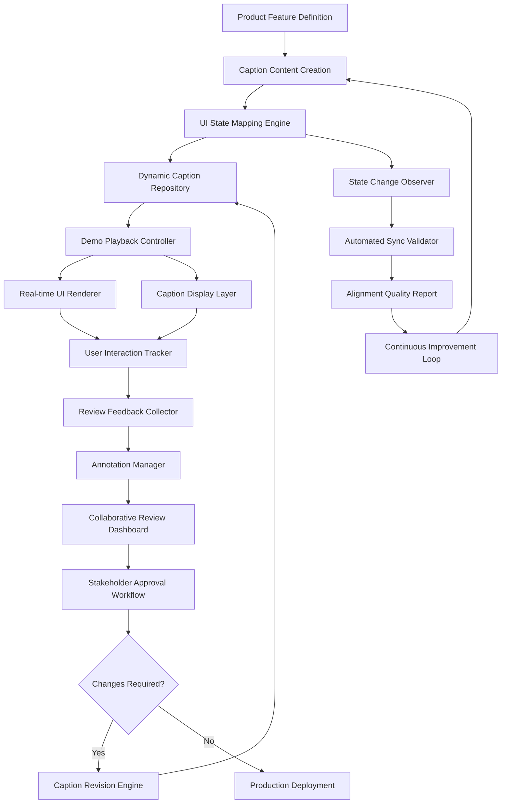

# Product Demo Captions: Review the Words and the Interface Together

## Introduction
A product demo is more than a sequence of screenshots. The words that accompany each frame must match what the interface actually does. When a caption describes a button that no longer exists, the viewer loses trust. When the UI shifts but the text stays static, the story breaks. In our team we learned that reviewing captions alone is not enough; we have to examine the copy and the interface at the same time. This article presents a method for synchronizing those two artifacts so that every revision is grounded in the real behavior of the product.

## Why This Matters
Engineers who build demo tooling often treat captions as a separate documentation step. That separation creates a feedback loop that is slow and error‑prone. A misaligned caption can cause a stakeholder to reject a feature that works correctly, or worse, ship a misleading demo that confuses customers. By coupling caption review with UI state inspection we reduce rework, catch broken interactions early, and keep the demo narrative consistent with the actual code.

## How It Works
The system operates as a closed loop. A feature definition feeds both the caption authoring pipeline and the UI component tree. A state observer watches the rendered components and triggers caption updates whenever the visible elements change. The updated captions are stored in a versioned repository, played back alongside the UI, and annotated by reviewers. The workflow is visualized below.



**Step‑by‑step explanation**

1. **Feature Definition** – A product manager writes a spec that includes UI states (e.g., idle, loading, success, error).  
2. **Caption Content Creation** – Copywriters draft captions for each state, storing them in a structured format (JSON or YAML).  
3. **UI State Mapping Engine** – A service maps each caption to the corresponding component identifier and expected visibility flags.  
4. **Dynamic Caption Repository** – Captions are versioned; each commit is linked to a UI snapshot.  
5. **Demo Playback Controller** – Plays the UI snapshot and the caption timeline in sync.  
6. **Real‑time UI Renderer** – Renders the component tree using the snapshot data.  
7. **Caption Display Layer** – Shows the caption text aligned with the current UI view.  
8. **User Interaction Tracker** – Records clicks, hovers, and form inputs during the demo.  
9. **Review Feedback Collector** – Gathers reviewer annotations and flags mismatches.  
10. **Annotation Manager** – Stores comments attached to specific UI elements or caption segments.  
11. **Collaborative Review Dashboard** – Presents side‑by‑side UI and caption, allowing multiple stakeholders to comment.  
12. **Stakeholder Approval Workflow** – Routes the demo for sign‑off; if changes are needed, the caption revision engine updates the repository and the loop repeats.

## Core Concepts
- **Caption Manager Service** – Handles text versioning, A/B testing, and retrieval based on UI context.  
- **UI State Observer** – Listens to component mount/unmount events and visibility changes, emitting a state delta.  
- **Review Dashboard** – Provides a split‑pane view with the UI on one side and the caption timeline on the other.  
- **Annotation Layer** – Enables reviewers to highlight a UI element and attach a comment that is stored with the caption version.

## Examples & Code Walkthrough

### Caption‑UI Synchronization Engine
The following JavaScript class receives UI state changes and updates the visible captions accordingly. It includes defensive checks for missing data and logs errors for debugging.

```javascript
// DemoCaptionOrchestrator.js
class DemoCaptionOrchestrator {
  /**
   * @param {UIStateObserver} uiObserver - Emits state changes for a given feature.
   * @param {CaptionRepository} captionRepository - Provides caption sets by context.
   */
  constructor(uiObserver, captionRepository) {
    this.uiObserver = uiObserver;
    this.captionRepo = captionRepository;
    this.activeCaptions = new Map(); // featureId -> caption objects
  }

  /**
   * Synchronizes captions for a specific feature with the current UI state.
   * @param {string} featureId - Identifier of the feature being demoed.
   */
  async syncCaptionsWithUI(featureId) {
    try {
      // 1. Retrieve the current UI state (visibility, props, etc.)
      const currentUIState = await this.uiObserver.getCurrentState(featureId);
      if (!currentUIState) {
        throw new Error(`No UI state found for feature ${featureId}`);
      }

      // 2. Fetch captions that match the detected context (e.g., "loading", "error")
      const relevantCaptions = await this.captionRepo.getCaptionsForContext(
        currentUIState.context
      );

      // 3. Determine which captions should be displayed based on visible elements
      const visibleElements = new Set(currentUIState.visibleElements);
      const captionsToShow = relevantCaptions.filter((caption) =>
        visibleElements.has(caption.elementId)
      );

      // 4. Update the active caption map and render
      this.activeCaptions.set(featureId, captionsToShow);
      this.updateVisibleCaptions(captionsToShow);
    } catch (err) {
      console.error('Caption sync failed:', err);
      // Fallback: show a generic placeholder caption
      this.updateVisibleCaptions([
        { elementId: 'fallback', text: 'Demo content unavailable.' },
      ]);
    }
  }

  /**
   * Injects the provided captions into the DOM.
   * @param {Array<Object>} captions - List of caption objects.
   */
  updateVisibleCaptions(captions) {
    const container = document.getElementById('caption-layer');
    if (!container) {
      console.warn('Caption container missing in DOM');
      return;
    }
    container.innerHTML = '';
    captions.forEach((caption) => {
      const el = document.createElement('div');
      el.className = 'caption';
      el.dataset.elementId = caption.elementId;
      el.textContent = caption.text;
      container.appendChild(el);
    });
  }
}
```

### Interactive Review Component
A React component that renders the UI snapshot and caption timeline together. It supports side‑by‑side and overlay modes, and allows reviewers to add annotations.

```typescript
// InteractiveDemoReviewer.tsx
import React, { useState } from 'react';
import { useDemoPlayback } from './useDemoPlayback';

interface Caption {
  elementId: string;
  text: string;
}

interface Annotation {
  id: string;
  elementId: string;
  comment: string;
  timestamp: number;
}

interface Props {
  featureId: string;
  initialCaptions: Caption[];
  uiSnapshot: any; // In practice, define a stricter type
}

type ReviewMode = 'side-by-side' | 'overlay';

const InteractiveDemoReviewer: React.FC<Props> = ({
  featureId,
  initialCaptions,
  uiSnapshot,
}) => {
  const [reviewMode, setReviewMode] = useState<ReviewMode>('side-by-side');
  const [annotations, setAnnotations] = useState<Annotation[]>([]);

  const { playbackPosition, jumpToTimestamp } = useDemoPlayback(featureId);

  const addAnnotation = (elementId: string, comment: string) => {
    const newAnnotation: Annotation = {
      id: `${elementId}-${Date.now()}`,
      elementId,
      comment,
      timestamp: playbackPosition,
    };
    setAnnotations((prev) => [...prev, newAnnotation]);
  };

  return (
    <div className="demo-reviewer">
      <div className="mode-selector">
        <button
          onClick={() => setReviewMode('side-by-side')}
          disabled={reviewMode === 'side-by-side'}
        >
          Side by Side
        </button>
        <button
          onClick={() => setReviewMode('overlay')}
          disabled={reviewMode === 'overlay'}
        >
          Overlay
        </button>
      </div>

      <div className="review-viewport">
        <UIPlaybackViewer snapshot={uiSnapshot} position={playbackPosition} />
        <CaptionPanel captions={initialCaptions} position={playbackPosition} />
      </div>

      <AnnotationToolbar
        onAdd={addAnnotation}
        reviewMode={reviewMode}
        onModeChange={setReviewMode}
      />

      <ul className="annotation-list">
        {annotations.map((ann) => (
          <li key={ann.id}>
            [{ann.timestamp}] {ann.elementId}: {ann.comment}
          </li>
        ))}
      </ul>
    </div>
  );
};

export default InteractiveDemoReviewer;
```

**Explanation of key parts**

- `syncCaptionsWithUI` first asks the observer for the current state. If the observer returns `null`, it throws and falls back to a placeholder.  
- The method filters captions by matching `elementId` with the set of visible elements, ensuring only relevant copy appears.  
- `updateVisibleCaptions` manipulates the DOM directly; in a production setting you would integrate with a UI library’s rendering cycle.  
- The React component uses a custom hook `useDemoPlayback` to keep the UI and caption timeline aligned. The `addAnnotation` function records the current playback position, which helps reviewers locate the exact moment of a mismatch.

## Best Practices
1. **Automated Sync Validation** – Add a CI step that compares the UI snapshot hash with the caption version hash; fail the build if they diverge.  
2. **Role‑Based Review Workflows** – Allow copywriters, engineers, and product managers to comment in separate lanes, merging feedback only after each group signs off.  
3. **Version Control for Assets** – Store caption files in a Git repository; use branches for A/B tests and merge requests for approval.  
4. **Accessibility Checks** – Run automated tools (e.g., axe) on the rendered demo to ensure captions meet contrast and ARIA guidelines.  
5. **Localization Pipeline** – Extract caption strings into i18n resources early; generate placeholder translations to verify layout does
