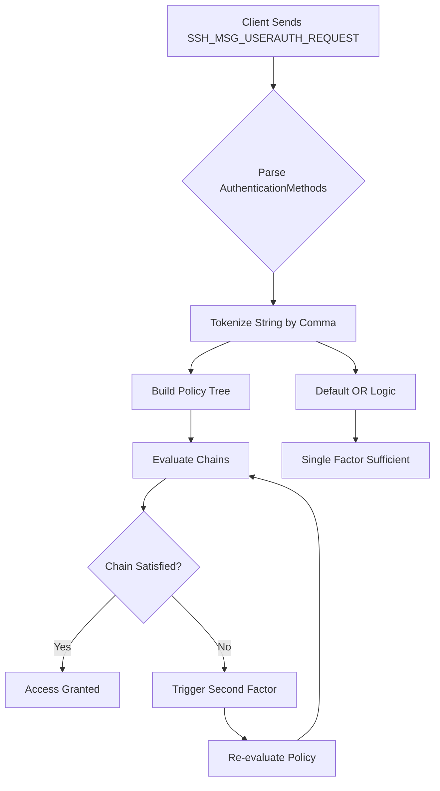

# Reading OpenSSH AuthenticationMethods as an AND Policy

## Introduction

In the trenches of bastion host management, we often hear the mantra: "Defense in depth." Yet, a subtle misconfiguration in OpenSSH can undermine that entire concept. Consider a common mistake: a site administrator configures `AuthenticationMethods` to include both `publickey` and `password`. Intuitively, this seems robust—perhaps even redundant. In practice, however, this default configuration often defaults to an **OR** logic. The server accepts a login if *either* the public key or the password is valid. It does not require both. This creates a false sense of security, allowing an attacker who has compromised a user's password to bypass the public key authentication entirely.

The truth lies in the specific syntax of the `AuthenticationMethods` directive. When factors are listed without commas, OpenSSH interprets them as an **OR** condition—single factor is sufficient. It is only when factors are separated by commas that the logic shifts to an **AND** condition—all factors must be satisfied. This distinction is not merely semantic; it is the bedrock of a Zero Trust architecture. Misreading this policy is not a typo; it is a security architecture failure.

## Why This Matters

Software engineers frequently treat SSH configuration as a static list of allowed methods. This approach is dangerous because it conflates the *availability* of methods with the *requirement* for them. A configuration that allows `publickey,password` allows a user to authenticate with just a password if they can bypass the key check. This is the classic single-factor authentication (1FA) trap.

In production environments, where bastion hosts serve as the gatekeeper for internal networks, the cost of a credential breach is magnified. An attacker who captures a password via phishing or a network sniff can gain access immediately if the server logic permits. By understanding that `AuthenticationMethods` acts as an explicit boolean circuit—specifically an OR gate unless commas are present—we can design policies that enforce Multi-Factor Authentication (MFA) as a mandatory state rather than an optional preference. This aligns with the principle that the weakest link in a chain is the only link that matters.

## How It Works

The mechanism relies on the interpretation of the `AuthenticationMethods` string by the OpenSSH server. The grammar is surprisingly strict regarding the comma.

When the server parses the directive, it tokenizes the string. A sequence of tokens without delimiters is treated as a disjunction (OR). However, the presence of a comma introduces conjunction (AND). Each token represents an `AuthMethod`.

The policy is evaluated as a series of OR-chained lists. For example, `publickey,password` is parsed as `AuthMethod: publickey` AND `AuthMethod: password`. The server attempts authentication sequentially. If the first method succeeds, it does not automatically proceed to the second. Instead, the server typically requires a successful challenge from the second method to complete the session, or it proceeds to the next available method in the list if the list is treated as a fallback pool rather than a strict sequence.

The most critical insight is the difference between the client-side offer (`auth_mETHOD_LIST`) and the server-side policy (`AuthenticationMethods`). The client sends a list of what it *knows* it can do. The server enforces the policy. If the server policy demands an AND chain, the client must present all tokens in that chain before access is granted.



## Core Concepts

The OpenSSH configuration treats authentication as a logical circuit. To master this, we must distinguish between the *list* of offered methods and the *policy* of required methods.

**The Comma as the AND Operator**
The comma is the sole explicit logical operator in `sshd_config`. Its presence transforms a list into a chain. Without a comma, the server operates in "OR" mode. With a comma, it operates in "AND" mode.

**The Grammar of the Policy**
We can model the policy using a simplified EBNF structure:

*   **AuthPolicy** := AuthRequirement ( " " AuthRequirement )*
*   **AuthRequirement** := AuthMethod ( "," AuthMethod )*
*   **AuthMethod** := "publickey" | "password" | "keyboard-interactive" | ...

**The Possession-First Invariant**
While the syntax dictates the logic, the semantics of the factors matter. The OpenSSH source code enforces a security invariant: you cannot chain two knowledge factors (password, keyboard-interactive) without a possession factor (publickey) leading the chain. This prevents a scenario where an attacker could leverage a password without the physical presence of the key, effectively negating the MFA benefit.

**Chains vs. Lists**
*   **Chain:** `publickey,password` (AND) — The server requires both.
*   **List:** `publickey,password,keyboard-interactive` (AND) — The server requires all three sequentially.
*   **List:** `publickey,password` (OR) — If the client supports `publickey`, the server attempts it. If it fails, it moves to `password`.

## Examples & Code Walkthrough

To prevent "accidental OR" configurations, we should treat the policy as a compiler problem. We need a system that validates the logic before it touches the disk. Below is a Python implementation of a Policy Compiler. This tool accepts a declarative set of desired factors and generates the `AuthenticationMethods` string, while enforcing the security invariant that possession (publickey) must be present if multiple factors are chained.

The compiler ensures that if the policy requires an AND chain, the public key method is always the first element. This enforces a logical flow: possession validates identity, knowledge (password) validates possession, and interaction (keyboard) validates biometric or physical presence.

```python
from dataclasses import dataclass, field
from typing import List, Set, Tuple
from enum import Enum

class AuthFactor(Enum):
    """Enumeration of valid authentication methods."""
    PUBLICKEY = "publickey"
    PASSWORD = "password"
    KEYBOARD_INTERACTIVE = "keyboard-interactive"  # TOTP, Duo, etc.
    GSSAPI = "gssapi-with-mic"
    HOSTBASED = "hostbased"

@dataclass(frozen=True, slots=True)
class AuthChain:
    """
    Represents a single AND chain of authentication factors.
    This chain must be satisfied entirely for access.
    """
    factors: Tuple[AuthFactor, ...]
    
    def __post_init__(self):
        # Invariant: An AND chain cannot consist solely of knowledge factors.
        # It must start with a possession factor (publickey) to be valid.
        if len(self.factors) > 0:
            first_factor = self.factors[0]
            if first_factor in (AuthFactor.PASSWORD, 
                               AuthFactor.KEYBOARD_INTERACTIVE):
                raise ValueError(
                    f"Security Invariant: Chain starts with knowledge factor "
                    f"{first_factor.value}. Public key (possession) must lead."
                )

    def to_sshd_token(self) -> str:
        """
        Converts the chain into the comma-separated token required by sshd_config.
        """
        return ",".join(f.value for f in self.factors)

@dataclass
class SshdAuthPolicy:
    """
    The complete AuthenticationMethods directive representation.
    It is a collection of AuthChains, separated by spaces, forming the overall OR logic.
    """
    chains: Tuple[AuthChain, ...] = field(default_factory=tuple)
    
    # The server policy defaults to OR if this tuple is empty
    # (This represents the "single factor" fallback)
    default_chain: Tuple[AuthFactor, ...] = (AuthFactor.PUBLICKEY,)

    def render(self) -> str:
        """
        Renders the final sshd_config directive string.
        If no chains are defined, it returns a placeholder indicating OR default.
        """
        if not self.chains:
            # Explicit deny or default behavior
            return "# AuthenticationMethods not set (Defaults to single-factor OR)"
        
        # Join chains with a space, rendering each chain as an AND sequence
        tokens = [chain.to_sshd_token() for chain in self.chains]
        return " ".join(tokens)

    def validate_client_compatibility(self, client_factors: Set[AuthFactor]) -> List[str]:
        """
        Static analysis to determine if a given client configuration can satisfy
        at least one of the defined chains.
        
        Returns a list of satisfiable chains.
        """
        satisfiable_chains = []
        for chain in self.chains:
            # Check if all factors in the chain are present in the client's capabilities
            if all(f in client_factors for f in chain.factors):
                satisfiable_chains.append(chain)
        return satisfiable_chains

# --- Usage Example ---
if __name__ == "__main__":
    # Scenario: Enforce 2FA using Keyboard Interaction and Password
    # This is an AND chain: Keyboard must be present, Password must be present
    policy = SshdAuthPolicy(
        chains=(
            AuthChain(factors=(AuthFactor.PUBLICKEY, AuthFactor.KEYBOARD_INTERACTIVE)),
            # A fallback chain for users who might not have a keyboard (e.g., TOTP)
            AuthChain(factors=(AuthFactor.PUBLICKEY, AuthFactor.PASSWORD))
        )
    )
    
    print("Generated sshd_config entry:")
    print(policy.render())
    print("\nCan a client with Public Key and Password log in?")
    print(policy.validate_client_compatibility({AuthFactor.PUBLICKEY, AuthFactor.PASSWORD}))
```

## Best Practices

1.  **Enforce Public
