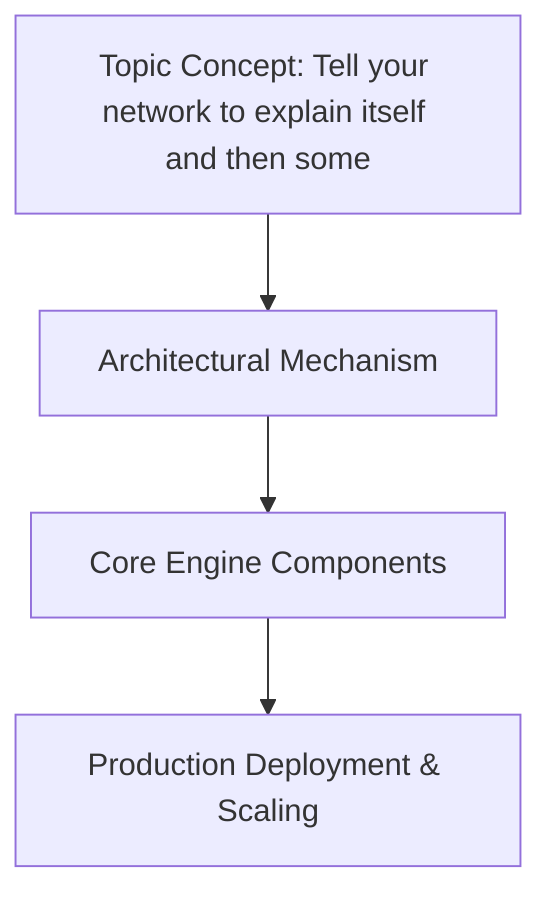

# Tell your network to explain itself and then some

## Introduction

After a recent incident where a silently-propagated routing misconfiguration took half our staging environment offline, my team stopped treating the network as a black box. We had logs, packet captures, and configuration version control, but no single source of truth that could answer "what is this node actually doing right now?" 

That question sparked a months-long effort to build a self-describing network layer—one where every daemon, every sidecar, every edge node can be asked for its current state, and the answer is structured, queryable, and safe to consume by monitoring pipelines. This article walks through the architecture, implementation, and operational considerations of that system.

## Why This Matters

In production, the cost of opaque networking compounds quickly. Debugging a service-to

## How It Works

