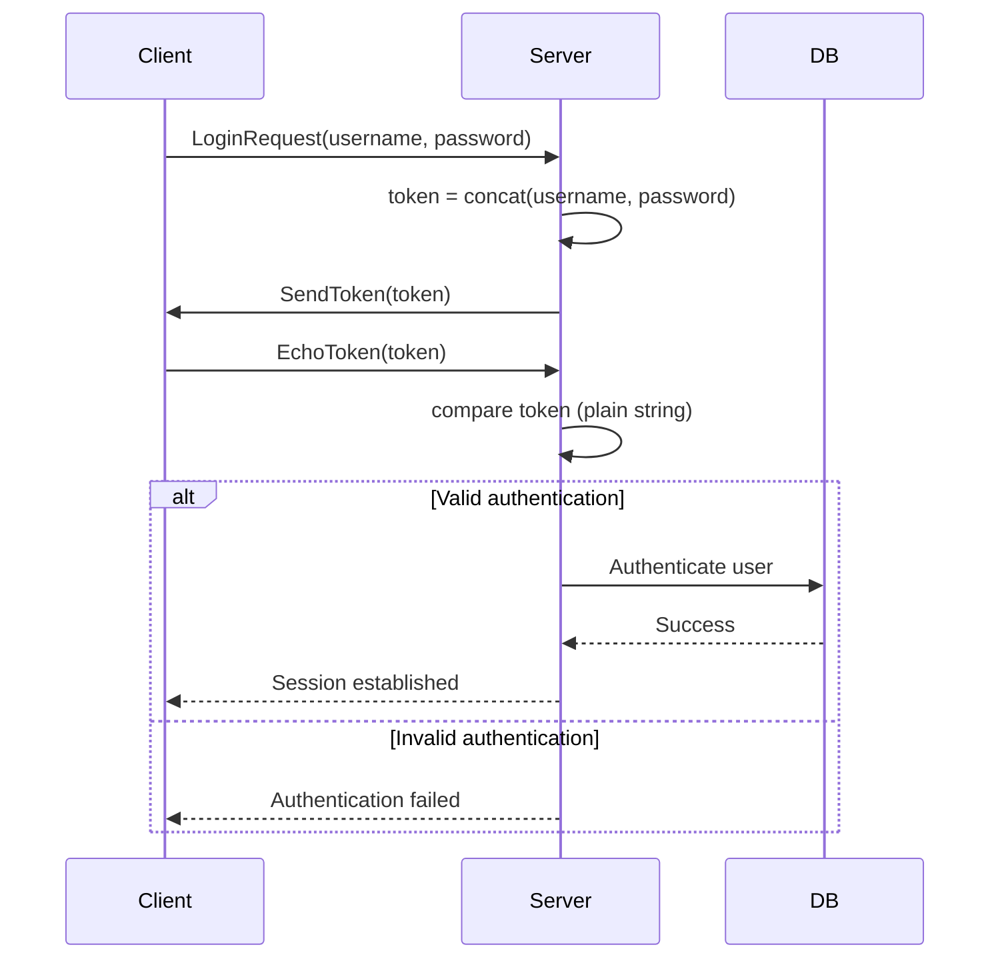

# Major ICQ security hole (1998)

## Introduction
ICQ launched in 1996 as one of the first widely adopted instant‑messaging clients. By 1998 it claimed tens of millions of users and relied on a simple binary protocol over TCP. The authentication flow was built around a server‑generated token that the client echoed back. Unfortunately the token was derived by naïve string concatenation of the username and password and compared in clear text, opening a trivial replay attack. This post walks through the exact flaw, why it mattered at the time, and what we can learn from it today.

## Why This Matters
Even though ICQ is a relic, the mistake it exposed is still reproduced in modern systems: transmitting a secret‑derived value without cryptographic binding, or relying on client‑side echo for verification. Understanding the root cause helps engineers spot similar patterns in legacy codebases, audit third‑party SDKs, and design authentication that resists network sniffing. The incident also sparked early discussions about nonce usage and HMAC‑based tokens in chat protocols, influencing later designs such as XMPP SASL and Signal’s noise protocol.

## How It Works
The vulnerability lives in the server’s login handler. After receiving a username and password, the server builds a token by concatenating the two strings, sends it to the client, and expects the client to return the exact same bytes. If the returned token matches the server’s copy, authentication succeeds.



Notice that the token never leaves the server in an encrypted or hashed form; an observer on the network can capture it and replay it immediately.

## Core Concepts
- **Token generation**: `token = username || password` (simple concatenation, no separator).
- **Stateless verification**: The server does not store any nonce or challenge; it merely compares the received echo to the locally computed token.
- **Lack of binding**: The token is not tied to a session identifier, timestamp, or random value, making it reusable across connections.
- **Clear‑text transport**: Although the underlying TCP connection could be encrypted with TLS (rarely used in 1998 ICQ deployments), the token itself is transmitted in plain bytes, so any network sniff reveals the secret.

## Examples & Code Walkthrough
Below is a realistic, self‑contained C fragment that mirrors the vulnerable logic found in ICQ’s auth‑service circa 1998. It deliberately omits hashing, salting, and replay protection to illustrate the flaw.

```c
/* Simplified login handler from ICQ auth-service (1998) */
#include <stdio.h>
#include <string.h>
#include <stdlib.h>

#define MAX_USER 32
#define MAX_PASS 32
#define TOKEN_LEN (MAX_USER + MAX_PASS)  /* username+password, no separator */

/* Mock user database – in reality this would be a DB lookup */
static int check_credentials(const char *user, const char *pass)
{
    /* Hard‑coded demo account */
    return (strcmp(user, "alice") == 0 && strcmp(pass, "wonderland") == 0);
}

/* Build token by concatenating username and password.
 * No delimiter, no hashing, no length encoding.
 */
static void make_token(const char *user, const char *pass, char *out, size_t outlen)
{
    size_t ulen = strlen(user);
    size_t plen = strlen(pass);

    if (ulen + plen >= outlen) {
        /* In production this would trigger an error; here we truncate for demo */
        ulen = outlen - plen - 1;
    }
    memcpy(out, user, ulen);
    memcpy(out + ulen, pass, plen);
    out[ulen + plen] = '\0';
}

/* Handle an incoming login request.
 * Returns 0 on success, -1 on failure.
 */
int handle_login(int client_fd, const char *rxbuf, size_t rxlen)
{
    char username[MAX_USER + 1];
    char password[MAX_PASS + 1];
    char token[TOKEN_LEN + 1];
    char echo[TOKEN_LEN + 1];
    int rc;

    /* ---- 1. Parse the incoming request (username\0password\0) ---- */
    if (rxlen < 2) return -1;   /* need at least two NUL terminators */
    const char *sep = memchr(rxbuf, '\0', rxlen);
    if (!sep) return -1;
    size_t ulen = sep - rxbuf;
    if (ulen >= sizeof username) return -1;
    memcpy(username, rxbuf, ulen);
    username[ulen] = '\0';

    const char *pass_start = sep + 1;
    const char *pass_end = memchr(pass_start, '\0', rxlen - (pass_start - rxbuf));
    if (!pass_end) return -1;
    size_t plen = pass_end - pass_start;
    if (plen >= sizeof password) return -1;
    memcpy(password, pass_start, plen);
    password[plen] = '\0';

    /* ---- 2. Generate token (vulnerable step) ---- */
    make_token(username, password, token, sizeof token);

    /* ---- 3. Send token to client ---- */
    if (write(client_fd, token, strlen(token)) != (ssize_t)strlen(token)) {
        perror("write token");
        return -1;
    }

    /* ---- 4. Read echo from client ---- */
    ssize_t nread = read(client_fd, echo, sizeof echo - 1);
    if (nread <= 0) {
        perror("read echo");
        return -1;
    }
    echo[nread] = '\0';

    /* ---- 5. Compare tokens (plain string compare) ---- */
    if (strcmp(echo, token) != 0) {
        /* authentication fails */
        write(client_fd, "FAIL", 4);
        return -1;
    }

    /* ---- 6. Verify credentials against DB (still using clear text) ---- */
    rc = check_credentials(username, password);
    if (rc != 0) {
        write(client_fd, "FAIL", 4);
        return -1;
    }

    /* ---- 7. Success ---- */
    write(client_fd, "OK", 2);
    return 0;
}
```

**What went wrong?**
- The token is a direct concatenation of secret material; an eavesdropper learns `username||password`.
- The server never mixes in a nonce or timestamp, so a captured token can be replayed indefinitely.
- The password is also compared in clear text against the user database (though many implementations stored hashed passwords, the token still leaked the password).

A simple network capture would show something like:

```
00 00 00 00 61 6c 69 63 65 00 77 6f 6e 64 65 72 6c 61 6e 64 00
```

After the first NUL terminator we see the username `alice`, after the second NUL the password `wonderland`. The server then sends back the concatenated string `alice wonderland` (no space, just the raw bytes) which the client echoes.

## Best Practices
1. **Never transmit raw secrets or secret‑derived values without cryptographic protection.** Use a salted hash or HMAC over a nonce.
2. **Bind authentication tokens to session‑specific data** (nonce, timestamp, session ID) to thwart replay.
3. **Prefer established authentication mechanisms** (SASL, PAKE, SRP) over ad‑hoc token schemes.
4. **Validate input lengths and delimiters** to avoid buffer overflows or parsing ambiguities.
5. **Log authentication failures** and implement rate limiting to deter brute‑force attempts.

## Common Mistakes & Anti‑Patterns
| Mistake | Why it’s risky | Fix |
|---------|----------------|-----|
| **Plain‑text token echo** | Allows network sniffers to capture reusable credentials. | Compute `HMAC(secret, nonce)` and send only the MAC; never send the secret itself. |
| **Fixed delimiter‑less concatenation** | Ambiguous parsing if username or password contains the NUL byte used as separator. | Use length‑prefixed fields or a known separator that cannot appear in valid input (e.g., `\x01`). |
| **No replay protection** | Captured token can be reused at any time. | Include a server‑generated nonce that changes per session and incorporate it into the token. |
| **Storing passwords in plain text** (or weak hashes) | If the DB leaks, all accounts are compromised. | Store salted, slow hashes (bcrypt, scrypt, Argon2). |
| **Trusting client‑side validation** | Malicious clients can bypass checks. | Perform all security‑critical checks server‑side. |

## Performance Considerations
The original vulnerable code performed only a few `memcpy` and `strcmp` operations—O(L) where L is the combined length of username and password—so the computational overhead was negligible. Adding an HMAC (e.g., HMAC‑SHA256) introduces a constant‑time hash over the nonce and secret, which on 1990s hardware added a few microseconds per login, well within acceptable limits for a chat server handling thousands of concurrent connections. Memory usage stays bounded by the fixed-size buffers; the only extra allocation is the nonce (typically 8‑16 bytes).

## Real-World Usage
While ICQ itself faded, the lessons shaped later messaging platforms:
- **XMPP** introduced SASL mechanisms (SCRAM‑SHA‑1, SCRAM‑SHA‑256) that combine a salted hash with a server nonce, preventing replay.
- **Signal Protocol** uses a Noise‑IK handshake where each message includes a DH‑derived key and a MAC, ensuring forward secrecy and replay resistance.
- **Modern mobile backends** (e.g., WhatsApp’s server‑side auth) employ TLS for channel security and JWTs signed with a server secret, binding tokens to issue time and expiration.

These designs explicitly avoid the pattern that doomed ICQ: a static, client‑echoed token derived directly from secrets.

## Frequently Asked Questions (FAQ)
**Q: Could TLS have prevented the attack?**  
A: TLS would have encrypted the traffic, making passive sniffing harder. However, if an attacker could perform a man‑in‑the‑middle or obtain the session keys (e.g., via compromised CA), the clear‑text token would still be exposed. Proper token binding is still required even over TLS.

**Q: Why didn’t ICQ just hash the password before concatenation?**  
A: Hashing the password would still leave the hash exposed; an attacker could replay the hash. The core issue is the lack of a verifier‑specific challenge (nonce) and binding the secret to that challenge.

**Q: Is this vulnerability still relevant today?**  
A: Yes. Any protocol that relies on a static secret or a secret‑derived value transmitted without a nonce is susceptible to replay. Audits of legacy internal tools, IoT device firmware, or third‑party SDKs often uncover similar patterns.

**Q: What’s the simplest mitigation for a legacy system like this?**  
A: Add a server‑generated random nonce to the login flow:  
1. Server sends `nonce`.  
2. Client returns `HMAC(secret, nonce)`.  
3. Server verifies the HMAC.  
This requires only a hash library and a small state change, yet eliminates replay and token leakage.

## Conclusion
The 1998 ICQ authentication flaw was a textbook example of how a seemingly innocuous design choice—echoing a concatenated username‑password token—can undermine an entire service’s security. By dissecting the vulnerable code, tracing the exploit path, and contrasting it with modern best practices, we see clearly why binding secrets to session‑specific challenges and avoiding clear‑text transmission of any secret‑derived data are non‑negotiable in protocol design. Today’s engineers can apply these lessons to harden not only chat systems but any service that relies on token‑based authentication.
