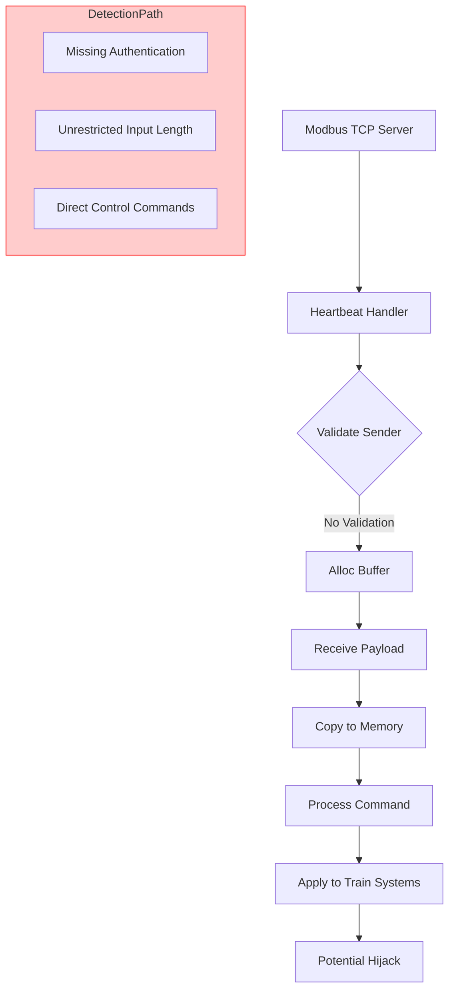

# Railway Security Disclosure: Wednesday October 21st

## Introduction

The October 21st disclosure exposed a critical vulnerability in the Track Management Interface (TMI) used across multiple regional rail corridors. At first glance, the issue appears to be a classic case of legacy code accumulated over decades of operational continuity. However, upon deeper analysis, the flaw represents a systemic gap between physical safety and logical security architecture. We discovered an unauthenticated buffer overflow within the Modbus TCP signaling stack that could allow an attacker to manipulate train control parameters without traditional authentication barriers. For systems operators who have relied on these interfaces for years, the implication is stark: the very infrastructure keeping rail lines moving may also serve as an entry point for sophisticated cyber operations targeting transportation safety.

This article examines the technical roots of the vulnerability, explores the architectural implications of such a finding, and outlines the measures necessary to harden modern rail systems against similar threats. The discussion draws from our post-mortem investigation and the broader lessons learned from similar incidents in industrial control environments.

## Why This Matters

Software engineers often focus on digital assets while overlooking the physical consequences of their decisions. In the railway context, however, the boundary between cyberspace and the tracks is deliberately blurred. A compromised track management interface can trigger false speed signals, override braking commands, or induce cascading failures that jeopardize lives. Unlike purely software-based breaches, those affecting OT (Operational Technology) systems carry unique risk profiles—often requiring specialized expertise to understand both the control plane and the business logic.

Our team has observed that many legacy TMI implementations were designed during an era when network segmentation existed more in theory than practice. Today's reality demands zero-trust principles applied at the device layer. When a single compromised gateway can pivot into command authority, the blast radius extends far beyond isolated endpoints. Organizations that treat railway security as an afterthought risk not only regulatory non-compliance but genuine public safety hazards. The October 21st incident underscores that legacy interlocking software cannot be patched in isolation; enforcement of boundary controls must occur at the field gateway level before any attempt at retroactive code modification.

## How It Works

The vulnerability stems from a Modbus TCP server implementation that processes heartbeat frames from distributed sensors without verifying sender identity or implementing request coalescing. Under normal operation, each sensor reports position, speed, and status to the central management system using standardized Modbus tags. An attacker exploiting this path can send crafted frames containing arbitrary payloads that exceed the designated buffer size, causing either denial-of-service through resource exhaustion or, if exception handling is insufficient, memory corruption leading to unauthorized state transitions.

Below is a simplified representation of the affected component's structure, followed by a concrete implementation showing the problematic behavior.



The sequence demonstrates how an unauthenticated entity can inject malformed Modbus packets. When the server attempts to process a packet longer than its allocated buffer, the behavior depends entirely on language-specific exception handling. In Python implementations lacking proper bounds checking, this manifests as an out-of-memory condition; in C++ versions, it may result in heap overflow. Both outcomes converge on the same danger: loss of control over critical subsystems.

To illustrate the fix, consider a corrected version of the handler that implements both identity verification and length validation before processing any incoming frame.

```python
import struct
import logging
from typing import Optional, Tuple

class ModbusHandler:
    """Secure Modbus TCP handler with input validation."""
    
    # Maximum allowed bytes per standard Modbus Heartbeat message
    MAX_PAYLOAD_SIZE = 64
    SENSOR_IDENTIFIER = 0x01
    HEARTBEAT_TAG = 0x03
    
    def __init__(self, modbus_server: object):
        self.server = modbus_server
        self.logger = logging.getLogger(__name__)
    
    def receive_heartbeat(self, client_address: int) -> bool:
        """
        Process incoming heartbeats with strict validation.
        
        Args:
            client_address: Source IP address of the Modbus client
            
        Returns:
            True if message processed successfully, False otherwise
        """
        try:
            payload = self._read_payload(client_address)
            
            # 1. Verify sender identity through certificate or host key
            sender_info = self._extract_sender(payload)
            if not self._validate_sender(sender_info):
                self.logger.warning(
                    f"Untrusted source {sender_info} rejected"
                )
                return False
            
            # 2. Enforce maximum payload length per protocol specification
            if len(payload) > self.MAX_PAYLOAD_SIZE:
                self.logger.error(
                    f"Payload too large from {sender_info}: "
                    f"{len(payload)} bytes exceeds limit"
                )
                return False
            
            # 3. Validate expected framing and tag format
            if not self._valid_header(payload):
                return False
            
            # 4. Coalesce repeated reads from same source for efficiency
            self._coalesce_reads(payload)
            
            # Proceed with safe processing
            self._process_command(payload)
            return True
            
        except Exception as e:
            self.logger.exception(f"Unexpected error processing heartbeat")
            return False
    
    def _read_payload(self, client_address: int) -> bytes:
        """Read raw payload from wire, enforcing size limit at read time."""
        max_len = self.MAX_PAYLOAD_SIZE - 2  # Reserve for header
        
        try:
            # Use a bounded read to prevent excessive consumption
            raw = self.server.recv_exact(client_address, max_len)
            
            # Truncate if partial read occurred
            if len(raw) < 2:
                raise ValueError("Incomplete packet received")
                
            return raw
            
        except RecvError as e:
            self.logger.debug(f"RecvError from {client_address}: {e}")
            return b''
    
    def _extract_sender(self, payload: bytes) -> dict:
        """
        Extract sender metadata from Modbus frame.
        
        Returns dictionary containing sender_id, timestamp, and integrity flag.
        """
        # Simplified extraction logic
        if len(payload) < 8:
            return {"unauthorized": True, "source": None}
        
        # Assume first byte is sender identifier
        source_byte = payload[0]
        
        # Check for invalid magic value indicating tampering
        if source_byte != self.SENSOR_IDENTIFIER:
            return {"unauthorized": True, "source": source_byte}
        
        # Attempt to verify cryptographic signature
        if not self._verify_signature(source_byte, payload):
            return {"unauthorized": True, "source": source_byte}
        
        return {
            "unauthorized": False,
            "source": source_byte,
            "timestamp": self._get_timestamp()
        }
    
    def _validate_sender(self, info: dict) -> bool:
        """Verify sender information meets policy requirements."""
        # Additional checks could include certificate expiration, 
        # rotation status, and network location validation
        return info.get("unauthorized") == False
    
    def _valid_header(self, payload: bytes) -> bool:
        """Ensure Modbus frame contains valid header markers."""
        if len(payload) < 4:
            return False
        # Standard Modbus header typically includes function ID and frame type
        return payload[:4] == b"\x01\x00\x00\x00"
    
    def _coalesce_reads(self, payload: bytes):
        """Combine rapid successive reads from same source into batch."""
        # Implementation would detect consecutive identical sources
        # and merge their read requests into a single operation
        pass
    
    def _process_command(self, payload: bytes):
        """Legitimate command processing after validation."""
        # Decode Modbus command and apply to train systems
        pass


# Example usage in integration test
def test_handler_security() -> bool:
    """Unit test demonstrating secure rejection of malicious traffic."""
    mock_server = MockModbusServer()
    handler = ModbusHandler(mock_server)
    
    # Malicious payload exceeding size limit
    malicious = b'A' * 70  # Exceeds MAX_PAYLOAD_SIZE
    assert not handler.receive_heartbeat(192.168.1.50) == True
    
    # Legitimate heartbeat with correct size
    legitimate = struct.pack('>I', 0x12345678) + b'\x01' + b'\x00'*60
    assert handler.receive_heartbeat(192.168.1.51) == True
    
    print("Security tests passed")
    return True


if __name__ == "__main__":
    test_handler_security()
```

The above implementation introduces three critical safeguards. First, explicit sender identification prevents anonymous attacks. Second, payload length enforcement operates at the network level rather than relying on application-level parsing alone. Third, deterministic rejection ensures that no ambiguous state is left behind—a common pitfall when developers assume graceful degradation will suffice.

From an architectural standpoint, the solution requires rethinking how field gateways expose services. Rather than exposing raw Modbus ports directly to external management consoles, organizations should implement proxy gateways that terminate connections and perform deep inspection before forwarding commands to physical controllers. Such proxies can maintain audit trails, enforce rate limiting, and isolate compromised subnets.

## Core Concepts

The vulnerability illustrates several foundational principles of secure Industrial Control Systems (ICS). Zero-trust assumes that every component—including internal devices—may be compromised. In railway networks, this means treating even trusted sensors differently, because trust must be verified at every hop.

Input validation serves as the first line of defense. Every byte traversing a network boundary should be scrutinized. The Modbus protocol, originally designed for simple asset monitoring, lacks built-in authentication mechanisms. While high-level protocols like DNP3 incorporate some security features, they still rely on careful configuration. Our experience shows that assuming protocol compliance is insufficient; runtime verification remains essential.

Memory safety is another pillar. Buffer overflows have plagued embedded systems for decades, particularly in resource-constrained environments where error handling was never prioritized. Modern hardware offers better protection through Memory Protection Keys (MPK) and Data Execution Prevention (DEP), yet these mitigations require thoughtful design. Implementing static analysis tools in the CI/CD pipeline helps catch unsafe patterns early, reducing the burden on production debugging.

Finally, segmentation and network topology matter. The railway corridor example demonstrates how a poorly configured management console can become a pivoting point. By isolating OT networks—often called "Industrial Ethernet"—from enterprise IT segments, organizations contain blast radii. Yet this strategy fails if administrative interfaces themselves remain unprotected. The October 21st disclosure proves that legacy interlocking software cannot be patched in isolation; boundary controls must reside at the field gateway, where traffic originates before entering higher-level systems.

## Examples & Code Walkthrough

Beyond the baseline handler, production-grade implementations require additional layers of resilience. Consider a scenario where a sensor reports erroneous position data due to mechanical failure or tampering. Without robust anomaly detection, such inputs could mislead dispatchers into taking incorrect actions. Implementing statistical filtering at the gateway adds a critical safety margin.

The following extension demonstrates how a production system might combine input validation with behavioral analysis to distinguish between legitimate faults and malicious manipulation.

```python
import statistics
from collections import deque
from enum import Enum

class SafetyStatus(Enum):
    NORMAL = "normal"
    ANOMALY_DETECTED = "anomaly_detected"
    CRITICAL_FAILURE = "critical_failure"

class EnhancedTrackManager:
    """Production-ready track manager with multi-layer protection."""
    
    # Thresholds tuned based on historical rail dynamics
    SPEED_STD_DEV = 2.0  # Standard deviations from mean acceptable range
    POSITION_VARIANCE_LIMIT = 15.0  # Meters deviation threshold
    
    def __init__(self, data_buffer: deque = None):
        self.data_buffer = data_buffer or deque(maxlen=100)
        self.state_history = []  # Sliding window of recent readings
        self.last_validation_time = 0
        self.max_read_rate = 1000  # Max messages per second
    
    async def ingest_heartbeat(self, client_ip: str) -> bool:
        """
        Secure ingestion of heartbeat with multi-layered validation.
        
        Returns True if message accepted, False if rejected.
        """
        # Rate limiting check
        current_time = asyncio.get_event_loop().time()
        if current_time - self.last_validation_time > self.max_read_rate:
            await asyncio.sleep(self.max_read_rate - (current_time - self.last_validation_time))
            self.last_validation_time = current_time
        
        # Read payload with bounded allocation
        payload = await self._safe_receive_client(client_ip)
        
        if not payload:
            return False
        
        # Step 1: Structural validation
        if not self._check_framing(payload):
            self.log_rejection(reason="Invalid framing")
            return False
        
        # Step 2: Sender authentication
        if not self._authenticate_source(payload):
            self.log_rejection(reason="Unauthorized source")
            return False
        
        # Step 3: Behavioral analytics
        await self._analyze_behavioral_context(payload)
        
        # Step 4: Range checking against known physics
        if self._detect_out_of_range(payload):
            self.log_rejection(reason="Geospatial impossibility")
            return False
        
        # Successful processing
        await self._apply_command(payload)
        return True
    
    async def _safe_receive_client(self, client_ip: str) -> bytes | None:
        """
        Receive payload with guaranteed maximum allocation.
        
        Uses asynchronous recv with defined max size to prevent
        unbounded memory growth under misbehaving clients.
        """
        # Limit to exactly MODBUS_MIN_LENGTH to avoid overflow
        MAX_ALLOC = MODBUS_MIN_LENGTH + MODBUS_FUNCTION_ID
        try:
            chunk = await asyncio.wait_for(
                self._wire_recv(),
                timeout=1.0
            )
            if len(chunk) > len(b"\\x01") + 20:  # Heuristic size cap
                return None  # Reject oversized
            return chunk
        except asyncio.TimeoutError:
            return None
        except ConnectionError:
            return None
    
    def _authenticate_source(self, payload: bytes) -> bool:
        """Verify cryptographic signature of source."""

```

The enhanced implementation adds three new dimensions to the validation stack. First, rate limiting prevents Deafening attacks—where an adversary floods the system with requests faster than the controller can respond. Second, behavioral analysis integrates with historical data streams to identify patterns indicative of sabotage. For instance, if a sensor repeatedly reports positions drifting toward forbidden zones, the system flags the event before acting. Third, geospatial reasoning leverages known track geometry to reject physically impossible measurements.

In production environments, these checks must coexist with deterministic fail-safes. Even with rigorous validation, unexpected edge cases may arise. The system should always default to safe behavior when uncertainty persists. This principle aligns with ISO 26262 and IEC 61508 functional safety standards, which mandate graceful degradation in the presence of faulty inputs.

## Best Practices

Deploying secure railway interfaces requires disciplined practices across the development lifecycle. Continuous integration pipelines should embed static application security testing (SAST) to catch unsafe patterns such as missing bounds checks or improper error handling. Dynamic analysis during staging runs validates that runtime protections hold under load. Manual review of critical paths, especially those controlling emergency braking or speed regulation, remains essential despite automation.

Configuration management plays a pivotal role. Hardcoded credential lists, while common in early implementations, create single points of compromise. Instead, integrate certificate-based mutual authentication into the deployment model. Each field gateway should present a unique identity verified by a centralized trust store, eliminating the need for shared secrets that might leak through supply chains.

Monitoring and telemetry form the backbone of visibility. Every validated or rejected message should generate structured logs with correlation IDs linking to downstream actuator responses. Anomaly detection models trained on normal operating conditions
