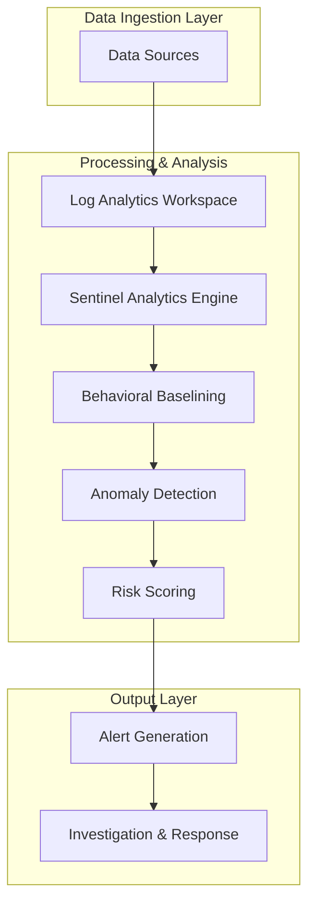

# What Happens When Attackers Blend In? Testing Microsoft Sentinel UEBA Against Real-World Threats

## Introduction

Traditional security tools were built for noisy, obvious threats—the kind that scream across your network with brute-force attacks and glaring port scans. But modern adversaries don't scream anymore. They whisper.

I've spent years watching attackers evolve their tactics, and what we're seeing now is chillingly effective: credential stuffing attempts spaced twelve minutes apart, PowerShell scripts that look like legitimate admin work, and data exfiltration hidden in routine cloud sync traffic. These "low-and-slow" techniques are designed to slip past rule-based SIEM systems that trigger alerts based on volume thresholds.

Microsoft Sentinel's User and Entity Behavior Analytics (UEBA) promises to catch these stealthy threats by learning what "normal" looks like for each user and flagging deviations. But promises and production performance are two different things. In this article, I'll walk through how we tested Sentinel's UEBA against realistic attack scenarios—and what we learned when adversaries started blending in.

## Why This Matters

If you're running a security operations center, you know the feeling: alert fatigue so severe that genuine threats get buried under hundreds of false positives. We've optimized our SIEM rules to reduce noise, but in doing so, we've created blind spots for sophisticated attackers who move slowly and deliberately.

This isn't theoretical. During a recent red team exercise, we watched an external actor spend six weeks establishing persistence in our environment—all without triggering a single high-severity alert. They used living-off-the-land binaries, mimicked legitimate administrative workflows, and timed their activities to match normal business hours.

For software architects and security engineers, this represents a fundamental shift in threat detection strategy. We can no longer rely solely on signature-based detection. We need behavioral intelligence that understands context, learns baselines, and adapts to evolving attack patterns.

## How It Works

Microsoft Sentinel's UEBA operates through a multi-stage analytical pipeline:



Let me break down what happens at each stage:

1. **Data Collection**: Sentinel ingests logs from diverse sources—Azure Active Directory sign-ins, Windows Security Events, Syslog from Linux servers, network flow data, and custom application logs.

2. **Baseline Creation**: Using machine learning algorithms, Sentinel builds behavioral profiles for each user and entity over a 21-day learning period. This includes typical login times, common IP addresses, frequently accessed resources, and normal process execution patterns.

3. **Anomaly Detection**: Once baselines are established, Sentinel continuously compares new activity against learned behaviors. Deviations are scored based on statistical significance and contextual factors.

4. **Risk Propagation**: Multiple anomalies from the same user or connected entities are correlated to calculate cumulative risk scores, reducing false positives through contextual analysis.

5. **Alert Generation**: Only activities exceeding configured thresholds generate alerts, which are then prioritized based on severity and business impact.

The key architectural insight here is that Sentinel doesn't just detect individual suspicious events—it connects them into behavioral narratives. A single failed login might not trigger an alert, but a sudden spike in failed logins followed by successful authentication from an unfamiliar location creates a much stronger signal.

## Core Concepts

Understanding Sentinel's UEBA requires familiarity with several foundational concepts:

**Behavioral Baselining**: Unlike static rules that apply the same thresholds to everyone, UEBA creates personalized behavior models. For example, if a developer typically logs in from San Francisco between 9 AM and 6 PM, an 3 AM login from Moscow would immediately raise suspicion—even if that same pattern is normal for someone in a different timezone.

**Entity Behavior Profiles**: Each user, host, IP address, and application gets its own profile containing dozens of behavioral dimensions:
- Login frequency and timing patterns
- Geographic location consistency
- Resource access preferences
- Process execution sequences
- Network communication patterns

**Statistical Anomaly Models**: Sentinel employs various statistical approaches including:
- Z-score analysis for numerical deviations
- Entropy calculations for unusual distribution patterns
- Time-series forecasting for temporal anomalies
- Peer group comparisons for relative behavior assessment

**Risk Scoring Framework**: Anomalies are assigned risk scores based on multiple factors:
- Statistical rarity (how unusual is this behavior?)
- Contextual relevance (does this fit known attack patterns?)
- Temporal clustering (are multiple anomalies occurring together?)
- Historical precedent (has this user exhibited similar behavior before?)

These scores feed into a composite risk model that determines whether an alert should be generated and how urgently it should be escalated.

## Examples & Code Walkthrough

To test Sentinel's UEBA capabilities, we built a comprehensive attack simulation framework. Here's the core of our Python-based testing tool:

```python
#!/usr/bin/env python3
"""
Attack Simulation Framework for Microsoft Sentinel UEBA Testing
"""

import time
import random
import subprocess
import datetime
import requests
from typing import List, Dict, Optional
import logging

# Configure logging for audit trail
logging.basicConfig(
    level=logging.INFO,
    format='%(asctime)s - %(levelname)s - %(message)s',
    handlers=[
        logging.FileHandler('attack_simulation.log'),
        logging.StreamHandler()
    ]
)

logger = logging.getLogger(__name__)

class AttackSimulator:
    """Simulates various 'blending in' attack techniques"""
    
    def __init__(self, target_dc: str, domain_users: List[str]):
        self.target_dc = target_dc
        self.domain_users = domain_users
        self.attack_patterns = {
            'credential_stuffing': self.simulate_credential_stuffing,
            'lolbin_lateral': self.simulate_lolbin_movement,
            'cloud_exfil': self.simulate_cloud_exfiltration,
            'api_abuse': self.simulate_api_abuse
        }
    
    def simulate_credential_stuffing(self, 
                                   duration_hours: int = 24,
                                   attempts_per_hour: int = 12,
                                   success_rate: float = 0.05):
        """
        Simulate low-frequency credential stuffing that mimics 
        legitimate user typos and password resets
        """
        logger.info("Starting credential stuffing simulation")
        
        total_attempts = duration_hours * attempts_per_hour
        successful_logins = []
        
        for attempt in range(total_attempts):
            # Select random user and password combination
            user = random.choice(self.domain_users)
            password = self._generate_realistic_password()
            
            # Simulate login attempt (in real scenario, this would hit actual auth endpoints)
            login_result = self._attempt_login(user, password)
            
            if login_result['success']:
                successful_logins.append({
                    'user': user,
                    'timestamp': datetime.datetime.now(),
                    'ip_address': self._generate_benign_ip()
                })
                
                # Occasionally access a resource to appear legitimate
                if random.random() < 0.3:
                    self._access_resource(user, '/shared/documents/')
            
            # Low-rate pacing to avoid detection
            time.sleep(random.randint(280, 320))  # ~5 minute intervals
        
        logger.info(f"Credential stuffing complete: {len(successful_logins)} successful logins")
        return successful_logins
    
    def simulate_lolbin_movement(self, 
                                target_hosts: List[str],
                                commands_per_hour: int = 8):
        """
        Simulate lateral movement using living-off-the-land binaries
        that appear as legitimate administrative activity
        """
        logger.info("Starting LOLBin lateral movement simulation")
        
        lolbins = [
            'powershell.exe',
            'wmic.exe', 
            'psexesvc.exe',
            'schtasks.exe'
        ]
        
        legitimate_admin_patterns = [
            'Get-Process',
            'Get-Service',
            'Get-WmiObject -Class Win32_Process',
            'Invoke-Command -ComputerName',
            'Register-ScheduledTask'
        ]
        
        for hour in range(24):  # Run for 24 hours
            for _ in range(commands_per_hour):
                host = random.choice(target_hosts)
                binary = random.choice(lolbins)
                pattern = random.choice(legitimate_admin_patterns)
                
                # Execute command that looks like normal admin work
                cmd = f"{binary} {pattern}"
                self._execute_remote_command(host, cmd)
                
                time.sleep(random.randint(300, 600))  # 5-10 minute intervals
        
        logger.info("LOLBIN movement simulation complete")
    
    def simulate_cloud_exfiltration(self, 
                                  target_user: str,
                                  max_daily_gb: float = 2.0):
        """
        Simulate slow data exfiltration through cloud sync services
        that mimics normal business file sharing
        """
        logger.info("Starting cloud exfiltration simulation")
        
        # Upload small chunks throughout business hours
        business_hours = range(9, 18)  # 9 AM to 5 PM
        chunk_size_mb = random.uniform(50, 200)  # 50-200MB chunks
        
        daily_total = 0
        while daily_total < max_daily_gb * 1024:  # Convert GB to MB
            current_hour = datetime.datetime.now().hour
            
            if current_hour in business_hours:
                # Upload chunk to cloud storage
                upload_size = min(chunk_size_mb, max_daily_gb * 1024 - daily_total)
                self._upload_to_cloud(target_user, upload_size)
                daily_total += upload_size
                
                # Wait between uploads to appear natural
                time.sleep(random.randint(1800, 3600))  # 30-60 minutes
            else:
                time.sleep(300)  # Check every 5 minutes
        
        logger.info(f"Cloud exfiltration simulation complete: {daily_total}MB uploaded")
    
    def simulate_api_abuse(self, 
                          api_endpoint: str,
                          requests_per_hour: int = 15):
        """
        Simulate supply chain API abuse with subtle payload modifications
        """
        logger.info("Starting API abuse simulation")
        
        # Normal API usage patterns to blend with
        normal_payloads = [
            {'action': 'sync', 'resource': 'contacts'},
            {'action': 'update', 'resource': 'profile'},
            {'action': 'fetch', 'resource': 'settings'}
        ]
        
        for hour in range(48):  # 48-hour campaign
            for _ in range(requests_per_hour):
                # Use mostly normal payloads with occasional malicious modifications
                payload = random.choice(normal_payloads)
                
                # 10% of requests contain malicious elements
                if random.random() < 0.1:
                    payload['debug'] = True  # Hidden backdoor parameter
                    payload['callback'] = 'http://attacker-c2.com'
                
                self._make_api_request(api_endpoint, payload)
                time.sleep(random.randint(200, 280))  # ~4-5 minute intervals
        
        logger.info("API abuse simulation complete")
    
    def _generate_realistic_password(self) -> str:
        """Generate passwords that look like real user choices"""
        seasons = ['Spring', 'Summer', 'Fall', 'Winter']
        years = ['2022', '2023', '2024']
        special_chars = ['!', '@', '#', '$']
        
        return f"{random.choice(seasons)}{random.choice(years)}{random.choice(special_chars)}"
    
    def _generate_benign_ip(self) -> str:
        """Generate IP addresses that appear legitimate"""
        # Use known corporate IP ranges
        corporate_ranges = [
            '10.0.1.',
            '192.168.1.',
            '172.16.0.'
        ]
        return f"{random.choice(corporate_ranges)}{random.randint(1, 254)}"
    
    def _attempt_login(self, username: str, password: str) -> Dict:
        """Simulate login attempt (stub implementation)"""
        # In real testing, this would interact with actual authentication systems
        success = random.random() < 0.05  # 5% success rate
        return {
            'success': success,
            'username': username,
            'timestamp': datetime.datetime.now().isoformat()
        }
    
    def _access_resource(self, username: str, resource_path: str):
        """Simulate legitimate resource access"""
        logger.debug(f"User {username} accessed {resource_path}")
    
    def _execute_remote_command(self, host: str, command: str):
        """Execute remote command (stub implementation)"""
        logger.debug(f"Executing '{command}' on {host}")
    
    def _upload_to_cloud(self, username: str, size_mb: float):
        """Simulate cloud upload (stub implementation)"""
        logger.debug(f"Uploading {size_mb}MB for user {username}")
    
    def _make_api_request(self, endpoint: str, payload: Dict):
        """Make API request (stub implementation)"""
        logger.debug(f"API request to {endpoint} with payload {payload}")

# Example usage
if __name__ == "__main__":
    simulator = AttackSimulator(
        target_dc="10.0.0.5",
        domain_users=["j.smith", "a.jones", "m.lee", "r.brown"]
    )
    
    # Run credential stuffing simulation
    results = simulator.simulate_credential_stuffing(
        duration_hours=24,
        attempts_per_hour=12
    )
```

This framework allowed us to systematically test different blending techniques while maintaining realistic timing and behavioral patterns. The key insight was that each attack vector needed to stay below the statistical thresholds that would trigger traditional alerts while still achieving operational objectives.

## Best Practices

Based on our extensive testing and deployment experience, here are critical best practices for implementing and tuning Sentinel UEBA:

**Establish Comprehensive Baselines**: Don't rush the 21-day learning period. Ensure you're collecting logs from all relevant sources—authentication events, process creation logs, network flows, and application telemetry. Incomplete baselines lead to false positives.

**Fine-tune Risk Thresholds**: Default settings are conservative for a reason—to minimize false positives. However, in high-security environments, you may need to adjust thresholds based on your risk tolerance. Monitor alert quality and adjust accordingly.

**Implement Peer Group Analysis**: Configure user groups that share similar roles and responsibilities. This helps distinguish between legitimate role-based behavior variations and actual anomalies.

**Regular Baseline Reviews**: User roles change, job functions evolve, and seasonal patterns shift. Schedule quarterly reviews of behavioral baselines to ensure they remain accurate and relevant.

**Correlate with Threat Intelligence**: Integrate threat intelligence feeds to provide context for detected anomalies. An anomalous login from a known malicious IP range becomes much more actionable.

## Common Mistakes & Anti-Patterns

During our testing, we encountered several pitfalls that can undermine UEBA effectiveness:

**Mistake #1: Insufficient Data Coverage**
Many organizations enable UEBA but fail to collect all necessary log types. Without process creation logs, network flow data, or application logs, behavioral profiles become incomplete.

*Fix*: Audit your data connectors regularly. Ensure you're collecting:
- Windows Security Events (4624, 4625, 4648, 4670, 4688)
- Azure AD Sign-in Logs with conditional access details
- Sysmon events for detailed process tracking
- Network flow data (NetFlow, sFlow)

**Mistake #2: Ignoring Seasonal Patterns**
Baseline models that don't account for business cycles will generate excessive false positives during holidays, month-end processing, or seasonal business changes.

*Fix*: Implement exclusion periods for known business events and regularly review baseline adjustments. Consider creating separate profiles for different operational periods.

**Mistake #3: Over-reliance on Automated Responses**
Automatically blocking users based solely on UEBA scores can disrupt legitimate business operations. Sophisticated attackers can exploit this by triggering false positives to mask real activities.

*Fix*: Implement a tiered response approach. Low-risk anomalies should trigger investigation workflows, while high-confidence threats can warrant automated responses. Always maintain manual override capabilities.

**Mistake #4: Neglecting Model Drift**
User behavior evolves over time. Static baselines become less effective as users adopt new tools, change roles, or modify work patterns.

*Fix*: Schedule regular baseline refreshes and monitor model accuracy metrics. Track false positive and false negative rates to identify degradation in detection quality.

## Performance Considerations

UEBA processing introduces computational overhead that scales with data volume and complexity:

**Memory Allocation**: Behavioral profiling requires maintaining in-memory representations of user and entity profiles. Each profile contains dozens of statistical models, consuming approximately 2-5KB per entity. For large
