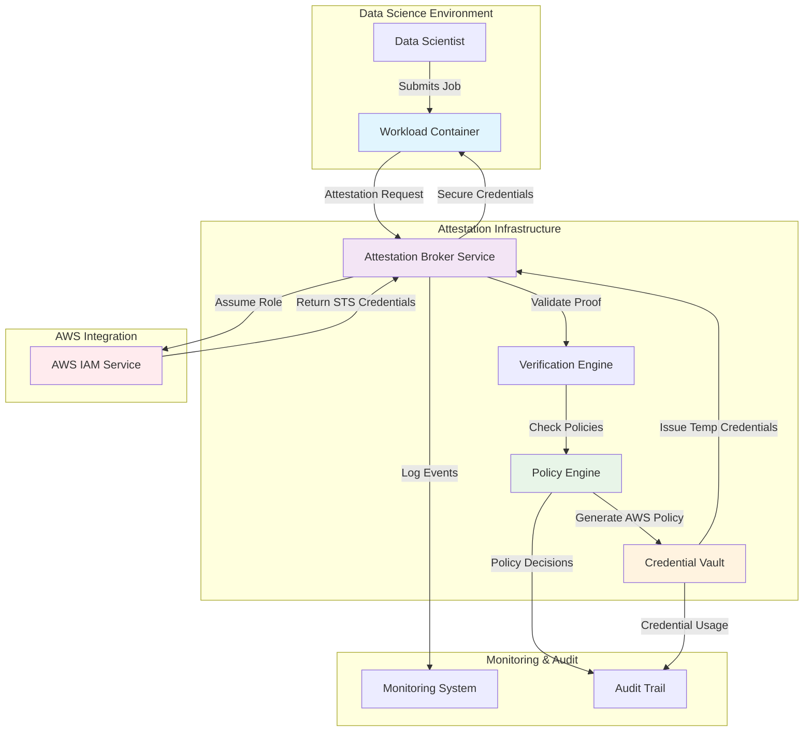

# Netflix Bridges AWS IAM and Internal Identity with Workload Attestation

## Introduction

When a data scientist at Netflix submits a training job that needs to read from a private S3 bucket containing user viewing history, the request doesn't go through a static IAM role or a shared credential store. Instead, the workload proves its identity to an attestation service, which issues time-bound AWS credentials scoped to exactly what that job needs.

This is workload attestation in action, and it's how Netflix bridges its internal identity system with AWS IAM without leaking long-lived secrets into containers, notebooks, or CI/CD pipelines.

## Why This Matters

Traditional approaches to cross-cloud identity—shared access keys, federated SAML assertions, or manually mapped IAM roles—break down at Netflix scale. We process over 250 billion daily events across thousands of data science workloads, each requiring fine-grained access to sensitive datasets. Static credentials lead to credential sprawl, privilege creep, and audit nightmares.

Workload attestation flips the model: instead of trusting that a workload *has* valid credentials, we verify that the workload *is* who it claims to be before issuing any AWS permissions. For data science teams, this means ephemeral Jupyter notebooks can access production data without hardcoded secrets, and batch Spark jobs can assume least-privilege roles based on dynamic context like sensitivity labels and job metadata.

## How It Works

The system operates through three tightly integrated components: an attestation broker, a policy translation engine, and a credential vault. Workloads initiate the flow by requesting attestation; the broker validates proof-of-work (typically TLS certificate fingerprints, binary signatures, or Kubernetes service account tokens), consults the policy engine for appropriate AWS permissions, and provisions temporary STS credentials via the vault.



Here's the step-by-step flow:

1. **Workload Initiation**: A containerized ML training job calls the attestation broker with its identity token (e.g., a signed Kubernetes service account JWT).
2. **Proof Validation**: The broker forwards the token to a verification engine that checks cryptographic signatures against trusted identity providers.
3. **Policy Resolution**: The verified identity and workload context (job name, dataset tags, sensitivity level) are passed to the policy engine, which generates a scoped AWS IAM policy.
4. **Credential Provisioning**: The broker requests temporary STS credentials from AWS using a pre-configured cross-account role, then stores them in the credential vault.
5. **Secure Delivery**: Time-bound credentials (typically valid for 1 hour) are returned to the workload over an encrypted channel.
6. **Audit Logging**: Every attestation decision, policy translation, and credential issuance is logged for compliance and incident response.

## Core Concepts

### Attestation Broker Service

The broker acts as the front door for all workload identity requests. It's stateless, horizontally scalable, and designed to handle bursts of thousands of concurrent attestation calls during peak data science hours. Internally, it maintains a registry of trusted identity sources (Kubernetes clusters, EC2 instance metadata, Lambda execution environments) and enforces rate limiting per source.

Key design decisions include:
- **Asynchronous Processing**: Long-running policy evaluations are queued via SQS to avoid blocking the HTTP response.
- **Circuit Breaker Pattern**: If AWS STS is degraded, the broker fails fast rather than queuing endless requests.
- **Multi-Tenant Isolation**: Each business unit gets its own broker instance to prevent noisy neighbor effects.

### Policy Translation Engine

This component maps Netflix's internal role hierarchy (DataScientist → SeniorDataScientist → MLPlatformAdmin) to equivalent AWS IAM policies. Unlike static role mappings, the engine supports dynamic constraints based on:

- **Resource Tags**: S3 objects tagged with `sensitivity=pii` require additional MFA conditions.
- **Time-Based Access**: Production datasets are only accessible during business hours (9 AM - 6 PM PST).
- **Geographic Constraints**: EU-based workloads can't access US-only datasets due to GDPR compliance.

The engine caches frequently requested policy combinations in Redis with a TTL of 5 minutes, reducing AWS API calls by ~70%.

### Credential Vault Integration

Built on top of Netflix's existing Atlas secret management system, the vault handles secure storage, rotation, and revocation of issued credentials. It integrates with Chaos Monkey to periodically test credential invalidation scenarios, ensuring that revoked workloads lose access within seconds of policy changes.

## Examples & Code Walkthrough

### Attestation Request Handler

```python
import time
import hashlib
from typing import List, Dict, Any
from dataclasses import dataclass

@dataclass
class WorkloadIdentity:
    workload_id: str
    service_account_token: str
    cluster_id: str
    namespace: str
    pod_name: str

@dataclass 
class AwsCredentials:
    access_key_id: str
    secret_access_key: str
    session_token: str
    expiration: int  # Unix timestamp

class AttestationRequestHandler:
    def __init__(self, policy_engine: 'PolicyTranslationEngine', 
                 credential_vault: 'CredentialVault',
                 verification_engine: 'VerificationEngine'):
        self.policy_engine = policy_engine
        self.credential_vault = credential_vault
        self.verification_engine = verification_engine
        self.max_credential_ttl_seconds = 3600  # 1 hour

    def process_attestation(self, identity: WorkloadIdentity, 
                          requested_roles: List[str]) -> AwsCredentials:
        """
        Main entry point for workload attestation.
        Validates workload integrity, translates roles to AWS policies,
        and provisions temporary credentials.
        """
        # Step 1: Verify workload integrity through attestation
        if not self._verify_workload_integrity(identity):
            raise SecurityException(
                f"Workload validation failed for {identity.workload_id}"
            )

        # Step 2: Build context for policy translation
        workload_context = {
            'cluster_id': identity.cluster_id,
            'namespace': identity.namespace,
            'pod_name': identity.pod_name,
            'timestamp': int(time.time())
        }

        # Step 3: Generate context-aware AWS policy
        try:
            aws_policies = self.policy_engine.translate_roles(
                requested_roles, workload_context
            )
        except PolicyTranslationError as e:
            raise SecurityException(f"Policy translation failed: {str(e)}")

        # Step 4: Issue temporary credentials with least privilege
        credentials = self.credential_vault.provision_temporary_creds(
            policies=aws_policies,
            ttl_seconds=self.max_credential_ttl_seconds
        )

        # Step 5: Log successful attestation for audit trail
        self._log_attestation_event(identity.workload_id, requested_roles)

        return credentials

    def _verify_workload_integrity(self, identity: WorkloadIdentity) -> bool:
        """
        Validate that the workload is running in a trusted environment
        and its identity token hasn't been tampered with.
        """
        # Verify Kubernetes service account token signature
        if not self.verification_engine.validate_k8s_token(
            identity.service_account_token
        ):
            return False

        # Check for known malicious pod patterns
        if self._is_suspicious_pod_pattern(identity.pod_name):
            return False

        # Ensure workload is running in approved clusters
        if not self.verification_engine.is_approved_cluster(identity.cluster_id):
            return False

        return True

    def _is_suspicious_pod_pattern(self, pod_name: str) -> bool:
        """Detect potentially malicious pod naming patterns."""
        suspicious_patterns = ['debug-', 'temp-', 'test-job-']
        return any(pattern in pod_name.lower() for pattern in suspicious_patterns)

    def _log_attestation_event(self, workload_id: str, roles: List[str]) -> None:
        """Log attestation events for monitoring and audit purposes."""
        # In production, this would integrate with Atlas logging
        print(f"[{int(time.time())}] Attestation granted: workload={workload_id}, roles={roles}")

class SecurityException(Exception):
    pass

class PolicyTranslationError(Exception):
    pass
```

### Policy Translation Logic

```python
import json
from typing import List, Dict, Any, Optional

class PolicyTranslationEngine:
    def __init__(self):
        # Pre-defined policy templates for common roles
        self.role_templates = {
            'data_scientist': self._build_data_scientist_policy,
            'ml_engineer': self._build_ml_engineer_policy,
            'platform_admin': self._build_platform_admin_policy
        }

    def translate_roles(self, internal_roles: List[str], 
                       workload_context: Dict[str, Any]) -> List[Dict]:
        """
        Translate internal Netflix roles to AWS IAM policy documents.
        Supports dynamic constraints based on workload context.
        """
        policies = []
        for role in internal_roles:
            if role in self.role_templates:
                policy = self.role_templates[role](workload_context)
                policies.append(policy)
            else:
                raise PolicyTranslationError(f"Unknown role: {role}")

        # Merge overlapping policies and apply global constraints
        merged_policy = self._merge_policies(policies)
        constrained_policy = self._apply_global_constraints(merged_policy, workload_context)
        
        return [constrained_policy]

    def _build_data_scientist_policy(self, context: Dict[str, Any]) -> Dict:
        """
        Construct IAM policy for data scientist workloads.
        Grants read-only access to approved datasets with sensitivity filtering.
        """
        base_policy = {
            "Version": "2012-10-17",
            "Statement": [
                {
                    "Effect": "Allow",
                    "Action": [
                        "s3:GetObject",
                        "s3:ListBucket",
                        "s3:GetObjectVersion"
                    ],
                    "Resource": [
                        f"arn:aws:s3:::netflix-data-{context['cluster_id']}/*",
                        f"arn:aws:s3:::netflix-data-{context['cluster_id']}"
                    ]
                },
                {
                    "Effect": "Allow",
                    "Action": [
                        "glue:GetTable",
                        "glue:GetDatabase",
                        "glue:GetPartitions"
                    ],
                    "Resource": "*"
                }
            ]
        }

        # Apply sensitivity-based constraints
        sensitivity_level = context.get('sensitivity_level', 'medium')
        if sensitivity_level == 'high':
            # Add condition requiring approved tag on objects
            base_policy["Statement"][0]["Condition"] = {
                "StringEquals": {
                    "s3:ExistingObjectTag/sensitivity": "approved"
                }
            }
        elif sensitivity_level == 'restricted':
            # Deny access entirely unless explicitly allowed
            base_policy["Statement"].append({
                "Effect": "Deny",
                "Action": "s3:*",
                "Resource": "*",
                "Condition": {
                    "StringNotLikeIfExists": {
                        "s3:ExistingObjectTag/approval": "executive*"
                    }
                }
            })

        return base_policy

    def _build_ml_engineer_policy(self, context: Dict[str, Any]) -> Dict:
        """
        ML engineers get additional permissions for model deployment and training.
        """
        policy = self._build_data_scientist_policy(context)
        
        # Add write permissions for model artifacts
        policy["Statement"].append({
            "Effect": "Allow",
            "Action": [
                "s3:PutObject",
                "s3:DeleteObject"
            ],
            "Resource": [
                f"arn:aws:s3:::netflix-models-{context['cluster_id']}/*"
            ]
        })

        # Allow SageMaker operations
        policy["Statement"].append({
            "Effect": "Allow",
            "Action": [
                "sagemaker:CreateTrainingJob",
                "sagemaker:DescribeTrainingJob"
            ],
            "Resource": "*"
        })

        return policy

    def _build_platform_admin_policy(self, context: Dict[str, Any]) -> Dict:
        """
        Platform admins get full access to all data science resources.
        """
        return {
            "Version": "2012-10-17",
            "Statement": [
                {
                    "Effect": "Allow",
                    "Action": [
                        "s3:*",
                        "glue:*",
                        "sagemaker:*",
                        "ec2:Describe*"
                    ],
                    "Resource": "*"
                }
            ]
        }

    def _merge_policies(self, policies: List[Dict]) -> Dict:
        """
        Merge multiple policy documents into a single consolidated policy.
        Handles overlapping resources and deduplicates actions.
        """
        merged_statements = []
        for policy in policies:
            merged_statements.extend(policy.get("Statement", []))
        
        return {
            "Version": "2012-10-17",
            "Statement": merged_statements
        }

    def _apply_global_constraints(self, policy: Dict, context: Dict[str, Any]) -> Dict:
        """
        Apply organization-wide constraints like time-based access and MFA requirements.
        """
        # Add time-based restriction for non-production environments
        if context.get('environment') == 'production':
            # Production workloads can run anytime
            pass
        else:
            # Non-production workloads restricted to business hours
            policy["Statement"].append({
                "Effect": "Deny",
                "Action": "*",
                "Resource": "*",
                "Condition": {
                    "DateNotInRange": {
                        "aws:CurrentTime": [
                            "2023-01-01T09:00:00Z-2023-12-31T18:00:00Z"
                        ]
                    }
                }
            })

        return policy

class PolicyTranslationError(Exception):
    pass
```

## Best Practices

1. **Always Use Short-Lived Credentials**: Never issue credentials valid for more than 1 hour. Our default TTL is 60 minutes, with automatic renewal handled by the workload runtime.

2. **Implement Defense-in-Depth**: Combine hardware-based attestation (Nitro Enclaves for EC2, TPM for bare metal) with software signatures. This prevents attackers from simply replaying valid tokens.

3. **Cache Policy Translations Aggressively**: Policy generation involves multiple AWS API calls. Cache results for at least 5 minutes, but invalidate immediately when underlying roles change.

4. **Log Everything**: Every attestation request, policy decision, and credential issuance should be logged with full context. We ship logs to both Splunk for security analysis and Atlas for operational monitoring.

5. **Design for Failure**: If the attestation service is down, workloads should fall back to cached credentials or fail safely rather than hanging indefinitely.

## Common Mistakes & Anti-Patterns

### 1. Static Role Mapping Instead of Dynamic Policies

**Anti-pattern**: Hardcoding IAM role ARNs in configuration files.

```python
# DON'T DO THIS
ROLE_MAPPING = {
    'data_scientist': 'arn:aws:iam::123456789012:role/DataScientistRole',
    'ml_engineer': 'arn:aws:iam::123456789012:role/MLEngineerRole'
}
```

**Fix**: Generate policies dynamically based on workload context.

```python
# DO THIS INSTEAD
def generate_dynamic_policy(workload_context: Dict[str, Any]) -> Dict:
    """Generate IAM policy based on actual workload requirements."""
    actions = set()
    resources = set()
    
    # Determine required actions based on workload type
    if workload_context.get('needs_s3_read'):
        actions.update(['s3:GetObject', 's3:ListBucket'])
        resources.add(f"arn:aws:s3:::netflix-data-{workload_context['team']}/*")
    
    if workload_context.get('needs_glue_metadata'):
        actions.update(['glue:GetTable', 'glue:GetDatabase'])
        resources.add('*')  # Glue metadata is generally safe to expose
    
    return {
        "Version": "2012-10-17",
        "Statement": [{
            "Effect": "Allow",
            "Action": list(actions),
            "Resource": list(resources)
        }]
    }
```

### 2. Ignoring Network-Level Security

**Anti-pattern**: Assuming that valid attestation means the network path is secure.

**Fix**: Always encrypt credential delivery and implement mutual TLS between services.

```python
import ssl
from cryptography.fernet import Fernet

class SecureCredentialDelivery:
    def __init__(self):
        self.encryption_key = self._load_encryption_key()
        self.cipher_suite = Fernet(self.encryption_key)

    def deliver_credentials(self, credentials:
