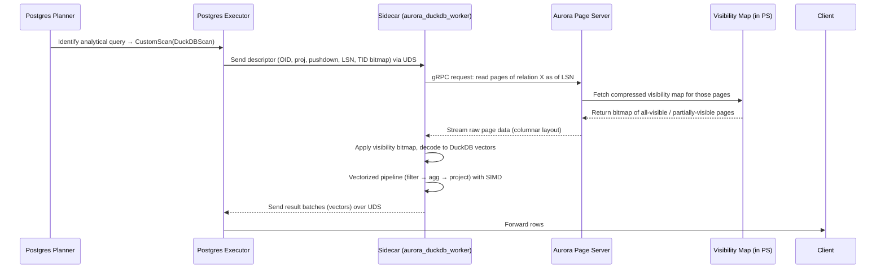

# Amazon Acquires DuckLabs and Integrates DuckDB in Amazon Aurora PostgreSQL

## Introduction
When you run a mixed OLTP/OLAP workload on Aurora PostgreSQL you quickly hit a wall: the planner keeps choosing sequential scans on huge fact tables, `work_mem` spills to disk, and vacuum churn eats up I/O bandwidth. The traditional fixes—read replicas, foreign data wrappers, or nightly ETL to a data warehouse—add latency, cost, and operational complexity. Amazon’s acquisition of DuckLabs and the subsequent integration of DuckDB as a vectorized sidecar changes the game. Instead of moving data out of Aurora, we bring a purpose‑built analytical engine to the data, letting it read directly from the Aurora Storage Layer while preserving MVCC guarantees.

## Why This Matters
Senior engineers and DBAs care about three things: predictable latency, cost efficiency, and operational simplicity. The DuckDB sidecar delivers:

* **Reduced query latency** for analytical scans—often 5‑10× faster than native PostgreSQL because the engine works on columnar vectors and pushes predicates down to the storage nodes.
* **Lower storage cost**—no need to duplicate data into Redshift, Snowflake, or a separate data lake; the same Aurora pages serve both transactional and analytical requests.
* **Operational continuity**—the sidecar runs as a managed process on the same instance (or an analytics‑only fleet) and fails back to the regular executor if it crashes, so there’s no new failure domain to monitor.

In short, you get HTAP‑style performance without the usual data‑movement tax.

## How It Works
The integration hinges on three tightly coupled pieces:

1. **Aurora Storage Layer** – the immutable, log‑structured source of truth (WAL, page servers, visibility map).
2. **Postgres Planner Hook** – a custom scan provider (`DuckDBScan`) that intercepts analytical queries and hands off a lightweight descriptor to a sidecar.
3. **DuckDB Sidecar Process** – a `aurora_duckdb_worker` that reads pages directly from storage, applies MVCC visibility via LSN‑anchored snapshots, and returns columnar result vectors.

### Data Flow
1. The planner tags a query as “analytical” (e.g., contains `count(*)`, wide projections, window functions, or hash aggregates).
2. It creates a `CustomScan` path whose `methods` point to `DuckDBScan`.
3. At executor startup, the `CustomScan` node gathers:
   * The target relation’s OID.
   * A list of requested attributes (projection).
   * Predicates that can be pushed down.
   * The current transaction’s **Query LSN** (see Section 3).
   * A bitmap of tuple IDs (TIDs) that are potentially visible (derived from the visibility map).
4. This descriptor is shipped over a Unix domain socket (or a shared‑memory ring buffer on larger instances) to the `aurora_duckdb_worker`.
5. The sidecar opens a gRPC stream to the Aurora Page Server, requests the relevant pages **as of the Query LSN**, and builds DuckDB vectors directly from the raw columnar layout (no heap decompression).
6. Predicate pushdown and column pruning happen inside DuckDB’s vectorized pipeline.
7. Result vectors stream back to the Postgres executor, which simply forwards them to the client.

If the sidecar crashes, the executor detects the broken socket, logs a warning, and falls back to a regular `SeqScan` path—graceful degradation.

### Mermaid Diagram


## Core Concepts

### Shared Storage, Disaggregated Compute
Aurora’s storage nodes already expose a **gRPC‑based Page Store API** that returns a page’s raw bytes given a segment ID and offset. The sidecar re‑uses this API; it never touches the PostgreSQL buffer pool or WAL directly. This means the sidecar can be scaled independently (e.g., a fleet of larger instances dedicated to analytics) without altering the storage contract.

### LSN‑Anchored Snapshots
PostgreSQL assigns a **Query LSN** at `StartTransactionCommand`. The sidecar treats this LSN as a read‑only point‑in‑time snapshot. Aurora Page Servers keep a **multi‑version page chain**; when a read request includes an LSN, the server walks the chain to find the version whose `LSN ≤ query LSN < next LSN`. Because the visibility map is also versioned, the sidecar can skip whole pages that are marked all‑visible at that LSN, avoiding tuple header parsing altogether.

### Vectorized Execution Bridge
DuckDB’s pipeline works on **columnar vectors** (typically 1024‑row chunks). The sidecar implements a thin adapter:
* **Type Mapping** – PostgreSQL’s `NUMERIC`, `MONEY`, and user‑defined `ENUM` types are converted to DuckDB’s `DECIMAL`, `DECIMAL`, and `VARCHAR` (with a lookup table) respectively.
* **Memory Hook** – DuckDB’s arena allocator is wrapped with a custom `AllocationHook` that backs allocations with PostgreSQL `MemoryContext` chunks allocated via `AllocSetContextCreate`. This prevents the sidecar’s memory from triggering the Linux OOM killer while still allowing DuckDB to reclaim memory aggressively when a query ends.
* **Tuple ID Filter** – For pages that are not all‑visible, the sidecar receives a **compressed bitmap of valid TIDs** from the storage node. During vector construction, each column’s validity mask is AND‑ed with this TID bitmap, ensuring only visible rows contribute to aggregates.

### Write Path (Phase 1 – Read‑Only)
The sidecar never writes. All `INSERT/UPDATE/DELETE` go through the standard PostgreSQL executor → WAL → Aurora Storage. A background invalidation service listens to the Aurora Control Plane event bus; when a page is mutated, it publishes an invalidation event (segment ID, new LSN). The sidecar’s local cache (LRU of columnar row groups) evicts the affected segments on the next read, guaranteeing that stale vectors are not served.

## Examples & Code Walkthrough

### Enabling the Feature
```sql
-- On an Aurora PostgreSQL 15+ instance with the duckdb extension installed:
CREATE EXTENSION IF NOT EXISTS aurora_duckdb;
-- Optional: tune worker memory (defaults to 8GB)
ALTER SYSTEM SET aurora.duckdb.worker_memory = '16GB';
SELECT pg_reload_conf();
```

### Using the DuckDB Scan in SQL
```sql
EXPLAIN (VERBOSE, BUFFERS)
SELECT
    l_returnflag,
    l_linestatus,
    SUM(l_quantity) AS sum_qty,
    SUM(l_extendedprice) AS sum_base_price,
    SUM(l_extendedprice * (1 - l_discount)) AS sum_disc_price,
    SUM(l_extendedprice * (1 - l_discount) * (1 + l_tax)) AS sum_charge,
    AVG(l_quantity) AS avg_qty,
    AVG(l_extendedprice) AS avg_price,
    AVG(l_discount) AS avg_disc,
    COUNT(*) AS count_order
FROM lineitem
WHERE l_shipdate <= DATE '1998-12-01' - INTERVAL '90' days
GROUP BY l_returnflag, l_linestatus
ORDER BY l_returnflag, l_linestatus;
```
The `EXPLAIN` output will show a `Custom Scan` node labeled `DuckDBScan`. Notice the absence of `Seq Next` or `Heap Tuple Satisfies Visibility` rows.

### Sidecar Registration (C++)
Below is a simplified version of the sidecar’s entry point. It registers a custom scan provider with the PostgreSQL planner and spins up a gRPC service that accepts scan descriptors.

```cpp
/* aurora_duckdb_worker/main.cpp */
#include <postgres.h>
#include <executor/spi.h>
#include <access/htup_details.h>
#include <libpq-fe.h>
#include <grpcpp/grpcpp.h>
#include "duckdb.hpp"
#include "aurora_storage.grpc.pb.h"

using grpc::Server;
using grpc::ServerBuilder;
using grpc::ServerContext;
using aurora_storage::PageService;
using aurora_storage::PageRequest;
using aurora_storage::PageResponse;

/* ------------------------------------------------------------------
 * 1. Custom Scan Provider registration
 * ------------------------------------------------------------------ */
static CustomScanMethods duckdb_scan_methods = {
    .CustomName = "DuckDBScan",
    .PlanState = nullptr,   // we keep state in the sidecar
    .BeginCustomScan = DuckDBBeginScan,
    .ExecCustomScan = DuckDBExecScan,
    .EndCustomScan = DBDEndScan,
    .ReScanCustomScan = nullptr,
    .MarkPosCustomScan = nullptr,
    .RestrPosCustomScan = nullptr
};

void _PG_init(void) {
    RegisterCustomScanMethods(&duckdb_scan_methods);
}

/* ------------------------------------------------------------------
 * 2. gRPC service implementation – receives scan descriptors
 * ------------------------------------------------------------------ */
class ScanServiceImpl final : public PageService::Service {
    grpc::Status GetPage(ServerContext* ctx,
                         const PageRequest* req,
                         PageResponse* resp) override {
        // req contains: relation OID, list of attribute numbers,
        // pushdown predicates, query LSN, TID bitmap.
        // We forward the request to the Page Server stub.
        // For brevity, error handling omitted.
        ClientContext page_ctx;
        stub_->GetPage(&page_ctx, *req, resp);
        return Status::OK;
    }
    std::unique_ptr<PageService::Stub> stub_;
public:
    ScanServiceImpl(const std::string& endpoint) {
        stub_ = PageService::NewStub(grpc::CreateChannel(endpoint,
                                                          grpc::InsecureChannelCredentials()));
    }
};

/* ------------------------------------------------------------------
 * 3. Main loop – initialize DuckDB, start gRPC, wait for signals
 * ------------------------------------------------------------------ */
int main(int argc, char* argv[]) {
    // Initialize PostgreSQL memory context for allocations
    MemoryContext old = CurrentMemoryContext;
    CurrentMemoryContext = AllocSetContextCreate(TopMemoryContext,
                                                 "DuckDBWorker",
                                                 ALLOCSET_DEFAULT_MINSIZE,
                                                 ALLOCSET_DEFAULT_INITSIZE,
                                                 ALLOCSET_DEFAULT_MAXSIZE);

    // Start gRPC server
    ServerBuilder builder;
    std::string server_addr("0.0.0.0:50051");
    builder.AddListeningPort(server_addr, grpc::InsecureServerCredentials());
    std::unique_ptr<ScanServiceImpl> service = std::make_unique<ScanServiceImpl>("pagestore.internal:50052");
    builder.RegisterService(service.get());
    std::unique_ptr<Server> server(builder.BuildAndStart());
    LOG_INFO("DuckDB sidecar listening on %s", server_addr.c_str());

    server->Wait();
    // Cleanup omitted for brevity
    return 0;
}
```

**Explanation of key parts**

* The `_PG_init` hook registers `DuckDBScan` as a custom scan provider. When the planner chooses this path, the executor will call `DuckDBBeginScan` (not shown) which simply opens a UDS connection to the sidecar and sends the scan descriptor.
* `ScanServiceImpl::GetPage` is the thin adapter that forwards the descriptor to the Aurora Page Server via an existing gRPC stub. The sidecar does **not** interpret the page format itself; it asks the storage node to give it the raw bytes as of the supplied LSN.
* Memory allocations are performed inside a dedicated `MemoryContext` (`DuckDBWorker`). DuckDB’s arena allocator is replaced with a hook that pulls memory from this context, ensuring the sidecar’s memory usage is visible to PostgreSQL’s `stats collector` and limited by `aurora.duckdb.worker_memory`.

### Custom Scan Executor Stub (simplified)
```cpp
/* executor DuckDBScan */
static void
DuckDBBeginScan(CustomScanState *node, EState *estate, int eflags) {
    // Open a UDS connection to the sidecar (path from env var)
    int sock = socket(AF_UNIX, SOCK_STREAM, 0);
    struct sockaddr_un addr = { .sun_family = AF_UNIX };
    strcpy(addr.sun_path, getenv("DUCKDB_SOCKET_PATH"));
    connect(sock, (struct sockaddr*)&addr, sizeof(addr));
    node->custom_state = (void*)(intptr_t)sock; // store fd
}

static TupleTableSlot *
DuckDBExecScan(CustomScanState *node) {
    int sock = (intptr_t)node->custom_state;
    // Read a batch of result vectors from the sidecar (length-prefixed)
    uint32_t len;
    if (read(sock, &len, sizeof(len)) != sizeof(len)) return NULL; // EOF
    std::vector<char> buf(len);
    if (read(sock, buf.data(), len) != len) return NULL;

    // Deserialize into DuckDB's columnar format and convert to TupleTableSlot
    // (omitted for brevity – uses DuckDB's DataChunk API)
    return slot; // filled with column values
}

static void
DuckDBEndScan(CustomScanState *node) {
    close((intptr_t)node->custom_state);
}
```

The executor treats the sidecar as a black box that returns ready‑to‑consume rows; no visibility checks are needed because the sidecar already applied them.

## Best Practices

1. **Size the sidecar memory deliberately** – set `aurora.duckdb.worker_memory` to roughly 60‑70 % of the instance’s RAM, leaving headroom for the PostgreSQL buffer pool, OS, and other processes. Monitor `pg_stat_duckdb.buffer_cache_hit_ratio`; if it drops below 0.8, consider increasing the worker memory or enabling spill to local NVMe.
2. **Align parallelism** – `max_parallel_workers_per_gather` now controls the number of DuckDB threads per query. Start with the number of physical cores minus one (to leave a core for the postgres executor) and adjust based on observed CPU saturation.
3. **Pre‑warm the visibility map** – the sidecar benefits from a hot cache of the compressed visibility map. Run a lightweight `SELECT count(*) FROM large_table` during off‑peak hours to fill the Page Server’s VM cache.
4. **Use dedicated analytics instances** – if your workload is heavily analytical, launch an Aurora Reader‑only fleet with a higher `aurora.duckdb.worker_memory` and lower `shared_buffers`. Route analytical traffic via a separate endpoint or using Aurora’s read‑only routing.
5. **Enable logging for invalidations** – set `log_min_messages = info` and watch for `DuckDB: invalidated segment X due to LSN Y` messages
