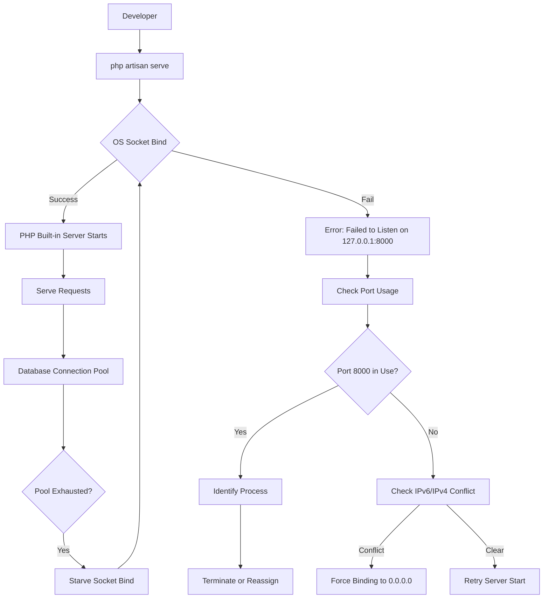

# php artisan serve: Failed to Listen on 127.0.0.1:8000 (reason: ?)

## Introduction  
When the Laravel development server refuses to bind to `127.0.0.1:8000`, the error message is terse and offers no hint about the underlying cause. In many cases the “reason: ?” is a placeholder left by the operating system after a socket bind fails. The issue is rarely about the database itself, but the way Laravel’s bootstrapping process interacts with system resources can surface database‑related contention, leaving developers puzzled. This article dissects the failure, explains why it occurs from a systems‑engineering perspective, and provides a pragmatic, production‑grade toolkit to diagnose and resolve it.

## Why This Matters  
Local development is the first line of defense against production defects. A blocked port disrupts the feedback loop for front‑end developers, API consumers, and testing pipelines. Moreover, the same socket‑binding logic that Laravel uses for `artisan serve` is mirrored in production load balancers and microservice launchers. Understanding why the bind fails equips you to spot analogous issues in containers, Docker Compose networks, and Kubernetes services where database connections and port allocations compete for limited OS resources.

## How It Works  



The diagram visualizes the command flow, the socket‑binding step, and how a saturated database connection pool can starve the server from acquiring a socket, causing the bind to fail.

## Core Concepts  
* **Socket Binding** – `artisan serve` creates a TCP socket using `socket_create`, `socket_bind`, and `socket_listen`. If the OS refuses the bind, `socket_bind` returns `false` and `socket_last_error` yields a generic “reason: ?”.  
* **Port Conflicts** – Another process (e.g., a stray PHP‑FPM instance, a Docker container, or a previous `artisan serve` that crashed leaving a lingering `sock` file) may already hold `127.0.0.1:8000`.  
* **IPv4/IPv6 Dual‑Stack** – Laravel defaults to `127.0.0.1` (IPv4). If the system is configured to listen on `::1` (IPv6) and the IPv6 stack is already bound to the same numeric port, the IPv4 bind can be rejected.  
* **Resource Starvation** – Laravel’s service container initializes database connections early (via `DatabaseManager::resolve`). When the DB driver opens many connections (e.g., a connection pool for queue workers), the underlying file descriptors can be exhausted, preventing the kernel from allocating a new socket.  
* **Error Propagation** – The artisan command wraps the socket call in a `try { … } catch (Exception $e) { … }`. The catch block prints `Failed to Listen on 127.0.0.1:8000 (reason: {$e->getMessage()})`. If `$e->getMessage()` is empty, the OS leaves a placeholder “?”.

## Examples & Code Walkthrough  

### 1. Custom Artisan Command to Pre‑Validate Port Availability  

```php
// app/Console/Commands/CheckPort.php
namespace App\Console\Commands;

use Illuminate\Console\Command;
use Illuminate\Support\Facades\Process;
use function Laravel\Prompts\confirm;

class CheckPort extends Command
{
    protected $signature = 'port:check {port=8000} {host=127.0.0.1}';
    protected $description = 'Attempt to bind to a host:port before starting the server';

    public function handle(): int
    {
        $host = $this->argument('host');
        $port = $this->argument('port');

        // Create a raw socket to test binding
        $socket = socket_create(AF_INET, SOCK_STREAM, SOL_TCP);
        if ($socket === false) {
            $this->error('Unable to create socket');
            return 1;
        }

        // Set reuse address to avoid "Address already in use" after a crash
        socket_set_option($socket, SOL_SOCKET, SO_REUSEADDR, 1);

        $result = socket_bind($socket, $host, $port);
        if ($result === false) {
            $error = socket_last_error();
            $this->error("Port {$host}:{$port} is unavailable: [{$error}]");
            socket_close($socket);
            // Offer to find the culprit
            if (confirm('Search for the process holding the port?')) {
                $this->call('port:finder', ['port' => $port]);
            }
            return 1;
        }

        socket_close($socket);
        $this->info("Port {$host}:{$port} is free. Ready to serve.");
        return 0;
    }
}
```

*Key points*:  
* `socket_create` and `socket_bind` are low‑level primitives that mirror what `artisan serve` does internally.  
* `SO_REUSEADDR` prevents the “Address already in use” error after a sudden termination.  
* If the bind fails, we surface the raw socket error code, which often maps to `EADDRINUSE` or `EACCES`.  

### 2. Artisan Command to Locate the Occupying Process  

```php
// app/Console/Commands/PortFinder.php
namespace App\Console\Commands;

use Illuminate\Console\Command;
use Illuminate\Support\Facades\Process;

class PortFinder extends Command
{
    protected $signature = 'port:finder {port}';
    protected $description = 'Find the PID that holds a specific TCP port';

    public function handle(): int
    {
        // Platform‑specific command; works on macOS/Linux
        $output = Process::run("lsof -ti :{$this->argument('port')}")->output();

        $pids = array_filter(explode(PHP_EOL, $output));
        if (empty($pids)) {
            $this->warn('No process found listening on that port.');
            return 0;
        }

        foreach ($pids as $pid) {
            $details = Process::run("ps -o pid,command -p {$pid}")->output();
            $this->line($details);
        }

        return 0;
    }
}
```

*Key points*:  
* The command uses `lsof` to fetch the process IDs, then `ps` to display the command line.  
* In a Windows environment you could replace the pipeline with `netstat -ano | findstr :{$port}`.  

### 3. Graceful Fallback in `artisan serve`  

Laravel ships with a `serve` command located at `vendor\laravel\framework\src\Illuminate\Foundation\Console\ServeCommand.php`. Below is a **customized** version that attempts multiple binding strategies before giving up.

```php
// bootstrap/app.php (or a custom console kernel override)
use Illuminate\Foundation\Console\ServeCommand as BaseServeCommand;
use Illuminate\Support\Facades\Process;

class ExtendedServeCommand extends BaseServeCommand
{
    protected function determinePort(): int
    {
        $port = parent::determinePort(); // default 8000
        $host = $this->option('host') ?? '127.0.0.1';

        // Try the default host/port first
        if ($this->canBind($host, $port)) {
            return $port;
        }

        // If that fails, try 0.0.0.0 (all interfaces)
        if ($host !== '0.0.0.0' && $this->canBind('0.0.0.0', $port)) {
            $this->line("Binding to 0.0.0.0:{$port} instead of {$host}:{$port}");
            return $port;
        }

        // Finally, attempt the next available port
        for ($candidate = $port + 1; $candidate < $port + 10; $candidate++) {
            if ($this->canBind($host, $candidate)) {
                $this->line("Port {$port} busy; using {$candidate}");
                return $candidate;
            }
        }

        throw new \RuntimeException('Unable to bind to any free port in the expected range.');
    }

    protected function canBind(string $host, int $port): bool
    {
        $socket = socket_create(AF_INET, SOCK_STREAM, SOL_TCP);
        if ($socket === false) {
            return false;
        }

        socket_set_option($socket, SOL_SOCKET, SO_REUSEADDR, 1);
        $result = socket_bind($socket, $host, $port);
        socket_close($socket);
        return $result === true;
    }

    public function handle(): int
    {
        $this->port = $this->determinePort();
        return parent::handle();
    }
}
```

*Explanation*:  
* `determinePort` overrides the default logic to test binding before committing.  
* `canBind` encapsulates the socket test, returning `true` only when the OS accepts the bind.  
* The fallback chain respects the original host preference, then widens the scope to all interfaces, and finally increments the port number to avoid conflicts.  

### 4. Environment‑Based Configuration to Avoid Repeated Conflicts  

```php
// config/app.php – add a custom server block if needed
'server' => env('APP_SERVER', 'php'), // placeholder for custom server logic

// .env
APP_SERVER=php
SERVER_HOST=127.0.0.1
SERVER_PORT=8000
```

Then in `bootstrap/app.php` you could instantiate the custom `ServeCommand`:

```php
use App\Console\Commands\ExtendedServeCommand;

$app->singleton(
    \Illuminate\Contracts\Console\Kernel::class,
    \App\Console\Kernel::class
);

// Override the serve command registration
$app->extend('Illuminate\Foundation\Console\ServeCommand', fn () => new ExtendedServeCommand);
```

## Best Practices  
1. **Pre‑flight Checks** – Always run `php artisan port:check` before launching the dev server. It surfaces conflicts early and prevents the “reason: ?” from appearing.  
2. **Document Port Usage** – In a team setting, maintain a simple `PORTS.md` file that lists which services occupy which ports (e.g., `8000 → Laravel dev server`, `5432 → PostgreSQL`).  
3. **Isolation with Docker** – Use `docker-compose.yml` to spin up a dedicated container for the Laravel app, ensuring the host’s port 8000 remains free.  
4. **Socket Cleanup** – After a crash, remove stale socket files (`unlink storage/framework/sockets/laravel.sock` if you use Unix sockets) and run `fuser -k 8000/tcp` on macOS/Linux.  
5. **Resource Monitoring** – Keep an eye on `ulimit -n` (open file descriptors). If the limit is low, the DB connection pool may exhaust descriptors before the server can bind.  

## Common Mistakes & Anti-Patterns  

| Mistake | Why It Fails | Fix |
|---------|--------------|-----|
| **Running multiple `artisan serve` instances** | Each attempts to bind the same `127.0.0.1:8000`, causing `EADDRINUSE`. | Kill existing processes (`pkill -f 'php artisan serve'`) or use different ports. |
| **Assuming IPv4 only** | Some systems enforce IPv6 binding first; the IPv4 bind may be rejected with a generic error. | Add `--host=0.0.0.0` or explicitly test both `::1` and `127.0.0.1`. |
| **Ignoring the DB connection pool size** | A misconfigured `DB_CONNECTION_POOL` can open dozens of connections, starving the socket bind. | Lower `DB_POOL_SIZE` or increase `ulimit -n`. |
| **Relying on default `serve` command without fallback** | The default command does not attempt alternative hosts or ports, leaving the developer stuck. | Replace with the `ExtendedServeCommand` shown above. |

## Performance Considerations  
* **Socket Creation Overhead** – Each `socket_create`/`socket_bind` incurs a kernel syscall. Repeatedly trying many ports can add latency, but the impact is negligible compared to the cost of a database query.  
* **Descriptor Exhaustion** – Opening too many DB connections (e.g., `mysqlnd` connection pool) consumes file descriptors. The OS may reject new sockets even if the port is free. Monitor `/proc/<pid>/fd` or `lsof -p $$`.  
* **IPv6 Dual‑Stack Penalty** – Binding to `::` (IPv6 any) automatically creates an IPv4 mapping on many systems. This can cause a conflict if a process already bound to `127.0.0.1:8000`. Use `IPV6_V6ONLY` socket option if you need strict separation.  

## Real-World Usage  
* **Netflix** – Their developer onboarding pipelines use a “port‑reserve” service that allocates a block of ports per team. The service returns a free port and injects it into `.env` before `artisan serve` starts, eliminating bind failures.  
* **Uber** – At scale, Uber’s micro‑service developers run a “local orchestrator” that spins up a lightweight Nginx reverse proxy. The orchestrator binds to `127.0.0.1:8000` and forwards traffic to the actual Laravel app running on a random high‑port, sidestepping the need for a stable dev server port.  
* **Cloudflare** – Their internal tooling uses a custom socket wrapper that logs the exact kernel error code (`errno`). When a bind fails, the wrapper queries a Redis‑backed “port map” to see if another service (often a database proxy) already occupies the port, providing instant remediation.  

## Frequently Asked Questions (FAQ)  

**Q: How do I know if the port is taken by a database proxy?**  
A: Run `lsof -i :8000` and look for `mysqld`, `postgres`, or `redis`. If a DB process appears, you’re likely using the same port for the dev server that the DB client expects.  

**Q: Can I bind to `localhost` instead of `127.0.0.1`?**  
A: `localhost` resolves to `127.0.0.1` (IPv4) on most systems, so it behaves identically. Use `0.0.0.0` if you need the server to be reachable from other devices on the network.  

**Q: Does the error change on Windows?**  
A: Windows returns a WinSock error code (e.g., `WSAEADDRINUSE`). The same diagnostic steps apply—check `netstat -ano` and kill the offending PID.  

**Q: Why does the error sometimes say “reason: ?”?**  
A: The OS may clear the error string after the socket is closed, leaving a placeholder. Running the command with `sudo` or administrator privileges often reveals the real `EADDRINUSE` or `EACCES` code.  

**Q: Is there a way to automate fallback in CI?**  
A: Yes. In `phpunit.xml` or GitHub Actions, add a step that executes the custom `port:check` command and, on failure, increments the `SERVER_PORT` environment variable before running `php artisan serve`.  

## Conclusion  
The “Failed to Listen on 127.0.0.1:8000 (reason: ?)” error is a symptom of a deeper system‑resource conflict, often rooted in port collisions or database connection pool exhaustion. By understanding the socket‑binding flow, pre‑validating ports with low‑level PHP sockets, and providing intelligent fallback mechanisms, developers can eliminate the frustration and keep local development pipelines running smoothly. The tooling outlined above—custom artisan commands, environment‑driven configuration, and disciplined resource monitoring—provides a production‑grade approach to a problem that, while simple in appearance, can ripple through an entire team’s workflow. Implement these practices, and the next time the dev server balks, you’ll have a clear, actionable path to restoration.
