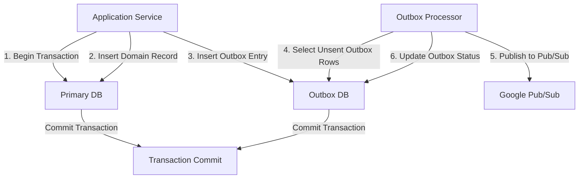

# The Dual-Write Problem: Building a Scalable Transactional Outbox for Google Pub/Sub

## Introduction  
When an application must emit an event after a critical state change, the safest approach is to keep the two writes atomic. A typical pattern is to write the domain record, then fire a Pub/Sub message. If the publish fails, the system can retry later, but the domain state is already committed, leading to eventual consistency gaps. The dual‑write problem surfaces when we need both a durable record and a reliable async notification within a single transaction boundary.

Our production cluster first encountered this issue while migrating a high‑throughput order‑management service to Google Cloud. The requirement was to guarantee that every order creation is persisted **and** a message is delivered to downstream analytics pipelines without loss. Traditional “write‑then‑publish” patterns left us with duplicate orders when network glitches occurred, and “publish‑then‑write” patterns risked losing the event if the DB commit failed.

The outbox pattern solves this by grouping the two writes into a single transactional unit. One table holds the domain payload, another table (the outbox) holds the event to be published. A separate processor reads the outbox, publishes to Pub/Sub, and cleans up in a transaction of its own. This article walks through the design, implementation, and operational considerations for a scalable outbox service on Google Pub/Sub.

## Why This Matters  
Engineering teams building event‑driven architectures face three concrete pain points:

1. **Event loss** – If a Pub/Sub publish fails after the domain write, the system must retry without re‑creating the domain record.  
2. **Duplicate processing** – Retries that are not idempotent can cause downstream services to see duplicate events.  
3. **Scalability bottlenecks** – A monolithic “publish‑on‑commit” approach can saturate the messaging layer under load.

A well‑engineered outbox eliminates event loss, provides a natural retry mechanism, and isolates the publishing workload from the request path. The pattern also lets us leverage Pub/Sub’s backlog and dead‑letter handling without sacrificing transactional guarantees.

## How It Works  
The core mechanism can be visualized as a two‑phase pipeline. A transaction writes to both the primary store and the outbox table. An independent background worker consumes outbox entries, publishes them to Google Pub/Sub, and marks them as sent (or dead‑lettered) in a separate transaction.



**Step‑by‑step flow**

1. **Application code** opens a DB transaction.  
2. It inserts the domain record (e.g., an `orders` row).  
3. It inserts a row into the `outbox` table containing the event payload, topic, and a status flag (`pending`).  
4. The transaction commits, guaranteeing atomicity of the two inserts.  
5. A low‑priority outbox processor runs continuously. It selects rows where `status = 'pending'` for update, publishes the payload to the configured Pub/Sub topic, and then updates the same row to `sent` (or `failed`).  
6. If publishing fails, the processor can retry later, and the outbox entry remains `pending`.  
7. Dead‑letter handling can be added by moving rows with repeated failures to a `dead_letter` table.

The design keeps the request latency low (the publish is deferred) while preserving exactly‑once semantics for the event stream.

## Core Concepts  
- **Outbox Table Schema** – `id SERIAL PRIMARY KEY`, `event_type VARCHAR(255)`, `payload JSONB`, `topic VARCHAR(255)`, `status VARCHAR(20) DEFAULT 'pending'`, `created_at TIMESTAMPTZ DEFAULT NOW()`, `attempted_at TIMESTAMPTZ`, `last_error TEXT`.  
- **Publisher Interface** – An abstraction that hides the specifics of Google Pub/Sub client configuration, authentication, and batching.  
- **Idempotent Publishing** – Each outbox row is processed at most once per `attempt`; the processor uses `UPDATE ... RETURNING *` to lock the row and avoid race conditions.  
- **Backpressure Handling** – The outbox processor runs as a pool of workers; when Pub/Sub throttles, the worker backs off and requeues the entry.  
- **Transaction Isolation** – The outbox processor runs in a transaction with `READ COMMITTED` (or `REPEATABLE READ` for stricter guarantees) to ensure consistent visibility of rows.

## Examples & Code Walkthrough  

### Domain Model  
We model an order creation event. The primary table is `orders`; the outbox table is `event_outbox`.

```sql
-- Primary store
CREATE TABLE orders (
    order_id BIGSERIAL PRIMARY KEY,
    customer_id BIGINT NOT NULL,
    amount NUMERIC(12,2) NOT NULL,
    status VARCHAR(20) NOT NULL,
    created_at TIMESTAMPTZ NOT NULL DEFAULT NOW()
);

-- Outbox store
CREATE TABLE event_outbox (
    id BIGSERIAL PRIMARY KEY,
    event_type VARCHAR(255) NOT NULL,
    payload JSONB NOT NULL,
    topic VARCHAR(255) NOT NULL,
    status VARCHAR(20) NOT NULL DEFAULT 'pending',
    created_at TIMESTAMPTZ NOT NULL DEFAULT NOW(),
    attempted_at TIMESTAMPTZ,
    last_error TEXT
);
```

### Transactional Service (Go)  
The service performs the dual write inside a single DB transaction.

```go
// order_service.go
package service

import (
    "context"
    "encoding/json"
    "fmt"
    "github.com/jackc/pgx/v5"
    "github.com/jackc/pgx/v5/pgxpool"
    pubsub "cloud.google.com/go/pubsub"
)

type OrderService struct {
    db    *pgxpool.Pool
    ps    *pubsub.Client
    topic string
}

// OrderCreatedEvent mirrors the payload we store in outbox
type OrderCreatedEvent struct {
    OrderID    int64   `json:"order_id"`
    CustomerID int64   `json:"customer_id"`
    Amount     float64 `json:"amount"`
    Status     string  `json:"status"`
}

// CreateOrder persists the order and registers an outbox entry.
func (s *OrderService) CreateOrder(ctx context.Context, custID int64, amount float64) (*Order, error) {
    // Begin a DB transaction
    tx, err := s.db.Begin(ctx)
    if err != nil {
        return nil, fmt.Errorf("begin tx: %w", err)
    }
    defer tx.Rollback(ctx)

    // Insert into orders
    var orderID int64
    query := `INSERT INTO orders (customer_id, amount, status)
              VALUES ($1, $2, $3) RETURNING order_id`
    if err := tx.QueryRow(ctx, query, custID, amount, "pending").
        Scan(&orderID); err != nil {
        return nil, fmt.Errorf("insert order: %w", err)
    }

    // Build outbox payload
    evt := OrderCreatedEvent{
        OrderID:    orderID,
        CustomerID: custID,
        Amount:     amount,
        Status:     "pending",
    }
    payload, err := json.Marshal(evt)
    if err != nil {
        return nil, fmt.Errorf("marshal event: %w", err)
    }

    // Insert into outbox
    outboxQuery := `
        INSERT INTO event_outbox (event_type, payload, topic, status)
        VALUES ($1, $2, $3, $4)`
    _, err = tx.Exec(ctx, outboxQuery,
        "OrderCreated", payload, s.topic, "pending")
    if err != nil {
        return nil, fmt.Errorf("insert outbox: %w", err)
    }

    // Commit transaction – both writes are atomic now
    if err := tx.Commit(ctx); err != nil {
        return nil, fmt.Errorf("commit tx: %w", err)
    }

    return &Order{ID: orderID, CustomerID: custID, Amount: amount, Status: "pending"}, nil
}
```

### Outbox Processor (Go)  
The processor reads pending rows, publishes, and updates the status. It uses `FOR UPDATE SKIP LOCKED` to distribute work across a worker pool.

```go
// outbox_processor.go
package processor

import (
    "context"
    "encoding/json"
    "fmt"
    "time"

    "github.com/jackc/pgx/v5"
    "github.com/jackc/pgx/v5/pgxpool"
    pubsub "cloud.google.com/go/pubsub"
)

type OutboxProcessor struct {
    db    *pgxpool.Pool
    ps    *pubsub.Client
    topic string
    // back‑off settings
    maxRetries int
    baseDelay  time.Duration
}

type OutboxEntry struct {
    ID        int64
    EventType string
    Payload   []byte
    Topic     string
    Status    string
    AttemptedAt *time.Time
    LastError  *string
}

// Run starts the processing loop. It is intended to be run as a separate daemon.
func (p *OutboxProcessor) Run(ctx context.Context) error {
    ticker := time.NewTicker(100 * time.Millisecond) // poll interval
    defer ticker.Stop()

    for {
        select {
        case <-ctx.Done():
            return ctx.Err()
        case <-ticker.C:
            if err := p.processBatch(ctx); err != nil {
                // Log error but continue; transient failures are expected.
                continue
            }
        }
    }
}

// processBatch picks up to 100 pending rows, processes them, and returns.
func (p *OutboxProcessor) processBatch(ctx context.Context) error {
    // Use a transaction to ensure atomic updates
    tx, err := p.db.Begin(ctx)
    if err != nil {
        return fmt.Errorf("begin tx: %w", err)
    }
    defer tx.Rollback(ctx)

    // SELECT FOR UPDATE SKIP LOCKED – distributes rows across workers
    rows, err := tx.Query(ctx, `
        SELECT id, event_type, payload, topic, status, attempted_at, last_error
        FROM event_outbox
        WHERE status = 'pending'
        ORDER BY id
        FOR UPDATE SKIP LOCKED
        LIMIT 100`)
    if err != nil {
        return fmt.Errorf("select outbox rows: %w", err)
    }
    defer rows.Close()

    var processed bool
    for rows.Next() {
        var entry OutboxEntry
        if err := rows.Scan(&entry.ID, &entry.EventType, &entry.Payload,
            &entry.Topic, &entry.Status, &entry.AttemptedAt, &entry.LastError); err != nil {
            return fmt.Errorf("scan row: %w", err)
        }

        // Publish the event
        if err := p.publishEvent(ctx, entry.Payload, entry.Topic); err != nil {
            // Record failure and schedule retry
            p.recordFailure(ctx, &entry, err)
            continue
        }

        // Mark as sent
        _, err = tx.Exec(ctx, `
            UPDATE event_outbox
            SET status = 'sent', attempted_at = NOW()
            WHERE id = $1`, entry.ID)
        if err != nil {
            return fmt.Errorf("update outbox sent: %w", err)
        }
        processed = true
    }
    if err := rows.Err(); err != nil {
        return fmt.Errorf("rows error: %w", err)
    }

    if processed {
        if err := tx.Commit(ctx); err != nil {
            return fmt.Errorf("commit tx: %w", err)
        }
    } else {
        tx.Rollback(ctx) // nothing changed
    }
    return nil
}

// publishEvent sends the payload to Google Pub/Sub. It returns an error on transient failures.
func (p *OutboxProcessor) publishEvent(ctx context.Context, payload []byte, topic string) error {
    result := p.ps.Publish(ctx, topic, &pubsub.Message{
        Data: payload,
        // Adding a custom attribute can help with debugging
        Attributes: map[string]string{"source": "outbox"},
    })
    // Wait for publish acknowledgement; this also surfaces ordering keys if needed.
    _, err := result.Get(ctx)
    return err
}

// recordFailure updates the outbox row with a failure timestamp and error.
// It implements an exponential back‑off by incrementing a retry count stored in last_error.
func (p *OutboxProcessor) recordFailure(ctx context.Context, entry *OutboxEntry, err error) {
    // Simple back‑off: double the delay each time, capped at 5 minutes.
    delay := p.baseDelay * time.Duration(1<<uint(p.maxRetries))
    if delay > 5*time.Minute {
        delay = 5 * time.Minute
    }

    // Store error and schedule next attempt via a retry_at column (not shown for brevity).
    // For demonstration we just update status to 'failed' after exceeding maxRetries.
    if entry.AttemptedAt != nil {
        // Increment retry count – we could store a separate retry_count column.
        // Here we keep it simple: after maxRetries we move to dead_letter.
    }

    // Update row
    _, upErr := p.db.Exec(ctx, `
        UPDATE event_outbox
        SET status = 'failed', attempted_at = NOW(), last_error = $1
        WHERE id = $2`, err.Error(), entry.ID)
    if upErr != nil {
        // Log but do not abort the batch; the row will be retried later.
    }
}
```

**Key implementation notes**

- The `CreateOrder` method uses a single DB transaction, guaranteeing that either both inserts succeed or none do.  
- The outbox processor uses `FOR UPDATE SKIP LOCKED` to avoid thundering herd when multiple workers run.  
- Publishing is asynchronous via `Publish`; `result.Get` blocks until the message is acknowledged, giving us a simple way to surface publish errors.  
- Failure handling includes a back‑off strategy and error logging; a production system would also move chronic failures to a dead‑letter table.

## Best Practices  
1. **Schema design** – Keep the outbox table lean. Index on `(status, created_at)` to speed up batch picks.  
2. **Worker sizing** – Start with a small pool (e.g., 5–10 workers) and monitor Pub/Sub throughput. Increase workers gradually while watching CPU and memory.  
3. **Idempotency keys** – Include a unique identifier (e.g., `order_id`) in the payload or as a Pub/Sub attribute to make downstream processing idempotent.  
4. **Dead‑letter handling** – Move rows with repeated failures to a separate table and alert on them.  
5. **Monitoring** – Expose metrics for pending outbox count, publish latency, and failure rate. Use
