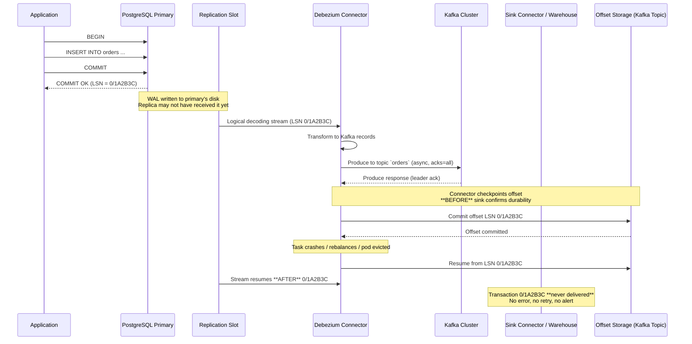

# The Silent CDC Bug: Data Loss With No Errors

## Introduction

Three years ago, our billing pipeline at a mid-sized fintech dropped $2.3M in recognized revenue over a weekend. No alerts fired. No dead-letter queues filled up. The CDC connector reported "healthy" with zero lag. The debt reconciliation job ran successfully every hour. Yet when finance closed the books Monday morning, the numbers didn't match.

The culprit wasn't a crash, a network partition, or a schema migration gone wrong. It was a subtle interaction between PostgreSQL's logical replication protocol, our connector's checkpointing logic, and a transaction that spanned exactly 4.7 seconds during a leader election. The connector acknowledged the LSN (Log Sequence Number) before the transaction was durably written to the downstream Kafka topic. When the task restarted on a new worker, it resumed from that acknowledged LSN—effectively skipping the in-flight transaction entirely.

This is the silent CDC bug: **data loss with zero errors, zero lag metrics, and zero visibility until a downstream consumer complains.** It's not a connector bug per se—it's an architectural invariant violation that emerges when you treat "acknowledged" as "durable" in a distributed system with asynchronous replication.

## Why This Matters

If you run Debezium, Kafka Connect, Fivetran, Airbyte, or any custom CDC pipeline in production, you are almost certainly vulnerable to this class of bug. The industry has normalized "at-least-once" delivery semantics while quietly assuming "effectively exactly-once" for business-critical data. That assumption breaks down at the intersection of three realities:

1. **Source databases acknowledge commits before replicas receive them** (synchronous replication is rare and expensive)
2. **Connectors checkpoint offsets asynchronously** for throughput
3. **Task restarts are routine**—scaling events, config changes, node failures, Kubernetes pod evictions

The financial impact is direct: missed revenue recognition, incorrect inventory counts, broken audit trails. The operational impact is worse: you lose trust in your data platform. Engineers stop using the warehouse for decisions because "the CDC layer is flaky." You end up building shadow reconciliation systems that cost more than the original pipeline.

This article dissects the exact failure mode, shows how to detect it in production, and provides a pattern for making CDC pipelines *verifiably* durable without sacrificing throughput.

## How It Works

The bug lives in the gap between **source acknowledgment** and **sink durability**. Let's trace a single transaction through a typical Debezium → Kafka → S3/warehouse pipeline.



### Step-by-Step Breakdown

1. **Application commits** — PostgreSQL writes to WAL, returns success to client. The LSN is assigned. At this point, the transaction is durable *on the primary only*. Synchronous replicas (if configured) haven't necessarily received it.

2. **Logical decoding emits change** — The replication slot streams the change. Debezium reads it, transforms to Avro/Protobuf, produces to Kafka.

3. **Producer acknowledges** — With `acks=all`, the Kafka leader acknowledges once the ISR (In-Sync Replicas) have the record. **This is not the same as the sink connector having processed it.**

4. **Connector checkpoints offset** — The Kafka Connect framework commits the source offset (LSN) to the offset storage topic. This happens *independently* of the sink task's progress. The source task considers the record "done."

5. **Failure occurs** — Pod OOM, node drain, config update, rebalance. The source task restarts, reads the last committed offset, and asks the replication slot for changes *after* that LSN.

6. **The gap** — If the sink connector hadn't yet persisted the record to the final destination (S3, Snowflake, BigQuery), that record is gone. The source will never re-emit it. The sink will never see it. No dead letter queue captures it because the source never failed.

## Core Concepts

### The Three Durability Boundaries

| Boundary | What "Success" Means | Typical Latency | Failure Mode |
|----------|---------------------|-----------------|--------------|
| **Source Commit** | WAL fsynced on primary | < 1ms | Primary crash before replica catches up |
| **Connector Checkpoint** | Offset written to Kafka offset topic | 10-500ms | Task restart skips uncommitted sink records |
| **Sink Durability** | Record visible in warehouse / object store | 100ms - minutes | Silent data loss if upstream checkpointed |

### LSN vs. Wall Clock Time

PostgreSQL LSNs are **logical** sequence numbers, not timestamps. They monotonically increase but have no fixed relationship to wall-clock time. A transaction at LSN `0/1A2B3C` might have committed 5 seconds ago or 5 milliseconds ago. The connector cannot infer "this transaction is safe to skip" from the LSN alone.

### The Checkpointing Contract

Kafka Connect's `SourceTask` contract:
```java
// Simplified SourceTask API
public interface SourceTask {
    List<SourceRecord> poll();           // Pull changes from source
    void commitOffsets(Map<Partition, Offset> offsets); // Checkpoint
    void commitRecord(SourceRecord record); // Fine-grained (rarely used)
}
```

The framework calls `commitOffsets` periodically (default: every 60 seconds or 5000 records). **There is no callback for "sink has confirmed durability."** The source task is decoupled from the sink task by design—this is what enables horizontal scaling, but it breaks end-to-end durability guarantees.

## Examples & Code Walkthrough

### The Vulnerable Pattern (What You Probably Have)

```python
# vulnerable_cdc.py — Typical Debezium/Kafka Connect source task logic
# THIS LOSES DATA SILENTLY

import json
import logging
from dataclasses import dataclass
from typing import Dict, Optional
from kafka import KafkaProducer, KafkaConsumer
from kafka.structs import TopicPartition

logger = logging.getLogger(__name__)

@dataclass
class CDCRecord:
    lsn: str                    # PostgreSQL LSN (e.g., "0/1A2B3C")
    table: str
    operation: str              # 'c', 'u', 'd', 'r'
    payload: Dict
    timestamp_us: int           # Commit timestamp (microseconds)

class VulnerableCDCSource:
    """
    Standard CDC source task: polls replication slot, produces to Kafka,
    checkpoints offset periodically. NO coordination with sink.
    """
    
    def __init__(
        self,
        slot_name: str,
        kafka_bootstrap: str,
        offset_topic: str,
        checkpoint_interval_ms: int = 60_000,
        checkpoint_record_count: int = 5000,
    ):
        self.slot_name = slot_name
        self.producer = KafkaProducer(
            bootstrap_servers=kafka_bootstrap,
            acks='all',                    # Wait for ISR ack
            enable_idempotence=True,       # Exactly-once producer
            max_in_flight_requests_per_connection=5,
            value_serializer=lambda v: json.dumps(v).encode(),
            key_serializer=lambda k: k.encode() if k else None,
        )
        self.offset_consumer = KafkaConsumer(
            offset_topic,
            bootstrap_servers=kafka_bootstrap,
            group_id=f'cdc-offset-{slot_name}',
            auto_offset_reset='earliest',
            enable_auto_commit=False,
        )
        self.checkpoint_interval_ms = checkpoint_interval_ms
        self.checkpoint_record_count = checkpoint_record_count
        
        # In-memory state (lost on restart)
        self._pending_records = 0
        self._last_checkpoint_ms = 0
        self._current_lsn: Optional[str] = None
        
        # Load last committed offset
        self._load_offset()
    
    def _load_offset(self) -> None:
        """Restore LSN from offset storage topic."""
        partitions = self.offset_consumer.assignment()
        if not partitions:
            return
        self.offset_consumer.seek_to_end(*partitions)
        end_offsets = self.offset_consumer.end_offsets(partitions)
        for tp, end_offset in end_offsets.items():
            if end_offset > 0:
                self.offset_consumer.seek(tp, end_offset - 1)
                records = self.offset_consumer.poll(timeout_ms=1000)
                for batch in records.values():
                    for record in batch:
                        self._current_lsn = record.value.get('lsn')
                        logger.info(f"Resumed from LSN {self._current_lsn}")
    
    def _save_offset(self, lsn: str) -> None:
        """Checkpoint LSN to offset storage. ASYNC - no sink coordination."""
        future = self.producer.send(
            '__cdc_offsets',
            key=self.slot_name,
            value={'lsn': lsn, 'timestamp': time.time()},
        )
        # Fire-and-forget! No wait for sink durability.
        future.add_callback(lambda _: logger.debug(f"Offset {lsn} checkpointed"))
        future.add_exception_handler(lambda e: logger.error(f"Offset commit failed: {e}"))
        self._current_lsn = lsn
    
    def poll_changes(self) -> list[CDCRecord]:
        """
        Simulated logical decoding poll. In reality this uses pgoutput
        or wal2json via a PostgreSQL connection.
        """
        # ... fetch changes from replication slot after self._current_lsn ...
        # Returns list of CDCRecord with monotonically increasing LSNs
        pass
    
    def run(self) -> None:
        """Main loop - THIS IS WHERE DATA LOSS HAPPENS."""
        while True:
            records = self.poll_changes()
            if not records:
                time.sleep(0.1)
                continue
            
            for record in records:
                # Produce to Kafka topic (e.g., 'postgres.public.orders')
                topic = f"postgres.public.{record.table}"
                future = self.producer.send(
                    topic,
                    key=record.payload.get('id'),
                    value={
                        'lsn': record.lsn,
                        'op': record.operation,
                        'data': record.payload,
                        'ts_us': record.timestamp_us,
                    },
                )
                # We do NOT wait for future.get() here - that kills throughput
                # We rely on producer callbacks for error handling
                future.add_exception_handler(
                    lambda e, r=record: logger.error(f"Produce failed for LSN {r.lsn}: {e}")
                )
            
            self._pending_records += len(records)
            self._current_lsn = records[-1].lsn
            
            # CHECKPOINT TRIGGER: time OR count based
            now = time.time() * 1000
            should_checkpoint = (
                self._pending_records >= self.checkpoint_record_count or
                now - self._last_checkpoint_ms >= self.checkpoint_interval_ms
            )
            
            if should_checkpoint:
                # CRITICAL BUG: Checkpointing BEFORE sink confirms durability
                self._save_offset(self._current_lsn)
                self._pending_records = 0
                self._last_checkpoint_ms = now
            
            # Poll producer callbacks
            self.producer.poll(0)
```

**Why this loses data:** The `_save_offset` call persists the LSN to Kafka *before* the sink connector (Kafka → S3, Kafka → Snowflake, etc.) has processed those records. If the process crashes after `_save_offset` but before the sink flushes, the records between the old offset and new offset are never delivered.

### The Fix: Durability-Aware Checkpointing

The solution requires **explicit coordination between source and sink**. We introduce a "durability horizon" — the highest LSN that the sink has confirmed as durably written. The source only checkpoints up to that horizon.

```python
# durable_cdc.py — Silent-bug-resistant CDC source with sink coordination

import json
import time
import threading
import logging
from dataclasses import dataclass, field
from typing import Dict, Optional, Set
from collections import defaultdict
from kafka import KafkaProducer, KafkaConsumer
from kafka.structs import TopicPartition
from kafka.errors import KafkaError

logger = logging.getLogger(__name__)

@dataclass
class DurabilityAck:
    """Acknowledgment from sink that a batch is durably persisted."""
    lsn: str                    # Highest LSN in the batch
    sink_partition: int         # Sink task partition that processed it
    timestamp_ms: int           # When sink confirmed durability
    batch_id: str               # Unique batch identifier for deduplication

@dataclass 
class InFlightBatch:
    """Tracks a batch of records from source production to sink durability."""
    lsn_start: str
    lsn_end: str
    record_count: int
    produced_at_ms: int
    sink_acks: Set[int] = field(default_factory=set)  # Which sink partitions acked
    is_durable: bool = False

class DurableCDCSource:
    """
    CDC source that only checkpoints offsets AFTER sink confirms durability.
    
    Key invariants:
    1. Offset checkpoint LSN <= Durability Horizon LSN (always)
    2. In-flight batches tracked until all sink partitions acknowledge
    3. Rebalance-safe: durability horizon persisted to Kafka
    """
    
    def __init__(
        self,
        slot_name: str,
        kafka_bootstrap: str,
        source_topic_prefix: str,      # e.g., "postgres.public"
        sink_topic: str,               # e.g., "cdc.sink.acks" - where sink publishes acks
        offset_topic: str,             # e.g., "__cdc_offsets"
        num_sink_partitions: int,      # Must match sink connector parallelism
        max_in_flight_batches: int = 100,
        checkpoint_interval_ms: int = 30_000,
    ):
        self.slot_name = slot_name
        self.source_topic_prefix = source_topic_prefix
        self.num_sink_partitions = num_sink_partitions
        self.max_in_flight = max_in_flight_batches
        
        # Producer for source records AND offset checkpoints
        self.producer = KafkaProducer(
            bootstrap_servers=kafka_bootstrap,
            acks='all',
            enable_idempotence=True,
            transactional_id=f'cdc-source-{slot_name}',  # Exactly-once transactions
            max_in_flight_requests_per_connection=5,
            value_serializer=lambda v: json.dumps(v, default=str).encode(),
            key_serializer=lambda k: k.encode() if k else None,
        )
        self.producer.init_transactions()
        
        # Consumer for sink durability acknowledgments
        self.ack_consumer = KafkaConsumer(
            sink_topic,
            bootstrap_servers=kafka_bootstrap,
            group_id=f'cdc-source-ack-{slot_name}',
            auto_offset_reset='latest',  # Only care about new acks
            enable_auto_commit=True,
            value_deserializer=lambda m: json.loads(m.decode()),
            key_deserializer=lambda k: k.decode() if k else None,
        )
        
        # Consumer for offset restoration
        self.offset_consumer = KafkaConsumer(
            offset_topic,
            bootstrap_servers=kafka_bootstrap,
            group_id=f'cdc-offset-restore-{slot_name}',
            auto_offset_reset='earliest',
            enable_auto_commit=False,
        )
        
        # State
        self._current_lsn: Optional[str] = None
        self._durability_horizon: Optional[str] = None  # Highest LSN sink confirmed
        self._in_flight: Dict[str, InFlightBatch] = {}  # batch_id -> batch
        self._batch_counter = 0
        self._last_checkpoint_ms = 0
        self._checkpoint_interval_ms = checkpoint_interval_ms
        self._lock = threading.RLock()
        
        # Background thread to process sink acks
        self._ack_thread = threading.Thread(target=self._process_acks, daemon=True)
        self._ack_thread.start()
