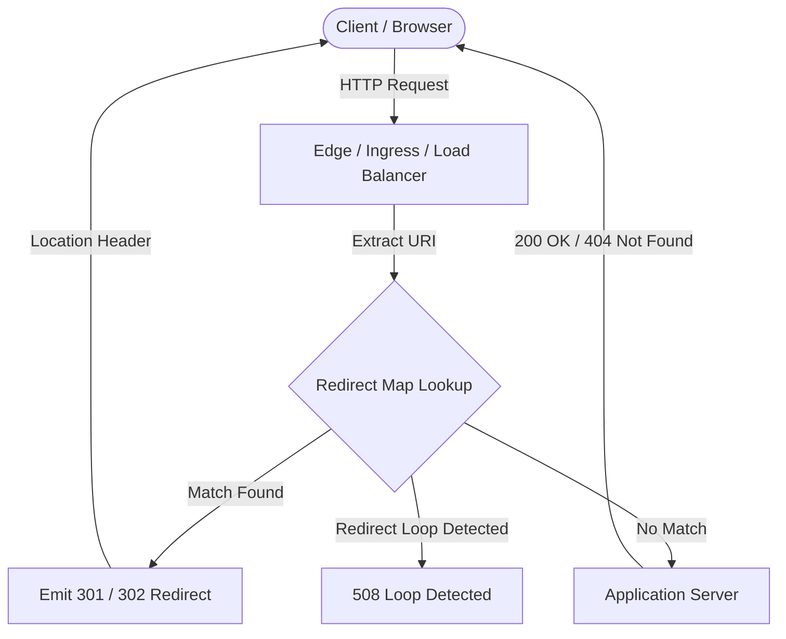

# A Website Redesign Is a URL Migration: Build the Redirect Map Before Launch

## Introduction

A redesign is not a visual refresh. It is a URL migration. When your team ships new information architecture, changes slug patterns, or collapses nested sections into flat landing pages, every old address stops resolving. Bookmarks break. Search engine indexes point to ghosts. Internal links return 404s. If you treat the redirect map as an afterthought, you are not launching a new site—you are launching a traffic incident.

This article treats the redirect map as production infrastructure. We will cover how to model it, validate it, compile it into server configuration, and operate it after cutover. The goal is zero unplanned 404s on launch day.

## Why This Matters

Engineers often frame a redesign as a frontend delivery: new components, updated styles, a refreshed component library. From an operations perspective, that framing is dangerous. URLs are part of your public API. External sites link to them. Search engines have spent months or years assigning ranking signals to them. Customers have them saved in browsers and notes apps.

When those addresses disappear without a redirect, you incur several production costs:

- **Search ranking decay.** Search engines interpret persistent 404s as page removal. Over time, your pages drop out of results, and the replacement pages must re-earn authority from scratch.
- **Support ticket spikes.** Customers land on error pages and open tickets asking where content went.
- **Analytics blind spots.** Campaign URLs and UTM-tagged links stop converting because the destination no longer exists.
- **Wasted crawl budget.** Crawlers hit dead ends instead of your new canonical pages, delaying indexation of the redesign.

A redirect map is the mechanism that preserves equity during the transition. It belongs in version control, in CI/CD, and in your pre-launch checklist—not in a spreadsheet someone emails to the deployer an hour before cutover.

## How It Works

The redirect map is a source-of-truth file that maps every deprecated URL to its replacement. At runtime, an edge node, ingress controller, or application middleware inspects the incoming request path, consults the map, and returns a `301 Moved Permanently` or `302 Found` response with a `Location` header pointing to the new address.

The pipeline looks like this:

Here is the operational flow:

1. **Author the map.** Product and engineering agree on old-to-new path mappings in a CSV or YAML file.
2. **Validate the map.** CI runs a linter that checks for duplicate sources, invalid status codes, and redirect chains (A → B → C).
3. **Compile to server config.** A build step emits Nginx `map` directives, Cloudflare Bulk Redirects rows, or application-side lookup tables.
4. **Deploy alongside the application.** The redirect configuration ships in the same release train as the new frontend, so old paths are handled from the first request.
