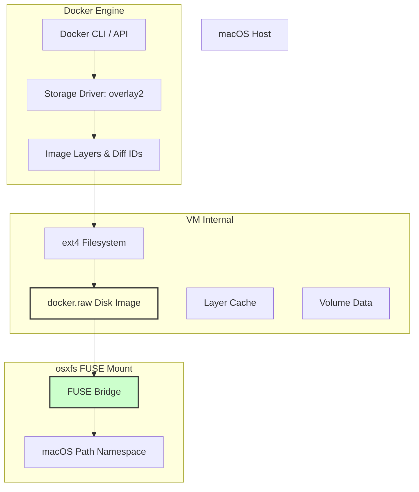

# Docker.raw: Why Is My Mac Out of Space When Docker Is Empty?

## Introduction

If you’ve ever checked the Docker Desktop interface on a fresh Mac and seen “0 containers, 0 images” only to find your disk usage unchanged—or worse, growing—you’re not alone. This disconnect between the UI and actual filesystem consumption is a classic Docker Desktop for Mac quirk, rooted in how storage is abstracted, cached, and persisted behind the scenes. The culprit is rarely the containers themselves; it’s the underlying storage stack: overlay2, the osxfs FUSE mount, and the `docker.raw` disk image that houses every layer, volume, and build cache entry.

I first encountered this during a CI runner debugging session where a 120 GB MacBook Pro partition filled up in under an hour despite running only two tiny service containers. The Docker UI showed nothing to prune. The `docker system df` output was misleading, and `du` pointed to a single 80 GB file nested deep in `~/Library/Containers/com.docker.docker/Data/`. That file is the raw disk image Docker Desktop uses to emulate a Linux filesystem on macOS. Understanding its structure and what feeds its growth is the difference between a dev environment that scales and one that silently sabotages your workflow.

This article walks through the architectural mechanism, provides a production‑grade diagnostic/cleanup script, and outlines field‑tested practices to keep Docker storage under control without sacrificing developer velocity.

## Why This Matters

In production‑first organizations, developer machine health directly impacts delivery velocity. A swollen Docker storage footprint doesn’t just eat disk space; it slows down `docker pull`, `docker build`, and container startup because the FUSE mount has to traverse more directory entries, and the virtual disk image incurs more seek overhead. In CI/CD pipelines, a full disk causes builds to fail mid‑step, corrupt layer caches, or trigger OOM kills on resource‑constrained runners.

From an architectural standpoint, the problem is a mismatch between the expectations of a Linux‑native storage model and the macOS host. Docker Desktop solves this by running a tiny MobyVM with an ext4 filesystem stored as a single `.raw` disk image. All container layers, volumes, and build caches live inside that image. When you remove a container, the underlying layers may remain marked as “unused” but still occupy space within the image, especially if the garbage collection hooks don’t run frequently or if the image is resized dynamically without shrinking. The result is a persistent, often invisible, consumption pattern that only reveals itself when `df -h` shows a nearly full disk and `docker system df` shows surprisingly low numbers.

For engineering teams managing fleets of developer workstations, this anti‑pattern leads to inconsistent environments, “it works on my machine” failures that are actually “it works on 20 GB of free space,” and unnecessary hardware refresh cycles. Diagnosing and mitigating the root cause is a high‑leverage operational improvement.

## How It Works

Docker Desktop for Mac doesn’t use Linux’s native `overlay2` on the host filesystem. Instead, it bundles a minimal virtual machine image that provides a Linux‑compatible kernel and filesystem. The host macOS interacts with this VM through a FUSE (Filesystem in Userspace) layer called `osxfs`. The flow is:

1. **Docker Engine** issues storage requests via the standard Docker API.
2. **Storage Driver** (typically `overlay2` configured for the VM) prepares diff directories and upper/lower layers.
3. **osxfs** translates these Linux‑style path operations into macOS filesystem calls, exposing the VM’s ext4 filesystem through a macOS mount point.
4. The VM’s root filesystem is a single `docker.raw` disk image (QCOW2 or raw format) stored under `~/Library/Containers/com.docker.docker/Data/v2/store/`.
5. **macOS** reports the total size of that disk image as “Used Storage,” regardless of how many containers have been stopped or removed.

The following Mermaid flowchart visualizes this storage pipeline, highlighting where space is allocated and where it can become stale.



**Step‑by‑step breakdown:**

- **Container creation** writes a new diff directory under the overlay2 store inside the VM. The `docker.raw` image grows as new layers are added.
- **Container removal** marks the diff as “deleted” in the overlay2 database, but the actual file blocks inside `docker.raw` are not reclaimed immediately. The filesystem retains them until the image is compacted or pruned.
- **Build cache** adds another layer hierarchy. Each `RUN`, `COPY`, or `ADD` in a Dockerfile creates an immutable layer. Even if a service is deleted, its build image may persist if untagged images aren’t pruned.
- **Volume mounts** bind-host paths or named Docker volumes. Named volumes are stored as directories inside the VM’s filesystem; bind mounts reflect host directory sizes. Both contribute to the `docker.raw` footprint.
- **Pruning** (`docker system prune`, `docker volume prune`) triggers the engine to delete referenced objects, but the raw image size shrinks only after compaction, which Docker Desktop performs lazily or on explicit request.

The key takeaway: the `docker.raw` file is a cap‑sized container for everything Docker manages inside the VM. Its size is not a real‑time reflection of running workloads but of ever‑accumulated state.

## Core Concepts

- **overlay2**: The storage driver responsible for union mounting diff directories. In the Docker Desktop VM, it operates inside the ext4 image, not on the host.
- **osxfs**: The FUSE-based bridge that makes the VM’s filesystem appear as macOS directories. It introduces latency and metadata overhead, especially with deep directory trees.
- **docker.raw**: A disk image file (often QCOW2‑compatible) that encapsulates the entire VM filesystem. Its size is the primary metric for “Docker storage usage” reported by macOS.
- **Layer caching**: Immutable filesystem layers built during `docker build`. They are shared across images but persist until explicitly removed.
- **Named vs bind volumes**: Named volumes are managed by Docker inside the VM; bind mounts are direct host paths. Both consume space within the raw image for named volumes, but bind mounts reflect host disk usage.
- **Garbage collection**: Docker’s internal cleanup of unused images, containers, and volumes. On macOS, this does not automatically shrink `docker.raw`; an explicit compaction step is required.

## Examples & Code Walkthrough

The following script is a production‑grade Python utility that diagnoses Docker storage consumption on macOS, identifies the largest contributors, and performs safe cleanup with confirmation prompts. It uses the `docker` SDK (`docker-py`), validates the environment, and includes defensive error handling and inline comments explaining each logical block.

```python
#!/usr/bin/env python3
"""
Docker.storage_diagnostics.py

A diagnostic and cleanup tool for Docker Desktop on macOS.
Inspects the raw disk image footprint, breaks down usage by
images, containers, volumes, and build cache, and prunes
unused resources after user confirmation.

WARNING: Run only on Docker Desktop for Mac. Pruning actions
are
