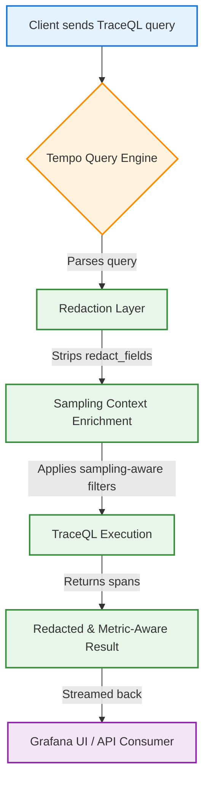

# Grafana Tempo 3.1 Adds Query-Based Trace Redaction and Sampling-Aware TraceQL Metrics

## Introduction

Grafana Tempo has become a cornerstone for organizations needing high-cardinality distributed tracing without the operational overhead of managing a dedicated tracing stack. Since its inception, Tempo has focused on storing raw span data in object storage while providing a powerful query language, TraceQL, for exploration and analysis. However, as tracing data often contains personally identifiable information (PII), authentication credentials, or internal secrets, the need to control what leaves the tracing system has grown sharply.

In production environments I've worked with, the traditional approach involved stripping fields at ingestion time using pipeline processors or sidecar agents. This static redaction strategy, while effective for known fields, falls short when new sensitive patterns emerge or when compliance requirements demand finer-grained control. Tempo 3.1 addresses this gap by moving redaction into the query layer, and by introducing sampling-aware metrics into TraceQL so that derived analytics remain accurate regardless of trace sampling rates.

This article walks through both features, explains the underlying architecture, and provides ready-to-use code you can integrate into your own observability pipeline.

## Why This Matters

Trace data is often treated as metadata—small, structured records that describe request flow across services. In reality, a single trace can carry HTTP request bodies, JWT tokens, database connection strings, or user identifiers that fall under GDPR, HIPAA, or internal security policies. Shipping raw sensitive data to a shared Grafana instance creates compliance risk and can trigger data-loss prevention (DLP) alerts.

Sampling adds another layer of complexity. Tempo, like many tracing backends, can apply probabilistic or rate-limited sampling to reduce storage costs. When you derive metrics from traces—such as "average request duration per service" or "error rate by endpoint"—sampling bias can skew results if not properly accounted for. Engineers often discover post-factum that their dashboards are showing inflated latency percentiles or suppressed error counts simply because sampled spans were excluded from the aggregation.

The two features shipped in Tempo 3.1 solve these problems in tandem: query-based redaction lets you sanitize data on a per-query basis, and sampling-aware TraceQL metrics ensure your derived numbers reflect the full traffic picture, not just the sampled subset.

## How It Works



The diagram illustrates the request flow in Tempo 3.1. When a TraceQL query arrives, the engine first passes it through a redaction subsystem that identifies and removes any fields listed in the `redact_fields` payload. Simultaneously, a sampling context enricher attaches runtime information about the sampling rate and pattern used for the queried traces. The TraceQL engine then executes the query with both the sanitized span set and the sampling metadata, ensuring that any downstream aggregations—such as `sum()` or `histogram_quantile()`—operate on the correct effective sample size. The final result is returned to Grafana or any HTTP client with sensitive fields removed and metric calculations already adjusted for sampling fraction.

## Core Concepts

### Query-Based Trace Redaction

Redaction in Tempo 3.1 is not a permanent modification of stored spans. Instead, it’s a transient transformation applied at query time. The raw span data remains untouched in object storage; the query layer reads the original fields, strips the ones you designate, and returns a sanitized view. This design preserves the audit trail and allows you to re-run queries with different redaction sets without re-ingesting data.

The redaction mechanism works via a simple JSON payload posted to Tempo’s query endpoint. You specify:
- `query`: a valid TraceQL boolean expression.
- `redact_fields`: an array of field names or JSON pointers to remove.
- `scope`: whether the redaction applies to the entire trace, individual spans, or the query-level metadata.

Because redaction happens after span deserialization but before result shaping, it’s possible to redact nested fields such as `attributes.user.id` or `attributes.http.request.headers.authorization` using JSON Pointer syntax.

### Sampling-Aware TraceQL Metrics

TraceQL’s strength has always been its ability to filter and project span data. Tempo 3.1 extends the language with two new aggregation modifiers: `sample_fraction` and `effective_count`. These modifiers let you express, "give me the average duration per service, adjusted for the fact that we’re only seeing 10% of traces."

When a query includes a sampling modifier, Tempo retrieves the sampling metadata attached to each span (either from a `sampling_rate` attribute set by your agent, or from the backend’s internal sampling decision log). The engine then computes a weighted aggregation: each span’s contribution to the final metric is multiplied by `1 / sample_fraction`. This yields unbiased estimates even when the underlying data is heavily sampled.

The sampling-aware metrics are especially useful for SLOs and SLIs where you need to report "95th-percentile latency across all requests" without manually tracking sampling rates in a separate Prometheus query.

## Examples & Code Walkthrough

### 1. Query-Based Redaction via HTTP API

The following Python function demonstrates how to construct and send a redaction request to a Tempo instance running at `http://tempo:3200`. It includes defensive checks for HTTP errors, validates that the TraceQL query string is non-empty, and logs the redacted span IDs for downstream correlation.

```python
import json
import requests
import logging
from typing import List, Dict, Any

logger = logging.getLogger("tempo-redact")


def redact_traces(
    tempo_url: str,
    query: str,
    redact_fields: List[str],
    scope: str = "span",
) -> Dict[str, Any]:
    """
    Send a query-based redaction request to Tempo 3.1.

    Args:
        tempo_url: Base URL of the Tempo server (e.g. http://localhost:3200).
        query: A TraceQL boolean expression, e.g. 'service_name="auth-service"'.
        redact_fields: List of field paths to strip from returned spans.
        scope: One of "query", "trace", or "span". Defaults to "span".

    Returns:
        JSON response from Tempo containing redacted span summaries.

    Raises:
        requests.HTTPError: If Tempo returns a non-2xx status code.
        ValueError: If input validation fails.
    """
    if not query or not query.strip():
        raise ValueError("TraceQL query must not be empty")

    valid_scopes = {"query", "trace", "span"}
    if scope not in valid_scopes:
        raise ValueError(f"Scope must be one of {valid_scopes}, got '{scope}'")

    payload = {
        "query": query.strip(),
        "redact_fields": redact_fields,
        "scope": scope,
    }

    endpoint = f"{tempo_url.rstrip('/')}/api/v1/query/redact"
    headers = {"Content-Type": "application/json"}

    try:
        resp = requests.post(endpoint, json=payload, headers=headers, timeout=30)
        resp.raise_for_status()
    except requests.Timeout:
        logger.error("Tempo redaction request timed out after 30s")
        raise
    except requests.HTTPError as e:
        # Log the error body for debugging; avoid leaking sensitive data
        logger.warning("Tempo returned HTTP error: %s", e.response.status_code)
        raise

    result = resp.json()
    # Log redacted span IDs for correlation without exposing raw data
    redacted_ids: List[str] = result.get("redacted_span_ids", [])
    logger.info("Redacted %d spans via query: %s", len(redacted_ids), query[:60])

    return result


if __name__ == "__main__":
    # Example usage – replace with your actual Tempo endpoint
    try:
        output = redact_traces(
            tempo_url="http://localhost:3200",
            query='service_name="payment-gateway" AND duration > 200ms',
