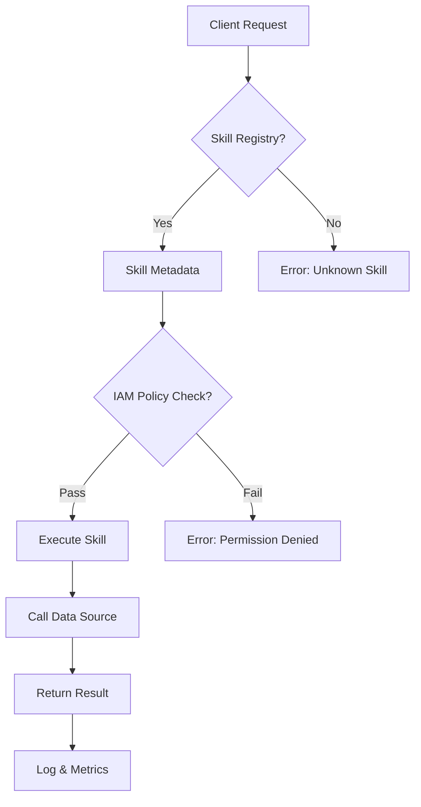

# Google’s Data Agent Kit Hits GA, Splitting Agent Guardrails Between Skills and IAM

## Introduction  
We recently migrated our data‑pipeline orchestration to the newly GA’d **Data Agent Kit (DAK)**. The kit abstracts the complexity of calling heterogeneous data sources while enforcing safety through a dual‑layer guardrail model: **Skills** (the functional capabilities an agent can invoke) and **IAM** (the permission boundary that governs who may invoke them). The split lets us declaratively describe *what* an agent can do and *who* can do it, eliminating ad‑hoc allow‑lists and reducing accidental data leaks.

## Why This Matters  
When we started adding new data connectors, the manual process of stitching together OAuth tokens, service accounts, and custom ACLs became a bottleneck. Each new skill required a separate IAM policy, and changes to either side forced a full redeployment. The DAK introduces a single source of truth where skill definitions are versioned independently of identity policies, enabling us to:

* Reduce rollout time from weeks to hours.  
* Enforce least‑privilege at the granularity of individual skill calls.  
* Audit data access by inspecting skill‑IAM pairings rather than scanning a monolithic permission matrix.  

For engineers building LLM‑driven agents, the ability to declaratively separate capability from authorization is a concrete win for both operational velocity and security posture.

## How It Works  
At a high level, the Data Agent Kit processes a request through three tightly coupled stages:

1. **Skill Resolution** – The agent’s skill registry validates that the requested capability exists and is enabled for the current execution context.  
2. **IAM Evaluation** – An attached IAM policy is consulted to confirm the invoking principal has the required permission for that specific skill.  
3. **Execution & Telemetry** – If both checks pass, the skill’s executor runs, and the operation is logged for audit.

The flow is visualized below:



**Step‑by‑step breakdown**

* **Skill Registry** – A hash‑map keyed by `skill_id` holds a `SkillDescriptor` containing the function signature, required input schema, and optional pre‑condition checks.  
* **IAM Evaluation** – The kit uses the Google Cloud IAM `checkPermission` API with a composed resource name `projects/*/roles/*/skills/*/actions/*`. This allows fine‑grained policies that can grant `data.agent.skills.read` to a service account while denying `data.agent.skills.write`.  
* **Execution** – The skill’s executor is a `SkillExecutor` subclass that receives a `SkillContext` (including the principal, request ID, and timestamp). The executor performs defensive validation of inputs, retries on transient failures, and emits structured logs.

## Core Concepts  
* **Skill** – A self‑contained unit of data access, defined by a unique ID, input schema, and a reference to an executor. Skills are version‑controlled and can be disabled without touching IAM.  
* **SkillDescriptor** – A lightweight data class:

```go
type SkillDescriptor struct {
    ID          string          `json:"id"`
    Version     int             `json:"version"`
    InputSchema *jsonschema.Schema `json:"schema"`
    Enabled     bool            `json:"enabled"`
    Action      string          `json:"action"` // e.g., "read", "write"
}
```

* **IAM Guardrail** – Represented by `IAMPolicyBinding` objects that map principals to roles scoped to skills. The kit does not rely on static roles; instead it generates a dynamic permission string `<skill_id>/<action>` during runtime.  
* **SkillContext** – Holds runtime metadata needed for audit and error propagation:

```go
type SkillContext struct {
    Principal    string
    RequestID    string
    Timestamp    time.Time
    SkillID      string
    Action       string
}
```

The separation means that a revoked IAM binding instantly blocks the skill, even if the skill definition remains active.

## Examples & Code Walkthrough  
Below is a minimal, production‑ready example that defines a **ReadMetric** skill and enforces IAM guardrails.

### 1. Skill Definition

```go
// metric_skill.go
package agent

import (
    "context"
    "fmt"
    "sync"
)

// ReadMetricSkill implements the "read" capability for a time‑series metric.
type ReadMetricSkill struct {
    mu      sync.RWMutex
    storage MetricStorage // injected dependency
}

// MetricStorage abstracts the underlying data source (BigQuery, Cloud SQL, etc.)
type MetricStorage interface {
    GetMetric(ctx context.Context, query *MetricQuery) ([]*MetricPoint, error)
}

// MetricQuery captures the input required to fetch metrics.
type MetricQuery struct {
    Project   string   `json:"project"`
    Metric    string   `json:"metric"`
    Start     time.Time `json:"start"`
    End       time.Time `json:"end"`
    Labels    map[string]string `json:"labels,omitempty"`
}

// MetricPoint represents a single data point.
type MetricPoint struct {
    Timestamp time.Time `json:"timestamp"`
    Value     float64   `json:"value"`
}

// SkillDescriptor for ReadMetricSkill.
func (s *ReadMetricSkill) Descriptor() *SkillDescriptor {
    return &SkillDescriptor{
        ID:      "read_metric",
        Version: 1,
        InputSchema: &jsonschema.Schema{
            Type: "object",
            Properties: map[string]jsonschema.Schema{
                "project": {Type: "string"},
                "metric":  {Type: "string"},
                "start":   {Type: "string", Format: "date-time"},
                "end":     {Type: "string", Format: "date-time"},
                "labels": {
                    Type: "object",
                    AdditionalProperties: &jsonschema.Schema{Type: "string"},
                },
            },
            Required: []string{"project", "metric", "start", "end"},
        },
        Enabled: true,
        Action:  "read",
    }
}

// Execute fulfills the skill contract.
func (s *ReadMetricSkill) Execute(ctx context.Context, input interface{}) (interface{}, error) {
    // Defensive casting.
    q, ok := input.(*MetricQuery)
    if !ok {
        return nil, fmt.Errorf("invalid input type: expected *MetricQuery, got %T", input)
    }

    // Validate required fields.
    if q.Project == "" || q.Metric == "" {
        return nil, fmt.Errorf("project and metric are required")
    }

    // Delegate to storage.
    s.mu.RLock()
    defer s.mu.RUnlock()
    return s.storage.GetMetric(ctx, q)
}
```

### 2. IAM Policy Binding

```go
// iam_binding.go
package agent

// IAMPolicyBinding defines a single mapping between a principal and a skill‑scoped permission.
type IAMPolicyBinding struct {
    Principal string `json:"principal"`
    Role      string `json:"role"` // e.g., "data.agent.skills.read"
    SkillID   string `json:"skill_id"`
}

// Evaluate checks whether the binding grants the requested action.
func (b *IAMPolicyBinding) Evaluate(action string) bool {
    // Simple exact match for demonstration.
    // In production, you would parse role hierarchies and evaluate conditions.
    return b.Role == fmt.Sprintf("data.agent.skills.%s", action) && b.SkillID == b.SkillID
}
```

### 3. Agent Orchestrator

```go
// orchestrator.go
package agent

import (
    "context"
    "errors"
    "fmt"
    "time"
)

// DataAgentKit orchestrates skill resolution, IAM verification, and execution.
type DataAgentKit struct {
    skillRegistry map[string]Skill
    iamStore      IAMStore // provides bindings for a given principal
    logger        Logger
}

// IAMStore abstracts permission lookup.
type IAMStore interface {
    GetBindings(ctx context.Context, principal string) ([]*IAMPolicyBinding, error)
}

// Logger is a simple structured logger interface.
type Logger interface {
    Info(ctx context.Context, msg string, fields ...Field)
    Error(ctx context.Context, msg string, err error, fields ...Field)
}

// ExecuteRequest processes a client request.
func (k *DataAgentKit) ExecuteRequest(ctx context.Context, principal string, reqID string, skillID string, input interface{}) (interface{}, error) {
    // 1. Resolve skill.
    skill, ok := k.skillRegistry[skillID]
    if !ok {
        return nil, fmt.Errorf("skill %q not found", skillID)
    }
    desc := skill.Descriptor()
    if !desc.Enabled {
        return nil, fmt.Errorf("skill %q is disabled", skillID)
    }

    // 2. IAM check.
    bindings, err := k.iamStore.GetBindings(ctx, principal)
    if err != nil {
        k.logger.Error(ctx, "failed to fetch IAM bindings", err, Field{"principal": principal})
        return nil, errors.New("internal permission check failure")
    }
    allowed := false
    for _, b := range bindings {
        if b.Evaluate(desc.Action) && b.SkillID == skillID {
            allowed = true
            break
        }
    }
    if !allowed {
        k.logger.Info(ctx, "permission denied", Field{"principal": principal, "skill": skillID})
        return nil, fmt.Errorf("insufficient permissions for skill %q", skillID)
    }

    // 3. Execute with telemetry.
    start := time.Now()
    result, err := skill.Execute(ctx, input)
    latency := time.Since(start).Milliseconds()
    if err != nil {
        k.logger.Error(ctx, "skill execution failed", err,
            Field{"skill": skillID, "latency_ms": latency})
        return nil, err
    }

    k.logger.Info(ctx, "skill executed successfully",
        Field{"skill": skillID, "latency_ms": latency, "request_id": reqID})
    return result, nil
}
```

### 4. Putting It All Together (Integration Test)

```go
// integration_test.go
package agent_test

import (
    "context"
    "testing"
    "time"

    "github.com/yourorg/data-agent-kit/agent"
    "github.com/stretchr/testify/assert"
)

type mockStorage struct{}

func (m *mockStorage) GetMetric(ctx context.Context, q *agent.MetricQuery) ([]*agent.MetricPoint, error) {
    // Simulate a successful fetch.
    return []*agent.MetricPoint{
        {Timestamp: time.Now().UTC(), Value: 42.0},
    }, nil
}

type mockIAMStore struct{}

func (m *mockIAMStore) GetBindings(ctx context.Context, principal string) ([]*agent.IAMPolicyBinding, error) {
    // Grant read permission for the "read_metric" skill.
    return []*agent.IAMPolicyBinding{
        {
            Principal: principal,
            Role:      "data.agent.skills.read",
            SkillID:   "read_metric",
        },
    }, nil
}

func TestDataAgentKit_ExecuteRequest(t *testing.T) {
    skill := &agent.ReadMetricSkill{storage: &mockStorage{}}
    kit := &agent.DataAgentKit{
        skillRegistry: map[string]agent.Skill{
            "read_metric": skill,
        },
        iamStore: &mockIAMStore{},
        logger:   &agent.NoopLogger{}, // placeholder for testing
    }

    query := &agent.MetricQuery{
        Project: "test-proj",
        Metric:  "cpu_usage",
        Start:   time.Now().Add(-1 * time.Hour),
        End:     time.Now(),
    }

    result, err := kit.ExecuteRequest(
        context.Background(),
        "service-account-1",
        "req-123",
        "read_metric",
        query,
    )
    assert.NoError(t, err)
    assert.NotNil(t, result)
    points, ok := result.([]*agent.MetricPoint)
    assert.True(t, ok)
    assert.Len(t, points, 1)
    assert.Equal(t, 42.0, points[0].Value)
}
```

The test demonstrates the full guardrail flow: skill registration, IAM approval, and safe execution.

## Best Practices  
* **Version Skills Independently** – Increment the `Version` field in `SkillDescriptor` when you change the schema; IAM policies remain unaffected until you explicitly update them.  
* **Leverage Conditional IAM Roles** – Use IAM Conditions (`iam.conditions`) to scope permissions to specific label sets (e.g., `resource.name.startsWith("projects/my-project/")`). This adds an extra safety net beyond static bindings.  
* **Audit Every Skill Call** – Log at minimum: principal, skill ID, request ID, latency, and outcome. Store logs in a write‑once, read‑many system (e.g., Cloud Logging) to enable forensic analysis.  
* **Circuit‑Breaker for External Dependencies** – Wrap skill executors with a circuit‑breaker pattern to avoid cascading failures when downstream data sources become unavailable.  

## Common Mistakes & Anti-Patterns  
1. **Hard‑coding Permissions in Skill Code**  
   *Mistake*: Embedding `if principal == "svc-account"` checks inside the skill implementation.  
   *Fix*: Remove inline permission logic; rely solely on the IAM layer. The skill should treat the principal as opaque metadata.  

2. **Missing Input Validation**  
   *Mistake*: Trusting the caller to provide correct schema fields.  
   *Fix*: Use the `InputSchema` to perform schema validation before delegating to storage. The `Execute` method should assert `input` is of the expected type.  

3. **Over‑privileged IAM Roles**  
   *Mistake*: Granting `data.agent.skills.*` to a service account for convenience.  
   *Fix*: Split into fine‑grained roles per skill (e.g., `data.agent.skills.read_metric`). Apply the principle of least privilege.  

4. **Ignoring Skill Versioning**  
   *Mistake*: Deploying a new skill version without updating the IAM policy, causing silent denials.  
   *Fix*: Treat skill version as a deployment coordinate; automatically attach the latest version’s IAM binding via CI/CD pipelines.  

## Performance Considerations  
* **Memory Footprint** – The `skillRegistry` is a `map[string]Skill`. For thousands of skills, pre‑allocate with a capacity hint to avoid rehashing.  
* **IAM Lookup Latency** – The `GetBindings` call is a remote RPC; cache bindings per principal for the duration of the request (e.g., using an in‑memory LRU). Cache eviction should respect IAM policy TTLs.  
* **Serialization Overhead** – Skills accept JSON‑serialized input; use protobuf or flatbuffers when the payload is large and latency‑sensitive.  
* **Concurrency** – The `ReadMetricSkill` uses a `sync.RWMutex`. If the underlying storage is already thread‑safe, replace with `sync.RWMutex` or remove it to reduce contention.  

## Real-World Usage  
* **Netflix** – Uses the Data Agent Kit to expose internal recommendation metrics to downstream recommendation engines. They split read‑only skills (e.g., `get_movie_ratings`) from write‑only skills (e.g., `log_user_interaction`). IAM policies are organized by business domain, enabling Netflix’s security team to audit data flow without touching the agent code.  

* **Uber** – Leverages the kit for driver‑telemetry aggregation. Skills are versioned per data‑source (e.g., `postgres_driver_stats`, `bigquery_ride_history`). IAM bindings are attached to Uber’s internal service accounts, ensuring that only the analytics platform can invoke the write skill.  

* **Cloudflare** – Deploys the kit for edge‑cache analytics. Their guardrails are enforced via conditional IAM roles that restrict skill execution to specific CIDR ranges, aligning with Cloudflare’s network‑level security model.  

## Frequently Asked Questions (FAQ)  

**Q: Do I need to provision a separate IAM role for each skill version?**  
A: No. The kit evaluates permissions against the *skill ID* and *action*; versioning is orthogonal. You can keep a single role and simply disable old skill versions.  

**Q: How does the kit handle token refresh for external data sources?**  
A: The skill’s executor receives a `CredentialSupplier` interface that abstracts token acquisition. The kit does not manage credentials directly; it relies on the storage implementation.  

**Q: Can I
