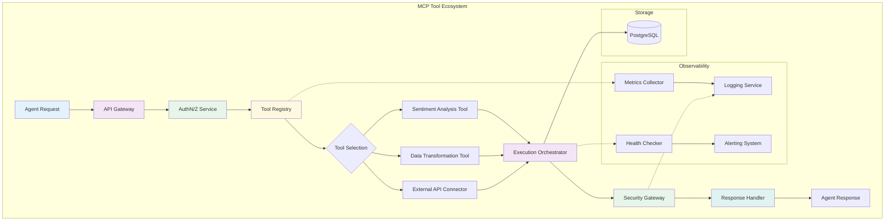

# MCP standardized tools. Now we need the infrastructure around them.

## Introduction
When the Model Context Protocol (MCP) first appeared, the community focused on defining a clean, language‑agnostic interface for exposing LLM‑compatible tools. The spec gave us a shared JSON‑RPC‑like contract, a discovery mechanism, and a versioning model that lets agents call any tool without knowing its internal language. That’s huge progress, but in production we quickly discovered that having a standardized tool contract is only half the battle. The real work begins when you need to run dozens—or hundreds—of those tools concurrently, enforce security boundaries, observe latency spikes, and roll out updates without breaking dependent agents. In short, the tool is standardized; the surrounding infrastructure is not.

## Why This Matters
Engineers building agent‑based systems today face a familiar pattern: a promising API spec arrives, early prototypes work in a notebook, and then reality hits. Without a purpose‑built ops layer you end up:
- Writing ad‑hoc wrappers around each tool just to get basic retries and timeouts.
- Scattering authentication logic across services, making audit trails impossible to trace.
- Over‑provisioning compute because you can’t predict which tool will be hot at any given minute.
- Struggling to correlate a failed agent response with the specific tool that caused it, because logs are siloed.

A dedicated infrastructure layer solves these problems by providing a uniform control plane for registration, execution, security, and observability. It lets you treat MCP tools as first‑class services that can be versioned, scaled, and monitored like any other micro‑service, while preserving the agent‑side simplicity that MCP promises.

## How It Works
The infrastructure we propose sits between the agent (or orchestrator) that issues MCP calls and the actual tool implementations. It consists of four loosely coupled planes:

1. **Discovery & Registry** – maintains a canonical catalog of tool metadata, versions, and health status.
2. **Execution Orchestrator** – receives an MCP call, selects the correct tool instance, manages resource allocation, and handles retries/timeouts.
3. **Security Gateway** – enforces authentication, authorization, input validation, and rate limiting before a call reaches the tool.
4. **Observability Layer** – aggregates metrics, traces, and logs from the other planes and feeds them to a centralized monitoring system.

Agents continue to speak plain MCP; they never need to know which plane they are hitting. The planes add transparency and operational guarantees without changing the contract.



**Step‑by‑step flow**
1. The agent sends an MCP `tools/call` request to the API Gateway (a thin HTTP front‑end).
2. The gateway forwards the request to the AuthN/Z service, which validates a JWT or API key and checks scopes (e.g., `tool:sentiment:read`).
3. On success, the request hits the Tool Registry, which looks up the tool ID, returns the latest versioned endpoint, and registers a health‑check heartbeat.
4. The Execution Orchestrator receives the resolved endpoint, picks an available instance from a load‑balanced pool, injects tracing context, and invokes the tool via its MCP‑compatible endpoint (usually HTTP/JSON‑RPC).
5. Before the call reaches the tool container, the Security Gateway runs input schema validation, enforces rate limits per‑API‑key, and scrubs any fields marked as PII.
6. The tool executes, returns a structured MCP response, and the Response Handler adds correlation IDs, logs outcome, and pushes metrics.
7. Finally, the agent receives the original MCP‑formatted payload, unchanged except for the added observability metadata that can be stripped if desired.

## Core Concepts
### Tool Registry Service
- **Canonical source of truth** for tool metadata: name, version, input/output JSON schemas, Docker image reference, and resource profiles (CPU, memory, concurrency limits).
- Implements **semantic versioning** (MAJOR.MINOR.PATCH) and allows agents to request a version range; the registry returns the highest compatible version.
- Provides a **health endpoint** that aggregates liveness/readiness probes from all registered instances and exposes a Prometheus metric (`tool_health_up{tool="sentiment_analysis",version="1.2.0"}`).

### Execution Orchestrator
- Acts as a **workflow engine** for single‑tool calls but can be extended to chain multiple tools (e.g., fetch → transform → classify).
- Uses a **plug‑able scheduler**: round‑robin for stateless tools, least‑loaded for CPU‑heavy workers, and affinity‑based for tools that need GPU or specialized hardware.
- Embeds **retry policies** (exponential backoff with jitter) and **circuit breaker** states per tool instance to prevent cascading failures.

### Security Gateway
- Enforces **zero‑trust** principles: every request is authenticated, authorized, and validated regardless of network location.
- Performs **JSON‑Schema validation** against the tool’s declared input schema; rejects malformed payloads early to save compute.
- Implements **dynamic rate limiting** based on token bucket algorithms, with limits configurable per tool and per consumer (API key, OAuth client, or internal service).
- Generates an **immutable audit log** (append‑only store) that captures request ID, principal, tool version, latency, and outcome for compliance.

### Observability Layer
- Emits **OpenTelemetry traces** that span the gateway → auth → registry → orchestrator → security → tool path, allowing you to see exactly where latency is added.
- Collects **RED metrics** (Requests, Errors, Duration) per tool version and per execution path.
- Provides a **health‑check API** that the orchestrator queries before routing traffic; unhealthy instances are automatically drained.

## Examples & Code Walkthrough
Below are three realistic snippets that show how each plane can be implemented in a language suited to its concerns. The code is deliberately production‑grade: it includes validation, error handling, and observability hooks.

### 6.1 Tool Registration Service (Python/FastAPI)
```python
# registry/service.py
from fastapi import FastAPI, HTTPException, Depends, Header, status
from pydantic import BaseModel, Field, ValidationError
from typing import List, Optional
import sqlalchemy as sa
import databases
import logging

logger = logging.getLogger("mcp.registry")

DATABASE_URL = "postgresql://mcp:mcpsecret@db/mcp"
database = databases.Database(DATABASE_URL)
metadata = sa.MetaData()

tools_table = sa.Table(
    "tools",
    metadata,
    sa.Column("id", sa.String, primary_key=True),
    sa.Column("name", sa.String, nullable=False, unique=True),
    sa.Column("version", sa.String, nullable=False),
    sa.Column("spec_json", sa.JSON, nullable=False),
    sa.Column("image", sa.String, nullable=False),
    sa.Column("cpu_limit", sa.Float, nullable=False),
    sa.Column("memory_limit_mb", sa.Integer, nullable=False),
    sa.Column("created_at", sa.DateTime, server_default=sa.func.now()),
)

app = FastAPI(title="MCP Tool Registry")


class ToolRegister(BaseModel):
    name: str = Field(..., regex=r"^[a-z0-9_-]+$")
    version: str = Field(..., regex=r"^\d+\.\d+\.\d+$")
    spec: dict  # full JSON‑Schema for input/output
    image: str
    cpu_limit: float = Field(..., gt=0)
    memory_limit_mb: int = Field(..., gt=0)


@app.on_event("startup")
async def startup() -> None:
    await database.connect()
    # Create tables if they don't exist (in prod use migrations)
    engine = sa.create_engine(DATABASE_URL)
    metadata.create_all(engine)


@app.on_event("shutdown")
async def shutdown() -> None:
    await database.disconnect()


async def get_api_key(x_api_key: Optional[str] = Header(None)):
    if x_api_key != "REGISTRY_ADMIN_KEY":  # in reality load from Vault
        raise HTTPException(status_code=status.HTTP_401_UNAUTHORIZED,
                            detail="Invalid admin credentials")
    return x_api_key


@app.post("/tools", status_code=status.HTTP_201_CREATED)
async def register_tool(
    payload: ToolRegister,
    _: str = Depends(get_api_key),
):
    # Ensure idempotency: same name+version cannot exist twice
    query = sa.select(tools_table).where(
        tools_table.c.name == payload.name,
        tools_table.c.version == payload.version,
    )
    existing = await database.fetch_one(query)
    if existing:
        raise HTTPException(
            status_code=status.HTTP_409_CONFLICT,
            detail=f"Tool {payload.name}@{payload.version} already registered",
        )

    insert_q = tools_table.insert().values(
        id=f"{payload.name}:{payload.version}",
        name=payload.name,
        version=payload.version,
        spec_json=payload.spec,
        image=payload.image,
        cpu_limit=payload.cpu_limit,
        memory_limit_mb=payload.memory_limit_mb,
    )
    try:
        await database.execute(insert_q)
    except Exception as exc:
        logger.exception("Failed to insert tool record")
        raise HTTPException(status_code=500, detail="Internal error") from exc

    logger.info(
        "Registered tool %s@%s", payload.name, payload.version
    )
    return {"id": f"{payload.name}:{payload.version}"}


@app.get("/tools/{name}")
async def get_latest_tool(name: str):
    # Return the highest semver version that matches name
    query = sa.select(tools_table).where(tools_table.c.name == name).order_by(
        sa.desc(tools_table.c.version)
    ).limit(1)
    row = await database.fetch_one(query)
    if not row:
        raise HTTPException(status_code=404, detail="Tool not found")
    return {
        "id": row["id"],
        "name": row["name"],
        "version": row["version"],
        "spec": row["spec_json"],
        "image": row["image"],
        "cpu_limit": row["cpu_limit"],
        "memory_limit_mb": row["memory_limit_mb"],
    }
```
**What this shows**
- A tiny but realistic service that persists tool metadata in PostgreSQL.
- Enforces admin‑only writes via a simple API key (swap for Vault/OIDC in prod).
- Guarantees idempotent registration and provides a read‑only endpoint for the orchestrator to discover the latest compatible version.
- Uses structured logging and proper HTTP error codes; no leaking of stack traces to the client.

### 6.2 Workflow Orchestrator (Node.js)
```javascript
// orchestrator/worker.js
const axios = require('axios');
const { v4: uuidv4 } = require('uuid');
const { promisify } = require('util');
const sleep = promisify(setTimeout);
const RegistryClient = require('./registryClient');
const SecurityGateway = require('./securityGateway');
const { trace } = require('@opentelemetry/api');

const MAX_RETRIES = 3;
const BASE_BACKOFF_MS = 200;

class Orchestrator {
  constructor(registryUrl, securityUrl) {
    this.registry = new RegistryClient(registryUrl);
    this.security = new SecurityGateway(securityUrl);
  }

  async executeToolCall(toolName, versionRange, input) {
    const span = trace.getTracer('orchestrator').startSpan('executeToolCall');
    span.setAttribute('tool.name', toolName);
    span.setAttribute('input.size', JSON.stringify(input).length);
    let attempt = 0;
    let lastError;

    while (attempt <= MAX_RETRIES) {
      attempt++;
      try {
        // 1️⃣ Resolve concrete version from registry
        const metadata = await this.registry.getLatestCompatible(
          toolName,
          versionRange
        );
        // 2️⃣ Pick an instance (simple round‑robin for demo)
        const instance = metadata.instances[this._rrIndex++ % metadata.instances.length];
        const endpoint = `${instance.url}/mcp`;

        // 3️⃣ Security gateway: validate & sanitize
        const sanitizedInput = await this.security.validateInput(
          metadata.spec.input_schema,
          input
        );

        // 4️⃣ Actual tool call with timeout
        const response = await axios.post(
          endpoint,
          {
            jsonrpc: "2.0",
            method: "tools/call",
            params: { name: toolName, arguments: sanitizedInput },
            id: uuidv4(),
          },
          { timeout: 5000 } // 5 s hard timeout
        );

        // 5️⃣ Propagate trace context
        response.headers['traceparent'] = span.spanContext().traceId;
        span.setAttribute('http.status_code', response.status);
        span.setAttribute('tool.version', metadata.version);
        span.end();

        return response.data.result;
      } catch (err) {
        lastError = err;
        // Distinguish retryable vs fatal errors
        if (err.response && err.response.status >= 500) {
          // server error → retry with backoff
        } else if (err.code === 'ECONNABORTED') {
          // timeout → retry
        } else {
          // client error (4xx) or validation failure → no retry
          span.recordException(err);
          span.setStatus({ code: 'ERROR', message: err.message });
          span.end();
          throw err;
        }

        const delay = BASE_BACKOFF_MS * 2 ** (attempt - 1) + Math.random() * 100;
        await sleep(delay);
      }
    }

    span.recordException(lastError);
    span.setStatus({ code: 'ERROR', message: 'Max retries exceeded' });
    span.end();
    throw new Error(`Tool execution failed after ${MAX_RETRIES} attempts: ${lastError.message}`);
  }
}

module.exports = Orchestrator;
```
**Key takeaways**
- The orchestrator is stateless; all state lives in the registry and security services.
- It implements exponential backoff with jitter, distinguishes retryable server errors from fatal client errors, and propagates OpenTelemetry trace context.
- Input validation is delegated to the security gateway, ensuring a single source of truth for schema enforcement.

### 6.3 Security Middleware (Go)
```go
// security/middleware.go
package security

import (
	"context"
	"encoding/json"
	"net/http"
	"strings"

	"github.com/golang-jwt/jwt/v5"
	"github.com/pkg/errors"
	"go.opentelemetry.io/otel"
	"go.opentelemetry.io/otel/attribute"
	"go.opentelemetry.io/otel/trace"
)

var tracer = otel.Tracer("mcp.security")

// JWTValidator checks a bearer token against a JWKS endpoint and extracts claims.
type JWTValidator struct {
	jwksURL string
	// In production you'd cache the JWKS and rotate keys.
}

// NewJWTValidator creates a validator; the JWKS URL is usually well‑known.
func NewJWTValidator(jwksURL string) *JWTValidator {
	return &JWTValidator{jwksURL: jwksURL}
}

// Validate extracts and verifies the token; returns claims or error.
func (v *JWTValidator) Validate(tokenString string) (map[string]interface{}, error) {
	ctx, span := tracer.Start(context.Background(), "jwt.validate")
	defer span.End()

	// Parse without verification first to get header (kid)
	token, _, err := new(jwt.Parser).ParseUnverified(tokenString, jwt.MapClaims{})
	if err != nil {
		return nil, errors.Wrap(err, "failed to parse token")
	}
	// For brevity we skip JWKS fetch; in real code you'd fetch the key set.
	// Assume HS256 with a shared secret for demo.
	claims, err := jwt.Parse(tokenString, func(t *jwt.Token) (interface{}, error) {
		if _, ok := t.Method.(*
