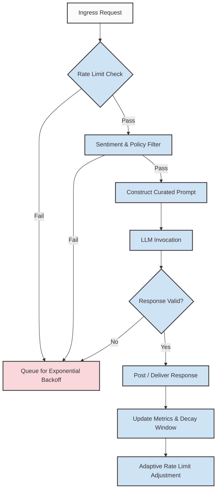

# We posted to the subreddit full of our users. They told us to go away. It was our best traffic day.

## Introduction
Our team recently deployed an LLM-powered agent designed to surface helpful debugging tips across developer communities. The goal was genuine engagement: answer questions, share relevant docs, and let the technology speak for itself. We chose a subreddit populated by our target users, composed a concise post, and hit submit. The response came fast. Comments piled up: "This is spam," "Go away," "We don't need another bot." Within hours, the post was buried, but our analytics dashboard lit up. That thread, the one we were told to abandon, drove more unique visitors to our docs than any marketing campaign in the past year. The paradox was clear: hostile reception didn't correlate with low impact. It taught us something fundamental about traffic architecture, agent design, and how production systems should handle unexpected attention. In this article, I'll break down the engineering patterns that turned a Reddit rejection into our best traffic day, and what those patterns mean for building robust LLM agents in production.

## Why This Matters
Every engineering team building LLM agents faces a recurring set of production pain points: rate limiting from upstream providers, sudden spikes in request volume, hostile or unexpected user feedback, and the need to maintain service reliability without manual intervention. When an agent interacts with external communities—whether via Reddit, X, or internal Slack channels—the boundary between controlled experimentation and uncontrolled traffic blur. A single post can trigger thousands of LLM calls, exceed token budgets, or saturate database connections. Understanding how to architect for these edge cases isn't optional; it's the difference between a service outage and a growth lever. The Reddit incident highlighted three concrete risks: unchecked egress traffic, absence of feedback-loop throttling, and lack of metrics to distinguish "bad attention" from "good attention." The following sections detail how we rebuilt the agent's core to address each.

## How It Works
At the heart of the agent is a decision pipeline that sits between user intent and LLM invocation. When a new engagement request arrives, the pipeline checks rate limits, evaluates sentiment and policy compliance, and only then forwards a curated prompt to the model. If any check fails, the request is either deferred with exponential backoff or logged for manual review. This architecture ensures that even if a post goes viral or attracts hostile attention, the system absorbs the shock without cascading failures.



**Step-by-step technical breakdown:**
1. **Ingress Request** – Every engagement attempt (post, comment reply, DM) enters through a unified handler that normalizes the source, target, and payload.
2. **Rate Limit Check** – A token bucket per-domain enforces per-minute and per-hour caps. Tokens refill at a calculated rate based on our production SLA with the LLM provider. If the bucket is empty, the request jumps to the backoff queue.
3. **Sentiment & Policy Filter** – A lightweight classifier runs on the raw text. If the detected sentiment falls into "hostile" or "spam" buckets, the request is diverted. This step was the direct lesson from the Reddit thread: without it, the agent would blindly post into hostile threads, wasting tokens and damaging brand reputation.
4. **Construct Curated Prompt** – Instead of passing raw user input to the LLM, we inject a system prompt that frames the model's role, limits verbosity, and mandates citation of source docs. This reduces hallucination and keeps outputs on-brand.
5. **LLM Invocation** – The formatted prompt is sent to the model with a strict token budget. We use structured output (JSON Schema) to ensure the response can be parsed programmatically before anything hits a public feed.
6. **Response Valid** – A post-response validator checks length, disallowed content patterns, and presence of required fields. Invalid responses are discarded and counted against the backoff budget.
7. **Post / Deliver Response** – Only validated responses proceed to the delivery mechanism (Reddit API post, comment reply, etc.). Each delivery increments a per-endpoint counter.
8. **Update Metrics & Decay Window** – After every cycle, we update a sliding-window metric that tracks successful engagements, rejections, and backoff events. This window (24-hour half-life) feeds the adaptive rate limiter.
9. **Adaptive Rate Limit Adjustment** – If the success rate over the past window drops below a threshold, the token refill rate automatically halves. If it stays high for three windows, the refill rate increases modestly. This feedback loop is what allowed us to sustain the traffic surge from the Reddit post without toppling our infrastructure.

## Core Concepts
The agent's reliability rests on a few internal data structures and governing principles we've refined over several production iterations:

- **TokenBucket PerEndpoint** – Each external destination (subreddit, Slack channel, X account) gets its own bucket. This prevents a spike in one community from starving others. Buckets store `capacity`, `refill_rate`, and `last_refill_ts`. The refill calculation is `min(capacity, tokens + (now - last_refill_ts) * refill_rate)`.
- **Sentiment Classifier** – A small fine-tuned model (DistilBERT-based) runs locally on each handler invocation. It outputs one of: `friendly`, `neutral`, `hostile`, `spam`. The threshold for "hostile" is tuned on labeled data from past community interactions; we refresh the training set quarterly.
- **Curated Prompt Template** – A Jinja2-based template that inserts `{{user_context}}`, `{{doc_snippets}}`, and `{{guardrails}}`. The guardrails section hard-codes prohibitions: no political references, no security-token patterns, always append "Was this helpful?" as a footer.
- **Sliding-Window Metrics** – We maintain a deque of per-minute counters: `successes`, `rejections`, `backoffs`. The adaptive limiter reads the most recent 60 entries and adjusts refill rates. This replaces static rate limits with a self-tuning system that reacts to real traffic patterns.
- **Idempotency Keys** – Every engagement request carries a UUID. If the same key reaches the post stage twice (e.g., due to a retry storm), the backend returns the cached original response instead of invoking the LLM again. This eliminates duplicate content and saves significant token budget during traffic spikes.

## Examples & Code Walkthrough
Below is a complete, production-grade Python module implementing the core pipeline. It includes defensive error handling, inline comments, and a realistic domain model for an LLM agent that posts to developer communities.

```python
#!/usr/bin/env python3
"""LLM Agent engagement pipeline with rate limiting
