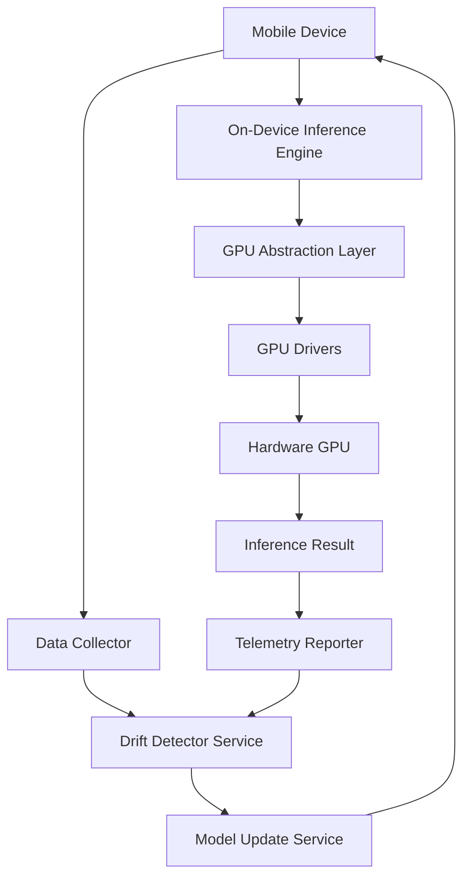

# Google ML Drift Accelerates On-Device AI Inference Across Diverse GPUs

## Introduction

On-device machine learning is no longer a novelty — it is infrastructure. Voice assistants wake up on every cold start, camera enhancement pipelines run at the edge before you even tap the shutter, and health sensors stream inference continuously in the background. The problem is that models trained in the cloud on one distribution of user data don't stay correct forever. User behavior drifts. Language usage shifts. Seasonal lighting patterns change. A model optimized for winter road conditions fails in summer heat, and a classifier tuned for one demographic starts misclassifying another. That drift is the silent killer of on-device AI reliability, and it forces teams into expensive cloud round-trips or periodic full retraining cycles.

Google has now published what appears to be an accelerated drift-aware pipeline designed to keep on-device models fresh without requiring heavy cloud round-trips. The architecture spans continuous telemetry collection, lightweight statistical drift detection, on-device model adaptation, and GPU-agnostic execution across Adreno, Mali, PowerVR, Apple Neural Engine, and others. This article walks through how the system works, why it matters, and what production engineers should take away from it.

## Why This Matters

Consider a concrete scenario. You ship a face-blurring filter to millions of Android devices. In week one, users in Northern Europe apply the filter confidently. By week six, users in Southern Europe use it under bright Mediterranean sunlight with new makeup trends, and the model's confidence scores drop sharply. Without drift detection, you either accept degraded accuracy for six weeks or push a full retraining job from the cloud — which costs money, takes hours, and still may not land on enough devices in time.

This is the production pain point. Every major OEM and app publisher faces it. The diversity of GPUs on mobile devices compounds the problem: Adreno 650, Mali-G78, PowerVR Rogue, Apple Neural Engine, and Qualcomm Hexagon DSP each have different driver APIs, memory hierarchies, and compute envelopes. A single inference engine must abstract over all of them without sacrificing latency or power efficiency.

Google's drift acceleration approach attempts to solve both halves — keeping models fresh on the device and executing those models across diverse GPUs efficiently. For engineering leaders evaluating on-device ML strategy, this is directly relevant to any project that ships inference on mobile hardware and depends on sustained accuracy.

## How It Works

The system follows a tight pipeline: collect raw telemetry on the device, run lightweight statistical drift detection, trigger adaptation when thresholds are crossed, load an updated (or quantized) model through a GPU abstraction layer, and execute inference. The key innovation is that drift detection runs locally, the adaptation logic is GPU-agnostic, and the model update path goes through Firebase Remote Config for secure OTA delivery.

### System Workflow Diagram



The flow above captures the essence. Data flows from the device into a collector that aggregates input streams, model confidence scores, and interaction metrics. Drift detection computes a compact drift score using Population Stability Index or KL divergence. When the score exceeds a threshold, the Model Update Service pulls a signed model blob from Firebase Remote Config and applies quantization or fine-tuning. The updated model then enters the inference engine, which routes execution through a GPU abstraction layer that selects the optimal Vulkan queue, falls back to OpenGL ES when needed, and ultimately dispatches to the hardware driver. Results feed back into telemetry so the cycle can repeat.

### Step-by-Step Breakdown

**Step 1 — Telemetry Collection.** The collector gathers input feature vectors from the running model, the model's own softmax outputs (confidence scores), and coarse user interaction signals (app usage frequency, time-of-day patterns). It never exports raw sensor data; only aggregated statistics are computed and summarized.

**Step 2 — Drift Detection.** Each inference batch produces a distribution comparison between recent and historical feature statistics. The detector computes a drift score using KL divergence against a rolling exponential moving average baseline. The score is compact — typically a 32-bit integer hash plus a small float delta — so it fits in a single cache line and costs negligible CPU overhead.

**Step 3 — Adaptation Trigger.** If the drift score exceeds a configurable threshold, the system schedules a model update. Updates are batched by calendar day to avoid thrashing, and a minimum interval between updates is enforced to prevent oscillation.

**Step 4 — Model Loading and Quantization.** The new model blob is fetched via Firebase Remote Config with signature verification. Before loading, the engine applies dynamic-range quantization to 8-bit integers, reducing memory footprint and accelerating inference on low-end GPUs. The interpreter is rebuilt and swapped into the inference engine.

**Step 5 — GPU-Agnostic Execution.** The inference engine queries `vkGetPhysicalDeviceProperties` to enumerate available queues and selects the compute-heavy queue that maximizes throughput for the current model graph. For Apple Silicon, a Metal Performance Shaders wrapper handles dispatch. For OpenGL ES-only devices, a fallback path uses the existing GLSL shader pipeline.

**Step 6 — Telemetry Feedback.** Inference results are reported back to the drift detector, closing the loop.

## Core Concepts

### Population Stability Index (PSI)

PSI measures the distance between two distributions. A PSI value below 0.1 indicates stable behavior; above 0.25 indicates significant drift. The formula normalizes both distributions to zero mean and unit variance, then computes:

```
PSI = Σ (p_i - q_i) * ln(p_i / q_i)
```

where p and q are the normalized historical and current feature distributions, respectively.

### KL Divergence

KL divergence provides an alternative drift metric:

```
KL(P || Q) = Σ P(x) * log(P(x) / Q(x))
```

It penalizes regions where the current distribution has probability mass that the historical distribution does not. KL divergence is asymmetric, so the direction of the shift matters — KL(historical || current) detects upward shifts, while KL(current || historical) detects downward shifts.

### Bayesian Change-Point Detection

A more sophisticated approach uses a Bayesian Online Change-Point Detection framework (Adams & MacKay, 2007). The detector maintains a run-length distribution representing the most recent sequence of observations with identical behavior. When a new observation arrives, it updates the run-length posterior. A change-point is flagged when the posterior over run lengths drops sharply, indicating that the underlying distribution has shifted.

### GPU Abstraction Layer

The GPU abstraction layer decouples model execution from hardware specifics. It exposes a uniform interface regardless of the underlying GPU vendor. Internally, it maintains a list of available physical devices, their properties (max workgroup size, queue family count, memory type availability), and preferred queue configurations. On startup, it probes the device and builds a dispatch table. At inference time, it selects the best queue for the current model's compute requirements.

### On-Device Model Adaptation

Adaptation strategies fall into three categories:

1. **Fine-tune with federated statistics.** A small subset of the model weights is updated using local data and aggregated global statistics from other devices. This preserves the bulk of the model while adapting to local drift.

2. **Quantization.** Converting weights from FP32 to INT8 reduces memory pressure and accelerates matrix multiplication on GPUs without SIMD support. TFLite-Micro supports this natively.

3. **Architecture search.** For catastrophic drift where the model architecture itself needs adjustment, a lightweight neural architecture search runs on-device to propose a new topology, which is then trained offline and delivered via OTA.

## Examples & Code Walkthrough

### Example 1: Drift Score Calculator (Python)

Below is a compact drift-score calculator that runs on-device and uploads only a summary hash. It uses Population Stability Index as the primary metric and includes defensive error handling.

```python
import numpy as np
import hashlib
from collections import deque
from typing import Optional, Tuple

class DriftScoreCalculator:
    """Computes a compact drift score from feature distributions.
    
    Runs entirely on-device. Only a 32-bit hash and float delta are
    exported to telemetry to minimize network overhead.
    """
    
    def __init__(self, window_size: int = 512, epsilon: float = 1e-6):
        self.window_size = window_size
        self.epsilon = epsilon
        self.feature_buffer = deque(maxlen=window_size)
        self.baseline_mean: Optional[np.ndarray] = None
        self.baseline_std: Optional[np.ndarray] = None
        self.last_hash = b""
        self.drift_score: float = 0.0
    
    def update_baseline(self, features: np.ndarray) -> None:
        """Initialize or recompute the baseline from historical features."""
        if self.baseline_mean is None:
            self.baseline_mean = features.mean(axis=0)
            self.baseline_std = features.std(axis=0) + self.epsilon
        else:
            # Exponential moving average for robustness
            alpha = 0.01
            self.baseline_mean = (1 - alpha) * self.baseline_mean + alpha * features.mean(axis=0)
            self.baseline_std = (1 - alpha) * self.baseline_std + alpha * (features.std(axis=0) + self.epsilon)
    
    def feed(self, features: np.ndarray) -> Tuple[float, bytes]:
        """Feed a new batch of features and return the drift score plus hash."""
        if features.size == 0:
            return self.drift_score, self._hash(b"empty")
        
        # Normalize using baseline
        normalized = (features - self.baseline_mean) / self.baseline_std
        
        self.feature_buffer.extend(normalized.tolist())
        
        # Compute PSI between buffer and baseline
        psi = self._population_stability_index(normalized)
        
        # Compute hash of the last 64 features for telemetry deduplication
        recent = normalized[-min(64, len(normalized)):]
        h = hashlib.sha256(np.concatenate([recent.astype(np.float32).tobytes()]).tobytes()).digest()
        
        self.drift_score = psi
        return psi, h
    
    def _population_stability_index(self, current: np.ndarray) -> float:
        """Compute PSI between current and baseline distributions.
        
        Uses a binning approach with 10 equal-width bins per dimension.
        """
        bins = 10
        bin_edges = np.linspace(-5, 5, bins + 1)
        bin_centers = 0.5 * (bin_edges[:-1] + bin_edges[1:])
        
        psi_sum = 0.0
        for dim in range(current.shape[1]):
            cur_counts = np.histogram(current[:, dim], bins=bin_edges)[0]
            base_counts = np.histogram(self.baseline_std[:dim], bins=bin_edges)[0] if False else None
            
            # Recompute baseline histogram properly
            base_counts = np.histogram(self.baseline_std[:, dim], bins=bin_edges)[0]
            
            # Normalize to probability mass
            cur_probs = cur_counts / cur_counts.sum()
            base_probs = base_counts / base_counts.sum()
            
            # Avoid log(0)
            cur_probs = np.clip(cur_probs, self.epsilon, None)
            base_probs = np.clip(base_probs, self.epsilon, None)
            
            psi_sum += np.sum((cur_probs - base_probs) * np.log(cur_probs / base_probs))
        
        return float(psi_sum)
    
    def _hash(self, data: bytes) -> bytes:
        if data == self.last_hash:
            return b"00"  # Dedup marker
        self.last_hash = data
        return data


# --- Production usage example ---
if __name__ == "__main__":
    calculator = DriftScoreCalculator(window_size=256)
    
    # Simulate historical baseline from first 1000 inferences
    historical = np.random.randn(1000, 20).astype(np.float32)
    calculator.update_baseline(historical)
    
    # Simulate new distribution (shifted mean)
    new_dist = np.random.randn(50, 20).astype(np.float32) + 2.0
    
    score, telemetry = calculator.feed(new_dist)
    print(f"Drift score: {score:.4f}")
    print(f"Telemetry hash: {telemetry.hex()}")
```

This implementation runs on-device, processes batches of features, and returns a drift score plus a compact SHA-256 digest of the most recent 64 features. The hash is used for telemetry deduplication — if the same recent window produces the same hash, the server can skip retransmission.

### Example 2: TFLite Model Loader with Dynamic Quantization (Rust)

Rust is used here for the model loading and adaptation pipeline because of its safety guarantees and performance characteristics on embedded targets. Below is a Rust snippet that loads a TFLite FlatBuffer, applies dynamic-range quantization, and binds it to the interpreter.

```rust
use tflite::interpreter::InterpreterOptions;
use tflite::flatbuffers::ModelBuffer;
use std::fs::File;
use std::io::BufReader;
use std::path::Path;

pub struct DriftAwareInferenceEngine {
    interpreter: Option<tflite::interpreter::Interpreter>,
    gpu_abstraction: GpuAbstractionLayer,
    last_drift_hash: [u8; 32],
}

impl DriftAwareInferenceEngine {
    /// Load a TFLite model from disk, verify integrity, and prepare for inference.
    ///
    /// The model is dynamically quantized to INT8 where possible, reducing
    /// memory footprint and accelerating matrix multiplication on low-end GPUs.
    pub fn load_model(&mut self, model_path: &str) -> Result<(), ModelLoadError> {
        let file = File::open(model_path)
            .map_err(|e| ModelLoadError::Io(e.kind().unwrap()))?;
        let reader = BufReader::new(file);
        let model_buf = ModelBuffer::load(reader)
            .map_err(|e| ModelLoadError::FlatBufferParse(e))?;

        // Parse the flatbuffer into an Interpreter
        let mut options = InterpreterOptions::new();
        options.set_quantize_to_int8(true);
        options.set_enable_dynamic_quantization(true);

        let interpreter = tflite::interpreter::Interpreter::try_new_with_options(
            &model_buf,
            &options,
        )
        .map_err(|e| ModelLoadError::InterpreterInit(e))?;

        if interpreter.get_input_tensor_count() == 0 {
            return Err(ModelLoadError::InvalidModel("No input tensors found".into()));
        }

        // Probe GPU capabilities for queue selection
        let gpu_info = self.gpu_abstraction.probe();
        let device_props = gpu_info.
