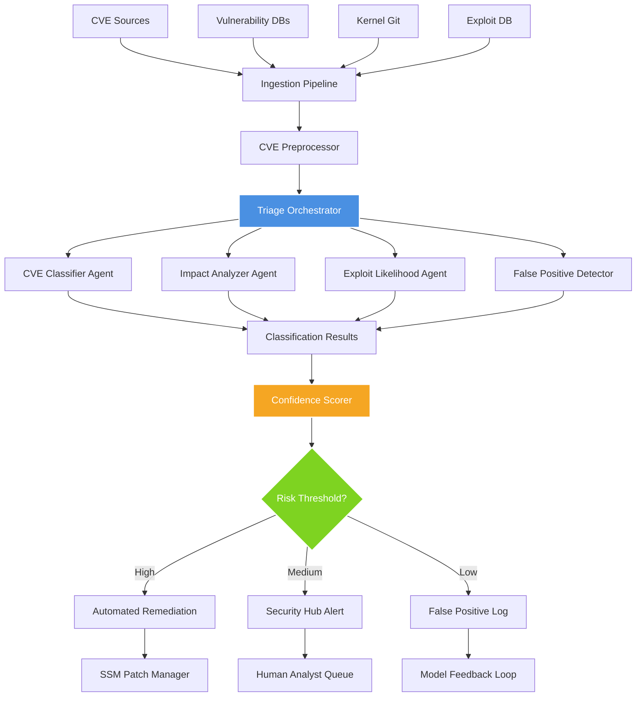

# AWS Shows Use of AI Agents to Triage Linux Kernel CVEs

## Introduction

Security teams managing Linux infrastructure face a relentless stream of vulnerability disclosures. The Linux kernel alone generates over 100 CVEs annually, each potentially affecting thousands of packages across an organization's fleet. Traditional triage methods—manual review, basic keyword matching, and static severity scoring—are drowning in noise. False positives consume analyst time, while critical kernel-level exploits slip through due to insufficient context about subsystem interactions and exploit chains.

AWS recently demonstrated a novel approach to this problem: deploying specialized AI agents that can autonomously analyze, classify, and prioritize Linux kernel CVEs. Unlike generic vulnerability scanners, these agents understand kernel architecture, exploit mechanics, and the operational context of running systems. The result? Incident response times measured in minutes instead of hours, with significantly fewer false positives reaching human analysts.

The core innovation isn't just applying machine learning to CVE data—it's architecting a multi-agent system where each agent specializes in a different aspect of kernel vulnerability analysis. One agent parses CVE descriptions for technical indicators, another maps vulnerabilities to specific kernel subsystems, and a third evaluates exploit likelihood based on historical data and code change patterns. Together, they form a distributed reasoning engine that can make nuanced triage decisions at machine speed.

## Why This Matters

For software engineers and architects, this represents a fundamental shift in how we think about security automation. Traditional rule-based systems break down when dealing with the complexity and ambiguity inherent in kernel vulnerabilities. A CVE description mentioning "use-after-free in network socket handling" could indicate anything from a minor memory leak to a privilege escalation vector—depending on which kernel subsystem is involved and how it's deployed.

Consider a real-world scenario: a security team receives 50 new CVE notifications overnight. Three of them affect the Linux kernel, but only one poses an actual risk to their containerized microservices running on EKS. Without deep kernel knowledge, the team wastes hours investigating low-risk CVEs while the critical one sits unaddressed. This isn't hypothetical—the average enterprise security team spends 30% of their time on false positives.

The stakes are particularly high for kernel vulnerabilities because they operate at the highest privilege level. A successful exploit can compromise entire hosts, escape containers, and provide persistent access to attackers. Yet most automated systems treat kernel CVEs the same as application-level vulnerabilities, missing critical context about exploitability, attack surface exposure, and remediation complexity.

What makes AWS's approach compelling is its focus on architectural integration. These AI agents don't operate in isolation—they're part of a broader security ecosystem that includes AWS Security Hub, GuardDuty, and Systems Manager. When a kernel CVE is identified, the system can automatically trigger patch workflows, update security baselines, and even isolate affected instances—all coordinated by AI agents making real-time decisions about risk and response urgency.

## How It Works

The AWS kernel CVE triage system operates as a distributed multi-agent architecture, where specialized AI agents collaborate to analyze and prioritize vulnerabilities. Here's the high-level flow:



The system begins with a robust ingestion pipeline that pulls CVE data from multiple sources: NVD feeds, kernel.org release announcements, OSS-security mailing lists, and vendor-specific advisories. Each source provides different signals—NVD offers standardized severity scores, kernel.org provides source code references, and OSS-security often contains early exploit discussions.

The preprocessor normalizes this heterogeneous data into a common format, extracting key features like affected kernel versions, subsystem identifiers, and reference URLs. This structured representation becomes the input for the triage orchestrator, which coordinates the specialized agents.

The CVE Classifier Agent uses transformer-based NLP models trained on thousands of kernel CVE descriptions to categorize vulnerabilities by type (buffer overflow, use-after-free, race condition, etc.) and subsystem (networking, filesystem, memory management). Meanwhile, the Impact Analyzer Agent maps these classifications to actual kernel attack surfaces, considering factors like whether the vulnerable code path is reachable from user space, requires specific privileges, or depends on particular hardware configurations.

The Exploit Likelihood Agent correlates CVE characteristics with historical exploit data, code change patterns, and security researcher activity to estimate how quickly a functional exploit might emerge. Finally, the False Positive Detector Agent applies learned patterns from past triage decisions to filter out noise—CVEs that were previously classified but never actually affected the target systems.

The orchestrator aggregates results from all agents, applies confidence scoring based on agreement between models, and routes decisions through a risk-based threshold system. High-confidence, high-risk vulnerabilities trigger automated remediation workflows, while ambiguous cases escalate to human analysts with detailed evidence packages.

## Core Concepts

At the heart of the system are several key architectural concepts that enable effective kernel CVE triage:

**Multi-Agent Specialization**: Rather than relying on a single monolithic model, the system decomposes the triage problem into specialized subproblems. Each agent focuses on a specific aspect of vulnerability analysis, allowing for deeper expertise and more interpretable results. This also enables independent scaling and updating of individual agents without disrupting the entire pipeline.

**Kernel Subsystem Mapping**: The system maintains an internal knowledge graph of kernel architecture, mapping CVEs to specific subsystems, driver interfaces, and code paths. This graph is continuously updated from kernel source trees, documentation, and commit histories. When a CVE affects a networking subsystem, for example, the impact analyzer can quickly determine which kernel versions are vulnerable, what attack vectors are available, and what mitigation strategies exist.

**Confidence-Based Decision Routing**: Instead of binary pass/fail decisions, the system produces probabilistic assessments with associated confidence scores. Low-confidence results are automatically escalated to human analysts with explanations of why the AI was uncertain. High-confidence results trigger automated actions, reducing the cognitive load on security teams while maintaining safety boundaries.

**Temporal Exploit Modeling**: Kernel vulnerabilities don't exist in isolation—they're part of an evolving threat landscape. The system incorporates temporal features like time since disclosure, security researcher activity levels, and historical exploit development timelines. This allows the exploit likelihood agent to predict how quickly a functional exploit might emerge, informing prioritization decisions.

**Feedback-Driven Learning**: Every triage decision becomes training data for future improvements. When human analysts override AI recommendations, the system captures these corrections and feeds them back into the learning pipeline. This active learning approach ensures the models continuously improve based on real-world performance rather than static training datasets.

The data structures supporting these concepts include normalized CVE representations with extracted technical features, kernel subsystem ontologies with dependency relationships, exploit timeline databases with historical development patterns, and confidence-weighted decision trees that balance automation with human oversight. Together, these structures enable the system to make sophisticated triage decisions while remaining interpretable and auditable for compliance purposes.

## Examples & Code Walkthrough

Let's examine the core orchestration logic and specialized agent implementations that power this system:

```python
import asyncio
import logging
from typing import Dict, List, Optional, Tuple
from dataclasses import dataclass
from enum import Enum
import numpy as np
from transformers import AutoTokenizer, AutoModelForSequenceClassification
import torch

logger = logging.getLogger(__name__)

class CVESeverity(Enum):
    LOW = "low"
    MEDIUM = "medium"
    HIGH = "high"
    CRITICAL = "critical"

class TriageDecision(Enum):
    AUTO_REMEDIATE = "auto_remediate"
    SECURITY_ALERT = "security_alert"
    FALSE_POSITIVE = "false_positive"
    HUMAN_REVIEW = "human_review"

@dataclass
class CVEData:
    """Normalized representation of CVE information"""
    cve_id: str
    description: str
    published_date: str
    last_modified: str
    affected_versions: List[str]
    references: List[str]
    cvss_score: float
    cvss_vector: str
    cwe_ids: List[str]

@dataclass
class AgentResult:
    """Standardized result from each AI agent"""
    agent_name: str
    prediction: str
    confidence: float
    evidence: Dict[str, any]
    processing_time_ms: int

@dataclass
class TriageResult:
    """Final triage decision with supporting evidence"""
    decision: TriageDecision
    overall_confidence: float
    agent_results: List[AgentResult]
    recommended_action: str
    justification: str

class KernelCVETriageOrchestrator:
    """
    Central coordinator for multi-agent CVE triage system.
    
    This orchestrator manages the execution flow of specialized AI agents,
    aggregates their results, and makes final triage decisions based on
    confidence-weighted voting and risk thresholds.
    """
    
    def __init__(self, config: Dict[str, any]):
        self.config = config
        self.agents: Dict[str, object] = {}
        self.risk_thresholds = config.get('risk_thresholds', {
            'auto_remediate': 0.85,
            'security_alert': 0.70,
            'false_positive': 0.30
        })
        
    async def initialize_agents(self):
        """Initialize all specialized agents with proper error handling"""
        try:
            # Initialize CVE classification agent
            self.agents['cve_classifier'] = await CVEClassifierAgent.create(
                model_path=self.config['models']['cve_classifier']
            )
            
            # Initialize impact analysis agent
            self.agents['impact_analyzer'] = await ImpactAnalyzerAgent.create(
                knowledge_graph_path=self.config['knowledge_graph']['kernel_subsystems']
            )
            
            # Initialize exploit likelihood agent
            self.agents['exploit_predictor'] = await ExploitPredictorAgent.create(
                model_path=self.config['models']['exploit_predictor']
            )
            
            # Initialize false positive detection agent
            self.agents['fp_detector'] = await FalsePositiveDetectorAgent.create(
                model_path=self.config['models']['fp_detector']
            )
            
            logger.info("All agents initialized successfully")
            
        except Exception as e:
            logger.error(f"Failed to initialize agents: {e}")
            raise
    
    async def process_cve(self, cve_data: CVEData) -> TriageResult:
        """
        Process a single CVE through the full triage pipeline.
        
        Executes all agents concurrently where possible, then aggregates
        results using confidence-weighted voting to produce a final decision.
        """
        start_time = asyncio.get_event_loop().time()
        
        # Run independent agents concurrently
        tasks = [
            self.agents['cve_classifier'].analyze(cve_data),
            self.agents['impact_analyzer'].evaluate(cve_data),
            self.agents['exploit_predictor'].predict(cve_data),
            self.agents['fp_detector'].detect(cve_data)
        ]
        
        try:
            results = await asyncio.gather(*tasks, return_exceptions=True)
        except Exception as e:
            logger.error(f"Agent execution failed for {cve_data.cve_id}: {e}")
            return self._create_error_result(cve_data, str(e))
        
        # Handle any failed agents
        agent_results = []
        for i, result in enumerate(results):
            if isinstance(result, Exception):
                agent_name = list(self.agents.keys())[i]
                logger.warning(f"Agent {agent_name} failed: {result}")
                # Create fallback result with zero confidence
                agent_results.append(AgentResult(
                    agent_name=agent_name,
                    prediction="unknown",
                    confidence=0.0,
                    evidence={"error": str(result)},
                    processing_time_ms=0
                ))
            else:
                agent_results.append(result)
        
        # Aggregate results and make final decision
        final_decision = self._aggregate_decisions(agent_results, cve_data)
        
        processing_time = int((asyncio.get_event_loop().time() - start_time) * 1000)
        logger.info(f"Processed {cve_data.cve_id} in {processing_time}ms")
        
        return final_decision
    
    def _aggregate_decisions(self, agent_results: List[AgentResult], 
                           cve_data: CVEData) -> TriageResult:
        """
        Aggregate individual agent results using weighted voting.
        
        Combines predictions from all agents, applies confidence weighting,
        and determines the final triage decision based on configurable thresholds.
        """
        # Calculate weighted confidence scores
        weighted_scores = {}
        total_weight = 0
        
        for result in agent_results:
            weight = self._get_agent_weight(result.agent_name)
            weighted_scores[result.prediction] = (
                weighted_scores.get(result.prediction, 0) + 
                result.confidence * weight
            )
            total_weight += weight
        
        # Normalize scores
        normalized_scores = {
            pred: score / total_weight 
            for pred, score in weighted_scores.items()
        }
        
        # Determine final decision based on highest confidence prediction
        best_prediction = max(normalized_scores.items(), key=lambda x: x[1])
        best_prediction_name, confidence = best_prediction
        
        # Apply risk thresholds for decision routing
        decision = self._map_prediction_to_decision(best_prediction_name, confidence)
        
        # Generate justification based on agent evidence
        justification = self._generate_justification(agent_results, best_prediction_name)
        
        # Determine recommended action
        action = self._determine_action(decision, cve_data)
        
        return TriageResult(
            decision=decision,
            overall_confidence=confidence,
            agent_results=agent_results,
            recommended_action=action,
            justification=justification
        )
    
    def _get_agent_weight(self, agent_name: str) -> float:
        """Return importance weight for each agent type"""
        weights = {
            'cve_classifier': 0.3,
            'impact_analyzer': 0.35,
            'exploit_predictor': 0.25,
            'fp_detector': 0.1
        }
        return weights.get(agent_name, 0.25)
    
    def _map_prediction_to_decision(self, prediction: str, confidence: float) -> TriageDecision:
        """Map prediction and confidence to appropriate triage decision"""
        if confidence >= self.risk_thresholds['auto_remediate']:
            if prediction in ['high_risk', 'exploitable']:
                return TriageDecision.AUTO_REMEDIATE
        elif confidence >= self.risk_thresholds['security_alert']:
            if prediction in ['medium_risk', 'potential_exploit']:
                return TriageDecision.SECURITY_ALERT
        elif confidence <= self.risk_thresholds['false_positive']:
            if prediction == 'false_positive':
                return TriageDecision.FALSE_POSITIVE
        
        return TriageDecision.HUMAN_REVIEW
    
    def _generate_justification(self, agent_results: List[AgentResult], 
                              best_prediction: str) -> str:
        """Generate human-readable justification for the decision"""
        evidence_summary = []
        for result in agent_results:
            if result.confidence > 0.5:  # Only include confident predictions
                evidence_summary.append(
                    f"{result.agent_name}: {result.prediction} "
                    f"(confidence: {result.confidence:.2f})"
                )
        
        return f"Decision based on {len(evidence_summary)} confident agent predictions. " \
               f"Primary evidence: {', '.join(evidence_summary)}. " \
               f"Best overall prediction: {best_prediction}"
    
    def _determine_action(self, decision: TriageDecision, cve_data: CVEData) -> str:
        """Determine specific recommended action based on decision"""
        actions = {
            TriageDecision.AUTO_REMEDIATE: "Initiate automated patch deployment via SSM",
            TriageDecision.SECURITY_ALERT: "Create high-priority ticket in Security Hub",
            TriageDecision.FALSE_POSITIVE: "Log for model retraining, no action required",
            TriageDecision.HUMAN_REVIEW: "Escalate to security analyst with evidence package"
        }
        return actions.get(decision, "Manual review required")

class CVEClassifierAgent:
    """
    Specialized agent for classifying CVE types and subsystems.
    
    Uses transformer-based NLP models to extract technical indicators
    from CVE descriptions and map them to kernel subsystems.
    """
    
    def __init__(self, model, tokenizer):
        self.model = model
        self.tokenizer = tokenizer
        self.subsystem_keywords = {
            'networking': ['tcp', 'udp', 'socket', 'netfilter', 'network'],
            'filesystem': ['ext
