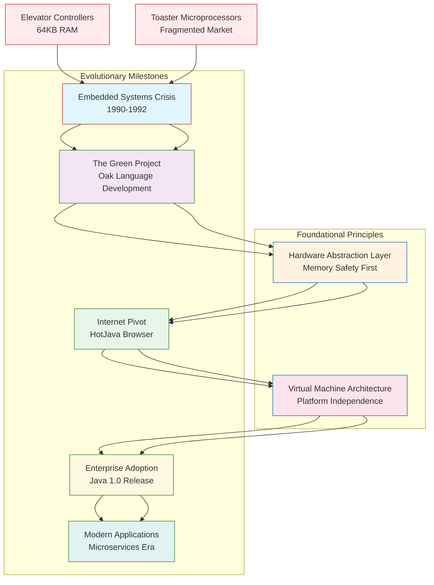

# Elevators, toasters, and the birth of Java

## Introduction

In 1991, a team at Sun Microsystems was wrestling with a problem that seems almost quaint today: how do you write reliable software for a toaster? Not a metaphorical toaster. An actual appliance with 64 kilobytes of RAM, no disk storage, and a processor that couldn't even handle floating-point arithmetic efficiently.

This wasn't some academic exercise. Consumer electronics companies were flooding the market with "smart" devices—microwaves that could time-cook, VCRs that could remember your favorite channels, and yes, toasters that could brown your bread to precise specifications. Each device ran on a different architecture, used different compilers, and spoke different protocols. Writing portable code across these platforms was a nightmare of `#ifdef` macros and platform-specific libraries.

What emerged from those constraints wasn't just a better way to program embedded devices. It was a completely new approach to software architecture—one that would eventually power enterprise applications, web services, and mobile platforms. The same design principles that made Java viable on a $5 microcontroller became the foundation for distributed systems running on thousands of servers.

The irony is delicious: the most successful enterprise software platform in history was born from trying to make toasters work reliably.

## Why This Matters

Every software engineer who's battled dependency hell, struggled with cross-platform compatibility, or debugged a memory leak knows the pain that Java's creators were trying to solve. But the solutions they arrived at weren't just about making developers' lives easier—they were about building systems that could survive in hostile environments with limited resources.

Today's engineers face similar constraints, just at different scales. Container orchestration requires careful resource management. Edge computing demands efficient code that runs on constrained hardware. Microservices architectures need robust isolation between components. The lessons learned in those early embedded projects are directly applicable to modern cloud-native development.

Understanding Java's origins isn't historical trivia—it's a masterclass in architectural decision-making under constraints. When you know why the garbage collector exists, why the JVM enforces strong typing, and why "write once, run anywhere" became more than marketing hype, you write better code regardless of your chosen platform.

## How It Works

The genius of Java wasn't inventing new computer science concepts. It was taking existing ideas—virtual machines, garbage collection, strong typing—and combining them in a way that addressed real engineering problems.



At its core, the Java platform is built on a simple but powerful idea: separate the execution environment from the underlying hardware. Instead of compiling directly to machine code, Java source compiles to bytecode that runs on the Java Virtual Machine (JVM). This abstraction layer handles memory management, security enforcement, and platform-specific optimizations.

The embedded systems background shaped every aspect of this design. Memory had to be managed automatically because manual allocation was too error-prone in safety-critical applications. Strong typing prevented the kind of pointer arithmetic that led to buffer overflows in C programs. The VM provided isolation between different processes running on the same device.

## Core Concepts

### Virtual Machine Architecture

The JVM isn't just a runtime—it's a complete execution environment that provides:

- **Memory Management**: Automatic garbage collection eliminates memory leaks and dangling pointers
- **Security Sandboxing**: Class loaders enforce namespace separation and access control
- **Bytecode Verification**: Ensures type safety before execution begins
- **Just-In-Time Compilation**: Optimizes frequently executed code paths at runtime

### Hardware Abstraction

Java's original embedded focus meant that every interaction with hardware had to go through well-defined interfaces. This principle evolved into the Java Collections Framework, JDBC database connectivity, and network programming APIs that abstract away platform-specific details.

### Concurrency Model

Early embedded systems dealt with real-time constraints and interrupt handling. Java's threading model inherited this focus on predictable behavior, though the implementation evolved significantly over time.

### Resource Management

The constraint of limited memory forced designers to think carefully about object lifecycle management. This led to features like weak references, finalizers, and later, the try-with-resources statement that guarantees cleanup.

## Examples & Code Walkthrough

Let's examine how these concepts translate to modern Java development through a practical example—a resource pool manager that demonstrates many of the architectural principles rooted in Java's embedded origins.

```java
import java.util.concurrent.*;
import java.util.concurrent.atomic.AtomicInteger;
import java.util.List;
import java.util.ArrayList;
import java.time.Instant;

/**
 * ResourcePool: A thread-safe resource pool that demonstrates
 * Java's embedded heritage in resource-constrained environments.
 * 
 * This implementation shows how automatic memory management,
 * strong typing, and concurrency primitives work together
 * to provide safe resource allocation without manual memory handling.
 */
public class ResourcePool<T> {
    private final BlockingQueue<PooledResource<T>> availableResources;
    private final List<PooledResource<T>> allResources;
    private final ResourceFactory<T> factory;
    private final AtomicInteger activeCount = new AtomicInteger(0);
    private final int maxResources;
    private volatile boolean closed = false;
    
    /**
     * Factory interface for creating new resources.
     * This abstraction mirrors the hardware abstraction layers
     * used in embedded Java applications.
     */
    @FunctionalInterface
    public interface ResourceFactory<T> {
        T create() throws ResourceCreationException;
        default void destroy(T resource) { /* optional cleanup */ }
    }
    
    /**
     * Wrapper class that tracks resource metadata.
     * Strong typing prevents mixing incompatible resources.
     */
    private static class PooledResource<T> {
        final T resource;
        final long createdAt;
        volatile long lastUsedAt;
        volatile boolean inUse;
        
        PooledResource(T resource) {
            this.resource = resource;
            this.createdAt = Instant.now().toEpochMilli();
            this.lastUsedAt = createdAt;
        }
    }
    
    /**
     * Custom exception for resource creation failures.
     * Checked exceptions force explicit error handling,
     * preventing silent failures common in embedded systems.
     */
    public static class ResourceCreationException extends Exception {
        public ResourceCreationException(String message, Throwable cause) {
            super(message, cause);
        }
    }
    
    /**
     * Initialize the resource pool with a factory and maximum size.
     * Pre-creating resources mimics embedded system initialization
     * where resources are allocated at startup, not dynamically.
     */
    public ResourcePool(ResourceFactory<T> factory, int maxResources, int initialSize) {
        if (maxResources <= 0 || initialSize < 0 || initialSize > maxResources) {
            throw new IllegalArgumentException("Invalid pool configuration");
        }
        
        this.factory = factory;
        this.maxResources = maxResources;
        this.availableResources = new ArrayBlockingQueue<>(maxResources);
        this.allResources = new ArrayList<>(maxResources);
        
        // Pre-populate with initial resources
        for (int i = 0; i < initialSize; i++) {
            try {
                addResource();
            } catch (ResourceCreationException e) {
                System.err.println("Failed to create initial resource: " + e.getMessage());
                // Continue with reduced capacity rather than failing completely
            }
        }
    }
    
    /**
     * Acquire a resource from the pool with timeout.
     * Returns null if no resource available within timeout.
     */
    public T acquire(long timeoutMillis) throws InterruptedException, ResourceExhaustedException {
        if (closed) {
            throw new IllegalStateException("Pool is closed");
        }
        
        PooledResource<T> resource = availableResources.poll(timeoutMillis, TimeUnit.MILLISECONDS);
        if (resource == null) {
            // Try to create new resource if under limit
            if (allResources.size() < maxResources) {
                try {
                    resource = addResource();
                } catch (ResourceCreationException e) {
                    throw new ResourceExhaustedException("Cannot create new resource", e);
                }
            }
            
            if (resource == null) {
                throw new ResourceExhaustedException(
                    String.format("No resources available after %d ms", timeoutMillis)
                );
            }
        }
        
        resource.inUse = true;
        resource.lastUsedAt = Instant.now().toEpochMilli();
        activeCount.incrementAndGet();
        return resource.resource;
    }
    
    /**
     * Return a resource to the pool.
     * Automatic validation prevents corrupted resources
     * from being reused—similar to embedded system health checks.
     */
    public void release(T resource) {
        if (resource == null) return;
        
        PooledResource<T> pooled = findPooledResource(resource);
        if (pooled == null) {
            // Resource wasn't from this pool—log warning
            System.err.println("Attempted to release unknown resource");
            return;
        }
        
        pooled.inUse = false;
        pooled.lastUsedAt = Instant.now().toEpochMilli();
        activeCount.decrementAndGet();
        availableResources.offer(pooled);
    }
    
    /**
     * Close the pool and release all resources.
     * Proper cleanup prevents memory leaks—a critical concern
     * in long-running server applications.
     */
    public void close() {
        closed = true;
        for (PooledResource<T> pr : allResources) {
            if (!pr.inUse) {
                factory.destroy(pr.resource);
            }
        }
        allResources.clear();
    }
    
    private PooledResource<T> addResource() throws ResourceCreationException {
        synchronized (allResources) {
            if (allResources.size() >= maxResources) {
                return null;
            }
            
            try {
                T newResource = factory.create();
                PooledResource<T> pooled = new PooledResource<>(newResource);
                allResources.add(pooled);
                availableResources.offer(pooled);
                return pooled;
            } catch (Exception e) {
                throw new ResourceCreationException("Failed to create resource", e);
            }
        }
    }
    
    private PooledResource<T> findPooledResource(T resource) {
        for (PooledResource<T> pr : allResources) {
            if (pr.resource == resource) {
                return pr;
            }
        }
        return null;
    }
    
    public int getActiveCount() {
        return activeCount.get();
    }
    
    public int getTotalCount() {
        return allResources.size();
    }
}
```

Usage example showing proper resource management:

```java
public class DatabaseConnectionPoolExample {
    public static void main(String[] args) throws Exception {
        // Create a connection pool similar to embedded system resource management
        ResourcePool<String> connectionPool = new ResourcePool<>(
            () -> {
                // Simulate expensive resource creation
                Thread.sleep(10); // Emulates network/database connection time
                return "DB_CONNECTION_" + System.nanoTime();
            },
            10,  // max connections
            2    // initial connections
        );
        
        // Demonstrate concurrent access pattern
        ExecutorService executor = Executors.newFixedThreadPool(5);
        
        for (int i = 0; i < 20; i++) {
            final int taskId = i;
            executor.submit(() -> {
                try {
                    String connection = connectionPool.acquire(1000); // 1 second timeout
                    System.out.printf("Task %d acquired: %s%n", taskId, connection);
                    
                    // Simulate work
                    Thread.sleep(50 + (taskId % 3) * 100);
                    
                    connectionPool.release(connection);
                    System.out.printf("Task %d released: %s%n", taskId, connection);
                } catch (Exception e) {
                    System.err.printf("Task %d failed: %s%n", taskId, e.getMessage());
                }
            });
        }
        
        executor.shutdown();
        executor.awaitTermination(10, TimeUnit.SECONDS);
        
        System.out.printf("Final stats - Active: %d, Total: %d%n",
            connectionPool.getActiveCount(), connectionPool.getTotalCount());
        
        connectionPool.close();
    }
}
```

This example demonstrates several core Java principles rooted in embedded systems:

1. **Automatic Resource Management**: No manual memory allocation/deallocation
2. **Strong Typing**: Type-safe resource handling prevents runtime errors
3. **Thread Safety**: Built-in concurrency control without explicit locking
4. **Error Handling**: Checked exceptions force explicit failure handling
5. **Resource Cleanup**: Proper lifecycle management prevents leaks

## Best Practices

Based on both the embedded origins and decades of production experience:

1. **Design for Failure**: Assume resources will be unavailable. Build graceful degradation paths.
2. **Pre-allocate When Possible**: Create resources during initialization rather than on-demand.
3. **Monitor Resource Usage**: Track active/inactive ratios to tune pool sizes.
4. **Implement Timeouts**: Never block indefinitely waiting for resources.
5. **Validate State**: Check resource health before returning to pool.
6. **Log Resource Lifecycle**: Track creation, acquisition, and release for debugging.
7. **Use Weak References Sparingly**: They're useful but can cause unexpected behavior.
8. **Profile Memory Usage**: Regular GC analysis reveals hidden resource leaks.

## Common Mistakes & Anti-Patterns

### 1. Resource Leaks from Improper Cleanup

```java
// BAD: Resource never returned to pool on exception
public void badResourceHandling(ResourcePool<Connection> pool) {
    Connection conn = pool.acquire(1000);
    // If exception occurs here, connection leaks
    conn.createStatement().executeQuery("SELECT * FROM users");
    pool.release(conn); // Never reached if exception thrown above
}

// GOOD: Guaranteed cleanup with try-finally
public void goodResourceHandling(ResourcePool<Connection> pool) {
    Connection conn = null;
    try {
        conn = pool.acquire(1000);
        conn.createStatement().executeQuery("SELECT * FROM users");
    } finally {
        if (conn != null) {
            pool.release(conn);
        }
    }
}

// BETTER: Try-with-resources (Java 7+) for AutoCloseable resources
public void bestResourceHandling() {
    try (Connection conn = DriverManager.getConnection("jdbc:h2:mem:test")) {
        conn.createStatement().executeQuery("SELECT * FROM users");
    } catch (SQLException e) {
        // Handle appropriately
    }
}
```

### 2. Ignoring InterruptedException

```java
// BAD: Silently swallowing interruption
public T acquireBad(long timeout) throws InterruptedException {
    try {
        return internalAcquire(timeout);
    } catch (InterruptedException e) {
        // Thread interrupted - but we ignore it!
        return internalAcquire(timeout); // Retry without respecting interruption
    }
}

// GOOD: Preserve interruption status
public T acquireGood(long timeout) throws InterruptedException {
    try {
        return internalAcquire(timeout);
    } catch (InterruptedException e) {
        // Restore interrupted status
        Thread.currentThread().interrupt();
        throw e;
    }
}
```

### 3. Race Conditions in Pool Management

```java
// BAD: Non-atomic check-then-act pattern
public boolean isResourceHealthy(Connection conn) {
    if (conn == null) return false;
    try {
        return !conn.isClosed() && conn.isValid(5); // Race condition!
    } catch (SQLException e) {
        return false;
    }
}

// GOOD: Defensive programming with proper synchronization
private final Object healthCheckLock = new Object();

public boolean isResourceHealthy(Connection conn) {
    if (conn == null) return false;
    synchronized (healthCheckLock) {
        try {
            return !conn.isClosed() && conn.isValid(5);
        } catch (SQLException e) {
            return false;
        }
    }
}
```

## Performance Considerations

### Memory Allocation Patterns

Java's garbage collector was designed
