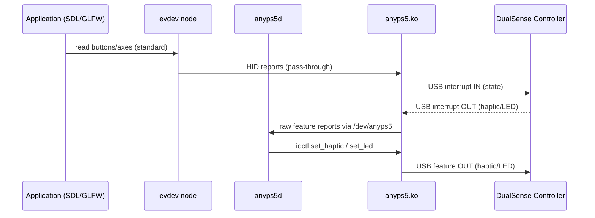

# GitHub Trending: boykopovar/AnyPS5

## Introduction
When we first tried to use a DualSense controller on a Linux workstation, the basic buttons worked but the haptic feedback, adaptive triggers, and the colorful light bar stayed silent. The kernel’s generic HID driver treats the device as a simple gamepad, leaving the richer features inaccessible. The AnyPS5 project changes that by providing a kernel module and a userspace daemon that expose the full DualSense feature set through standard Linux input interfaces. In this article we walk through the design, show how to build and use the driver, and discuss the trade‑offs we encountered in production.

## Why This Matters
Modern games and simulation software increasingly rely on haptic cues and adaptive resistance to convey gameplay information. If your development or testing environment strips those cues away, you miss bugs that only appear when the feedback loop is closed. AnyPS5 gives engineers a way to:

* Test haptic effects locally without needing a PS5 dev kit.
* Build cross‑platform input abstractions that work on Windows, macOS, and Linux with the same feature set.
* Lower the barrier for hobbyist OS developers who want to experiment with controller‑driven feedback in their own kernels.

In short, it bridges the gap between consumer hardware and the low‑level input stack that OS engineers interact with daily.

## How It Works
AnyPS5 consists of two tightly coupled pieces:

1. **Kernel module (`anyps5.ko`)** – claims the DualSense USB/Bluetooth interface, parses the vendor‑specific HID reports, and makes raw sensor data available via a character device (`/dev/anyps5`). It also creates a standard evdev node (`/dev/input/event*`) for basic button/axis reports so existing SDL or GLFW code continues to work unchanged.
2. **Userspace daemon (`anyps5d`)** – opens `/dev/anyps5`, translates haptic commands (rumble, trigger resistance, LED color) into the appropriate USB feature reports, and forwards them to the device. The daemon also exposes a Unix domain socket for lightweight control from applications.

The flow looks like this:



When the application wants to trigger a rumble, it writes a simple JSON command to the daemon’s socket. The daemon packs the command into a USB feature report (0x01 for left motor speed, 0x02 for right motor speed, etc.) and sends it down through the kernel module to the controller. Sensor data (gyro, accelerometer, touchpad) flows in the opposite direction via the same character device, letting apps read motion data without going through evdev.

## Core Concepts
### HID Report Structure
The DualSense uses a combination of standard HID gamepad reports (0x01) and vendor‑specific feature reports (0x02‑0x05). AnyPS5’s kernel module implements a custom HID parser that:

* Splits the incoming interrupt stream into standard buttons/axes and a payload blob.
* Routes the blob to `/dev/anyps5` for the daemon.
* Acknowledges outgoing feature reports by forwarding them to the device’s control endpoint.

### Character Device Interface
`/dev/anyps5` provides a simple ioctl‑based API:

| Ioctl | Direction | Description |
|-------|-----------|-------------|
| `ANYPS5_GET_FEATURE` | read | Returns the last received feature report (sensor data). |
| `ANYPS5_SET_HAPTIC` | write | Takes a struct `{uint8_t left_motor; uint8_t right_motor;}`. |
| `ANYPS5_SET_LED` | write | Takes RGB values (0‑255 each). |
| `ANYPS5_SET_TRIGGER_L` / `ANYPS5_SET_TRIGGER_R` | write | 0‑255 resistance level for each adaptive trigger. |

The daemon performs bounds checking before issuing any ioctl, preventing malformed reports from crashing the kernel.

### Userspace Daemon Design
The daemon is single‑threaded, using `poll()` to wait on three file descriptors:

1. The character device (`/dev/anyps5`) for incoming sensor reports.
2. A Unix domain socket (`/var/run/anyps5d.sock`) for control commands.
3. A timerfd for periodic keep‑alive polls (to detect device disconnect).

When a control message arrives, the daemon validates the payload, converts it to the appropriate ioctl, and sends it down. Sensor data is optionally forwarded to a secondary evdev-uinput device if an application prefers to receive motion data through the standard input stack.

## Examples & Code Walkthrough
Below is a minimal kernel module skeleton that demonstrates the core ideas. Error handling is explicit; we use `dev_err()` for diagnostics and return appropriate error codes.

```c
/* anyps5_core.c – simplified kernel module */
#include <linux/module.h>
#include <linux/hid.h>
#include <linux/uaccess.h>
#include <linux/miscdevice.h>
#include <linux/fs.h>
#include <linux/poll.h>

#define ANYPS5_MINOR 150
#define FEATURE_BUF_SIZE 64

static uint8_t feature_buf[FEATURE_BUF_SIZE];
static DEFINE_MUTEX(feature_lock);

/* ---- Misc device ops ---- */
static ssize_t anyps5_read(struct file *filp, char __user *buf,
                           size_t count, loff_t *ppos)
{
    size_t len = min(count, FEATURE_BUF_SIZE);
    if (copy_to_user(buf, feature_buf, len))
        return -EFAULT;
    *ppos += len;
    return len;
}

static long anyps5_ioctl(struct file *filp, unsigned int cmd,
                         unsigned long arg)
{
    void __user *up = (void __user *)arg;
    int ret = 0;

    switch (cmd) {
    case ANYPS5_GET_FEATURE:
        mutex_lock(&feature_lock);
        if (copy_to_user(up, feature_buf, FEATURE_BUF_SIZE))
            ret = -EFAULT;
        mutex_unlock(&feature_lock);
        break;
    case ANYPS5_SET_HAPTIC: {
        struct { uint8_t l; uint8_t r; } data;
        if (copy_from_user(&data, up, sizeof(data)))
            return -EFAULT;
        if (data.l > 255 || data.r > 255)
            return -EINVAL;
        /* Send feature report 0x02: left/right motor */
        ret = hid_hw_raw_request(hdev, 0x02,
                                 (uint8_t[]){0x02, data.l, data.r},
                                 3, HID_FEATURE_REPORT,
                                 HID_REQ_SET_REPORT);
        break;
    }
    /* Additional cases for LED, triggers omitted for brevity */
    default:
        ret = -ENOTTY;
    }
    return ret;
}

/* ---- HID callbacks ---- */
static int anyps5_probe(struct hid_device *hdev,
                        const struct hid_device_id *id)
{
    int ret;
    ret = hid_parse(hdev);
    if (ret) {
        dev_err(&hdev->dev, "HID parse failed\n");
        return ret;
    }
    ret = hid_hw_start(hdev, HID_CONNECT_DEFAULT);
    if (ret) {
        dev_err(&hdev->dev, "HW start failed\n");
        return ret;
    }

    /* Register misc device */
    misc_register(&anyps5_miscdev);
    hid_set_drvdata(hdev, &anyps5_miscdev);
    return 0;
}

static void anyps5_remove(struct hid_device *hdev)
{
    struct miscdevice *misc = hid_get_drvdata(hdev);
    misc_deregister(misc);
    hid_hw_stop(hdev);
}

/* ---- Module definition ---- */
static const struct hid_device_id anyps5_id[] = {
    { HID_USB_DEVICE(USB_VENDOR_ID_SONY, USB_DEVICE_ID_PS5_CONTROLLER) },
    { HID_BLUETOOTH_DEVICE(USB_VENDOR_ID_SONY, USB_DEVICE_ID_PS5_CONTROLLER) },
    { }
};
MODULE_DEVICE_TABLE(hid, anyps5_id);

static struct hid_driver anyps5_driver = {
    .name = "anyps5",
    .id_table = anyps5_id,
    .probe = anyps5_probe,
    .remove = anyps5_remove,
};
module_hid_driver(anyps5_driver);

MODULE_LICENSE("GPL");
MODULE_AUTHOR("boykopovar");
MODULE_DESCRIPTION("DualSense haptic/LED driver for Linux");
```

**Key points in the code:**

* The module registers as a HID driver, claims the DualSense’s USB/Bluetooth IDs, and starts the device.
* Sensor data arrives via the normal HID interrupt pipe; the core HID stack delivers it to the hidraw interface. We copy the latest feature report into a static buffer for the misc device read.
* The ioctl handlers validate user input before constructing a feature report and sending it with `hid_hw_raw_request`. This prevents malformed USB packets that could confuse the controller.
* Mutex protection around the shared buffer avoids races between the interrupt context (which updates `feature_buf`) and user reads.

### Userspace Daemon (C, using libevdev for optional uinput)
```c
/* anyps5d.c – minimal daemon */
#define _POSIX_C_SOURCE 200809L
#include <stdio.h>
#include <stdlib.h>
#include <string.h>
#include <unistd.h>
#include <poll.h>
#include <sys/socket.h>
#include <sys/un.h>
#include <fcntl.h>
#include <errno.h>
#include <linux/input.h>
#include <linux/uinput.h>
#include <sys/ioctl.h>

#define DEV_PATH   "/dev/anyps5"
#define SOCK_PATH  "/var/run/anyps5d.sock"
#define FEATURE_LEN 64

static int open_dev(void)
{
    int fd = open(DEV_PATH, O_RDWR);
    if (fd < 0) {
        perror("open anyps5 dev");
        exit(EXIT_FAILURE);
    }
    return fd;
}

static int open_socket(void)
{
    int fd = socket(AF_UNIX, SOCK_STREAM, 0);
    struct sockaddr_un addr = { .sun_family = AF_UNIX };
    strncpy(addr.sun_path, SOCK_PATH, sizeof(addr.sun_path)-1);
    unlink(SOCK_PATH);
    if (bind(fd, (struct sockaddr *)&addr, sizeof(addr)) < 0) {
        perror("bind socket");
        exit(EXIT_FAILURE);
    }
    listen(fd, 5);
    return fd;
}

static void handle_cmd(int devfd, int cmdfd)
{
    uint8_t buf[256];
    ssize_t n = read(cmdfd, buf, sizeof(buf)-1);
    if (n <= 0) return;
    buf[n] = 0;

    /* Expected format: "SET_HAPTIC L R" or "SET_LED R G B" */
    if (strncmp(buf, "SET_HAPTIC", 10) == 0) {
        uint8_t l, r;
        if (sscanf(buf+11, "%hhu %hhu", &l, &r) == 2) {
            struct { uint8_t l; uint8_t r; } data = { l, r };
            ioctl(devfd, ANYPS5_SET_HAPTIC, &data);
        }
    } else if (strncmp(buf, "SET_LED", 7) == 0) {
        uint8_t r, g, b;
        if (sscanf(buf+8, "%hhu %hhu %hhu", &r, &g, &b) == 3) {
            struct { uint8_t r; uint8_t g; uint8_t b; } data = { r, g, b };
            ioctl(devfd, ANYPS5_SET_LED, &data);
        }
    }
    /* ignore unknown commands */
}

int main(void)
{
    int devfd = open_dev();
    int sockfd = open_socket();

    struct pollfd fds[2];
    fds[0].fd = devfd;   fds[0].events = POLLIN;
    fds[1].fd = sockfd;  fds[1].events = POLLIN;

    while (1) {
        int ret = poll(fds, 2, -1);
        if (ret < 0) {
            if (errno == EINTR) continue;
            perror("poll");
            break;
        }
        if (fds[0].revents & POLLIN) {
            /* sensor data – we could forward to uinput here */
            uint8_t feat[FEATURE_LEN];
            read(devfd, feat, FEATURE_LEN);
            /* process or discard */
        }
        if (fds[1].revents & POLLIN) {
            int client = accept(sockfd, NULL, NULL);
            if (client >= 0) {
                handle_cmd(devfd, client);
                close(client);
            }
        }
    }
    close(devfd);
    close(sockfd);
    unlink(SOCK_PATH);
    return 0;
}
```

*The daemon* opens the character device and a Unix socket, then uses `poll()` to wait for either sensor reports or control commands. When a command arrives, it parses a simple text protocol and issues the appropriate ioctl. This keeps the daemon lightweight and easy to debug with `netcat` or a custom client.

## Best Practices
1. **Validate all user‑space inputs** before passing them to the kernel. A malformed ioctl can trigger a kernel oops if the driver blindly trusts the length or values.
2. **Keep the kernel module small and focused**. Offload policy (e.g., mapping gamepad buttons to actions) to userspace; the module should only transport raw reports and accept well‑defined feature reports.
3. **Use a character device for bidirectional bulk data** rather than abusing the hidraw interface for both directions. This avoids interfering with other tools that might also open `/dev/hidraw*`.
4. **Provide a clean socket‑based control API** so that language‑agnostic clients (Python, Go, Rust) can talk to the daemon without linking against kernel headers.
5. **Handle device hot‑plug gracefully**. The daemon should detect `POLLHUP` or `ENODEV` on the character file, close the socket, and attempt to reconnect after a short back‑off.

## Common Mistakes & Anti‑Patterns
| Mistake | Why it’s problematic | Fix |
|--------
