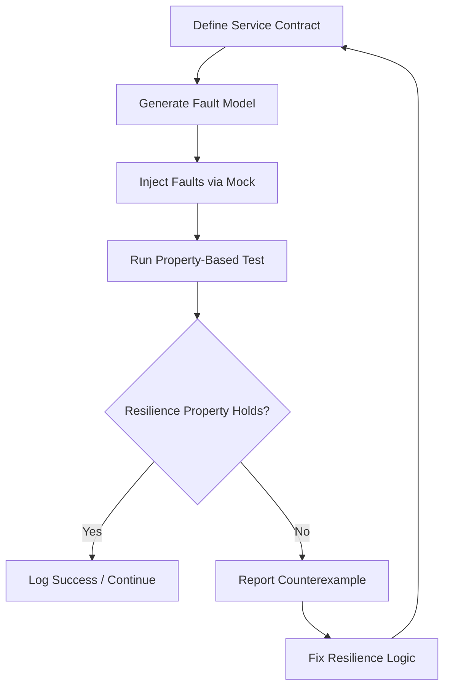

# Presentation: How to Find Resilience Bugs in Systems that Don't Exist

## Introduction
When you design a service you often rely on contracts with other components—databases, APIs, message queues. In practice those components may fail in ways you never imagined: they can drop connections, return corrupted data, or simply disappear. Testing only the happy path leaves you blind to those failure modes. The trick is to treat the *missing* or *unreliable* part of the system as a first‑class test subject: generate realistic fault models for components that don’t yet exist (or that you can’t control in production) and verify that your own code stays resilient under those conditions.

## Why This Matters
Production outages frequently trace back to unhandled error paths that were never exercised during development. A single missed timeout or retry can cascade into a service‑wide degradation, hurting SLA compliance and eroding user trust. By systematically probing your code against synthetic failures you catch those bugs early, reduce the mean time to recovery, and gain confidence that your resilience patterns (circuit breakers, bulkheads, timeouts) actually work when the real world gets noisy.

## How It Works
The workflow consists of four repeatable steps:

1. **Define a contract** – describe the expected interface (request/response shape, latency bounds, error codes) of the dependency.
2. **Generate a fault model** – from the contract produce a set of possible misbehaviors (latency spikes, error codes, partial responses, silent drops).
3. **Inject faults in a test harness** – replace the real dependency with a mock that can emit any fault from the model, driven by a property‑based tester.
4. **Assert resilience properties** – verify that your service respects invariants such as “no request hangs forever”, “error rates stay below a threshold”, or “state remains consistent”.

The following diagram visualizes the loop:



Each iteration tightens the contract or improves the fault model, gradually expanding the space of failure scenarios you have validated.

## Core Concepts
- **Contract**: A formal description (e.g., OpenAPI, Protobuf, or a simple Go interface) that isolates the service from its collaborators.
- **Fault Model**: A probabilistic or exhaustive set of deviations from the contract (latency distribution, error codes, message loss, corruption).
- **Property‑Based Testing**: Instead of a single example, the test framework generates many inputs (here: fault sequences) and checks that a property always holds.
- **Observability Hooks**: Instruments (metrics, traces, logs) inside the service let the test harness detect violations of resilience properties.
- **Deterministic Seeding**: To make flaky tests reproducible, the fault injector is seeded; a failing run yields a concrete seed that can be replayed.

## Examples & Code Walkthrough
Below is a minimal Go service that talks to an external `UserStore`. We'll test its resilience using the `goquick` property‑based library and a custom mock that can inject latency, errors, and partial responses.

```go
package usersvc

import (
	"context"
	"errors"
	"time"
)

// UserStore defines the contract we depend on.
type UserStore interface {
	GetUser(ctx context.Context, id string) (User, error)
}

// User is the domain object returned by the store.
type User struct {
	ID   string
	Name string
	Age  int
}

// Service wraps a store and adds a timeout + retry policy.
type Service struct {
	store   UserStore
	timeout time.Duration
	retries int
}

// NewService builds a service with sensible defaults.
func NewService(s UserStore) *Service {
	return &Service{
		store:   s,
		timeout: 200 * time.Millisecond,
		retries: 2,
	}
}

// FetchUser attempts to get a user, applying timeout and retry logic.
func (s *Service) FetchUser(ctx context.Context, id string) (User, error) {
	var lastErr error
	for attempt := 0; attempt <= s.retries; attempt++ {
		// Create a child context that enforces the per‑attempt timeout.
		ctx, cancel := context.WithTimeout(ctx, s.timeout)
		u, err := s.store.GetUser(ctx, id)
		cancel()

		if err == nil {
			return u, nil
		}
		lastErr = err

		// If the error is context.DeadlineExceeded we retry; otherwise we break.
		if !errors.Is(err, context.DeadlineExceeded) {
			break
		}
		// Backoff briefly before retry.
		time.Sleep(50 * time.Millisecond)
	}
	return User{}, lastErr
}
```

### Mock that Generates Faults
```go
package mockstore

import (
	"context"
	"errors"
	"math/rand"
	"time"
)

// FaultyStore implements UserStore but can misbehave according to a fault model.
type FaultyStore struct {
	// Probability of returning an error on each call.
	errorRate float64
	// Probability of delaying beyond the configured timeout.
	latencyRate float64
	// Max extra latency we might inject (nanoseconds).
	maxLatency int64
	rand       *rand.Rand
}

// NewFaultyStore creates a store seeded for deterministic testing.
func NewFaultyStore(seed int64, errRate, latRate float64, maxLat int64) *FaultyStore {
	return &FaultyStore{
		errorRate:  errRate,
		latencyRate: latRate,
		maxLatency: maxLat,
		rand:       rand.New(rand.NewSource(seed)),
	}
}

// GetUser either returns a valid user, an error, or waits longer than usual.
func (f *FaultyStore) GetUser(_ context.Context, id string) (User, error) {
	// Simulate latency spike.
	if f.rand.Float64() < f.latencyRate {
		delay := time.Duration(f.rand.Int63n(f.maxLatency)) * time.Nanosecond
		time.Sleep(delay)
	}

	// Simulate random error.
	if f.rand.Float64() < f.errorRate {
		return User{}, errors.New("simulated store error")
	}

	// Normal successful response.
	return User{ID: id, Name: "Test User", Age: 30}, nil
}
```

### Property‑Based Test
```go
package usersvc_test

import (
	"context"
	"testing"

	"github.com/google/goquick"
	"your/module/mockstore"
	"your/module/usersvc"
)

// Property: under any fault model the service must either return a valid user
// or return an error that is not nil, and it must never block forever.
func ServiceResilience(t *testing.T) {
	goquick.Check(func(seed int64, errRate, latRate float64, maxLat int64) bool {
		// Bound the inputs to keep the test fast.
		if errRate < 0 || errRate > 1 || latRate < 0 || latRate > 1 || maxLat < 0 {
			return true // skip invalid combos
		}
		mock := mockstore.NewFaultyStore(seed, errRate, latRate, maxLat)
		svc := usersvc.NewService(mock)

		ctx := context.Background()
		// Use a timeout on the test itself to catch hangs.
		done := make(chan struct{}, 1)
		panicChan := make(chan interface{}, 1)
		go func() {
			defer func() { panicChan <- recover() }()
			_, err := svc.FetchUser(ctx, "user-123")
			done <- struct{}{}
		}()

		select {
		case <-done:
			// Completed without panic.
			return <-panicChan == nil
		case <-time.After(500 * time.Millisecond):
			// Took too long → potential hang.
			return false
		case p := <-panicChan:
			// Panic inside the service is a failure.
			t.Errorf("service panicked: %v", p)
			return false
		}
	}, goquick.Values(
		// Seed for reproducibility.
		goquick.Int64Range(0, 1<<30),
		// Error rate 0.0–0.5.
		goquick.Float64Range(0, 0.5),
		// Latency spike rate 0.0–0.5.
		goquick.Float64Range(0, 0.5),
		// Max extra latency up to 200ms.
		goquick.Int64Range(0, int64(200*time.Millisecond)),
	))
}
```

Running the test will explore thousands of fault combinations. If a particular seed causes a hang or panic, the framework prints that seed, allowing you to replay the exact scenario and fix the underlying issue (e.g., missing context propagation, insufficient back‑off, or a deadlock in retry logic).

## Best Practices
- **Keep contracts versioned** – any change to the interface should trigger a refresh of the fault model.
- **Start with simple fault models** (error rates, latency) then gradually add more sophisticated behaviors like partial responses or out‑of‑order messages.
- **Deterministic seeding** makes flaky tests reproducible; log the seed on failure.
- **Limit blast radius** – run fault injection in a dedicated test namespace or container so that a misbehaving mock never touches production data.
- **Integrate with CI** – treat the property‑based test as a gate; require a minimum number of generated cases (e.g., 10 000) before merging.
- **Monitor real‑world metrics** – compare the observed error/latency distribution in production with the ranges you tested; adjust the model if reality exceeds your assumptions.

## Common Mistakes & Anti‑Patterns
| Mistake | Why It’s Harmful | Fix |
|---------|------------------|-----|
| **Only mocking the happy path** | You never see how your code reacts to errors, timeouts, or corrupted data. | Use a fault model that injects errors at a configurable rate; start low and increase. |
| **Ignoring temporal faults** (e.g., delayed responses that exceed timeout) | A service may appear resilient under instant failures but deadlock when responses are slow. | Add latency spikes to the model; test with values both below and above your configured timeouts. |
| **Reusing real stateful dependencies in unit tests** | Tests become nondeterministic and can pollute each other, hiding bugs that only appear under contention. | Replace stateful collaborators with mocks that can simulate state transitions (e.g., a mock DB that can return stale reads). |
| **Assuming a single retry is enough** | Under bursty faults a single retry may still fail, leading to cascading timeouts. | Parameterize retry count and back‑off; verify with the property‑based test that increasing retries improves the success rate without causing resource exhaustion. |
| **Neglecting to cancel in-flight requests on timeout** | Goroutines or threads may leak, exhausting resources over time. | Ensure every timeout‑context call includes a `defer cancel()` and verify with a leak detector (e.g., Go’s `-race` or a custom goroutine counter). |

## Performance Considerations
- **Property‑based test explosion**: The input space grows quickly with the number of fault dimensions. Mitigate by:
  - Bounding each dimension (e.g., error rate ≤ 0.5).
  - Using `goquick.Values` to sample rather than exhaust.
  - Running the test with a fixed number of iterations (default 100) for quick feedback, and a higher count (e.g., 10 000) in nightly builds.
- **Mock overhead**: The mock adds a few nanoseconds of work per call; negligible compared to real I/O.
- **Deterministic seeding**: Guarantees that a failing test can be replayed without re‑generating the entire space, reducing debugging time.
- **Resource usage**: Ensure that the test harness does not accumulate goroutines or timers; each test iteration should clean up its context and mock state.

## Real-World Usage
- **Netflix** runs *Chaos Monkey* in production but also injects faults in their CI pipeline using a library called *Simian Army* to validate circuit‑breaker and retry logic before deployment.
- **Uber** employs *gRPC fault injection* in their service mesh to test latency tolerance and back‑pressure handling across microservices.
- **Cloudflare** uses synthetic traffic generators that can deliberately drop or corrupt packets to verify that their edge services remain compliant with SLOs under network faults.
- **Google SRE** teams write *test harnesses* that emulate downstream datastore failures (e.g., Bigtable latency spikes) to validate their *load‑shedding* and *admission control* mechanisms.

These organizations treat the “missing” or “unreliable” part of the system as a first‑class test artifact, exactly the approach outlined here.

## Frequently Asked Questions (FAQ)
**Q: How do I decide which fault rates to use?**  
Start with observations from production monitoring (e.g., 99th‑percentile latency, error percentages). Use those as upper bounds for your model; you can then explore worse‑case values to uncover hidden assumptions.

**Q: Won’t property‑based testing make my test suite slow?**  
Only if you let it run unchecked. Keep the CI version to a modest iteration count (e.g., 200) and run an extended suite nightly or on release branches. The feedback loop stays fast while still gaining coverage.

**Q: What if my service has internal state that makes reproducibility hard?**  
Extract the state‑dependent logic into pure functions where possible, and test those functions with property‑based tests. For the remaining thin integration layer, use deterministic mocks that simulate state transitions (e.g., a mock DB that can be put into “stale‑read” mode).

**Q: How do I know if my fault model is realistic enough?**  
Compare the distribution of observed faults in production (latency histograms, error codes) with the ranges you inject. If production regularly exceeds your test bounds, expand the model; if your tests are far harsher than reality, you may be over‑engineering.

**Q: Can this approach replace chaos engineering in production?**  
No. Property‑based testing validates design assumptions *before* code reaches production. Chaos engineering validates that those assumptions hold in the real, dynamic environment. Use both: unit‑level property tests for early detection,
