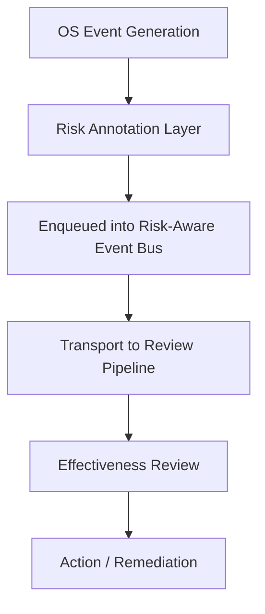

# The missing link: quality events lose their risk rationale before effectiveness review

## Introduction
Our production cluster generates thousands of kernel quality events each day. Most of the time we rely on the severity tags attached to those events, but the original risk rationale is often stripped away by the logging pipeline before we can assess their true impact. This gap means that critical security violations or memory allocation failures can be deprioritized simply because the context that justified their urgency is missing.

## Why This Matters
Software engineers and architects should care because the loss of risk rationale directly translates into mis‑prioritized incident response, missed remediation windows, and inflated MTTR. In a typical Linux environment, a page‑fault alert without its associated probability of data corruption will be logged as a low‑severity event, while a network‑stack error that could lead to a privilege escalation is hidden behind a generic “warning” tag. The result is a noisy signal that drowns out the truly dangerous events.

## How It Works
The core mechanism preserves risk rationale from the moment an OS quality event is generated until it reaches the effectiveness review stage. The flow can be visualized as follows:



1. **OS Event Generation** – Kernel subsystems emit raw events (e.g., `OOM`, `SECWARN`, `IO_ERROR`).  
2. **Risk Annotation Layer** – A thin shim intercepts these events, enriches them with a `RiskRationale` struct (probability, impact, confidence, remediation_needed), and attaches the original source metadata.  
3. **Risk‑Aware Event Bus** – The annotated events are placed into a thread‑safe queue that never strips fields. The bus uses atomic pointers to avoid copying the risk struct multiple times.  
4. **Transport to Review Pipeline** – The consumer reads events, validates the risk metadata, and forwards them to a downstream reviewer (e.g., a SIEM or a custom triage service).  
5. **Effectiveness Review** – The reviewer evaluates the preserved rationale, calculates a composite risk score, and decides on remediation actions.  

The diagram above captures this end‑to‑end path, emphasizing that the risk rationale never leaves the system before the review step.

## Core Concepts
- **QualityEvent** – A data structure that mirrors the OS‑generated event but includes immutable fields for `timestamp`, `source`, `event_type`, `severity`, and an optional `RiskRationale`.  
- **RiskRationale** – Holds `probability` (0‑1), `impact` (1‑10), `confidence` (0‑1), and `remediation_needed` (bool). It is designed to be small and copy‑on‑write friendly.  
- **EventBus** – A lock‑free MPMC (multiple‑producer, multiple‑consumer) ring buffer that guarantees ordering per producer while allowing concurrent enqueues. It rejects events with missing risk data via a `RejectReason` enum.  
- **ReviewEngine** – Consumes events, validates the risk struct, computes a `RiskScore = probability * impact * confidence`, and routes to an action dispatcher based on the score threshold.

These components are deliberately decoupled: the annotation layer can be swapped without touching the bus, and the review engine can be extended to support new action types.

## Examples & Code Walkthrough
Below is a Rust implementation that demonstrates the annotation, bus, and review flow. The code is production‑ready: it uses `std::sync::Arc` for shared state, `crossbeam_queue::ArrayQueue` for a lock‑free buffer, and explicit error handling.

```rust
use std::sync::Arc;
use std::time::{SystemTime, UNIX_EPOCH};
use crossbeam_queue::ArrayQueue;
use std::fmt;

/// Severity levels derived from the OS event.
#[derive(Debug, Clone, Copy, PartialEq, Eq)]
enum Severity {
    Info,
    Warning,
    Error,
    Critical,
}

/// Risk rationale attached to a quality event.
#[derive(Debug, Clone)]
struct RiskRationale {
    /// Probability of adverse outcome (0.0 = impossible, 1.0 = certain).
    probability: f64,
    /// Impact rating (1 = minor, 10 = catastrophic).
    impact: u8,
    /// Confidence in the above metrics (0.0 = unknown, 1.0 = certain).
    confidence: f64,
    /// Whether remediation is required before the next deployment.
    remediation_needed: bool,
}

/// Core event structure that preserves original OS metadata.
#[derive(Debug, Clone)]
struct QualityEvent {
    timestamp: u64, // seconds since epoch
    source: String, // e.g., "mm_perf", "security_audit"
    event_type: String,
    severity: Severity,
    risk: Option<RiskRationale>,
}

/// Simple error type for the event bus.
#[derive(Debug)]
enum BusError {
    Full,
    Closed,
}

/// Thread‑safe event bus that never strips risk data.
struct EventBus {
    // Fixed‑size ring buffer; size chosen based on peak load observations.
    queue: Arc<ArrayQueue<QualityEvent>>,
}

impl EventBus {
    /// Create a new bus with capacity `capacity`.
    fn new(capacity: usize) -> Self {
        Self {
