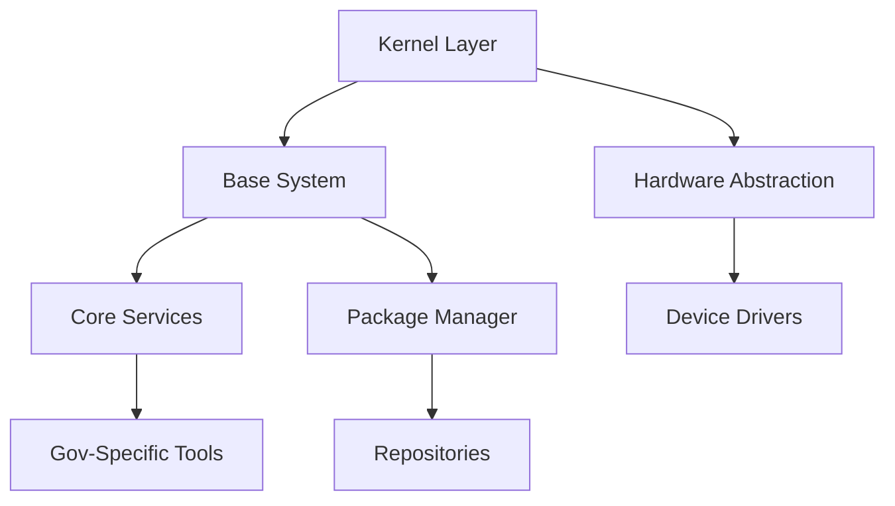

# The Netherlands is building its own Linux OS to break free from Microsoft

## Introduction

The Dutch government has announced plans to develop a sovereign Linux-based operating system, aiming to reduce dependence on proprietary platforms like Microsoft Windows. While headlines often frame this as a geopolitical move, the engineering implications are far more nuanced. At its core, this initiative is about building a secure, auditable, and maintainable OS stack — one that can be trusted by public institutions handling sensitive citizen data.

This isn't just another Linux distribution. It's an attempt to create a hardened, minimal OS tailored for government workloads — with full control over the kernel modules, package repositories, and update mechanisms. For engineers working in infrastructure, security, or compliance, there’s a lot to unpack here.

## Why This Matters

Let’s cut through the noise: most organizations don’t build their own operating systems because it’s expensive and risky. But governments operate under different constraints — regulatory mandates, supply chain risks, and long-term support requirements that commercial vendors struggle to meet.

For software architects and SREs, this project raises critical questions:
- How do you design a minimal, secure OS for production clusters?
- What does full-stack auditability look like when you own every layer?
- Can we apply similar principles in enterprise environments without reinventing the wheel?

It matters because the Dutch effort reflects a growing trend toward sovereign tech stacks — and offers lessons for anyone designing resilient, self-hosted infrastructure.

## How It Works

The proposed OS will likely follow a modular architecture built on top of the mainline Linux kernel, with custom user-space tools and a curated set of packages. Here’s a high-level view of how such a system might be structured:



### Step-by-step Breakdown:

1. **Kernel Customization**: Start with a vanilla Linux kernel and strip out unnecessary drivers/modules. Apply security patches and enable features like SELinux or AppArmor for mandatory access control.
2. **Minimal Base System**: Use tools like Yocto or Buildroot to generate a tiny root filesystem with only essential binaries (`/bin`, `/sbin`, `/usr`).
3. **Custom Package Repository**: Host internally signed DEB/RPM packages to ensure integrity and traceability.
4. **Service Management**: Replace systemd with a lighter init system if needed, or harden existing ones using sandboxing techniques.
5. **Audit & Logging Layer**: Integrate centralized logging with immutable audit trails via journald or custom syslog daemons.

Each component must be version-controlled, tested independently, and deployed through automated pipelines — much like modern microservices, but at the OS level.

## Core Concepts

Before diving into implementation details, let’s define the key building blocks:

### 1. Immutable Root Filesystem
A read-only base image prevents unauthorized changes. Updates happen atomically through verified boot processes.

### 2. Verified Boot Chain
UEFI Secure Boot + dm-verity ensures that each stage of the boot process is cryptographically validated.

### 3. Minimal Attack Surface
Only install what’s strictly required. Remove unused daemons, disable USB auto-mounting, and lock down network interfaces.

### 4. Centralized Configuration Management
Use declarative configs managed via GitOps-style workflows. Tools like Ansible, Puppet, or even Kubernetes CRDs can manage node state across thousands of machines.

### 5. Transparency Through Auditing
All system calls, file modifications, and privilege escalations should log to tamper-evident stores — ideally stored off-node in append-only storage.

These aren't theoretical ideals. They're battle-tested practices used by companies like Google (BeyondCorp), AWS (Firecracker), and now, potentially, nation-states.

## Examples & Code Walkthrough

Let’s explore how to implement a basic service manager in Rust — something that could serve as a lightweight replacement for parts of systemd in a minimal environment.

```rust
// src/main.rs - Simple service supervisor written in Rust
use std::process::Command;
use std::time::Duration;
use tokio::time;

#[derive(Debug)]
struct ServiceConfig {
    name: String,
    exec_start: String,
    restart_policy: RestartPolicy,
}

#[derive(Debug)]
enum RestartPolicy {
    Always,
    OnFailure(u32), // Max retries
}

impl ServiceConfig {
    fn spawn(&self) -> Result<(), String> {
        match Command::new(&self.exec_start)
            .arg("--daemon")
            .spawn()
        {
            Ok(child) => {
                println!("Started {} with PID {}", self.name, child.id());
                Ok(())
            },
            Err(e) => Err(format!("Failed to start {}: {}", self.name, e)),
        }
    }
}

async fn run_supervisor(configs: Vec<ServiceConfig>) {
    let mut interval = time::interval(Duration::from_secs(30));
    
    loop {
        interval.tick().await;
        
        for config in &configs {
            match config.spawn() {
                Ok(_) => println!("Service {} restarted successfully.", config.name),
                Err(msg) => eprintln!("{}", msg),
            }
        }
    }
}

#[tokio::main]
async fn main() {
    let services = vec![
        ServiceConfig {
            name: "sshd".to_string(),
            exec_start: "/usr/bin/sshd".to_string(),
            restart_policy: RestartPolicy::Always,
        },
        ServiceConfig {
            name: "nginx".to_string(),
            exec_start: "/usr/sbin/nginx".to_string(),
            restart_policy: RestartPolicy::OnFailure(3),
        },
    ];

    run_supervisor(services).await;
}
```

> Note: This example assumes `tokio` runtime and focuses on simplicity. In production, you'd add health checks, signal handling, and inter-process communication.

Key takeaways:
- We use async Rust for concurrency-safe supervision loops.
- Each service is defined declaratively, making configuration easy to version.
- Error propagation helps detect failures early.

For larger deployments, consider integrating with container runtimes like Podman or embedding within a broader orchestration framework.

## Best Practices

Drawing from real-world experience managing fleets of Linux servers, here are some field-tested recommendations:

### 1. Keep Images Small
Strip binaries with `strip --strip-all`, remove manpages/docs during build, and prefer static linking where possible.

### 2. Automate Everything
Build pipelines should compile, test, and sign artifacts automatically. Any manual step introduces drift and risk.

### 3. Monitor at Every Layer
Instrument not just applications, but also kernel metrics (`vmstat`, `iostat`) and firmware events (TPM logs).

### 4. Enforce Policy as Code
Use tools like Open Policy Agent (OPA) to validate configurations before they reach nodes.

### 5. Plan for Rollback
Every deploy must support instant rollback — whether via snapshotting filesystems or blue-green deployment strategies.

## Common Mistakes & Anti-Patterns

Even experienced teams fall into these traps when building custom OS images:

### ❌ Including Unnecessary Packages
Installing too many tools increases attack surface and complicates patching.

✅ Fix: Audit dependencies regularly using tools like `deborphan` or `rpm -qa`.

### ❌ Hardcoding Secrets
Embedding credentials directly in scripts or binaries leads to leaks.

✅ Fix: Inject secrets at runtime using Vault, AWS Secrets Manager, or encrypted overlays.

### ❌ Ignoring Hardware Diversity
Testing only on VMs ignores quirks present in physical hardware.

✅ Fix: Maintain hardware compatibility matrices and run periodic bare-metal validation suites.

### ❌ Skipping Fuzz Testing
Unvalidated input parsing in low-level utilities invites exploits.

✅ Fix: Run fuzzers like AFL++ against core utilities during CI builds.

## Performance Considerations

Building an OS means thinking deeply about resource usage:

| Component        | Memory Overhead | CPU Impact | Scalability |
|------------------|------------------|------------|-------------|
| Kernel Modules   | Low              | Medium     | High        |
| Init System      | Very Low         | Negligible | Infinite    |
| Logging Daemon   | Moderate         | Low        | Medium      |
| Audit Subsystem  | High             | High       | Limited     |

### Key Points:
- **Memory**: Aim for sub-100MB RAM footprint post-boot.
- **CPU**: Avoid polling loops; rely on event-driven models.
- **Disk I/O**: Prefer tmpfs for volatile data to reduce wear on flash storage.
- **Network Latency**: Cache DNS lookups locally to avoid round trips.

Big-O complexity matters less at the OS level than ensuring deterministic latencies under load.

## Real-World Usage

While few nations have built their own OSes, several global players have adopted similar approaches:

### Google – ChromeOS
Built on a hardened Linux kernel with verified boot, automatic updates, and per-app sandboxing.

### Microsoft – Azure Sphere
A specialized IoT OS based on a custom Linux kernel optimized for constrained devices.

### Amazon – Firecracker
MicroVMs powered by a stripped-down Linux kernel, used extensively in AWS Lambda.

The Dutch initiative joins this elite cohort, albeit targeting desktop/government use cases rather than cloud or mobile.

## Frequently Asked Questions (FAQ)

### Q: Is creating a national OS feasible?
Yes, but costly. Projects like CentOS Stream show how communities can sustain large distributions. Governments need funding and talent pipelines.

### Q: Will it improve cybersecurity?
Partially. A smaller attack surface helps, but misconfiguration remains the biggest threat vector.

### Q: Can enterprises adopt these ideas?
Absolutely. Many adopt minimal base images, enforce immutability, and centralize patching — all hallmarks of sovereign OS design.

### Q: What about application compatibility?
Expect breakage. Legacy apps may require recompilation or containerization to run smoothly.

### Q: How does this affect developers?
Developers gain more insight into underlying systems, enabling better debugging and optimization.

## Conclusion

Building a sovereign Linux OS isn’t about politics — it’s about taking ownership of your computing stack. Whether you’re securing a government network or running a high-scale SaaS platform, the principles remain the same: minimize complexity, maximize transparency, and automate relentlessly.

The Netherlands’ bold move serves as both inspiration and cautionary tale. If done right, it could redefine trust in digital infrastructure. If rushed, it risks becoming another bloated distro with unclear value.

But for engineers? It’s a masterclass in systems thinking — and worth studying regardless of your mission.
