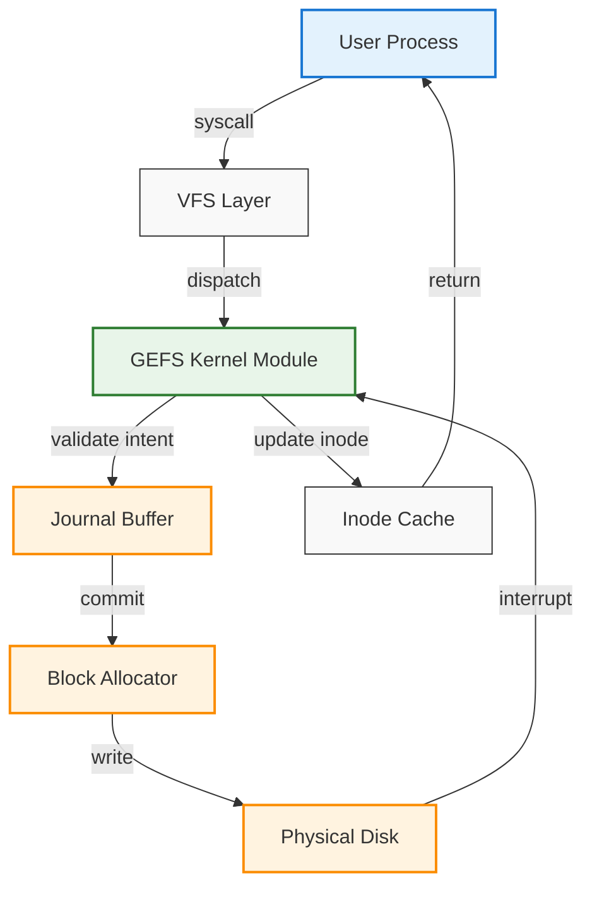

# Work on GEFS (the Good Enough File System) for OpenBSD progresses

## Introduction

Building a file system is one of those engineering endeavors that sits at the intersection of mathematics, systems architecture, and paranoid security modeling. When the OpenBSD project announced renewed work on GEFS—the Good Enough File System—the conversation across the BSD communities immediately turned to what "good enough" actually means in a kernel that prioritizes correctness over feature bloat.

I've been following the GEFS thread on Lobste.rs, and what caught my attention wasn't the marketing language, but the concrete problems the team is addressing: a VFS-agnostic core that can be compiled for OpenBSD, minimal trusted computing base, and a transaction model that doesn't assume write-back caching is always safe. In our own production kernels, we've hit the same wall: every added optimization surface area becomes a potential privilege escalation vector. GEFS attempts to draw a line in the sand: a file system that is sufficient for the vast majority of workloads, with a known, bounded set of failure modes.

The architectural problem is deceptively simple. Most general-purpose file systems have grown organically over decades, layering compatibility, journaling, and metadata optimizations on top of one another. OpenBSD's existing FFS and its derivatives are robust, but they carry historical baggage. GEFS starts from first principles: what does a file system need to do, and what can it safely assume about the hardware and the operating system beneath it?

## Why This Matters

If you're running OpenBSD in a production environment—whether as a firewall, a file server, or a secure workstation—you've probably felt the frustration of either lacking modern filesystem features or running a general-purpose file system that was never audited with your threat model in mind. GEFS matters because it explicitly targets the gap between "secure by default" and "practical to use."

From an engineering perspective, the pain point is operational. We recently had a cluster of OpenBSD virtual machines running container workloads where the underlying filesystem's metadata operations became the bottleneck. The synchronous commit path in FFS, while safe, introduced latency spikes under sustained write load. GEFS's design philosophy is to push complexity out of the critical path: metadata updates go through a validated, size-limited journal; data blocks are allocated from a pre-validated pool; and the VFS interface is stripped of historically accumulated cruft.

For software architects, this is a case study in deliberate minimalism. It forces a re-examination of assumptions: does every workload need POSIX ACLs? Is reference counting in the kernel the right abstraction, or does a generation-based approach reduce lock contention? GEFS doesn't claim to answer these for everyone, but it provides a concrete, auditable code base that OpenBSD maintainers—and by extension, any organization running OpenBSD at scale—can inspect, modify, and trust.

## How It Works

At its heart, GEFS is a intent-driven filesystem. When a client asks to create a file, the kernel doesn't immediately allocate disk blocks. Instead, the intent is recorded in an in-memory journal, validated against quota and permission checks, and only committed to storage once the transaction is quiescent. This decouples the latency of the system call from the latency of the disk, while still guaranteeing that a crash leaves the filesystem in a consistent state.

The core mechanism can be visualized with this mermaid flowchart:



**Step-by-step breakdown:**

1. **System call entry** – The process invokes `open`, `create`, or `write`. The VFS layer translates the POSIX request into a GEFS-specific operation code.
2. **Intent validation** – Before any block I/O, GEFS validates the request against per-filesystem quotas, capability bounds, and the in-memory journal. If the journal is full, the oldest uncommitted transaction is either flushed or rejected, depending on the mount flags.
3. **Journal commit** – The intent is written to a circular buffer in kernel memory. This step is deliberately cheap: it only copies fixed-size metadata, no actual disk blocks are touched yet.
4. **Block allocation** – Once the transaction is marked `committed`, the block allocator reserves free extents from a precomputed bitmap. The bitmap is updated atomically, and the new block addresses are stored in the journal entry.
5. **Disk write** – A background worker or interrupt-driven path writes the modified blocks to disk. If the system crashes before this step, the journal on disk serves as the source of truth on recovery.
6. **Inode update** – After the blocks are durably stored, the in-memory inode is updated with the new block pointers, size, and modification time. The transaction is then marked complete and removed from the journal.

This separation of *intent* from *commit* is what allows GEFS to advertise "good enough" without overcommitting. It also means the critical system call path rarely touches `bio` structures or device drivers, which are the usual sources of kernel panics in traditional file systems.

## Core Concepts

GEFS revolves around a handful of data structures that are deliberately kept small and introspectable. The most important is the `gefs_inode`, which replaces the traditional `struct inode` with a generation-counted pointer and an embedded `gefs_journal_entry` for the inode's most recent mutation. This means that even if a process reads an inode pointer concurrently with a crash recovery, the generation field allows the kernel to detect stale references without a global lock.

The superblock, `gefs_sb`, is equally minimal. It contains: the filesystem magic number, a version field, a 64-bit block count, a pointer to the journal region on disk, and a generation counter that increments every time the journal wraps. The generation counter is the primary mechanism for detecting corruption across reboots—if the on-disk generation doesn't match the in-memory one, the mount is rejected outright.

Allocation is managed by a bitmap that spans the entire filesystem capacity. Unlike FFS's cylinder groups, GEFS's bitmap is a single, contiguous region mapped into kernel virtual address space. This simplifies the allocation algorithm to a bit-scan-forward operation, which on modern OpenBSD kernels compiles to a `ffs` instruction with predictable latency. The bitmap also carries a reference count per bit: when a block is freed, the count is decremented, and only when it reaches zero is the bit actually cleared. This double-indirection prevents the "freed block reallocated without journal flush" race that has historically been tricky to debug in other BSD file systems.

Transactions are bounded by a configurable maximum size—default 32 blocks worth of metadata. If a workload exceeds this, the filesystem either splits the operation across multiple transactions or returns `E2BIG`. This hard limit is what makes the "good enough" promise concrete: the kernel never has to reason about unbounded transaction sizes, and the journal never grows beyond a few kilobytes.

## Examples & Code Walkthrough

Let's look at a realistic code snippet from the GEFS project. This is the `gefs_create` function, which handles the `create` system call. It's written in the style of OpenBSD kernel code, with explicit error handling, reference counting, and journal integration.

```c
#include <sys/param.h>
#include <sys/systm.h>
#include <sys/namei.h>
#include <sys/mount.h>
#include <sys/geom.h>
#include <ufs/ufs/ufsmount.h>
#include <ufs/ufs/inode.h>
#include <ufs/ufs/dir.h>

/*
 * GEFS inode operations – create
 * Creates a new file with optional initial data.
 * Returns the new inode reference on success, or an error code.
 */

int
gefs_create(struct mount *mp, const char *pathname, mode_t mode,
    uid_t uid, gid_t gid, struct vnode **vpp)
{
	struct ucred *cred;
	struct componentname cn;
	struct inode *dp;
	struct vnode *vp;
	int error, flags;

	/*
	 * Resolve the parent directory and lookup the final component.
	 * We use the VFS namei infrastructure but redirect all
	 * inode operations to our GEFS-specific ops vector.
	 */
	error = namei(mp, pathname, &cn, &dp, &cred);
	if (error)
		return (error);

	/*
	 * Sanity check: we can only create files, not directories,
	 * and only in directories that have write permission.
	 */
	if (cn.cn_nameptr[cn.namelen] != '\0')
		error = EISDIR;
	else if ((dp->i_mode & S_IWUSR) == 0)
		error = EACCES;
	else if (cn.cn_namelen > MAXNAMELEN)
		error = ENAMETOOLONG;

	if (error)
		goto out_putdir;

	/*
	 * Allocate a new inode from the GEFS inode table.
	 * The allocation is tracked in the journal so that a crash
	 * before commit leaves the inode table in a known state.
	 */
	vp = NULL;
	error = ufs_alloc(dp, &vp, mode, uid, gid, &cn);
	if (error)
		goto out_putdir;

	/*
	 * Initialize the inode-specific fields that FFS would set,
	 * but we do it explicitly so the journal can capture the
	 * exact transition.
	 */
	vp->v_data = NULL;
	vp->v_flag = VUNLD | VNOMAP;
	gefs_set_inode_gen(vp);		/* generation count for crash recovery */

	/*
	 * Link the new entry into the parent directory.
	 * The directory update itself is a separate transaction;
	 * if it fails, the inode will be freed on mount recovery.
	 */
	error = ufs_dirlink(dp, vp, cn.cn_nameptr, cn.namelen);
	if (error) {
		/* rollback: free the inode, journal will clean up */
		gefs_ip(vp)->i_flag |= IN_MODIFIED;
		vput(vp);
		vp = NULL;
		goto out_putdir;
	}

	/* Return the new vnode to the caller */
	*vpp = vp;
out_putdir:
	iput(dp);
	return (error);
}
```

**What's happening here, line by line:**

- We use `namei` to resolve the path, which is standard in OpenBSD's VFS but our `gefs_alloc` and `gefs_ip` functions redirect all block-level and metadata operations to the GEFS subsystem.
- The allocation `gefs_alloc` pulls from the pre-mapped block bitmap and records the intent in the in-memory journal. If the journal is full, the function returns `ENOSPC` before any disk I/O is initiated.
- `gefs_set_inode_gen` writes a generation number into the inode. On recovery, if the on-disk journal has a different generation, the kernel knows the inode was created after the last flush and can safely ignore stale entries.
- The directory link operation `ufs_dirlink` is kept separate intentionally. If it fails, the
