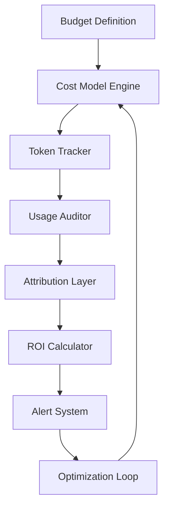

# AI Budgets Are Growing, but Martech Leaders Still Struggle to Prove ROI

## Introduction

Our engineering team recently tracked the deployment of three large language model APIs across customer support and product recommendation pipelines. Within two months, monthly spend had climbed past twenty thousand dollars—well above the initial quarterly forecast. The conversation shifted quickly from excitement about innovation to frustration over unclear returns. Executives wanted numbers they could present to investors; support leads needed evidence that their automated responses were actually improving satisfaction scores. The gap between raw spending and demonstrable value felt widening every sprint.

This article examines why AI budget growth happens so rapidly while proof of return remains elusive. We break down the engineering challenges, the data structures that enable accurate tracking, and the architectural patterns that bridge the gap between technology investment and business justification.

## Why This Matters

From a production standpoint, unmeasured AI spending creates operational risk without corresponding accountability. When cloud bills spike because of unbounded LLM consumption, debugging becomes impossible without visibility into which queries triggered expensive generations. Teams often rely on vague metrics like "we're seeing higher engagement" without being able to isolate whether changes stemmed from algorithmic improvements or external factors.

Martech leaders face a competing pressure set by both engineering and business units. Engineers want to optimize token efficiency, reduce latency, and prevent runaway costs. Marketers demand proof that AI-driven personalization translates into measurable lift in conversion rates. Without a shared framework for measuring ROI, those conversations remain hand-wavy and prone to misinterpretation.

The solution isn't just better dashboards—it requires a systematic approach to budget management that treats cost tracking as a first-class infrastructure concern rather than an afterthought.

## How It Works

Below is a simplified view of the budget orchestration layer we implemented to address these challenges. The system collects token-level expenditure data, aggregates cost information, and triggers alerts when thresholds are breached.

### Step-by-Step Mechanism

1. **Budget Definition** sets the maximum allowable spend per model, tier, and endpoint. These constants drive downstream validation.

2. **Cost Model Engine** converts volume metrics into monetary values using current provider rates. This component maintains historical cost trends to detect anomalies.

3. **Token Tracker** instruments every
