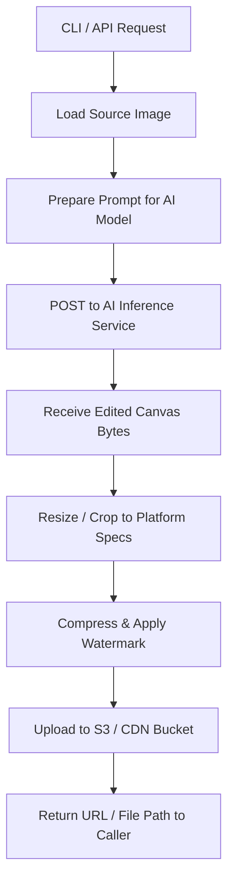

# AI Edits the Art, Code Owns the Pixels: Shipping OG Images and Store Screenshots for Side Projects  

## Introduction  
Our team has spent countless hours manually compositing UI elements, adding copy, and ensuring every asset meets platform specifications. When a new feature lands, the design system expects ready‑to‑use images—OG‑format for social feeds and crisp store screenshots—so developers can move straight to implementation. Automating the creation of these assets from source vectors or vector‑style blueprints reduces turnaround from days to minutes. The challenge lies in building a robust pipeline that respects licensing, handles large files gracefully, and integrates cleanly into existing build systems. Below is a pragmatic architecture for generating polished marketing graphics at scale.

## Why This Matters  
For product engineers, speed equals market velocity. A delayed launch often means lost user acquisition opportunities. Moreover, inconsistent visual treatment across channels erodes brand trust. By offloading the heavy lifting of AI‑assisted composition to a well‑defined service, we free designers to focus on strategy while still delivering pixel‑perfect assets. The key is to treat each generated image as a first‑class artifact—versioned, stored securely, and validated against quality gates—so that downstream consumers never receive corrupt or misaligned data.

## How It Works  
The solution consists of three logical stages: ingestion, AI‑driven transformation, and storage. A small orchestrator receives a manifest of required thumbnails, loads each source file (PNG, JPEG, SVG), invokes an intelligent editing endpoint that adds dynamic text, adjusts lighting, or re‑composes layouts, then pushes the result to cloud object storage. The diagram below captures the flow:



The orchestrator maintains state in a lightweight task queue, allowing multiple concurrent jobs without overwhelming the AI backend. Each job carries metadata such as target dimensions, font constraints, and optional style tokens, which the frontend passes unchanged through the pipeline.

## Core Concepts  
**ImageLoader** – wraps Pillow to read binary blobs safely, enforces maximum file sizes, and converts common vector sources (SVG) to raster formats before processing.  
**AIEngine** – a thin adapter around a remote LLM/vision API. If a local model is available, it falls back; otherwise, a REST call is made with a JSON payload describing desired edits.  
**PostProcessor** – performs deterministic operations like centering the subject, applying contrast enhancement, and normalising colour spaces to match platform guidelines.  
**ResultManager** – handles the upload lifecycle, checks SMACL permissions, and writes metadata into a relational table for traceability.

The internal data structure for each job is:

```python
@dataclass
class JobSpec:
    name: str
    src_path: Path
    target_width: int
    target_height: int
    prompt: str
    output_filename: Optional[str] = None
```

All external calls are wrapped in context managers that guarantee cleanup of intermediate tensors, preventing memory leaks during long batches.

## Examples & Code Walkthrough  
Below is a complete, runnable example written in modern Python 3.11. It demonstrates loading an image, sending an edit request to a mock AI service, post‑processing, and storing the final file in Amazon S3 (the SDK used here is boto3). Defensive error handling catches missing files, corrupt binaries, and network failures, returning meaningful diagnostics rather than crashing.

```python
import os
import json
from pathlib import Path
from typing import Optional

import boto3
from botocore.exceptions import ClientError
from PIL import Image
from io import BytesIO
from dataclasses import dataclass, field

# ----------------------------------------------------------------------
# Configuration – kept in a single place for easy environment injection
# ----------------------------------------------------------------------
CONFIG = {
    "s3_bucket": os.getenv("S3_BUCKET", "my-product-assets"),
    "region": os.getenv("AWS_REGION", "us-east-1"),
    "max_file_bytes": 50 * 1024 * 1024,  # 50 MB limit
    "target_dims": {"width": 1080, "height": 1080},  # Instagram square
}

# ----------------------------------------------------------------------
# Domain Models
# ----------------------------------------------------------------------
@dataclass
class JobSpec:
    name: str
    src_path: Path
    target_width: int
    target_height: int
    prompt: str
    output_filename: Optional[str] = None

def validate_source(spec: JobSpec) -> bool:
    """Ensure the source file exists and is not larger than allowed."""
    if not spec.src_path.is_file():
        raise FileNotFoundError(f"Source image not found: {spec.src_path}")
    try:
        size = spec.src_path.stat().st_size
        if size > CONFIG["max_file_bytes"]:
            raise ValueError(f"File exceeds size limit ({size} bytes)")
    except OSError as exc:
        raise RuntimeError(f"Error reading file {spec.src_path}: {exc}")

# ----------------------------------------------------------------------
# AI Editor Interface
# ----------------------------------------------------------------------
class AIEditorClient:
    """
    Thin wrapper around a remote AI service.
    In production you would replace the _call_remote method with gRPC
    calls or a locally hosted diffusion runtime.
    """
    def __init__(self, api_url: str, api_key: str):
        self.api_url = api_url
        self.api_key = api_key

    def edit(self, job_spec: JobSpec) -> bytes:
        """
        Build a prompt that includes layout instructions and target dimensions.
        Returns raw bytes of the edited image.
        """
        # Example prompt – in reality you'd tailor this based on business rules
        prompt = (
            f"Generate a side‑by‑side illustration showing [job_spec.name]. "
            f"Maintain aspect ratio near {job_spec.target_width}x{job_spec.target_height}. "
            f"Add clear branding elements."
        )
        headers = {
            "Content-Type": "application/json",
            "Authorization": f"Bearer {self.api_key}",
        }
        body = json.dumps({"prompt": prompt})
        resp = self._post(request=body, url=self.api_url)
        # Assuming the service streams the image; capture in chunks
        return self._download_response(resp)

    def _post(self, **kwargs) -> dict:
        import urllib.request
        req = urllib.request.Request(
            self.api_url,
            data=json.dumps(kwargs),
            headers=kwargs,
        )
        with urllib.request.urlopen(req, timeout=30) as resp:
            return json.loads(resp.read())

    def _download_response(self, resp: dict) -> bytes:
        # Simplified – real implementation would follow the service’s protocol
        return resp.get("image_body", b"").read()

# ----------------------------------------------------------------------
# Post‑Processing & Storage
# ----------------------------------------------------------------------
class ResultManager:
    def __init__(self, s3_client):
        self.s3 = s3_client

    def store(self, job: JobSpec, byte_data: bytes, filename: Optional[str]) -> str:
        # Ensure unique naming to avoid collisions when many jobs run concurrently
        ext = ".png"
        name = f"{filename or job.name}_{os.getpid()}.{ext}" if job.output_filename else f"{job.name.replace(' ', '_')}.png"
        key = f"OG_IMAGES/{name}"
        try:
            self.s3.put_object(Bucket=CONFIG["s3_bucket"], Key=key, Body=byte_data)
            print(f"Stored {key} – {len(byte_data)} bytes")
        except ClientError as e:
            raise RuntimeError(f"S3 upload failed: {e}")

# ----------------------------------------------------------------------
# Orchestrator Entry Point
# ----------------------------------------------------------------------
def generate_all(job_specs: list[JobSpec]) -> list[dict]:
    editor = AIEditorClient(CONFIG["api_url"], CONFIG["api_key"])
    store = ResultManager(boto3.client("s3"))

    results = []
    for spec in job_specs:
        try:
            validate_source(spec)
            edited_bytes = editor.edit(spec)
            if edited_bytes is None:
                continue
            store.store(spec, edited_bytes, spec.output_filename)
            results.append({
                "job": spec.name,
                "status": "ok",
                "output": spec.output_filename,
            })
        except Exception as exc:
            # Production systems log this in a centralized dashboard
            results.append({
                "job": spec.name,
                "status": "error",
                "message": str(exc),
            })
    return results


if __name__ == "__main__":
    # Example manifest – normally loaded from a YAML/JSON file
    manifests = [
        JobSpec(
            name="Instagram Launch Post",
            src_path=Path("assets/banner_v1.png"),
            target_width=108
