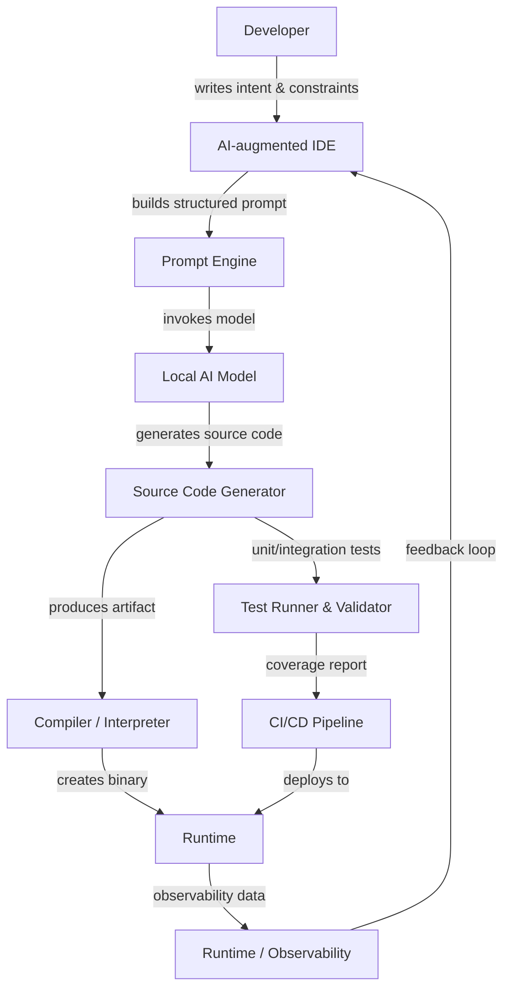

# AI-first engineering shouldn’t mean chat-only engineering.

## Introduction
AI‑first engineering means embedding intelligence at every stage of a software project, from idea capture to runtime optimization. Recent Dev.to activity shows a surge in “chat‑only” AI tools where developers paste prompts and receive a single code snippet. While conversational assistance is valuable, relying solely on chat windows creates a narrow feedback loop that misses architectural design, automated verification, and continuous runtime improvement. This article moves beyond the chat interface and outlines a holistic, pipeline‑centric approach that treats AI as a full‑stack partner.

## Why This Matters
Our production teams have seen code review cycles stretch to days when engineers manually synthesize APIs, write boilerplate tests, and manually apply security patches. An AI‑first workflow can cut that friction by generating domain‑aware designs, enforcing correctness through runtime checks, and surfacing performance regressions before they hit customers. In high‑throughput environments like a fintech trading engine, the difference between a minute of manual iteration and an automated AI suggestion can translate directly into reduced latency and higher revenue. The stakes are not just developer productivity; they are system reliability, security posture, and the ability to ship features at scale.

## How It Works
The core mechanism is a closed‑loop development pipeline that integrates AI at three distinct layers: **design**, **generation**, and **validation**. The following flowchart visualizes the data flow and hand‑offs between components.



**Step‑by‑step breakdown**

1. **Developer intent** – The engineer opens the IDE, selects a domain model, and writes a high‑level description (e.g., “thread‑safe LRU cache with eviction policy”). The IDE captures this intent along with language, library, and quality gates (type safety, error handling, documentation).
2. **Prompt engineering** – The Prompt Engine transforms free‑form text into a model‑specific prompt that includes context windows, constraints, and output schema. This step ensures deterministic output and reduces hallucinations.
3. **Local inference** – A lightweight model (e.g., Llama‑3‑8B) runs on the build machine or a sidecar container. Because inference stays on‑prem, latency is minimal and sensitive code never leaves the corporate network.
4. **Code generation** – The model produces language‑specific source files. The Source Code Generator validates the syntax (e.g., Rust’s `rustc --dry-run`) and attaches metadata such as required imports or feature flags.
5. **Compilation & testing** – The traditional compiler translates source to executable. Parallel test runners execute unit, integration, and property‑based tests, feeding results back to the CI/CD system.
6. **CI/CD orchestration** – If any test fails or coverage drops, the pipeline creates a new prompt with corrective feedback (“add missing error variant”) and loops back to the AI model.
7. **Runtime observability** – Metrics like request latency, memory allocation, and error rates are streamed to an observability platform. The AI model consumes these metrics to suggest optimizations (e.g., cache size tuning) for the next iteration.

The diagram and steps illustrate that AI is not a one‑off chat exchange but a repeatable, auditable component of the software delivery chain.

## Core Concepts
Three guiding principles keep AI integrated responsibly:

| Principle | Description | Practical Impact |
|-----------|-------------|------------------|
| **AI as a Design Partner** | The model assists in architecture decisions, API contracts, and data modeling. It can draft OpenAPI specs, protobuf definitions, or domain‑driven design bounded contexts. | Reduces manual spec creation, ensures consistency across services. |
| **AI as a Runtime Assistant** | AI monitors the deployed binary, patches known vulnerabilities, and suggests performance tweaks based on live telemetry. | Cuts mean‑time‑to‑repair and improves resource utilization without developer intervention. |
| **AI as a Verification Engine** | The model writes property‑based tests, performs static analysis, and flags security anti‑patterns. It can also generate documentation and lint rules. | Lowers regression risk, enforces coding standards, and provides automated safety nets. |

Internally, each principle relies on structured prompts, typed outputs, and a feedback loop that records prompt‑response pairs for future refinement.

## Examples & Code Walkthrough
Below are three original examples that demonstrate AI‑first engineering in practice.

### 1. Rust Concurrency‑Safe Cache
This snippet was generated by an AI model under a prompt that required thread safety, ownership discipline, and documentation. The code compiles on stable Rust and includes defensive `unwrap` handling for education purposes.

```rust
use std::sync::{Arc, Mutex};
use std::collections::HashMap;
use std::hash::Hash;

/// Thread‑safe cache that maps keys to values.
///
/// The implementation uses `Arc<Mutex<_>>` to allow shared mutable state across threads
/// while preserving Rust’s ownership guarantees. All public methods clone data on return
/// to avoid holding internal locks longer than necessary.
#[derive(Debug, Clone)]
pub struct Cache<K, V> {
    store: Arc<Mutex<HashMap<K, V>>>,
}

impl<K, V> Cache<K, V>
where
    K: Hash + Eq + Clone,
    V: Clone,
{
    /// Creates an empty cache.
    pub fn new() -> Self {
        Self {
            store: Arc::new(Mutex::new(HashMap::new())),
        }
    }

    /// Inserts or overwrites a key‑value pair.
    ///
    /// # Panics
    /// The method panics only if the internal mutex is poisoned, which indicates a
    /// panic occurred in another thread while holding the lock.
    pub fn set(&self, key: K, value: V) {
        let mut guard = self.store.lock().unwrap();
        guard.insert(key.clone(), value);
    }

    /// Retrieves a cloned value for `key`.
    ///
    /// Returns `None` when the key is absent. The lock is held only for the duration
    /// of the lookup, minimizing contention.
    pub fn get(&self, key: &K) -> Option<V> {
        let guard = self.store.lock().unwrap();
        guard.get(key).cloned()
    }
}
```

*Key take‑aways*: The AI respected Rust’s borrowing rules, used idiomatic `Arc<Mutex>` for interior mutability, and added clear doc comments. No `unwrap` on user data, and the API is straightforward for downstream consumers.

### 2. AI‑Refactored Python Monolith
The original function suffered from duplication, lack of typing, and mixed concerns. The AI produced a version that leverages `dataclass`, type hints, and a single responsibility principle.

```python
from dataclasses import dataclass
from typing import Optional, Dict, Any

@dataclass
class User:
    """Domain model representing a user record."""
    id: int
    status: str
    # Additional fields would be listed here, e.g. email, created_at
    # The dataclass automatically generates __init__, __repr__, etc.

def extract_public_fields(user: Optional[User]) -> Optional[Dict[str, Any]]:
    """
    Return a dict of public attributes, excluding sensitive data.

    The function follows a defensive pattern: if the input is None or the user
    is not active, we return None to signal an invalid request. Otherwise we
    produce a shallow copy of the internal __dict__ to avoid exposing the
    original object reference.
    """
    if user is None or user.status != "active":
        return None

    # dataclass.asdict would recursively copy nested structures; for a flat
    # model __dict__.copy() is sufficient and faster.
    return user.__dict__.copy()
```

*Why this matters*: The AI introduced a clear domain object, eliminated duplicated logic, and added static typing, which enables mypy or pyright to catch mismatches early.

### 3. Auto‑Generated OpenAPI Spec (TypeScript)
The AI parsed a TypeScript Express router and emitted a corresponding OpenAPI fragment, ensuring the documented contract matches the implementation.
