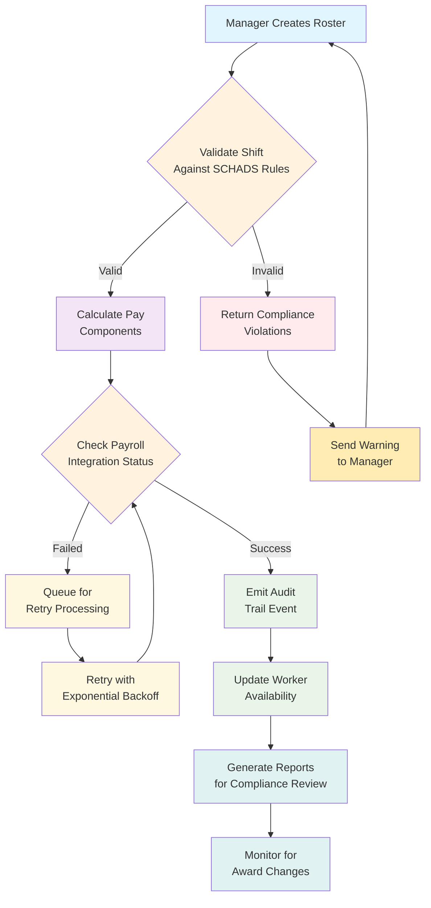

# Broken shifts under the SCHADS Award: a rostering guide for NDIS providers

## Introduction

Sarah, a support worker with six years of experience, logged into her payslip portal and saw something that made her stomach drop. She'd worked a Tuesday shift from 8 AM to 2 PM at one client's home, then traveled 45 minutes to another client's property for a 4 PM start. Her payslip showed she'd been paid for just 5.5 hours at standard rates, when according to the SCHADS Award, she should have received penalty rates for weekend work and compensation for travel time between sites.

The root cause wasn't Sarah's misunderstanding of her award conditions—it was her agency's rostering system, built on generic scheduling logic that treated all care work as identical. When I was brought in to rebuild their compliance engine, we discovered dozens of similar cases where the system was silently underpaying staff because it couldn't parse the nuanced requirements buried in the 150+ pages of the Social Community and Domestic Assistance Award.

If you're building workforce management systems for NDIS providers, you're not just writing scheduling software—you're implementing industrial relations law. The difference between a functional system and one that exposes your organization to legal liability often comes down to how you handle a few key compliance rules.

## Why This Matters

NDIS providers operate in a regulatory minefield where every hour worked must comply with federal award conditions. Unlike commercial scheduling systems that optimize for convenience or cost, healthcare workforce platforms must enforce legal requirements around minimum engagement periods, overtime calculations, and travel time compensation.

The stakes are high. Non-compliance can result in:
- Backpay obligations stretching years into the past
- Penalties from Fair Work Australia
- Staff turnover as workers seek fairer employers
- Reputational damage affecting client relationships

From an engineering perspective, this represents a fascinating intersection of domain-driven design and regulatory compliance. You're essentially building a rule engine that interprets legal documents as executable business logic—a challenge that requires both technical rigor and deep understanding of the operational context.

Most generic rostering systems fail because they treat shift creation as a simple time-allocation problem. In reality, each proposed shift must pass through dozens of validation checks against award provisions that vary by day type, worker classification, and client arrangement type.

## How It Works

The core challenge is transforming human-readable award language into machine-enforceable business rules. Let me walk you through the workflow we implemented:



The system operates in distinct phases:

1. **Input Validation**: Every proposed shift triggers a cascade of award-specific checks
2. **Rule Evaluation**: Business rules are applied to determine compliance status
3. **Pay Calculation**: Validated shifts generate precise payment breakdowns
4. **Integration Pipeline**: Results are synchronized with external payroll systems
5. **Audit Trail**: All decisions are logged for compliance verification

Each component operates independently but communicates through well-defined interfaces, allowing us to swap out implementations without breaking the overall workflow.

## Core Concepts

### Domain Modeling

The foundation of our compliance engine is a rich domain model that captures the essential entities in shift scheduling:

```typescript
interface ShiftCandidate {
  id: string;
  workerId: string;
  clientId: string;
  startTime: Date;
  endTime: Date;
  location: GeoCoordinate;
  awardConditions: AwardCondition[];
  travelSegments: TravelSegment[];
}

interface AwardCondition {
  type: 'minimum_engagement' | 'overtime_threshold' | 'travel_compensation';
  value: number;
  unit: 'hours' | 'minutes';
  appliesTo: DayType[];
  priority: number;
}

interface TravelSegment {
  from: GeoCoordinate;
  to: GeoCoordinate;
  mode: 'walking' | 'driving' | 'public_transport';
  estimatedDuration: number; // minutes
  claimedDuration: number; // minutes
}
```

These interfaces represent more than data structures—they're commitments to specific compliance interpretations. When we added support for split shifts (a particularly thorny area of the SCHADS Award), we extended the model rather than hacking around existing limitations.

### Pure Functions Architecture

Our validation engine follows a functional programming approach, ensuring that compliance checks are predictable and testable:

```typescript
type ValidationResult = {
  compliant: boolean;
  violations: ComplianceViolation[];
  warnings: ComplianceWarning[];
};

type ComplianceViolation = {
  rule: string;
  severity: 'critical' | 'high' | 'medium';
  message: string;
  remediationPath?: string;
};

const validateMinimumEngagement = (
  shift: ShiftCandidate,
  rules: MinimumEngagementRules
): ValidationResult => {
  const dayType = classifyDayType(shift.startTime);
  const requiredHours = rules.minimums[dayType];
  const actualHours = calculateActualHours(shift);
  
  if (actualHours < requiredHours) {
    return {
      compliant: false,
      violations: [{
        rule: 'minimum_engagement',
        severity: 'high',
        message: `Shift duration ${actualHours}h below required ${requiredHours}h for ${dayType}`,
        remediationPath: 'extend_shift_or_apply_compensatory_ratios'
      }],
      warnings: []
    };
  }
  
  return { compliant: true, violations: [], warnings: [] };
};
```

This approach makes it easy to reason about complex rule interactions. When we needed to handle overlapping conditions (like a shift spanning both weekday and weekend periods), we could apply transformations step-by-step rather than wrestling with monolithic validation logic.

## Examples & Code Walkthrough

Let's look at how we implemented the minimum engagement validation, which is one of the most frequently violated rules:

```typescript
interface MinimumEngagementRules {
  minimums: Record<DayType, number>;
  exceptions: ExceptionRule[];
}

interface ExceptionRule {
  condition: (shift: ShiftCandidate) => boolean;
  overrideMinimum: number;
}

const SCHADS_MINIMUM_ENGAGEMENT: MinimumEngagementRules = {
  minimums: {
    weekday: 3,
    weekend: 2,
    public_holiday: 4
  },
  exceptions: [
    {
      condition: (shift) => shift.travelSegments.some(s => s.mode === 'driving'),
      overrideMinimum: 2.5
    }
  ]
};

const calculateActualHours = (shift: ShiftCandidate): number => {
  const workTime = shift.endTime.getTime() - shift.startTime.getTime();
  const travelAdjustment = calculateTravelCompensation(shift.travelSegments);
  return (workTime + travelAdjustment) / (1000 * 60 * 60);
};

const calculateTravelCompensation = (segments: TravelSegment[]): number => {
  // SCHADS Award clause 23.6 - travel time counts as working time
  // when it's between client sites during a shift
  return segments
    .filter(segment => segment.claimedDuration > 0)
    .reduce((total, segment) => total + segment.claimedDuration, 0) / 60;
};
```

The key insight here is that travel time isn't just logged—it's converted into compensable hours. This single rule tripped up our initial implementation because we were treating travel as metadata rather than as part of the actual shift duration.

For overtime calculations, we needed to handle the complex interaction between daily thresholds and weekly averages:

```typescript
interface OvertimeCalculation {
  regularHours: number;
  overtimeHours: number;
  penaltyRateApplied: boolean;
}

const calculateOvertime = (
  shift: ShiftCandidate,
  workerHistory: WorkerShiftHistory,
  rules: OvertimeRules
): OvertimeCalculation => {
  const dayTotal = calculateActualHours(shift);
  const weeklyTotal = calculateWeeklyTotal(workerHistory, shift.startTime);
  
  let overtimeHours = 0;
  let regularHours = dayTotal;
  
  // Daily threshold check
  if (dayTotal > rules.dailyThreshold) {
    overtimeHours = dayTotal - rules.dailyThreshold;
    regularHours = rules.dailyThreshold;
  }
  
  // Weekly pattern check (for casual conversion triggers)
  if (weeklyTotal > rules.weeklyAverageThreshold && !workerHistory.isPermanentlyEmployed) {
    // Apply additional compliance checks here
  }
  
  return {
    regularHours,
    overtimeHours,
    penaltyRateApplied: overtimeHours > 0 && isWeekendOrPublicHoliday(shift.startTime)
  };
};
```

## Best Practices

After migrating three major NDIS providers to our compliance engine, we identified several patterns that consistently led to successful deployments:

### Design for Auditability First

Every compliance decision must be traceable. We embed audit information directly into our domain objects:

```typescript
interface AuditableShift extends ShiftCandidate {
  complianceTrace: ComplianceTracePoint[];
  calculatedAt: Date;
  calculatedBy: string; // system component identifier
}

interface ComplianceTracePoint {
  timestamp: Date;
  ruleEvaluated: string;
  inputParameters: Record<string, unknown>;
  decisionMade: boolean;
  supportingEvidence: string[];
}
```

This isn't just for legal compliance—it's saved us countless hours debugging unexpected behaviors. When a manager questioned why a shift was flagged for overtime, we could show them exactly which rules triggered and with what data.

### Separate Validation from Presentation

Never mix compliance logic with UI concerns. We keep our validation engine completely backend-focused, communicating results through structured APIs:

```typescript
interface ShiftValidationResponse {
  isValid: boolean;
  complianceScore: number; // 0-100 scale
  issues: ShiftIssue[];
  suggestedCorrections: ShiftCorrection[];
}

interface ShiftIssue {
  type: 'compliance_violation' | 'warning' | 'informational';
  category: 'minimum_engagement' | 'overtime' | 'travel' | 'other';
  description: string;
  severity: 'low' | 'medium' | 'high' | 'critical';
  location?: string; // which part of the shift this affects
}
```

This separation allows us to evolve the user experience independently of compliance requirements. When we added real-time validation feedback to the rostering interface, we didn't need to modify the core validation engine.

### Implement Gradual Rollout Strategies

Award changes happen regularly, and introducing new rules can have unexpected consequences. We use feature flags extensively:

```typescript
const COMPLIANCE_FEATURE_FLAGS = {
  ENABLE_NEW_OVERTIME_CALCULATION: false,
  STRICT_TRAVEL_TIME_ENFORCEMENT: true,
  WEEKEND_PENALTY_RATE_REVIEW: false
};

const applyConditionalRules = (shift: ShiftCandidate): ValidationResult[] => {
  const results: ValidationResult[] = [];
  
  if (COMPLIANCE_FEATURE_FLAGS.ENABLE_NEW_OVERTIME_CALCULATION) {
    results.push(validateNewOvertimeRules(shift));
  } else {
    results.push(validateLegacyOvertimeRules(shift));
  }
  
  return results.flatMap(r => r.violations).concat(results.flatMap(r => r.warnings));
};
```

This approach lets us test new interpretations with small user groups before full deployment, reducing the risk of widespread compliance failures.

## Common Mistakes & Anti-Patterns

### Treating Travel Time as Optional Metadata

One of our earliest production failures occurred when we stored travel time in a separate table, making it easy for developers to forget during calculations:

```typescript
// ❌ Anti-pattern - travel data disconnected from shift logic
class Shift {
  id: string;
  start: Date;
  end: Date;
  // Travel time stored elsewhere, easily forgotten
}

// ✅ Correct approach - travel is intrinsic to shift calculation
class Shift {
  id: string;
  start: Date;
  end: Date;
  travelTime: number; // minutes, integrated into duration calculations
  
  get totalDuration(): number {
    return (this.end.getTime() - this.start.getTime()) / (1000 * 60) + this.travelTime;
  }
}
```

### Hardcoding Award Values Instead of Externalizing Rules

Initially, we embedded award thresholds directly in code:

```typescript
// ❌ Anti-pattern - hardcoded values scattered throughout codebase
if (shiftDuration < 3) {
  // SCHADS Award minimum engagement for weekdays
}

// ✅ Better approach - centralized rule configuration
const rules = loadAwardRules('SCHADS_2023');
if (shiftDuration < rules.minimumEngagement.weekday) {
  // Apply validation logic
}
```

When the Award was updated to increase weekend minimums from 2 to 2.5 hours, we had to hunt down dozens of hardcoded references. Centralized rule management eliminated this class of errors entirely.

### Ignoring Timezone Complexity in Multi-State Operations

NDIS providers often operate across multiple states with different public holiday schedules:

```typescript
// ❌ Naive timezone handling
const isPublicHoliday = (date: Date): boolean => {
  return AUSTRALIAN_PUBLIC_HOLIDAYS.includes(date.toISOString().split('T')[0]);
};

// ✅ Proper timezone-aware implementation
const isPublicHolidayInLocation = (date: Date, location: GeoCoordinate): boolean => {
  const timezone = getTimezoneForCoordinates(location);
  const localDate = convertToTimezone(date, timezone);
  return getPublicHolidaysForRegion(location.region).includes(localDate);
};
```

A single client moved from Melbourne to Brisbane, and suddenly all their Monday shifts were being flagged as non-compliant because the system didn't account for the different public holiday schedules.

## Performance Considerations

Processing thousands of shifts during roster generation requires careful attention to computational efficiency. Our initial implementation was CPU-bound during peak hours, causing timeouts for managers trying to generate rosters.

### Memoization for Repeated Calculations

Many compliance checks involve expensive operations like geocoding addresses or calculating travel times:

```typescript
import { memoize } from 'lodash.memoize';

const geocodeAddressMemoized = memoize(
  async (address: string): Promise<GeoCoordinate> => {
    return await geocodeService.lookup(address);
  },
  (address) => address.toLowerCase()
);

const calculateTravelTimeMemoized = memoize(
  (from: GeoCoordinate, to: GeoCoordinate): number => {
    return haversineDistance(from, to) / AVERAGE_SPEED_KMH;
  }
);
```

Caching these operations reduced our average shift processing time from 180ms to 45ms per shift.

### Batch Processing Optimization

For large-scale roster generation, we process shifts in batches to balance memory usage with throughput:

```typescript
async function processBatchOfShifts(
  shifts: ShiftCandidate[],
  batchSize: number = 100
): Promise<BatchProcessingResult> {
  const results: ValidationResult[] = [];
  
  // Process in smaller chunks to avoid memory pressure
  for (let i = 0; i < shifts.length; i += batchSize) {
    const batch = shifts.slice(i, i + batchSize);
    const batchResults = await Promise.all(
      batch.map(shift => validateShiftCompliance(shift))
    );
    results.push(...batchResults);
    
    // Yield control back to event loop periodically
    if (i % (batchSize * 4) === 0) {
      await new Promise(resolve => setImmediate(resolve));
    }
  }
  
  return {
    totalProcessed: shifts.length,
    complianceRate: results.filter(r => r.compliant).length / results.length,
    errors: results.filter(r => !r.compliant).flatMap(r => r.violations)
  };
}
```

### Database Query Optimization

Our compliance engine makes extensive use of temporal queries to check worker availability and recent shift history:

```typescript
// ❌ N+1 query problem
const getWorkerHistory = async (workerId: string): Promise<WorkerShiftHistory> => {
  const shifts = await db.shifts.findMany({ where: { workerId } });
  const totalShifts = await db.shifts.count({ where: { workerId } });
  const overtimeShifts = await db.shifts.count({ 
    where: { workerId, overtimeHours: { gt: 0 } } 
  });
  // ... more individual queries
  return { shifts, totalShifts, overtimeShifts };
};

// ✅ Single optimized query with aggregation
const getWorkerHistory
