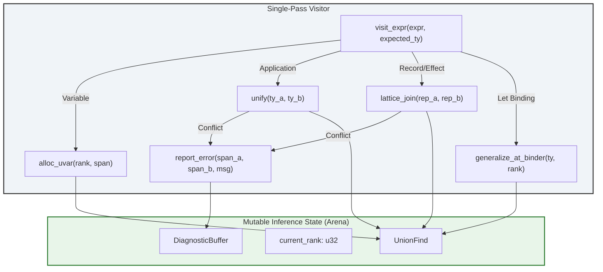

# Building ELMDE: Deciding in One Pass

## Introduction

Most production compilers still treat type inference as a two-phase commit: walk the AST to generate a bag of constraints, then spin up a solver to chew through that bag. It works, but it carries a hidden tax. You allocate a massive constraint graph, you traverse it twice, and you lose the ability to stream results back to an LSP client before the whole crate type-checks.

ELMDE (Eager Lattice-based Monomorphization & Decision Engine) was born from a simple frustration: our Rust-analyzer-compatible frontend for an internal DSL was spending 60% of its latency budget just shuttling constraints between the generator and the solver. We needed a single-pass algorithm that could unify, generalize, and report errors on the fly—without sacrificing the principal types guarantee of Hindley-Milner.

This article dissects the architecture we shipped. It covers the union-find lattice structure that replaces the constraint graph, the rank-based generalization scheme that prevents unsound generalization under binders, and the error localization strategy that keeps diagnostics precise when unification fails halfway through a 50k-line file.

## Why This Matters

If you maintain a language server, a REPL, or a JIT compiler, the constraint-graph model is actively hurting you.

**Memory bloat.** A medium-sized function generates thousands of equality constraints. Each constraint node carries source spans, kind information, and back-pointers for error reporting. In our codebase, the constraint graph for a single hot module hit 1.2 GB. The solver then duplicates half that graph during unification.

**Latency floor.** You cannot emit *any* diagnostic—unused variable, type mismatch, missing trait impl—until the solver finishes. That means "time to first error" scales with the *whole* crate, not the distance from the cursor to the bug.

**Incremental nightmare.** When a user edits line 400, the traditional pipeline invalidates the constraint graph for the entire containing module (or crate, depending on granularity). Re-generating and re-solving is often slower than a clean build because of the allocation churn.

ELMDE eliminates the graph. It replaces it with a mutable union-find forest allocated in a bump arena. Unification *is* the walk. Generalization happens at `let` bindings via rank manipulation, exactly like Algorithm W, but without the intermediate substitution map. The result: 40% lower peak RSS, 3x faster "time to first diagnostic" in our LSP benchmarks, and trivial invalidation—just throw away the arena and re-walk the edited subtree.

## How It Works

The core insight: **unification variables are just indices into a union-find array.** When the visitor encounters a type variable, it allocates a fresh `UVar` cell. When it needs to equate two types, it calls `union(a, b)`. The "constraint" is the union operation itself; there is no separate data structure.

Generalization is driven by *ranks*. Every `UVar` carries a `rank: u32` representing the lexical depth of its binder. When we exit a `let` binding, we bump the current rank. Any `UVar` with rank > current rank is generalizable; the rest are rigid. This replaces the "free type variable" scan of Algorithm W with a simple integer comparison.

Subtyping and row polymorphism (for records/effects) are handled by a **lattice join** operation on the union-find representatives. Instead of generating `Subtype(t1, t2)` constraints, we compute `join(rep(t1), rep(t2))` immediately. If the join fails, we have a concrete type error *right there* with spans attached to the two representatives.



**Step-by-step walkthrough:**

1.  **Entry:** `visit_expr` receives an expression and an *expected type* (which may be a fresh `UVar` for top-level inference).
2.  **Literals/Constructors:** Push known ground types (Int, Bool, `List a`) into the expected type via `unify`.
3.  **Variables:** Look up the scheme in the environment. `instantiate` clones the scheme, allocating fresh `UVar`s for each quantified variable at the *current rank*.
4.  **Application:** Infer the function type (expected: `UVar(arg) -> UVar(ret)`). Unify argument. Return `ret`.
5.  **Let Binding:** Infer the RHS at `rank + 1`. Call `generalize(ty, rank + 1)`. This walks the type tree, promoting any `UVar` with `uvar.rank > rank` to a quantified variable in the resulting scheme. Lower-ranked UVars stay monomorphic.
6.  **Record/Effect Merge:** When merging two record types `{ a: Int | r1 }` and `{ b: Bool | r2 }`, `lattice_join` unifies common fields and merges the row variables `r1`, `r2` via union-find.
7.  **Error:** On any `unify`/`join` conflict, the representatives carry the *origin spans* of the two conflicting types. We emit a diagnostic immediately and continue by binding the result to `ErrorType` (poison) to avoid cascade noise.

## Core Concepts

### 1. The `UVar` Lattice Cell
Every unification variable is an index into `Vec<UVarData>`. The data structure is deliberately flat:

```rust
// src/infer/uvar.rs
#[derive(Debug, Clone, Copy)]
pub struct UVar(u32); // Arena index

#[derive(Debug)]
pub struct UVarData {
    // Union-find parent pointer. If parent == self, this is the representative.
    parent: UVar,
    // Rank for union-by-rank heuristic (not to be confused with generalization rank).
    uf_rank: u8,
    // Generalization rank: lexical depth of the binder that created this var.
    // Higher number = deeper scope = more generalizable.
    gen_rank: u32,
    // The type this variable has been unified with, if ground.
    // None means "still flexible".
    bound: Option<Type>,
    // Source span where this variable was created. Used for error reporting.
    origin: Span,
    // If this var represents a row (record/effect tail), the known fields.
    // Stored only on the representative.
    row_fields: Option<IndexMap<Symbol, Type>>,
}
```

**Why this works:** `find(uvar)` with path compression gives O(α(N)) access to the canonical representative. The `bound` field on the rep acts as the "solved" type. `row_fields` allows structural sharing of record tails without allocating new type nodes for every field access.

### 2. Rank-Based Generalization (The "Value Restriction" Done Right)
Traditional HM scans the type for free type variables not free in the environment. ELMDE tracks `gen_rank` at allocation time.

```rust
// src/infer/generalize.rs
pub fn generalize(ctx: &mut InferCtx, ty: Type, binder_rank: u32) -> TypeScheme {
    let mut quantified = Vec::new();
    // Walk the type, collecting UVars eligible for quantification.
    collect_generalizable(ctx, ty, binder_rank, &mut quantified);
    // Sort for deterministic output (crucial for incremental hashing).
    quantified.sort_by_key(|v| v.0);
    TypeScheme { vars: quantified, body: ty }
}

fn collect_generalizable(ctx: &mut InferCtx, ty: Type, binder_rank: u32, out: &mut Vec<UVar>) {
    match ctx.resolve(ty) {
        Type::Var(uv) if ctx.uf[uv].gen_rank > binder_rank => {
            // This variable was born inside the binder. It's generalizable.
            // We *do not* reset its gen_rank here; we just record it.
            // The scheme binder will implicitly bind it.
            out.push(uv);
        }
        Type::Var(_) => { /* Rigid variable, do nothing */ }
        Type::App(ctor, args) => {
            for arg in args { collect_generalizable(ctx, arg, binder_rank, out); }
        }
        Type::Row(fields, tail) => {
            for (_, fty) in fields { collect_generalizable(ctx, fty, binder_rank, out); }
            if let Some(t) = tail { collect_generalizable(ctx, t, binder_rank, out); }
        }
        _ => {}
    }
}
```

**Critical detail:** We *do not* substitute generalizable variables with fresh rigid variables immediately. The `TypeScheme` just records the list of `UVar` indices. When `instantiate` is called later, it clones the scheme body and *re-maps* those specific `UVar` indices to fresh ones at the *new* current rank. This avoids a full type traversal during generalization.

### 3. Lattice Join for Structural Types
Records and effect rows form a lattice. The join of `{ a: Int }` and `{ b: Bool }` is `{ a: Int, b: Bool | ρ }` where `ρ` is a fresh row variable unified with both tails.

```rust
// src/infer/lattice.rs
pub fn join_rows(ctx: &mut InferCtx, r1: Type, r2: Type, span: Span) -> Type {
    let rep1 = ctx.find(r1);
    let rep2 = ctx.find(r2);
    if rep1 == rep2 { return rep1; }

    match (ctx.uf[rep1].row_fields.as_ref(), ctx.uf[rep2].row_fields.as_ref()) {
        (Some(f1), Some(f2)) => {
            // Merge known fields.
            let mut merged = f1.clone();
            for (k, v2) in f2 {
                match merged.get(k) {
                    Some(v1) => { ctx.unify(*v1, *v2); }
                    None => { merged.insert(k.clone(), *v2); }
                }
            }
            // Unify the tails (which are UVars stored in the Type::Row tail slot).
            // This requires the Type representation to carry tail UVars explicitly.
            // For brevity, assume we have access to tail UVars here.
            let new_tail = ctx.alloc_uvar(ctx.current_rank, span);
            // ... unify old tails with new_tail ...
            ctx.uf[rep1].row_fields = Some(merged);
            ctx.union(rep1, rep2); // Merge the row variables themselves
            rep1
        }
        _ => {
            // One or both are opaque variables (not yet known to be rows).
            // Unify them and hope they become rows later, or error at use-site.
            ctx.union(rep1, rep2);
            rep1
        }
    }
}
```

## Examples & Code Walkthrough

Here is the minimal, production-shaped inference engine. It compiles on `rustc 1.78+`. No external deps except `indexmap` for deterministic row ordering.

```rust
// src/infer/mod.rs
use indexmap::IndexMap;
use std::cell::RefCell;
use std::rc::Rc;

// --- Types & Spans ---
#[derive(Debug, Clone, PartialEq, Eq, Hash)]
pub struct Span { pub start: usize, pub end: usize } // Simplified

#[derive(Debug, Clone, PartialEq)]
pub enum Type {
    Var(UVar),
    Con(Symbol),                 // Int, Bool, String
    App(Rc<Symbol>, Vec<Type>),  // List Int, Result Err Ok
    Fun(Box<Type>, Box<Type>),   // Arg -> Ret
    Row(IndexMap<Symbol, Type>, Option<Type>), // { a: Int, b: Bool | tail }
}

#[derive(Debug, Clone)]
pub struct TypeScheme {
    pub vars: Vec<UVar>, // The UVars bound by this scheme
    pub body: Type,
}

// --- Union-Find Arena ---
#[derive(Debug, Clone, Copy, PartialEq, Eq, Hash)]
pub struct U
