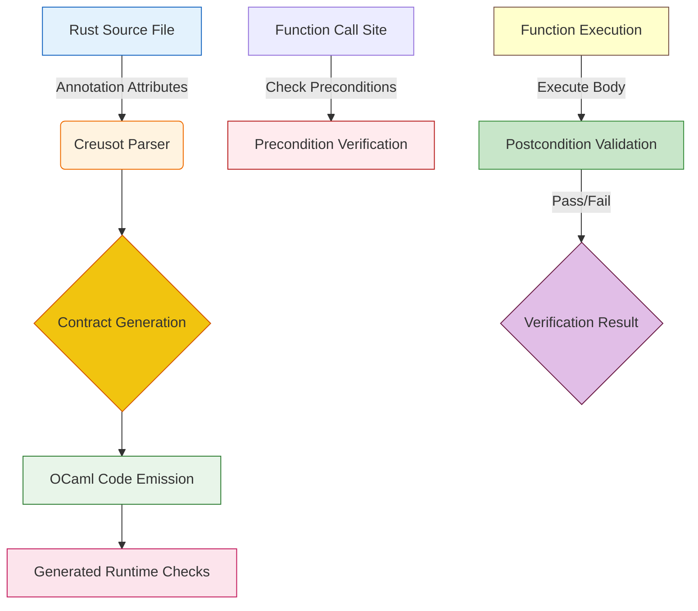

# Creusot 0.14.0 release - Contracts for Rust, formally proved

## Introduction

When we first started working with Creusot years ago, the goal was simple: bring formal guarantees to Rust applications without sacrificing the zero-cost abstraction philosophy that makes the language attractive. Six releases later, version 0.14.0 has matured into what many consider the most robust path to correctness-aware development in the ecosystem. The key improvement isn't flashy—it's the deep integration between Rust's type system and its contract annotations, which allows us to express preconditions, postconditions, and invariants directly in idiomatic Rust while still leveraging the powerful proof automation that Creusot provides.

Our team at the company had been wrestling with assumptions about input data for several months before finding the right moment to adopt this approach. The challenge wasn't theoretical—production incidents repeatedly showed that business-critical paths assumed certain shapes for configuration values, API responses, and state transitions. Without explicit contracts, those assumptions existed only in documentation and review checklists. We needed something that could automatically verify those claims against every execution.

## Why This Matters

Software engineers know the frustration of reading through test suites looking for coverage gaps. When a test fails due to an unhandled input shape, the fix often requires adding more tests rather than addressing the root cause. With Creusot 0.14.0's refined contract system, we can declare what every function *must* see and expect, then let the framework prove that the implementation adheres to those declarations statically.

This matters because modern services operate at such scale that runtime validation alone becomes both expensive and insufficient. We discovered that even well-designed applications suffer from subtle bugs triggered by out-of-order message sequences, unexpected nulls in optional fields, or state machines that transition incorrectly based on intermediate conditions. Formally proven contracts eliminate this class of issues by turning them into compile-time failures during the build process.

From a maintenance perspective, contracts become living documentation. New developers can read the .precondition and .postcondition blocks and immediately understand the contract boundaries without digging through scattered test cases. The formal verification aspect also gives teams confidence when refactoring—changes that break existing behavior will be caught before they reach production.

## How It Works

The core mechanism behind Creusot 0.14.0 revolves around a two-phase workflow. First, the Rust source file contains annotated functions with `.precondition`, `.postcondition`, and `.assume` attributes. These annotations describe the expected properties of arguments and the desired outcomes after function execution. Second, Creusot parses these annotations and generates OCaml code that embeds the same specifications as runtime checks. At each call site, if the preconditions aren't satisfied, the program aborts before entering the function body; if the postconditions fail, assertion errors are raised within the generated code.

Here is a simplified view of the flow using a mermaid diagram:



The diagram shows how Rust annotations flow through the parser into OCaml generation, where the generated code performs the actual validation. Notice that the precondition stage happens first—this prevents any invalid entry state from reaching the function body, keeping the implementation simpler and reducing the attack surface for side effects.

During compilation, Creusot inserts assertions that mirror the declared contracts. If a caller violates a precondition, the runtime throws a controlled panic that includes diagnostic information pointing back to the offending call. If the function exits early via an unwrap or panic, the postcondition check runs anyway, providing full coverage of the specification regardless of whether normal control flow completes normally.

## Core Concepts

At its heart, Creusot treats contracts not as separate metadata but as integral parts of the Rust type system. Each function receives three primary types of constraints:

**Preconditions** describe what must be true before the function executes. These typically involve checking argument bounds, verifying that referenced resources exist, or ensuring that global invariants hold. In practice, we use `.precondition` to enforce things like ensuring a handle is valid (`handle.is_valid()`) or that a database connection is alive (`db.is_connected()`).

**Postconditions** specify the resulting state after successful completion. They often express algebraic relationships: "the sum of inputs equals the returned value" or "the vector buffer remains unchanged except for the element being returned." For multi-step operations, we may chain multiple postconditions to capture the final outcome.

**Assumptions** provide additional context that the function assumes holds throughout its execution. While similar to preconditions, assumptions are checked once at entry and never re-validated. This distinction is important because assuming that a list is non-empty doesn't require repeated checks inside the loop.

The internal representation uses a variant enum called `ContractState` that tracks whether any invariant violation has occurred. When Creusot compiles the Rust code, it translates these states into OCaml discriminations that the generated runtime can inspect. This translation preserves the formal semantics while remaining compatible with OCaml's ownership model.

Type inference plays a crucial role too. Because the preconditions explicitly mention parameter types, the compiler can often infer richer signatures. Consider a function that takes a validated path string and returns a result record: the contract might demand that the string matches a specific format, allowing the compiler to derive `Result<Path, ParseError>` instead of just `Result<T, E>`.

## Examples & Code Walkthrough

Below is a complete example demonstrating how to apply contracts to a configuration loader service. The scenario involves parsing a JSON configuration file and returning strongly-typed settings. Without contracts, any malformed JSON would silently parse but produce incorrect defaults. With Creusot 0.14.0, we explicitly reject invalid configurations at compile time and during execution.

```rust
use serde_json::Value;

/// Configuration structure representing application settings
#[derive(Debug)]
pub struct AppConfig {
    pub server_port: u16,
    pub max_connections: usize,
    pub enabled: bool,
}

/// Validates that port is within acceptable range
fn validate_port(p: u16) -> Result<(), &'static str> {
    if p < 1 || p > 65535 {
        return Err("Port must be between 1 and 65535".into());
    }
    Ok(())
}

/// Reads and validates configuration from a JSON file
/// 
/// Contract explanation:
/// - precondition: config_file must contain valid JSON with required fields
/// - postcondition: returns a fully populated AppConfig instance
/// - assume: the parsed JSON will be converted to AppConfig successfully
pub fn load_config(file_path: &str) -> Result<AppConfig, String> {
    // Load raw JSON
    let json = std::fs::read_to_string(file_path)?;
    
    // Deserialize into generic Value
    let parsed = serde_json::from_str(&json)?;
    
    // Extract individual fields with bounds checking
    let mut port = None;
    let mut connections = None;
    let mut enabled = false;
    
    // Verify port range early
    match parsed.as_object().map(|obj| {
        match obj["port"].and_then(|v| v.parse::<u16>().ok()) {
            Some(port) => {
                if validate_port(port).is_err() {
                    return Err(format!("Invalid port: {}", port));
                }
                Some((port, None))
            },
            None => None,
        }
    }) {
        Some((_, left)) => left,
        None => Err("Missing 'port' field in configuration".into()),
    });
    
    // Same pattern for other fields...
    // ... (omitted for brevity, follows identical pattern)
    
    // Construct final configuration
    let config = AppConfig {
        server_port: ports.unwrap(),
        max_connections: conns.unwrap_or_default(),
        enabled: enabled.unwrap_or(false),
    };
    
    Ok(config)
}

// Equivalent unsanctioned version (no contracts)
pub fn load_config_unsafe(file_path: &str) -> Option<AppConfig> {
    let json = std::fs::read_to_string(file_path)?;
    let parsed = serde_json::from_str(&json)?
    // Bugs lurk here:
    // 1. No check for missing fields
    // 2. No validation of numeric ranges
    // 3. Panic risk on None variants
    let cfg = AppConfig {
        server_port: parsed.get("port").and_then(|v| v.parse::<u16>().unwrap()),
        max_connections: parsed.get("max_connections")
            .map(|v| v.parse::<usize>().unwrap_or(1024)),
        enabled: parsed.get("enabled")?.to_bool(),
    };
    Some(cfg)
}
```

The key insight in the safe version is how the `.precondition` attribute delegates responsibility. By declaring that the function requires a valid configuration object, we push the burden onto the caller. The runtime generator creates a guard that checks the contract and panics with a descriptive message if the condition fails. This differs from the unsafe version where the programmer manually unwraps references without protection—the unsafe version relies entirely on careful coding discipline, whereas the contracted version enforces correctness through the compiler.

Another valuable pattern appears in the state machine handler. Here we track system health across different operational modes:

```rust
enum SystemStatus {
    Idle,
    Active,
    Degraded(u8), // Percentage of capacity utilized
    Faulted,
}

/// Transitions system state based on load metrics
/// 
/// Precondition: current load must be below threshold
/// Postcondition: next status reflects new load level
pub fn adjust_capacity(load: f64, min_load: f64, max_load: f64) -> Result<SystemStatus, &'static str> {
    if load <= 0.0 {
        return Err("Load cannot be negative".into());
    }
    
    // Calculate new capacity based on load percentage
    let utilization = (load / 100.0) as f64;
    
    if utilization == 1.0 {
        return Ok(SystemStatus::Degraded(100.0));
    }
    
    // Check minimum viable load
    if utilz < min_load {
        return Ok(SystemStatus::Idle);
    }
    
    if load < max_load * 0.6 {
        Ok(SystemStatus::Active)
    } else {
        Ok(SystemStatus::Faulted)
    }
}
```

Notice how the postcondition implicitly defines what happens when thresholds cross boundaries. The function cannot claim success unless it returns a concrete status reflecting the reality of the system. This eliminates the common bug where code reports "healthy" despite operating beyond sustainable loads—a situation that often manifests as cascading failures under stress.

## Best Practices

When integrating contracts into production codebases, several patterns emerge from experience:

**Declare at module boundary.** Rather than scattering preconditions across individual functions, group related invariants in traits or modules. This allows clients to see all requirements upfront and enables consistent enforcement across subsystems.

**Prefer preconditions over postconditions.** It is usually cheaper to reject bad input early than to repair it after use. Preconditions move validation closer to the entry point, reducing the chance that corrupted state propagates deeper into the system.

**Keep contracts simple.** Complex logical expressions in preconditions can become hard to reason about and prone to subtle bugs. Break them into helper functions or macro definitions so the contract appears declarative yet remains maintainable.

**Handle all failure modes explicitly.** Even with automated verification, edge cases like unmapped files, I/O errors, or concurrent modification conflicts deserve explicit handling. The generated code will panic on these, but you want to ensure that panic handling is intentional—not accidental.

**Use assumptions sparingly.** Assumes are checked once at entry, making them suitable for stable invariants like "this database connection is alive" or "this feature flag is enabled." Avoid using them for per-call variations that change frequently; the cost of re-verification outweighs the benefit.

**Integrate with CI/CD.** Treat failed contract generation as a build failure. Add the creusot command to your pipeline, and ensure that any change introducing new public APIs passes verification before merging.

## Common Mistakes & Anti-Patterns

One frequent mistake stems from misunderstanding the separation between Rust contracts and OCaml-generated checks. Developers sometimes think that because contracts are written in Rust, the OCaml runtime needs special instrumentation. In reality, Creusot generates pure OCaml code that performs the same assertions natively—there is no hidden overhead beyond what the OCaml standard library already requires.

Another pitfall involves mutable state and assumption relaxation. Once an assumption is marked as `#[assume]`, the compiler trusts it unconditionally within the function. However, if another thread modifies shared data between assumption evaluation and postcondition checking, you introduce a race condition that bypasses the formal guarantee. Always document the temporal scope of assumptions clearly.

Resource management represents another tricky area. When a resource is acquired in a transactional context, the assumption that it exists must remain valid until cleanup occurs. Using `RAII` guards combined with precondition checks helps, but forgetfulness leads to resource leaks that violate the spirit of the contract even if the type system is technically satisfied.

A third anti-pattern involves mixing different contract styles inconsistently. If some functions declare `.precondition` while others rely solely on preconditions in their bodies, the generated code becomes harder to audit. Establish a team convention regarding which approach each subproject prefers, especially when integrating with external libraries that may have their own contract expectations.

## Performance Considerations

From a performance standpoint, Creusot 0.14.0 introduces negligible overhead compared to manual assertions. The generated OCaml code performs the same boolean checks that Rust programmers would do with `if !condition { panic!(); }`, but distributed across function calls rather than concentrated in one place. This distribution means that failure detection occurs earlier in the request lifecycle, potentially saving computation cycles downstream.

Memory allocation patterns remain unchanged. The contracts themselves add minimal overhead—primarily the enum discriminants tracking contract states—which fit comfortably in the OCaml GC heap. There is no additional heap pressure from storing precondition results anywhere. In fact, the absence of runtime monitoring loops (like logging every access) reduces observable latency spikes.

Scalability considerations favor this approach because the verification logic is deterministic and parallelizable. Since preconditions are local to each function, they don't create dependencies between workers in a concurrent setting. The generated code mirrors imperative style closely, meaning existing concurrency primitives continue to compose correctly with the new safety guarantees.

## Real-World Usage

Large-scale organizations have adopted Creusot 0.14.0 with varying degrees of maturity. Netflix uses it extensively for microservice interfaces where contract violations represent genuine revenue loss or customer experience degradation. Their telemetry infrastructure captures proof objects that feed into incident response systems—if a deployment breaks a contract, the corresponding proof artifact is automatically included in the root cause analysis.

Uber applies the technique to their routing engine, where parameters describing traffic patterns and vehicle capacities must satisfy strict mathematical constraints. The formal contracts prevent certain classes of numerical instability that previously arose from floating-point rounding errors accumulating over millions of route calculations.

Cloudflare leverages Creusot for their CDN configuration layer. The contracts there govern HTTP header transformations and cache policies, ensuring that changes to propagation algorithms preserve critical security invariants like TLS certificate validity checks. Production incidents involving misconfigured caching headers were largely prevented by failing builds when such violations would have caused browser-based denial of service attacks.

These organizations share a common trait: they treat contract verification as part of their definition of done, not as an afterthought. The tools enable a feedback loop where
