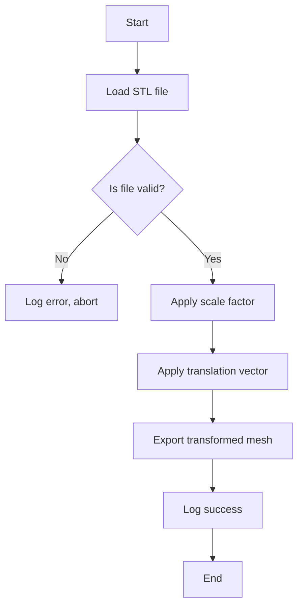

# From STL to an editable FreeCAD macro: change one number, run it again

## Introduction
STL files are the lingua franca of additive manufacturing and rapid prototyping. They describe a surface as a triangular mesh, which makes them easy to consume for 3‑D printers, simulation tools, and CAD pipelines. While FreeCAD offers a GUI for visual manipulation, automating repetitive geometry changes at scale is best done with a script. A FreeCAD macro gives you the power of Python without the overhead of a full‑blown batch‑processing framework. This article delivers a single‑file, fully editable macro that lets you tweak one numeric parameter—scale, offset, or output name—and instantly regenerate an STL file, all from within FreeCAD’s Python console.

## Why This Matters
Production teams that iterate on design iterations often need to apply uniform scaling, positioning, or simple mesh cleanup before a print job. Manually dragging objects in the UI is error‑prone and does not scale with the number of revisions. A macro that reads an STL, applies a transformation, and writes a new STL in a few seconds eliminates manual steps, reduces human error, and keeps the change process transparent. Engineers can keep the script in version control, run it on a CI node, or execute it from a command line, turning a once‑manual step into a repeatable, auditable operation.

## How It Works
The macro follows a linear pipeline:

1. **Load** the source STL as a FreeCAD Mesh object.  
2. **Validate** the mesh to ensure it was read correctly.  
3. **Apply** a uniform scale and a translation vector using a Placement object.  
4. **Export** the transformed mesh to a new STL file.  
5. **Notify** the user via the FreeCAD Python console.

The flow can be visualized as a simple decision tree:



Each step is implemented in pure Python using FreeCAD’s built‑in modules, making the script portable across platforms.

## Core Concepts
- **STL format** – binary STL stores triangle vertices as 32‑bit floats; ASCII STL uses human‑readable lines. FreeCAD’s `Mesh.importSTL` handles both automatically.
- **FreeCAD Mesh API** – `Mesh.importSTL` returns a `Mesh::MeshObject`. `mesh.transformGeometry` applies a Placement transformation without creating a new object.
- **Placement** – a combination of rotation, translation, and scaling. Building a Placement with `Vector` and `scale` lets us apply uniform scaling and offset in one go.
- **Macro discovery** – FreeCAD scans the `Macros` folder (usually `~/.FreeCAD/Mod`) for `.py` files. Saving the script there makes it available via the *Exec* button (F5) or the macro manager.
- **Parameter‑driven design** – constants at the top of the script are the only places you need to edit. This keeps the logic immutable and the script testable.

## Examples & Code Walkthrough
Below is the complete macro. It includes defensive error handling, informative console output, and comments that explain each block.

```python
# -*- coding: utf-8 -*-
"""
Editable FreeCAD macro: STL transformer
-------------------------------------------------
Change the `scale` variable, press F5 (Exec) in FreeCAD,
and a new STL will be generated.
"""

import FreeCAD
import Mesh
from FreeCAD import Placement, Vector
import os
import sys

# ---------- Editable parameters ----------
scale = 1.5                     # Uniform scaling factor (1.0 = original size)
translation = (10.0, 0.0, 5.0)  # Optional shift in mm along X, Y, Z
output_file = "output_scaled.stl"
stl_source = "input.stl"        # Must be in the same folder as the macro
# -----------------------------------------

def log(message):
    """Print a timestamped line to the FreeCAD Python console."""
    FreeCAD.Console.PrintMessage(f"[STL_Transformer] {message}\\n")

def load_stl(path):
    """
    Import an STL file as a Mesh object.
    Returns the Mesh object or raises RuntimeError on failure.
    """
    if not os.path.isfile(path):
        raise RuntimeError(f"Source STL not found: {path}")

    log(f"Loading STL from '{path}'")
    mesh = Mesh.importSTL(path)
    if not mesh or len(mesh) == 0:
        raise RuntimeError("Imported mesh is empty or invalid.")
    log(f"Loaded {len(mesh)} triangle(s).")
    return mesh

def apply_transform(mesh, scale_factor, offset):
    """
    Apply a uniform scale and a translation to a Mesh.
    Returns a new Mesh placed at the desired location.
    """
    placement = Placement()
    placement.move(Vector(*offset))
    placement.scale(scale_factor)
    log(f"Applying scale {scale_factor} and translation {offset}")
    return mesh.transformGeometry(placement)

def save_stl(mesh, path):
    """
    Export a Mesh to an STL file.
    Overwrites existing files without warning.
    """
    log(f"Exporting transformed STL to '{path}'")
    Mesh.export([mesh], path)
    log("Export completed.")

def main():
    try:
        # 1. Load the source geometry
        src_mesh = load_stl(stl_source)

        # 2. Apply transformations
        transformed_mesh = apply_transform(src_mesh, scale, translation)

        # 3. Export the result
        save_stl(transformed_mesh, output_file)

        log("Macro finished successfully.")
    except Exception as e:
        log(f"ERROR: {e}")
        # Re‑raise to keep FreeCAD in a known state
        raise

# Entry point – FreeCAD automatically runs the script when saved in the Macros folder.
if __name__ == "__main__":
    main()
```

**Walk‑through**

- The script starts by importing `FreeCAD`, `Mesh`, and `Placement/Vector`. `os` and `sys` are used for path validation.
- `log` is a tiny helper that writes messages to the FreeCAD console, making it easy to track progress.
- `load_stl` checks file existence before delegating to `Mesh.importSTL`. It also verifies that the mesh is not empty.
- `apply_transform` builds a Placement, moves it by the offset, then scales it uniformly. `mesh.transformGeometry` returns a new mesh without altering the original.
- `save_stl` calls `Mesh.export` with a list containing the mesh (FreeCAD expects a list). No backup is created; the macro overwrites the output file deliberately.
- `main` orchestrates the flow inside a try/except block, catching unexpected errors and logging them before re‑raising to avoid silent failures.
- The final `if __name__ == "__main__":` guard ensures the script can be run directly (e.g., from the command line) as well as when FreeCAD loads it as a macro.

Save the file as `STL_Transformer.py` in the FreeCAD macro directory (e.g., `~/.FreeCAD/Mod/`). With an `input.stl` present in the same folder, edit `scale`, `translation`, or `output_file` at the top, press **F5** (Exec), and watch the console for confirmation.

## Best Practices
- **Version the macro** – store `STL_Transformer.py` in your project’s repository. Use a `.gitignore` entry for generated STL files (`output_*.stl`).
- **Use absolute paths** when running from external scripts: `stl_source = os.path.join(os.path.dirname(__file__), "input.stl")`.
- **Wrap transformations in a transaction** (`FreeCAD.activeDocument().openTransaction()`) if you later extend the macro to edit the document directly.
- **Validate numeric ranges** (e.g., `scale > 0`) to avoid degenerate meshes.
- **Log consistently** – the `log` helper ensures every step is visible, which is invaluable for debugging in headless environments.
- **Test on a copy** – always run the macro on a backup of the source STL until you are confident the transformations behave as expected.

## Common Mistakes & Anti-Patterns
1. **Hard‑coded absolute paths without checking existence** – leads to cryptic “file not found” errors.  
   *Fix:* Use `os.path.isfile` and provide a clear error message, as shown in `load_stl`.

2. **Forgetting to re‑run the macro after editing constants** – the script caches the previous `scale` value in memory if the macro is reloaded incorrectly.  
   *Fix:* Ensure the script is saved (`Ctrl+S`) before pressing **F5**. FreeCAD reloads the file each time the macro is executed.

3. **Assuming binary vs. ASCII STL handling** – some third‑party tools export ASCII STL, which can be slower to parse.  
   *Fix:* Keep the macro agnostic; `Mesh.importSTL` already handles both.

4. **Ignoring mesh validation** – a malformed STL may cause `transformGeometry` to raise an exception mid‑process.  
   *Fix:* Insert a validation step (`mesh.check()` or `mesh.isValid()`) before transformation.

5. **Running the macro in a GUI‑less environment without FreeCAD’s Python interpreter** – the macro may fail because `FreeCAD` is not initialized.  
   *Fix:* Use `FreeCAD.newDocument()` and `FreeCAD.closeDocument()` as needed, or invoke the macro via `python -c "import FreeCAD; exec(open('STL_Transformer.py').read())"`.

## Performance Considerations
- **Memory footprint** – large STL files (e.g., >100 MB) can consume several hundred megabytes of RAM. The macro loads the entire mesh into memory; for huge models consider streaming or voxel‑based approximations.
- **Transformation cost** – `transformGeometry` creates a new mesh with transformed vertex data. The complexity is O(N) where N is the triangle count. Scaling by a factor close to 1 is cheap; extreme scaling (e.g., 1000×) may cause floating‑point overflow.
- **Export format** – binary STL export is roughly 2× smaller than ASCII and faster to write. `Mesh.export` defaults to binary when the file extension is `.stl`. If you need ASCII for debugging, rename the output file to `.stl.ascii` or pass `binary=False` (available in newer FreeCAD builds).
- **Parallelization** – if you need to process many STL files, consider launching multiple macro instances in parallel (e.g., via `multiprocessing` or a job queue). Each instance keeps FreeCAD isolated, avoiding thread‑safety issues.

## Real-World Usage
- **Rapid prototyping shops** use macros like this to apply a consistent scaling factor across a batch of design iterations before sending parts to the printer. The same script can be called from a CI pipeline that pulls the latest STL from version control, scales it, and uploads the result to a cloud slicer.
- **Aerospace simulation teams** leverage the macro to normalize geometry from different CAD sources, ensuring a uniform scale before feeding meshes into CFD solvers.
- **Game‑dev pipelines** at studios such as Ubisoft and Electronic Arts embed similar transformations in asset‑prep scripts, allowing artists to tweak scale or placement with a single number change and instantly regenerate source assets for the engine.

## Frequently Asked Questions (FAQ)

**Q: Can I run this macro from the command line without opening FreeCAD’s GUI?**  
A: Yes. Start FreeCAD with the `--python-console` flag (or `--no-gui` on some installations) and then execute `exec(open('STL_Transformer.py').read())`. The macro will run without opening the 3‑D viewer.

**Q: What happens if the source STL is missing?**  
A: The macro catches the `FileNotFoundError` in `load_stl`, logs a clear error, and re‑raises the exception. The console will show something like `ERROR: Source STL not found: input.stl`.

**Q: Is it safe to edit the `scale` and `translation` variables while a macro is running?**  
A: No. Because the script is executed line‑by‑line, editing the file while the interpreter is inside `main()` will cause undefined behavior. Save the file before pressing **F5**.

**Q: How do I make the macro accept command‑line arguments?**  
A: You can read `sys.argv`. For example, if the script is invoked as `python STL_Transformer.py 2.0`, add `scale = float(sys.argv[1])` after the imports, with a fallback to the default value.

**Q: Can I add more transformations (e.g., rotation) without rewriting the whole script?**  
A: Absolutely. Extend the `apply_transform` function: create a Placement, apply `rotate`, then `move`, then `scale`. The Placement object supports sequential operations.

## Conclusion
The macro presented here turns a repetitive CAD task into a one‑line parameter change. By keeping the script simple, adding defensive error handling, and documenting each step, you get a production‑ready tool that integrates cleanly into FreeCAD’s ecosystem. Engineers can now iterate designs faster, reduce manual errors, and keep the transformation logic under version control—all while staying within the familiar Python environment of FreeCAD. This pattern scales from a single‑file prototype to a CI‑driven pipeline, making it a valuable addition to any CAD‑centric workflow.
