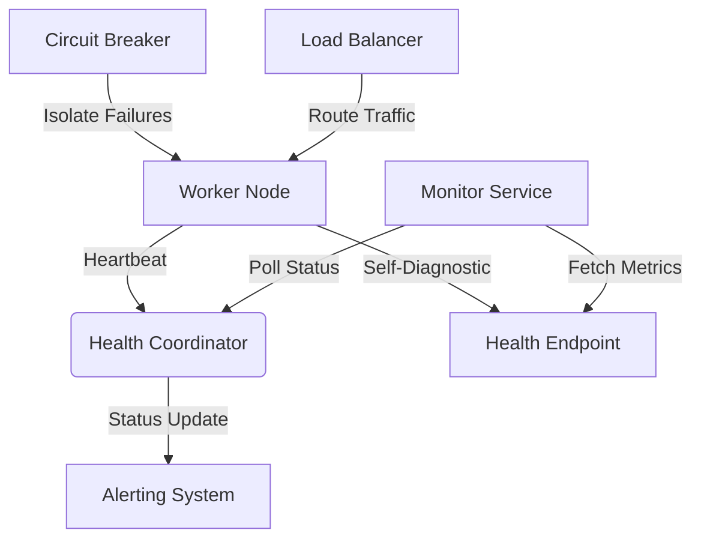

# Ghost In The Machine 👻

## Introduction

There's a subtle failure mode that creeps into distributed systems when asynchronous messaging goes wrong — messages disappear, handlers crash silently, and entire workflows grind to a halt. I first encountered this during a production outage at a fintech startup where payment confirmations were being dropped by a misconfigured Kafka consumer group. The root cause wasn't a bug in our business logic; it was an invisible process dying without anyone noticing until customers started complaining.

This is what I call the "ghost in the machine" — a background worker, daemon, or service that appears to be running but is actually doing nothing useful. Unlike a hard crash that triggers alerts, these phantom processes consume resources while failing their primary duties. In this article, I'll walk through how to detect, prevent, and recover from these insidious failures using heartbeat monitoring, circuit breakers, and proactive health checks.

## Why This Matters

Every modern application relies on background processing — whether it's sending emails, processing uploads, or syncing data across services. When these workers fail silently, the impact compounds quickly:

- **Data inconsistency**: Transactions left in limbo, orders never confirmed, notifications never sent.
- **Resource waste**: Dead processes still holding database connections, memory allocations, and file locks.
- **Operational blindness**: Standard monitoring tools report green status while critical paths remain broken.
- **Customer trust erosion**: Users experience timeouts, missing features, or incomplete operations without explanation.

At scale, even a small percentage of ghost processes can cascade into system-wide instability. Engineers spend countless hours firefighting instead of innovating because they lack visibility into the actual state of their asynchronous infrastructure.

## How It Works

The core idea behind detecting ghost processes involves three key mechanisms working together:

1. **Heartbeat monitoring** — Regular pings from each worker to a central coordinator
2. **Circuit breaker patterns** — Automatic isolation of failing components
3. **Health check endpoints** — Self-reporting diagnostics exposed over HTTP

Here's how they interact in practice:



Each worker sends periodic heartbeats containing metadata like last processed message ID, current queue depth, and error counts. If a heartbeat doesn't arrive within a configured timeout window, the coordinator flags the node as potentially dead. The monitor service polls both the coordinator and individual health endpoints to build a comprehensive view of system health.

When failures are detected, circuit breakers automatically isolate problematic nodes before they affect other parts of the system. Meanwhile, health endpoints provide deep introspection capabilities for debugging sessions.

## Core Concepts

Let me break down the fundamental pieces:

### Heartbeat Protocol

Workers emit structured JSON payloads every few seconds:

```json
{
  "worker_id": "payment_processor_01",
  "timestamp": "2023-09-15T14:30:22Z",
  "last_message_id": "msg_abc123",
  "queue_depth": 47,
  "errors": 0,
  "uptime_seconds": 86400
}
```

This simple structure gives us enough information to make intelligent decisions about process viability.

### Circuit Breaker States

Following Netflix's Hystrix model, breakers cycle through four states:

| State      | Behavior |
|------------|----------|
| CLOSED     | Normal operation, requests flow freely |
| OPEN       | Requests blocked immediately, fallback used |
| HALF_OPEN  | Test request allowed to probe recovery |
| DISABLED   | Manual override for maintenance |

### Health Check Layers

Effective monitoring requires multiple layers:

1. **Liveness probe** — Is the process alive?
2. **Readiness probe** — Can it handle traffic?
3. **Startup probe** — Has initialization completed successfully?

These map directly to Kubernetes lifecycle hooks but apply equally well to bare-metal deployments.

## Examples & Code Walkthrough

Let me show you a concrete implementation using Python and Redis for coordination. This example models a real-world scenario where we're processing financial transactions asynchronously.

First, let's define our core data structures:

```python
import time
import json
import uuid
from dataclasses import dataclass, field
from typing import Optional, Dict, Any
import redis
import logging

logger = logging.getLogger(__name__)

@dataclass
class WorkerMetadata:
    """Tracks runtime statistics for a single worker instance."""
    worker_id: str
    started_at: float
    last_heartbeat: float
    last_processed_id: Optional[str] = None
    queue_depth: int = 0
    error_count: int = 0
    
    def to_heartbeat_payload(self) -> Dict[str, Any]:
        """Serialize metadata for transmission to coordinator."""
        return {
            'worker_id': self.worker_id,
            'timestamp': time.time(),
            'last_message_id': self.last_processed_id,
            'queue_depth': self.queue_depth,
            'errors': self.error_count,
            'uptime_seconds': time.time() - self.started_at
        }

class HeartbeatMonitor:
    """
    Coordinates heartbeat signals between distributed workers.
    
    Uses Redis sorted sets to track expiration times efficiently.
    Workers must renew their lease periodically or risk being marked stale.
    """
    
    HEARTBEAT_TTL = 30  # seconds before worker considered stale
    REDIS_KEY_PREFIX = "ghost:monitor:"
    
    def __init__(self, redis_client: redis.Redis):
        self.redis = redis_client
        self._lock = None  # Thread-safe locking if needed
    
    def register_worker(self, worker_id: str) -> WorkerMetadata:
        """Initialize tracking for a new worker."""
        metadata = WorkerMetadata(
            worker_id=worker_id,
            started_at=time.time(),
            last_heartbeat=time.time()
        )
        
        payload = metadata.to_heartbeat_payload()
        # Store in Redis with TTL so expired entries auto-clean
        self.redis.setex(
            f"{self.REDIS_KEY_PREFIX}heartbeat:{worker_id}",
            self.HEARTBEAT_TTL,
            json.dumps(payload)
        )
        
        logger.info(f"Registered worker {worker_id}")
        return metadata
    
    def send_heartbeat(self, metadata: WorkerMetadata) -> bool:
        """
        Send updated heartbeat signal.
        
        Returns True if successful, False if Redis unavailable.
        """
        try:
            payload = metadata.to_heartbeat_payload()
            self.redis.setex(
                f"{self.REDIS_KEY_PREFIX}heartbeat:{metadata.worker_id}",
                self.HEARTBEAT_TTL,
                json.dumps(payload)
            )
            
            metadata.last_heartbeat = time.time()
            return True
            
        except redis.RedisError as e:
            logger.error(f"Heartbeat failed for {metadata.worker_id}: {e}")
            return False
    
    def get_stale_workers(self) -> list[Dict[str, Any]]:
        """
        Identify workers whose heartbeats have expired.
        
        Scans all active heartbeat keys and returns those past their TTL.
        """
        pattern = f"{self.REDIS_KEY_PREFIX}heartbeat:*"
        stale_workers = []
        
        cursor = 0
        while True:
            cursor, keys = self.redis.scan(cursor=cursor, match=pattern, count=100)
            
            for key in keys:
                try:
                    raw_data = self.redis.get(key)
                    if raw_data:
                        data = json.loads(raw_data)
                        age = time.time() - data['timestamp']
                        if age > self.HEARTBEAT_TTL:
                            stale_workers.append(data)
                except (json.JSONDecodeError, KeyError) as e:
                    logger.warning(f"Corrupted heartbeat data in {key}: {e}")
            
            if cursor == 0:
                break
                
        return stale_workers
```

Now let's implement a simple transaction processor that integrates with this monitoring system:

```python
import random
from typing import List, Callable
import signal
import sys

class TransactionProcessor:
    """
    Processes financial transactions with built-in ghost detection.
    
    Simulates real-world challenges like:
    - Variable processing times
    - Intermittent failures
    - Memory pressure
    """
    
    def __init__(
        self,
        worker_id: str,
        monitor: HeartbeatMonitor,
        transaction_source: Callable[[], List[Dict]]
    ):
        self.metadata = monitor.register_worker(worker_id)
        self.monitor = monitor
        self.transaction_source = transaction_source
        self.running = True
        
        # Graceful shutdown handling
        signal.signal(signal.SIGTERM, self._handle_shutdown)
        signal.signal(signal.SIGINT, self._handle_shutdown)
    
    def _handle_shutdown(self, signum, frame):
        """Clean exit on termination signals."""
        logger.info(f"Worker {self.metadata.worker_id} shutting down...")
        self.running = False
    
    def process_batch(self, transactions: List[Dict]) -> int:
        """
        Process a batch of transactions with simulated variability.
        
        Returns number of successfully processed items.
        """
        success_count = 0
        
        for tx in transactions:
            try:
                # Simulate variable processing time (10ms - 500ms)
                processing_time = random.uniform(0.01, 0.5)
                time.sleep(processing_time)
                
                # Simulate occasional failure (5% chance)
                if random.random() < 0.05:
                    raise RuntimeError("Simulated processing error")
                
                # Actual transaction logic would go here
                logger.debug(f"Processed transaction {tx.get('id')}")
                success_count += 1
                self.metadata.last_processed_id = tx.get('id')
                
            except Exception as e:
                self.metadata.error_count += 1
                logger.error(f"Failed to process transaction: {e}")
                # In production, route to dead letter queue
                
        return success_count
    
    def run(self):
        """Main processing loop with heartbeat maintenance."""
        logger.info(f"Starting worker {self.metadata.worker_id}")
        
        while self.running:
            try:
                # Fetch work from source (could be Kafka, SQS, etc.)
                transactions = self.transaction_source()
                self.metadata.queue_depth = len(transactions)
                
                if transactions:
                    processed = self.process_batch(transactions)
                    logger.info(
                        f"Processed {processed}/{len(transactions)} transactions"
                    )
                
                # Send heartbeat after each batch
                if not self.monitor.send_heartbeat(self.metadata):
                    logger.warning("Failed to send heartbeat - continuing anyway")
                
                # Brief pause to simulate realistic workload pacing
                time.sleep(1)
                
            except Exception as e:
                logger.exception(f"Unexpected error in main loop: {e}")
                self.metadata.error_count += 1
                time.sleep(5)  # Back off on errors
```

Finally, here's a coordinator script that monitors everything:

```python
class SystemCoordinator:
    """
    Central authority for managing worker lifecycle and alerting.
    
    Periodically scans for stale workers and takes corrective action.
    """
    
    def __init__(self, monitor: HeartbeatMonitor):
        self.monitor = monitor
        self.alert_callback: Optional[Callable] = None
    
    def set_alert_handler(self, callback: Callable[[str], None]):
        """Register function to call when issues detected."""
        self.alert_callback = callback
    
    def scan_and_alert(self):
        """Check for stale workers and trigger alerts."""
        stale = self.monitor.get_stale_workers()
        
        for worker in stale:
            message = (
                f"Worker {worker['worker_id']} appears stale "
                f"(last seen {time.time() - worker['timestamp']:.1f}s ago)"
            )
            logger.warning(message)
            
            if self.alert_callback:
                self.alert_callback(message)
    
    def generate_report(self) -> Dict[str, Any]:
        """Produce summary report of system health."""
        stale = self.monitor.get_stale_workers()
        # In a full implementation, we'd also query active workers
        return {
            'stale_count': len(stale),
            'total_workers': len(stale),  # Simplified for demo
            'timestamp': time.time()
        }

# Example usage:
if __name__ == "__main__":
    # Setup logging
    logging.basicConfig(level=logging.INFO)
    
    # Connect to Redis (in production, add connection pooling)
    redis_client = redis.Redis(host='localhost', port=6379, db=0)
    monitor = HeartbeatMonitor(redis_client)
    coordinator = SystemCoordinator(monitor)
    
    # Mock transaction source
    def mock_transactions():
        return [{'id': f'tx_{i}', 'amount': random.randint(1, 1000)} 
                for i in range(random.randint(0, 10))]
    
    # Start a worker
    processor = TransactionProcessor(
        worker_id=f"worker_{uuid.uuid4().hex[:8]}",
        monitor=monitor,
        transaction_source=mock_transactions
    )
    
    # Run coordinator scan in another thread (simplified here)
    coordinator.scan_and_alert()
```

## Best Practices

Based on years of fighting ghost processes in production, here are my hard-won recommendations:

1. **Always use timeouts on network calls** — Never let a worker block indefinitely waiting for external resources.
2. **Implement graceful degradation** — When dependencies fail, fall back to safe defaults rather than crashing.
3. **Log heartbeat failures distinctly** — Separate heartbeat logs from application logs so alert rules can target them specifically.
4. **Use exponential backoff for retries** — Prevent thundering herds when recovering from transient failures.
5. **Validate assumptions about process state** — Don't assume a running process is actually doing useful work.
6. **Test failure scenarios regularly** — Chaos engineering helps expose hidden ghost behaviors.

## Common Mistakes & Anti-Patterns

Here are the most dangerous pitfalls I've seen teams fall into:

### 1. Heartbeats Without Validation

Sending a heartbeat proves the process is alive, but not that it's functional. Fix this by including health assertions:

```python
# BAD: Heartbeat says "alive" but process might be stuck
def send_simple_heartbeat():
    redis.setex('heartbeat', 30, 'alive')

# GOOD: Include actual health metrics
def send_validated_heartbeat(metadata):
    # Verify critical subsystems before reporting healthy
    db_connection_ok = check_database_health()
    queue_accessible = check_queue_connectivity()
    
    if not (db_connection_ok and queue_accessible):
        metadata.error_count += 1
        logger.warning("Skipping heartbeat due to subsystem failures")
        return False
    
    return monitor.send_heartbeat(metadata)
```

### 2. No Circuit Breakers

Allowing failing workers to continue consuming resources creates cascading failures. Always wrap critical sections:

```python
# BAD: No protection against repeated failures
def process_payment(amount):
    charge_gateway.charge(amount)  # Could hang or timeout

# GOOD: Circuit breaker prevents resource exhaustion
from pybreaker import CircuitBreaker

payment_breaker = CircuitBreaker(fail_max=3, reset_timeout=60)

@payment_breaker
def process_payment(amount):
    return charge_gateway.charge(amount)
```

### 3. Ignoring Graceful Shutdown

Killing processes abruptly leaves data in inconsistent states. Handle termination signals properly:

```python
# BAD: Process dies mid-transaction
def bad_worker():
    while True:
        tx = get_next_transaction()
        process_transaction(tx)  # No cleanup on kill

# GOOD: Clean shutdown preserves data integrity
class GracefulWorker:
    def __init__(self):
        self.running = True
        signal.signal(signal.SIGTERM, self.shutdown)
    
    def shutdown(self, *args):
        self.running = False
        # Wait for current batch to finish
        time.sleep(2)
        sys.exit(0)
```

### 4. Static Configuration

Hardcoded timeouts and thresholds don't adapt to changing conditions. Make them dynamic:

```python
# BAD: Fixed values that may not suit all environments
HEARTBEAT_INTERVAL = 5
HEARTBEAT_TIMEOUT = 10

# GOOD: Configurable based on deployment context
class AdaptiveConfig:
    def __init__(self, environment='production'):
        base_interval = 5 if environment == 'production' else 2
        self.heartbeat_interval = base_interval
        self.heartbeat_timeout = base_interval * 3
```

## Performance Considerations

Ghost detection systems introduce their own overhead, so optimize carefully:

- **Redis memory usage**: Sorted sets for tracking expirations scale better than lists. Each entry should be under 1KB.
- **Network round trips**: Batch heartbeat updates when possible. Sending one combined payload every 30 seconds beats individual calls every 5 seconds.
- **Scan operations**: Avoid full keyspace scans in
