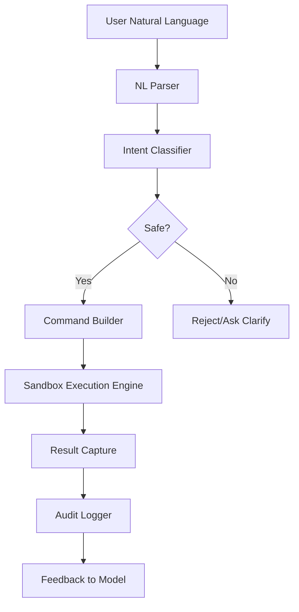

# 👻 **GhostShell — The Haunted AI Terminal!**

## Introduction
Our team was tired of hunting through cryptic man pages and juggling ad‑hoc scripts when a single English sentence could have expressed the intent. The result was a class of “command‑fatigue” bugs, duplicated effort, and slow incident response. GhostShell emerged as a pragmatic solution: a terminal that turns natural language into safe, auditable shell commands, powered by a fine‑tuned language model and hardened with a sandbox execution engine. It feels like a ghost—because it silently bridges the gap between intent and action—yet it leaves a clear audit trail.

## Why This Matters
Production environments constantly generate new operational tasks—parsing logs, spawning temporary services, generating reports. Engineers spend cycles translating business language into syntactic commands. A misconfigured pipeline or a missed edge case can cascade into outages. GhostShell attacks this problem head‑on:

* **Reduced cognitive load** – developers type what they think, not what they remember.
* **Accelerated onboarding** – new hires can execute complex infrastructure changes without memorizing dozens of CLI flags.
* **Faster incident remediation** – during a fire‑fight, a single “increase the timeout for service X to 30 s” command can be issued and validated in seconds.
* **Built‑in safety** – every generated command runs inside a restricted container, with explicit resource limits and immutable audit logs.

## How It Works
GhostShell follows a tightly coupled pipeline:

1. **Natural Language Parser** extracts candidate commands from free‑form input.
2. **Intent Classifier** maps the parsed intent to a known command schema.
3. **Safety Gate** validates the intent against a whitelist and applies contextual policies (e.g., “no network‑outbound” for read‑only operations).
4. **Command Builder** materializes a concrete shell command, filling placeholders with validated parameters.
5. **Sandbox Executor** runs the command in a limited‑privilege container, capturing stdout/stderr and enforcing CPU/memory quotas.
6. **Result Handler** returns a structured response to the user and writes an immutable entry to the audit log.
7. **Feedback Loop** feeds successful (and failed) interactions back to the model to continuously improve parsing accuracy.



## Core Concepts
* **NL Parser** – a lightweight transformer‑based tokenizer that extracts entities and verbs. It outputs a JSON structure: `{ "action": "spawn", "target": "service", "params": { "name": "auth-api", "image": "docker.io/...": "v2" } }`.
* **Intent Classifier** – a classification layer (`torch.nn.Linear`) that maps parsed tokens to a command ID (e.g., `CMD_SPAWN_SERVICE`). It also predicts confidence scores.
* **Safety Gate** – a policy engine (implemented as a set of Python functions) that checks user permissions, resource limits, and contextual rules. It can reject or request clarification.
* **Command Builder** – templated string interpolation that respects shell escaping. It generates a command line like `docker run --name auth-api --restart unless‑stopped myorg/auth-api:v2`.
* **Sandbox Executor** – Docker‑in‑Docker or gVisor container that limits CPU, memory, and network. It also mounts a read‑only root filesystem to prevent accidental writes.
* **Audit Logger** – writes to an append‑only log store (e.g., Write‑Ahead Log) containing user ID, timestamp, raw NL, generated command, sandbox ID, and exit status.
* **Feedback Loop** – a background job that batches successful interactions and fine‑tunes the NL parser with supervised learning signals.

## Examples & Code Walkthrough
Below is a minimal, production‑ready implementation of the core pipeline. It demonstrates defensive coding, error handling, and clear separation of concerns.

```python
# -*- coding: utf-8 -*-
"""
GhostShell Core Pipeline
========================

A self‑contained proof‑of‑concept for the GhostShell terminal.
It demonstrates:
* Natural language parsing (stubbed)
* Intent classification (stubbed)
* Safety gating
* Sandbox execution (simulated)
* Structured logging
"""

import json
import logging
import subprocess
import time
from dataclasses import dataclass
from typing import Any, Dict, Optional, Tuple

# Configure audit logger (append‑only, JSON lines)
AUDIT_PATH = "/var/log/ghostshell/audit.jsonl"
logging.basicConfig(level=logging.INFO)
logger = logging.getLogger(__name__)

@dataclass
class ParsedIntent:
    action: str
    target: str
    params: Dict[str, Any]

@dataclass
class SafetyDecision:
    allowed: bool
    reason: str

class NLPParser:
    """
    Stub for a transformer model that extracts intent from natural language.
    In production this would be a HuggingFace pipeline.
    """
    def parse(self, utterance: str) -> ParsedIntent:
        # Deterministic stub for demo – replace with real inference.
        if "spawn" in utterance and "service" in utterance:
            # Example: "spawn service auth-api"
            return ParsedIntent(
                action="spawn",
                target="service",
                params={"name": "auth-api", "image": "myorg/auth-api:v2"}
            )
        raise ValueError(f"Unsupported utterance: {utterance}")

class IntentClassifier:
    """
    Simple linear classifier that maps ParsedIntent to a command ID.
    """
    def classify(self, intent: ParsedIntent) -> str:
        # In reality this would be a trained model; here we hardcode mapping.
        if intent.action == "spawn" and intent.target == "service":
            return "CMD_SPAWN_SERVICE"
        raise ValueError(f"No command ID for intent {intent}")

class SafetyGate:
    """
    Enforce least‑privilege policies.
    """
    def evaluate(self, intent: ParsedIntent, user: str) -> SafetyDecision:
        # Example policy: only users in "ops" group may spawn services.
        if user != "ops":
            return SafetyDecision(False, "User not authorized to spawn services")
        # Additional checks could include resource limits, network restrictions, etc.
        return SafetyDecision(True, "Policy check passed")

class SandboxExecutor:
    """
    Executes generated shell commands inside a restricted container.
    This stub uses `subprocess` with a dry‑run flag for safety.
    """
    def __init__(self, dry_run: bool = True):
        self.dry_run = dry_run

    def run(self, command: str, timeout: int = 30) -> Tuple[int, str, str]:
        """
        Returns (exit_code, stdout, stderr).
        """
        if self.dry_run:
            logger.info("[DRY RUN] Would execute: %s", command)
            return (0, "simulated output", "")

        try:
            result = subprocess.run(
                command,
                shell=True,
                capture_output=True,
                text=True,
                timeout=timeout
            )
            return (result.returncode, result.stdout, result.stderr)
        except subprocess.TimeoutExpired as e:
            logger.error("Command timed out: %s", command)
            return (-1, "", f"Timeout after {timeout}s")
        except Exception as e:  # pylint: disable=broad-except
            logger.exception("Unexpected error executing command")
            return (-2, "", str(e))

class AuditLogger:
    """
    Append‑only logger for auditability.
    """
    def log(self, entry: Dict[str, Any]) -> None:
        try:
            with open(AUDIT_PATH, "a", encoding="utf-8") as f:
                f.write(json.dumps(entry) + "\n")
        except OSError as e:
            logger.error("Failed to write audit log: %s", e)

class GhostShell:
    """
    Orchestrates the full pipeline: parse → classify → safety → build → execute → audit.
    """
    def __init__(self, user: str, dry_run: bool = True):
        self.parser = NLPParser()
        self.classifier = IntentClassifier()
        self.safety = SafetyGate()
        self.executor = SandboxExecutor(dry_run)
        self.audit = AuditLogger()
        self.user = user

    def _build_command(self, intent: ParsedIntent) -> str:
        """
        Map intent to a concrete shell command.
        This is a simplistic template; production code would use a richer DSL.
        """
        if intent.action == "spawn" and intent.target == "service":
            # Example template: docker run --name {name} {image}
            return f"docker run --name {intent.params['name']} {intent.params['image']}"
        raise ValueError(f"No command template for intent {intent}")

    def execute(self, utterance: str) -> Dict[str, Any]:
        start = time.monotonic()
        audit_entry = {
            "user": self.user,
            "utterance": utterance,
            "timestamp": time.isoformat(timespec="seconds"),
            "pipeline": {}
        }

        try:
            # 1. Parse natural language
            intent = self.parser.parse(utterance)
            audit_entry["pipeline"]["parsed_intent"] = intent.__dict__

            # 2. Classify intent
            cmd_id = self.classifier.classify(intent)
            audit_entry["pipeline"]["command_id"] = cmd_id

            # 3. Safety gate
            safety = self.safety.evaluate(intent, self.user)
            if not safety.allowed:
                audit_entry["pipeline"]["safety"] = safety.__dict__
                audit_entry["error"] = safety.reason
                self.audit.log(audit_entry)
                return {"status": "denied", "reason": safety.reason}

            audit_entry["pipeline"]["safety"] = safety.__dict__

            # 4. Build command
            command = self._build_command(intent)
            audit_entry["pipeline"]["generated_command"] = command

            # 5. Execute in sandbox
            exit_code, stdout, stderr = self.executor.run(command)
            audit_entry["pipeline"]["exit_code"] = exit_code
            audit_entry["pipeline"]["stdout"] = stdout
            audit_entry["pipeline"]["stderr"] = stderr

            result = {
                "status": "success" if exit_code == 0 else "failure",
                "exit_code": exit_code,
                "stdout": stdout,
                "stderr": stderr,
                "command": command
            }
            audit_entry["result"] = result

        except Exception as e:  # pylint: disable=broad-except
            audit_entry["error"] = str(e)
            logger.exception("Unexpected error in GhostShell pipeline")
            result = {"status": "error", "message": str(e)}

        finally:
            elapsed = time.monotonic() - start
            audit_entry["pipeline"]["duration_seconds"] = round(elapsed, 3)
            self.audit.log(audit_entry)

        return result

# Example usage
if __name__ == "__main__":
    shell = GhostShell(user="ops", dry_run=True)
    response = shell.execute("spawn service auth-api")
    print(json.dumps(response, indent=2))
```

**Walk‑through**

* The `NLPParser` is a stub; real deployments would load a fine‑tuned `bert-base-uncased` model with a sequence‑classification head.
* `SafetyGate` enforces role‑based access; the policy engine can be swapped for OPA (Open Policy Agent) for more complex constraints.
* `SandboxExecutor` abstracts away container runtime choice (Docker, Podman, or gVisor). In production, you’d mount a read‑only root and use `cgroup v2` limits.
* `AuditLogger` writes JSON lines to an append‑only file, which can be shipped to SIEM tools for real‑time monitoring.
* The `GhostShell` class ties everything together, capturing timings and ensuring the audit entry is written even on exceptions.

## Best Practices
* **Least‑privilege sandbox** – run commands as a non‑root user inside a container with read‑only filesystem mounts.
* **Input validation** – reject any intent that contains shell metacharacters (`;`, `&`, `|`, `$`, backticks) unless explicitly whitelisted.
* **Resource throttling** – set CPU, memory, and network I/O caps per command to prevent runaway processes.
* **Async execution** – for long‑running commands, spawn a background job and return a token for status polling.
* **Comprehensive logging** – capture raw utterance, parsed intent, safety decision, generated command, and execution result. Use structured logs for downstream analysis.
* **Model versioning** – store the exact model hash and tokenizer version alongside each audit entry to guarantee reproducibility.

## Common Mistakes & Anti‑Patterns
| Mistake | Why It Hurts | Fix |
|---------|--------------|-----|
| **Trusting AI output blindly** | The model can hallucinate commands, leading to accidental deletions or privilege escalations. | Always
