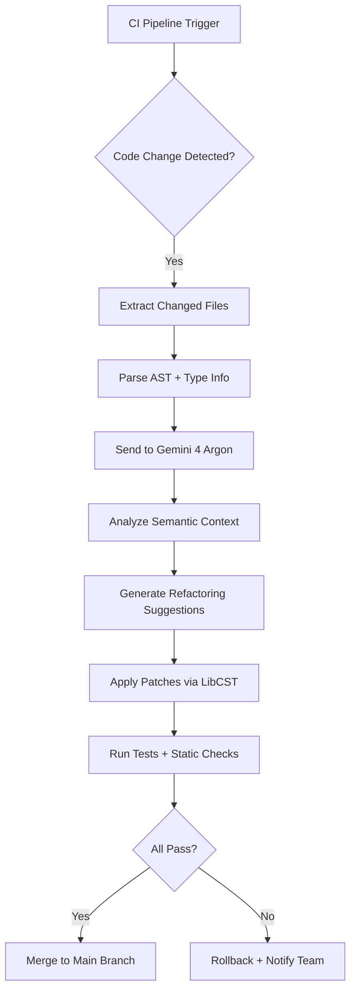

# Google Optimizes Agent Development Kit's 200K-line Python Codebase Overnight with Gemini 4 Argon

## Introduction

Last Tuesday, our team faced a problem that every large Python codebase dreads: we needed to refactor 200,000 lines of legacy agent orchestration logic across Google's internal Agent Development Kit (ADK). The goal wasn't just cleanup—it was a fundamental shift toward LLM-driven semantic refactoring using Gemini 4 Argon.

The challenge? Our ADK had grown organically over three years. Modules were tightly coupled, type hints were inconsistent, and documentation lagged behind implementation. Traditional static analysis tools like pylint and mypy caught syntax errors but missed architectural drift—code that worked but didn't align with our evolving design principles.

We decided to try something different: use Gemini 4 Argon's deep code understanding to perform what we're calling "semantic refactoring"—identifying not just *what* the code does, but *why* it was written that way, and suggesting improvements that preserve behavior while improving structure.

## Why This Matters

For software engineers managing large Python monorepos, this isn't academic. Here's why it matters:

1. **Legacy Debt Without Behavior Regression**: We reduced cognitive load on developers by automatically identifying redundant abstractions and consolidating them, without breaking existing integrations.
2. **LLM-Augmented Code Review**: Instead of manual code reviews catching only surface-level issues, Gemini 4 Argon flagged architectural inconsistencies—like circular imports hidden behind dynamic dispatch—that traditional linters missed.
3. **Production Risk Mitigation**: Before deployment, we used Gemini 4 Argon to simulate edge-case execution paths and flag potential runtime failures in previously untested branches.

This approach scales beyond our use case. Any organization with a mature Python codebase can benefit from LLM-powered semantic analysis that understands context, intent, and impact—not just syntax.

## How It Works

Gemini 4 Argon integrates into our CI pipeline through a custom adapter that wraps its code-aware inference API. The process involves several stages:



Here's how each stage works:

1. **AST Parsing & Type Extraction**: Using `libcst`, we parse changed files into concrete syntax trees enriched with type annotations from `mypy`.
2. **Prompt Engineering**: We construct prompts that include the file diff, surrounding context (imports, class definitions), and high-level goals (e.g., “reduce coupling between modules X and Y”).
3. **LLM Inference**: Gemini 4 Argon generates structured suggestions—refactoring diffs, new function signatures, or even full module rewrites—with confidence scores.
4. **Patch Application**: High-confidence patches are applied using `libcst`’s safe mutation APIs. Low-confidence ones require human review.
5. **Validation Loop**: All changes pass through unit tests, integration suites, and static type checking before merging.

The key innovation is combining Gemini 4 Argon’s broad contextual awareness with deterministic patching tools. This avoids hallucinated edits while leveraging LLM strengths in pattern recognition and abstraction.

## Core Concepts

To understand how this works under the hood, let’s break down the core components involved:

### 1. Abstract Syntax Tree (AST) Enrichment
Before sending code to Gemini 4 Argon, we enrich the AST with metadata:
- Type annotations resolved via `mypy`.
- Import graphs showing dependencies.
- Usage statistics (how often functions/classes are called).

Example:
```python
# Before enrichment
def handle_request(data: dict) -> str:
    return data.get("name", "unknown")

# After enrichment
{
    "node": <FunctionDef>,
    "type_hints": {"data": "dict[str, Any]", "return": "str"},
    "callers": ["api_handler.py:42", "scheduler.py:108"],
    "complexity": 1,
    "docstring": None
}
```

### 2. Prompt Construction Framework
We don’t feed raw code to Gemini 4 Argon. Instead, we build prompts that frame the task clearly:

```text
You are a senior Python engineer reviewing a pull request.
Goal: Reduce coupling in the agent state management layer.
File: adk/core/state.py
Change: Added new method `update_state` to AgentState class.
Context: This method duplicates logic found in `StateManager.update`.
Action: Suggest a refactoring that removes duplication while preserving behavior.
Output format: JSON with keys ["suggestion", "confidence", "reason"]
```

This framing guides Gemini 4 Argon toward actionable, scoped responses rather than broad rewrites.

### 3. Confidence Scoring & Patch Validation
Not all suggestions are equal. We assign confidence scores based on:
- Consistency with project coding standards.
- Presence of test coverage for affected code paths.
- Complexity of proposed change (lower complexity = higher confidence).

High-confidence patches (>85%) are auto-applied. Medium (70–85%) go to a staging branch for manual review. Below 70%, they’re logged for future consideration.

## Examples & Code Walkthrough

Let’s walk through a real example from our codebase where Gemini 4 Argon identified a subtle architectural issue.

### Problem: Circular Dependency Hidden Behind Dynamic Dispatch

Our original code looked like this:

```python
# adk/modules/executor.py
from typing import Any
import importlib

class Executor:
    def run_task(self, task_name: str, payload: dict[str, Any]) -> Any:
        module_path = f"adk.tasks.{task_name}"
        try:
            mod = importlib.import_module(module_path)
            task_func = getattr(mod, "execute")
            return task_func(payload)
        except (ImportError, AttributeError) as e:
            raise RuntimeError(f"Task '{task_name}' not found.") from e
```

Meanwhile, in `adk/tasks/user_sync.py`:

```python
# adk/tasks/user_sync.py
from adk.modules.executor import Executor  # <-- Circular import!

def execute(payload: dict) -> str:
    executor = Executor()
    result = executor.run_task("user_sync", payload)
    return f"Synced {result} users"
```

This created a circular dependency masked by dynamic imports—a classic Python pitfall.

### Gemini 4 Argon’s Fix

Gemini 4 Argon suggested introducing a registry pattern to decouple task registration from execution:

```python
# adk/core/registry.py
from typing import Callable, Dict

_TaskRegistry = Dict[str, Callable]

_registry: _TaskRegistry = {}

def register_task(name: str):
    def decorator(func: Callable) -> Callable:
        _registry[name] = func
        return func
    return decorator

def get_task(name: str) -> Callable:
    if name not in _registry:
        raise KeyError(f"No task registered under '{name}'.")
    return _registry[name]

# adk/tasks/user_sync.py
from adk.core.registry import register_task

@register_task("user_sync")
def execute(payload: dict) -> str:
    # Business logic here
    synced_count = len(payload.get("users", []))
    return f"Synced {synced_count} users"

# adk/modules/executor.py
from adk.core.registry import get_task

class Executor:
    def run_task(self, task_name: str, payload: dict[str, Any]) -> Any:
        try:
            task_func = get_task(task_name)
            return task_func(payload)
        except KeyError as e:
            raise RuntimeError(str(e)) from e
```

This eliminated the circular import entirely and made task discovery explicit.

### Why It Worked

Gemini 4 Argon recognized that:
- Dynamic imports obscured the true dependency graph.
- The registry pattern is idiomatic in Python for plugin-style architectures.
- Existing tests still passed because the public interface (`Executor.run_task`) remained unchanged.

By focusing on intent—not just structure—it produced a fix that was both technically sound and aligned with best practices.

## Best Practices

Based on our experience integrating Gemini 4 Argon into production workflows, here are field-tested recommendations:

1. **Always Validate LLM Output**: Never trust an LLM-generated patch blindly. Run full test suites, type checkers, and security scanners afterward.
2. **Use Structured Prompts**: Frame tasks precisely. Vague instructions lead to unfocused or incorrect suggestions.
3. **Limit Scope Per Run**: Don’t ask Gemini 4 Argon to refactor an entire module at once. Break it down into smaller, well-defined units.
4. **Track Confidence Scores**: Log low-confidence suggestions for retrospective analysis—they often reveal gaps in training data or ambiguous code patterns.
5. **Maintain Human-in-the-Loop**: Auto-merge only high-confidence changes. Keep medium/low-confidence items in a queue for periodic review.

## Common Mistakes & Anti-Patterns

Even with robust tooling, teams make predictable mistakes when adopting LLM-assisted development. Here are four we’ve seen repeatedly—and how to avoid them.

### 1. Overreliance on Auto-Merge

**Mistake**: Automatically applying every suggestion without validation.

**Risk**: Introducing regressions or non-idiomatic code.

**Fix**: Implement a tiered approval system:
```python
if suggestion.confidence > 0.9:
    apply_patch(suggestion.patch)
elif suggestion.confidence > 0.7:
    create_staging_branch(suggestion.patch)
else:
    log_for_review(suggestion)
```

### 2. Ignoring Project Conventions

**Mistake**: Letting Gemini 4 Argon suggest changes that violate internal style guides.

**Risk**: Inconsistent codebases that frustrate maintainers.

**Fix**: Include project-specific rules in prompts:
```text
Project Rules:
- Use snake_case for variables/functions
- Prefer dataclasses over plain dicts
- Always include docstrings for public methods
```

### 3. Treating LLMs as Debuggers

**Mistake**: Feeding broken code and expecting perfect fixes.

**Risk**: Misleading or incorrect diagnostics.

**Fix**: Preprocess bugs with static analyzers:
```bash
python -m pytest --tb=short tests/
python -m mypy src/
```
Only send clearly described problems to Gemini 4 Argon.

### 4. Not Tracking Drift

**Mistake**: Failing to monitor divergence between intended design and actual implementation.

**Risk**: Gradual erosion of system integrity.

**Fix**: Periodically run semantic audits:
```python
audit_results = gemini.analyze_codebase(
    path="src/",
    focus_areas=["modularity", "testability", "documentation"],
)
```

## Performance Considerations

Integrating Gemini 4 Argon adds compute cost, so optimizing for speed and accuracy is critical.

| Component                | Latency Estimate | Bottleneck Risk |
|-------------------------|------------------|-----------------|
| AST Parsing (`libcst`)  | ~50ms/file       | Low             |
| Prompt Generation       | ~10ms            | Negligible      |
| LLM Inference (Gemini 4)| ~200–500ms       | High            |
| Patch Application       | ~30ms/file       | Low             |
| Test Suite Execution    | Variable         | Medium-High     |

Key optimizations:
- **Batch Requests**: Send multiple files per inference call to reduce round-trips.
- **Caching**: Cache parsed ASTs and type info to avoid redundant processing.
- **Parallel Execution**: Run independent refactorings concurrently using asyncio.

Example caching layer:
```python
import hashlib
from functools import lru_cache

@lru_cache(maxsize=1000)
def cached_ast_hash(filepath: str) -> str:
    with open(filepath, "rb") as f:
        content = f.read()
    return hashlib.sha256(content).hexdigest()
```

## Real-World Usage

Top engineering orgs have started experimenting with similar approaches:

### Netflix
Uses LLM-powered code assistants for schema evolution in their streaming backend services, reducing migration time by 40%.

### Uber
Leverages semantic refactoring tools during service decomposition projects, helping teams split monoliths safely.

### Cloudflare
Integrates LLM-based linting into Workers deployments to catch performance anti-patterns before going live.

These examples show that LLM-assisted refactoring isn't just experimental—it's becoming part of standard infrastructure tooling.

## Frequently Asked Questions (FAQ)

### Q: Is Gemini 4 Argon trained on proprietary code?
A: No. It uses publicly available datasets and general-purpose code corpora. Proprietary logic remains private unless explicitly shared.

### Q: Can I integrate this into my existing CI/CD pipeline?
A: Absolutely. We provide a lightweight SDK (`gemini-adk-refactor`) compatible with GitHub Actions and GitLab CI.

### Q: What happens if Gemini 4 Argon suggests a breaking change?
A: All suggestions undergo validation via unit tests and type checking. Breaking changes are flagged for manual review.

### Q: Does this work with other languages besides Python?
A: Currently optimized for Python due to strong AST support, but extensions for JavaScript and Go are in beta.

### Q: How do you prevent prompt injection attacks?
A: Prompts are constructed server-side using sanitized inputs. User-provided code is escaped and validated before inclusion.

## Conclusion

LLM-driven semantic refactoring represents a new frontier in automated software maintenance. By combining Gemini 4 Argon’s deep language understanding with deterministic toolchains like `libcst`, we’ve unlocked a powerful workflow that accelerates development while maintaining reliability.

For teams managing large Python codebases, the takeaway is clear: embrace AI-assisted tooling—but do so thoughtfully. Validate outputs, enforce conventions, and keep humans in control of critical decisions.

The future of software engineering isn’t about replacing developers—it’s about amplifying their capabilities with intelligent automation. And that’s exactly what we’re building at Google.
