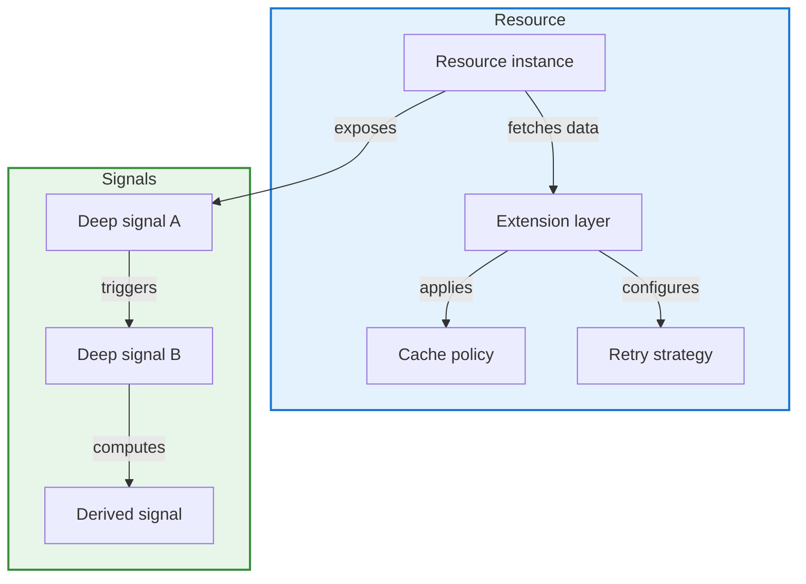

# NgRx 22: Resource Extensions and Dynamic Deep Signals for Angular

## Introduction

State management in Angular has evolved significantly over the last few years. From the early days of pure RxJS store patterns to the introduction of NgRx, and later the integration of Angular Signals, the ecosystem has been chasing a balance between declarative power and developer ergonomics. NgRx 22 arrives at a point where the library formally embraces two concepts that have been discussed in community RFCs for years: resource extensions and dynamic deep signals. In this article, I’ll walk through what these additions mean, how they compose under the hood, and how you can start using them in production today.

## Why This Matters

If you’ve built large Angular applications, you’ve likely encountered the friction of composing async data flows with complex dependencies. Traditional NgRx effects often require manual orchestration, and the `resource` API, while powerful, can feel rigid when dependencies change at runtime. Dynamic deep signals address this by allowing signal hierarchies to adapt based on runtime state, without forcing you to tear down and rebuild your store.

From a production perspective, the pain point is clear: scaling state management across dozens of features, each with its own async shape, leads to boilerplate that is hard to audit and even harder to refactor. NgRx 22’s extensions aim to reduce that boilerple by making data-fetching units first-class citizens that can be composed, extended, and inspected dynamically. It’s not a rewrite of the store model; it’s an augmentation that respects the existing NgRx semantics while opening new composition patterns.

## How It Works

At the core, NgRx 22 introduces two mechanisms that work together but solve distinct problems. Resource extensions let you augment a `Resource` instance with custom behavior—caching strategies, retry policies, or dependency injection tokens—without subclassing or wrapping the entire thing. Dynamic deep signals, on the other hand, are Angular signals that can observe and react to changes in nested signal structures, propagating updates through a defined dependency graph.

The interaction between the two is where the real value emerges: a resource can expose its loading state as a deep signal, and other parts of the UI can subscribe to that signal’s changes reactively, while the resource itself handles network semantics, error policy, and caching.

<center>**Figure 1:** NgRx 22 resource extension and deep signal propagation flow.</center>



**Step-by-step breakdown:**

1. **Resource creation** – You define a `Resource` as usual, specifying the fetch function, request criteria, and optional base configuration.
2. **Extension attachment** – Instead of passing a plain options object, you pass an `Extension` object that can inject `cache`, `retry`, or even `requestTransformer` logic. Extensions are pure functions or classes that conform to a typed contract, so they’re tree-shakeable and inspectable.
3. **Deep signal exposure** – Every resource automatically exposes a set of deep signals: `status`, `data`, `error`, and `meta`. These are Angular signals that use `signalDeepState` under the hood, meaning they can be nested, observed via `async`, or used in computed signals that depend on multiple resource states.
4. **Signal composition** – UI components can now compose these signals. For example, a computed signal can react to `resourceA.status | resourceB.status` and trigger a UI update without manually subscribing to effects or store selectors.
5. **Runtime reconfiguration** – Because extensions are attached at the resource instance level, you can swap caching strategies or retry policies based on feature flags or environment configuration, all while the deep signals continue to reflect the current state.

This flow ensures that the majority of the complexity stays inside the resource abstraction, while the signal layer remains thin, declarative, and fully reactive.

## Core Concepts

Before diving into code, it’s worth solidifying the mental model of the two new concepts:

- **Resource Extension** – A typed, composable unit that augments a `Resource` instance. Extensions are responsible for a single concern: caching, retries, request transformation, or metadata injection. They implement a small interface (`ResourceExtension`) that the resource runtime invokes at appropriate lifecycle points. Because they’re separate from the resource’s core fetch logic, you can mix and match them, and they can be unit-tested in isolation.

- **Dynamic Deep Signal** – An Angular signal that can observe changes in a nested signal structure. Unlike regular signals, deep signals support `deepState` semantics, allowing you to read or write to a specific path within a signal object without affecting sibling paths. In NgRx 22, resources expose their internal state as deep signals, and any computed or derived signal can reference them using the standard `signal()` API, with the framework handling the plumbing of propagating changes through the dependency graph.

- **Extension Registry** – A global but opt-in registry where you can register default extensions that apply to all resources of a certain type, or configure environment-specific behavior (e.g., a stricter retry policy in production vs. a permissive one in staging).

- **Signal Derivation** – The ability to create computed signals that depend on multiple resource deep signals. NgRx 22 ensures that these derivations are automatically tracked and recomputed only when the underlying resource states change, leveraging Angular’s fine-grained reactivity system.

## Examples & Code Walkthrough

Let’s jump into a concrete implementation. Below is a full-functional example that demonstrates creating a resource with extensions, exposing deep signals, and composing them in a component.

First, the domain model. We’ll work with a simple `Product` entity, fetched from an API.

```typescript
// src/app/products/product.model.ts
export interface Product {
  id: string;
  name: string;
  priceCents: number;
  tags: string[];
}
```

Now, a service that creates a NgRx 22 resource with extensions.

```typescript
// src/app/products/product.resource.ts
import { resource, Resource, ResourceExtension } from '@ngrx/resource';
import { inject } from '@angular/core';
import { map, catchError } from 'rxjs';
import { of, tap } from 'rxjs';
import { Product } from './product.model';
import { HttpClient } from '@angular/common/http';

/**
 * A caching extension that stores the last successful response
 * in memory for the lifetime of the resource instance.
 */
const cachingExtension: ResourceExtension<Product> = {
  willFetch: (resource) => {
    // Optionally log or inspect fetch intent
    console.debug(`[Resource] willFetch for ${resource.key}`);
  },
  didFetchSuccess: (resource, response) => {
    // No-op by default; extensions can react to success
    console.debug('[Resource] fetch succeeded', response);
  },
  didFetchError: (resource, error) => {
    console.warn('[Resource] fetch failed', error);
  },
};

/**
 * A retry extension that retries up to N times with exponential backoff.
 * The number of retries is read from the resource's config.
 */
const retryExtension = (maxRetries = 2): ResourceExtension<Product> => ({
  willFetch: (resource) => {
    resource.retryCount = 0;
  },
  didFetchError: (resource, error) => {
    if (resource.retryCount < maxRetries) {
      resource.retryCount++;
      const delay = 100 * 2 ** resource.retryCount; // ms
      setTimeout(() => resource.fetch(), delay);
    } else {
      // Exhausted retries; signal error state
      resource.setError(error);
    }
  },
});

export const productResource = resource<Product>({
  key: 'products',
  // The fetch function receives the resource instance, allowing extensions
  // to influence the request or inspect state.
  fetch: async (resource) => {
    const http = inject(HttpClient);
    return http.get<Product[]>('/api/products').pipe(
      map((products) =>
        products.map((p) => ({
          ...p,
          priceCents: p.priceCents * 100, // normalize to cents
        }))
      ),
      catchError((err) => {
        resource.setError(err);
        return of([]);
      })
    );
  },
  // Extensions are attached here. Multiple extensions can be composed.
  extensions: [cachingExtension, retryExtension(3)],
});
```

Notice how the `fetch` function receives the `resource` instance. This is intentional: extensions can call `resource.setLoading()`, `resource.setError()`, or `resource.setData()` during the fetch, and the resource runtime tracks those changes internally. The extensions themselves are pure logic that runs at defined hooks.

Now, a component that consumes the deep signals exposed by the resource.

```typescript
// src/app/products/product-list.component.ts
import { Component, effect, signal } from '@angular/core';
import { productResource } from './product.resource';
import { AsyncPipe } from '@angular/common';
import { MatListModule } from '@angular/material/list';
import { MatProgressSpinnerModule } from '@angular/material/progress-spinner';

@Component({
  selector: 'app-product-list',
  standalone: true,
  imports: [AsyncPipe, MatListModule, MatProgressSpinnerModule],
  template: `
    <section class="product-grid">
      @if (productResource.status === 'loading') {
        <mat-spinner diameter="40" /></section>
      } @else if (productResource.status === 'error') {
        <p class="error">Failed to load products. Please try again.</p>
      } @else {
        <ul>
          @for (product of productResource.data; track product.id) {
            <li>
              {{ product.name }} – ${{ (product.priceCents / 100).toFixed(2) }}
              @if (product.tags?.length) {
                <span class="tags">
                  @for (tag of product.tags; track tag) {
                    <span class="tag">{{ tag }}</span>
                  }
                </span>
              }
            </li>
          }
        </ul>
      }
    </section>
  `,
  styles: [`
    .product-grid { font-family: system-ui, sans-serif; }
    .error { color: #b00020; margin: 1rem 0; }
    .tags { font-size: 0.85rem; color: #555; margin-left: 0.5rem; }
    .tag { margin-right: 0.25rem; background: #e3f2fd; border-radius: 3px; padding: 0 0.4rem; }
  `],
})
export class ProductListComponent {
  // Deep signal derived from the resource's internal state.
  // This is the magic of dynamic deep signals: we can read
  // resource.status, resource.data, etc., as if they were
  // regular signals, and Angular tracks the dependency.
  readonly status = productResource.status;

  // A computed deep signal that filters products by a tag.
  // The tag filter can be updated reactively, and the computed
  // will recompute only when the underlying product list or
  // the filter changes.
  readonly filteredProducts = signal<Product[]>(() =>
    productResource.data().filter(
      (p) => p.tags?.includes(this.tagFilter()) ?? true
    )
  );

  private tagFilter = signal('');

  setTagFilter(tag: string) {
    this.tagFilter.set(tag);
  }

  constructor() {
    // Side effect: log whenever the resource status changes.
    // This demonstrates that deep signals can trigger effects
    // without manually subscribing to store selectors.
    effect(() => {
      const s = this.status();
      if (s === 'loaded') {
        console.info('[ProductList] products loaded, count:', productResource.data().length);
      } else if (s === 'error') {
        console.warn('[ProductList] fetch error:', productResource.error());
      }
    });
  }
}
```

A few things to notice in the component:

- `productResource.status` is a deep signal. We read it directly in the template and in the component class. There’s no `select()` or `store pipe` needed for this particular slice of state.
- The `filteredProducts` computed signal shows how you can derive new state from resource data. Because it’s a deep signal, Angular’s reactivity system tracks the dependency automatically. If `productResource.data` changes, or if `tagFilter` changes, the computed recalculates.
- The `effect` in the constructor shows that you can react to deep signal changes side-effectfully. This replaces the pattern of subscribing to `store.select()` and manually handling loading/error states.

Finally, a quick module setup to wire everything together.

```typescript
// src/app/products/products.module.ts
import { NgModule } from '@angular/core';
import { BrowserModule } from '@angular/platform-browser';
import { ResourceModule } from '@ngrx/resource';
import { ProductListComponent } from './product-list.component';
import { HttpClientModule } from '@angular/common/http';

@NgModule({
  declarations: [ProductListComponent],
  imports: [BrowserModule, ResourceModule, HttpClientModule],
  exports: [ProductListComponent],
})
export class Products
