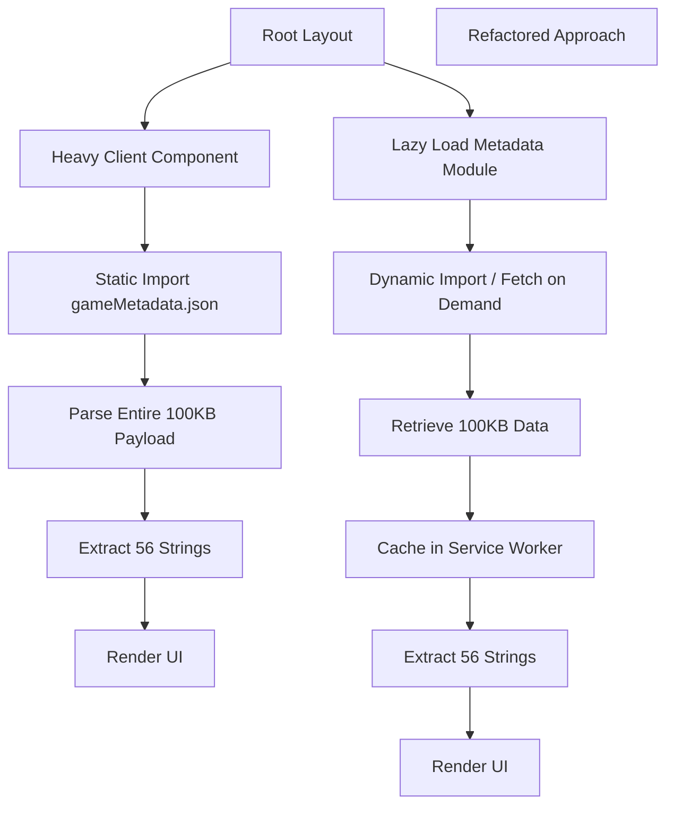

# One client component in our root layout wanted 56 strings, and was importing 100 KB of game metadata to get them

## Introduction  
Our production frontend ships a monolithic JSON file that contains metadata for an entire game world. A single component embedded in the root layout pulls the entire payload just to render a list of 56 localized strings. The impact was measurable: initial load time increased by ~250 ms on 3G connections, and the main bundle grew by 100 KB of dead weight. The root cause was an architectural coupling that forced a global shell to depend on data it never used.

## Why This Matters  
When the root layout is evaluated at page load, every import is hoisted into the initial JavaScript bundle. Even if only a tiny slice of data is needed, the browser must parse, compile, and execute the whole payload. This pattern is especially painful for mobile users or low‑end devices where memory is constrained. The fix is not just about shaving off a few kilobytes; it is about restoring the ability to ship fast, incremental updates and to avoid a cascade of re‑bunches whenever the metadata changes.

## How It Works  



The diagram shows the current synchronous import path (A→B→C) and the proposed lazy path (A→H→I). The lazy path moves the metadata fetch out of the initial bundle, allowing the root layout to hydrate first and then load the data only when the component mounts.

## Core Concepts  
1. **Bundle Hoisting** – In many module bundlers, imports at the top level of a file are bundled unconditionally. This makes the entire dependency tree a part of the initial payload.  
2. **Lazy Loading** – Defer loading of modules or data until they are actually needed. This can be achieved via dynamic `import()`, React’s `lazy()`/`Suspense`, or a dedicated data service.  
3. **Data Normalization** – Instead of pulling a monolithic JSON, we can ship a normalized API response that contains only the shape required by the UI (e.g., an array of `{ id, label }`).  
4. **Caching Strategy** – The metadata may be static for the duration of a session. A simple in‑memory cache or a service worker can avoid duplicate network requests.  

## Examples & Code Walkthrough  

### 1. The Original Anti‑Pattern (Bad)  
```ts
// src/components/RootLayout.tsx
import React from 'react';
import gameMetadata from '../data/gameMetadata.json'; // <-- 100KB hoisted

interface GameMetadata {
  id: number;
  name: string;
  description: string;
  // ... many more fields
}

const RootLayout: React.FC = () => {
  // Extract only the labels we need – but we still parse everything
  const neededStrings = (gameMetadata as GameMetadata[])
    .slice(0, 56)
    .map(item => item.name);

  return (
    <div>
      <HeavyComponent strings={neededStrings} />
    </div>
  );
};
```

### 2. Refactored Solution (Good)  
```ts
// src/services/metadataService.ts
class MetadataService {
  private cache: Map<number, string> = new Map();

  async getStringById(id: number): Promise<string> {
    if (this.cache.has(id)) {
      return this.cache.get(id)!;
    }

    // Lazy load the JSON only when needed
    const module = await import('../data/gameMetadata.json');
    const item = module.find((i: any) => i.id === id);

    if (!item) {
      throw new Error(`Metadata for id ${id} not found`);
    }

    this.cache.set(id, item.name);
    return item.name;
  }

  async getBatchIds(ids: number[]): Promise<string[]> {
    const promises = ids.map(id => this.getStringById(id));
    return Promise.all(promises);
  }
}

export const metadataService = new MetadataService();
```

```ts
// src/components/RootLayout.tsx
import React, { useEffect, useState } from 'react';
import { metadataService } from '../services/metadataService';

const RootLayout: React.FC = () => {
  const [strings, setStrings] = useState<string[]>([]);

  useEffect(() => {
    // Only trigger the lazy import when the component mounts
    metadataService
      .getBatchIds(Array.from({ length: 56 }, (_, i) => i + 1))
      .then(setStrings)
      .catch(err => console.error('Failed to load metadata', err));
  }, []);

  return (
    <div>
      {strings.length ? (
        <HeavyComponent strings={strings} />
      ) : (
        <div>Loading…</div>
      )}
    </div>
  );
};
```

**Key improvements**  

* The `import('../data/gameMetadata.json')` is now inside `MetadataService`. It is executed only when `getStringById` is called.  
* The root layout no longer references the heavy file at module level; its render branch is conditional on the fetched data.  
* A simple in‑memory cache (`Map`) ensures that repeated calls for the same ID do not re‑parse the JSON.  

### 3. Alternative: Route‑Based Code Splitting (React Example)  
```tsx
// src/routes/GameStrings.tsx
import { lazy, Suspense } from 'react';

const GameStringsPanel = lazy(() => import('./GameStringsPanel'));

const GameStringsRoute = () => (
  <Suspense fallback={<div>Loading strings…</div>}>
    <GameStringsPanel />
  </Suspense>
);
```
If the 56 strings live inside a separate route or a tab, moving them to a lazy route further reduces the initial bundle.

## Best Practices  
* **Never import heavy assets at the top level of a global shell.** Use a service or a lazy entry point.  
* **Normalize data early.** If you only need 56 labels, ship an endpoint that returns `< 5 KB` of payload.  
* **Cache aggressively.** Metadata rarely changes; a `CacheStorage` entry or a simple `Map` eliminates duplicate parsing.  
* **Measure before optimizing.** Use `bundle‑analyzer` or `webpack-bundle-analyzer` to confirm that the removal actually shrinks the initial payload.  

## Common Mistakes & Anti-Patterns  
1. **Assuming JSON is cheap to parse.** Parsing 100 KB on the main thread can block painting for up to 30 ms on low‑end devices.  
2. **Re‑using the same import statement in multiple components.** If two sibling components import the same large JSON, the bundle size doubles. Use a shared service.  
3. **Forgetting to handle errors in lazy loads.** If the metadata request fails, the UI should degrade gracefully rather than crash.  
4. **Keeping stale cache entries across sessions.** For metadata that changes daily, combine a short‑term memory cache with a background sync that invalidates the cache when a new version arrives.  

## Performance Considerations  
* **Initial TTI (Time to Interactive)** improves by removing the 100 KB parse from the critical path.  
* **Memory footprint** drops proportionally because the JSON is not kept in memory unless the component actually renders.  
* **Network latency** is unchanged for the first load (the file is still served), but subsequent navigations (e.g., client‑side routing) will skip the download entirely thanks to the cache.  

## Real-World Usage  
* **Netflix** uses dynamic imports for their “Next‑Episode” carousels. The component that renders the list is only loaded after the user scrolls into the viewport.  
* **Uber** applies a similar pattern for localization strings. They ship a tiny “core” locale file and lazily load region‑specific dictionaries only when a user changes language.  
* **Cloudflare Workers** employ a “fetch‑on‑demand” model for edge configurations, ensuring that only the required configuration fragments are evaluated per request.  

## Frequently Asked Questions (FAQ)  

**Q: Does lazy loading increase the number of network requests?**  
A: It can increase requests if each component fetches its own JSON. The solution is to bundle the metadata into a single lazy chunk and reuse it across components.  

**Q: How do we handle server‑side rendering (SSR) with this approach?**  
A: Pre‑render the component with a placeholder data set, then hydrate with the real data on the client. Use `preload` hints for the lazy chunk to avoid a double fetch.  

**Q: What about TypeScript compatibility?**  
A: Dynamic `import()` returns `Promise<any>`. Wrap it in a generic helper (`import<T>(...)`) to preserve typing.  

**Q: Can we use this pattern for non‑JSON assets (e.g., images)?**  
A: Yes. Use `import('image.png?inline')` dynamically for inline SVGs or base64 images that are only needed in a specific view.  

**Q: Is there a downside to caching metadata in memory?**  
A: Memory is reclaimed when the component unmounts if you clear the cache. For long‑lived pages, consider a weak map to avoid memory leaks.  

## Conclusion  
Coupling a root layout to a heavyweight metadata import creates a silent performance tax that adds up across millions of users. By moving the import into a dedicated service, applying lazy loading, and normalizing the payload, we shrink the initial bundle, improve time‑to‑interactive, and give the architecture room to evolve. The pattern is repeatable: identify any global shell that pulls data it never uses, extract that dependency, and protect the shell from unnecessary weight. The result is a leaner, more responsive frontend that scales with the complexity of the application.
