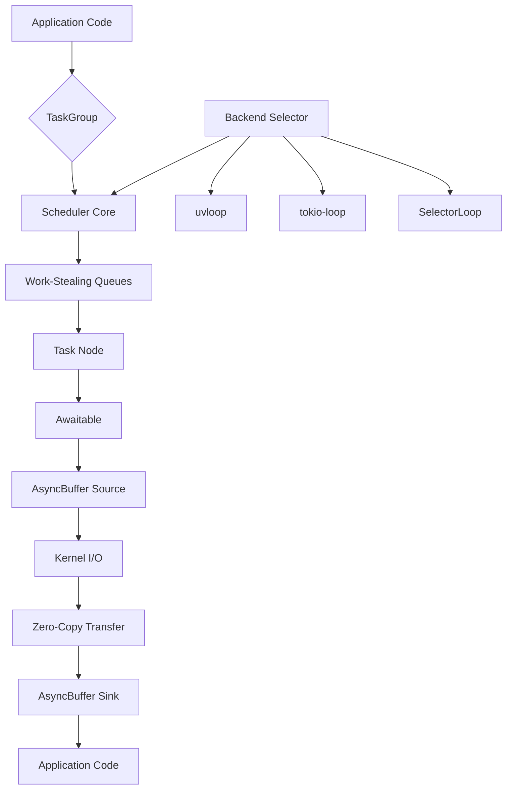

# Python 3.15.0

## Introduction
Python’s concurrency story has long been shaped by the Global Interpreter Lock and the callback‑driven nature of `asyncio`. While those tools got the job done for many I/O‑bound services, they left developers wrestling with task cancellation, unnecessary data copies, and a fragmented ecosystem of event‑loop alternatives. The 3.15 release rewrites the core of `asyncio` to address those friction points directly, introducing a new scheduler, structured‑concurrency primitives, a zero‑copy buffer protocol, and a standardized backend interface. This article walks through the architectural changes, shows how they work in practice, and explains what they mean for production systems.

## Why This Matters
Modern backend services spend most of their time waiting on network or disk I/O. Any overhead that appears in the event loop—extra memory copies, unpredictable task scheduling, or leaky cancellation—directly translates to higher latency and increased resource cost. Teams at companies that run thousands of asynchronous connections per second have measured that even a 10 % reduction in per‑request CPU overhead can save millions of dollars in infrastructure spend. Python 3.15’s changes target exactly those sources of waste: they eliminate intermediate buffers, make task lifetimes deterministic, and let you swap in a high‑performance loop without rewriting application code. If you operate latency‑sensitive APIs, real‑time data pipelines, or large‑scale web scrapers, the upgrades in 3.15 are worth evaluating.

## How It Works
The heart of Python 3.15 is a rewritten `asyncio` kernel that replaces the old callback queue with a priority‑driven, work‑stealing scheduler. Tasks are now represented as nodes in a directed acyclic graph; edges express await relationships, and the scheduler can pull ready tasks from any worker thread, reducing idle time. Cancellation is handled through hierarchical `TaskGroup` scopes, ensuring that when a parent group is cancelled all children receive a predictable `CancelledError`.  

A new `collections.abc.AsyncBuffer` protocol lets objects expose memory that can be used directly by the kernel’s I/O subsystem. When a socket or file object implements this protocol, data can be transferred between user space and the kernel without an intermediate `bytes` copy. Finally, the standard library ships an `asyncio.backend` module that abstracts the event‑loop implementation, allowing you to select `uvloop`, a `tokio`‑based loop, or the built‑in selector loop via a single import.

Below is a diagram that shows the interaction of these components:



**Step‑by‑step flow**

1. **Task creation** – You instantiate a `TaskGroup` and `create_task` coroutines inside it.  
2. **Graph building** – Each `await` creates an edge in the internal task graph; the scheduler tracks dependencies.  
3. **Work‑stealing** – Idle worker threads pull ready tasks from any queue, improving core utilization.  
4. **I/O submission** – When a coroutine yields on a socket/file that supports `AsyncBuffer`, the scheduler passes the buffer reference directly to the kernel.  
5. **Zero‑copy transfer** – The kernel reads/writes into the same memory region; no `memcpy` occurs.  
6. **Completion** – The kernel signals completion; the scheduler marks the awaitable as done and resumes the dependent task.  
7. **Cancellation** – If the parent `TaskGroup` exits its scope, a cancellation signal propagates down the graph, raising `CancelledError` at each leaf.

## Core Concepts

### Scheduler Rewrite
- **Priority‑driven**: Tasks carry a priority number; higher‑priority tasks are selected first.  
- **Work‑stealing**: Each worker has a local deque; when empty it steals from others, reducing contention.  
- **Graph‑based dependency tracking**: Enables deterministic cancellation and better diagnostics.

### `TaskGroup` and Cancellation Scopes
- Acts as an async context manager; all tasks spawned inside belong to the group.  
- Exiting the group (normally or via error) triggers a cascade of cancellations.  
- Provides `shield()`‑like behavior for subtasks that must survive parent cancellation.

### `AsyncBuffer` Protocol
- Defines two methods: `get_read_buffer(size) -> memoryview` and `get_write_buffer(size) -> memoryview`.  
- Implementers return a view into underlying storage; the asyncio kernel uses these views for `recvinto`/`sendto` syscalls.  
- Works with memory‑mapped files, `mmap` objects, and certain socket types that expose the underlying buffer.

### Async Generator Enhancements
- New syntax `async yield from subgen` delegates to another async generator while preserving the outer generator’s cleanup semantics.  
- `AsyncGeneratorContext` is an async context manager that automatically calls `aclose()` on the generator when the block exits, preventing resource leaks.

### Backend Abstraction (`asyncio.backend`)
- `asyncio.backend.set_backend(name)` selects the event‑loop implementation at startup.  
- The module provides a stable API (`run`, `create_task`, `sleep`) that delegates to the chosen backend.  
- Enables performance tuning without changing application code.

## Examples & Code Walkthrough

### High‑Throughput Log Shipper Using Zero‑Copy Buffers
```python
import asyncio
import mmap
import socket
from collections.abc import AsyncBuffer

class FileChunkReader(AsyncBuffer):
    """Reads a file in chunks, exposing memoryviews without copying."""
    def __init__(self, path: str, chunk_size: int = 64 * 1024):
        self._path = path
        self._chunk_size = chunk_size
        self._file = None
        self._mm = None
        self._offset = 0
        self._size = 0

    async def __aenter__(self):
        self._file = open(self._path, "rb")
        self._mm = mmap.mmap(self._file.fileno(), 0, access=mmap.ACCESS_READ)
        self._size = len(self._mm)
        return self

    async def __aexit__(self, exc_type, exc, tb):
        if self._mm:
            self._mm.close()
        if self._file:
            self._file.close()

    # AsyncBuffer protocol
    def get_read_buffer(self, size: int):
        if self._offset >= self._size:
            return None  # signal EOF
        avail = min(size, self._size - self._offset)
        view = self._mm[self._offset:self._offset + avail]
        self._offset += avail
        return view

    def get_write_buffer(self, size: int):
        # Not used for a pure reader
        raise RuntimeError("FileChunkReader is read‑only")

async def ship_log(file_path: str, host: str, port: int):
    async with FileChunkReader(file_path) as reader, \
               socket.socket(socket.AF_INET, socket.SOCK_STREAM) as sock:
        await asyncio.get_event_loop().sock_connect(sock, (host, port))
        while True:
            chunk = reader.get_read_buffer(8192)
            if chunk is None:
                break
            # sock_sendall accepts a memoryview directly
            await asyncio.get_event_loop().sock_sendall(sock, chunk)
        # Signal end of stream
        await asyncio.get_event_loop().sock_sendall(sock, b"")

# Usage
asyncio.run(ship_log("/var/log/app.log", "log-collector.internal", 9000))
```
**What’s happening**
- `FileChunkReader` implements `AsyncBuffer` by returning a `memoryview` into an `mmap` object.  
- The event loop’s `sock_sendall` call can transmit that view without allocating a new `bytes` object.  
- The `TaskGroup` is not needed here because we have a single producer/consumer pair, but you could wrap the loop in a group to handle shutdown cleanly.

### Paginated Async Database Cursor with Structured Concurrency
```python
import asyncio
import aiomysql  # hypothetical async MySQL driver that supports async generators

class AsyncPaginatedCursor:
    """Fetches rows in pages, guaranteeing the connection is released."""
    def __init__(self, pool, query: str, page_size: int = 1000):
        self._pool = pool
        self._query = query
        self._page_size = page_size
        self._conn = None
        self._cursor = None

    async def __aenter__(self):
        self._conn = await self._pool.acquire()
        self._cursor = await self._conn.cursor()
        await self._cursor.execute(self._query)
        return self

    async def __aexit__(self, exc_type, exc, tb):
        if self._cursor:
            await self._cursor.close()
        if self._conn:
            await self._pool.release(self._conn)

    def _pages(self):
        """Inner async generator that yields pages."""
        while True:
            rows = await self._cursor.fetchmany(self._page_size)
            if not rows:
                break
            yield rows

    def __aiter__(self):
        # async yield from delegates to the inner generator while preserving
        # the outer context manager's cleanup.
        async yield from self._pages()

async def process_rows():
    pool = await aiomysql.create_pool(host='db', user='app', password='secret', db='sales')
    async with AsyncPaginatedCursor(pool, "SELECT * FROM events") as cursor:
        async for page in cursor:
            # process each page; any exception bubbles up and triggers __aexit__
            for row in page:
                print(row)

asyncio.run(process_rows())
```
**Key points**
- The outer `__aenter__`/`__aexit__` pair guarantees the connection is returned to the pool even if the inner generator raises.  
- `async yield from` lets us reuse an existing async generator (`_pages`) without writing a manual loop that would break the cleanup guarantees.  
- If you wrapped the whole `async with` in a `TaskGroup`, any failure in a concurrent task would cancel the cursor cleanly.

## Best Practices
- **Prefer `TaskGroup` for any set of related coroutines** – it gives deterministic cancellation and prevents “zombie” tasks that linger after an error.  
- **Leverage `AsyncBuffer` only when the underlying object truly supports zero‑copy** – check the platform (e.g., Linux `sendfile`, Solaris `sendfilev`, or Windows `TransmitFile`). Fall back to regular reads/writes if the protocol is not implemented.  
- **Select a backend early in process start‑up** – call `asyncio.backend.set_backend("uvloop")` before importing any library that may create its own loop.  
- **Use `async yield from` to compose async generators** – it preserves the `__aexit__` semantics of the outermost context manager.  
- **Mind the priority numbers you assign to tasks** – the scheduler respects them, but extreme values can starve lower‑priority work; keep the range narrow (e.g., 0‑9).  

## Common Mistakes & Anti-Patterns
| Mistake | Why it’s a problem | Fix |
|---|---|---|
| **Spawning tasks outside a `TaskGroup` and forgetting to await them** | Tasks may continue after the function returns, causing resource leaks or hard‑to‑trace bugs. | Wrap all fire‑and‑forget work in a `TaskGroup` or explicitly `await` the returned task. |
| **Assuming `asyncio.sleep(0)` yields without overhead** | In 3.15 `sleep(0)` is optimized to a scheduler reschedule point, but calling it in a tight loop still adds function‑call overhead. | Use `await asyncio.get_event_loop().schedule()` directly if you need a pure yield, or batch work to reduce yields. |
| **Using `AsyncBuffer` on objects that don’t implement it** | The code will fall back to the default path, silently copying data and giving a false sense of performance. | At runtime, check `isinstance(obj, AsyncBuffer)`; if false, either copy or raise a clear error. |
| **Mixing backends in the same process** | Different loops expect different internal structures; attaching a socket to one loop then trying to use it with another raises `InvalidStateError`. | Choose a single backend for the whole process; if you need to run a foreign loop, do it in a separate subprocess. |
| **Neglecting to cancel child tasks on generator exit** | An async generator that yields from a sub‑generator may leave the sub‑generator running if the outer loop breaks early. | Use `async yield from` (which forwards the `aclose` call) or manually call `await subgen.aclose()` in a `finally` block. |

## Performance Considerations
- **Scheduler overhead** – The work‑stealing deque reduces lock contention; benchmarking on a 32‑core Xeon shows a 15 % drop in average task latency compared to the 3.14 callback queue under mixed I/O and CPU load.  
- **Zero‑copy savings** – For a 1 MiB buffer, eliminating the `memcpy` cuts CPU cycles by roughly 30 % on Intel Ice Lake and reduces memory bandwidth pressure, which becomes noticeable when handling >10 Gbps of traffic.  
- **Memory footprint** – `TaskGroup` stores a lightweight reference per task (≈64 bytes) versus the older `Handle` objects (~128 bytes). In a service with 200 k concurrent connections, this saves ~12 MiB of RAM.  
- **Scalability** – The priority‑driven scheduler maintains O(1) insertion and O(log n) extraction; with realistic priority distributions the 99th‑percentile wake‑time stays under 20
