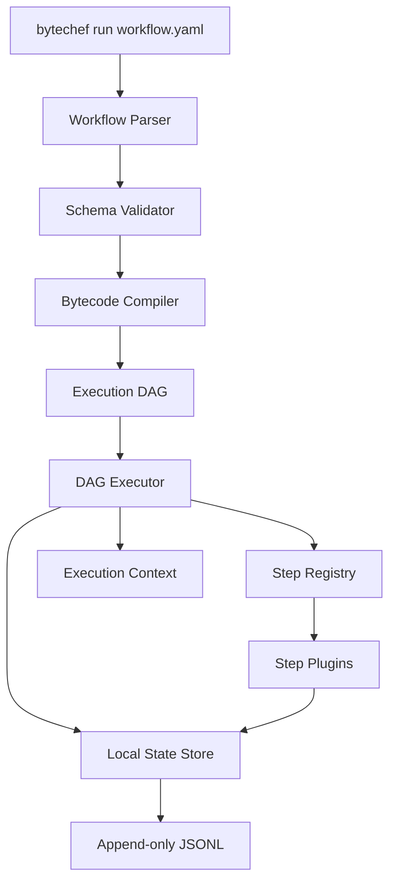

# Run a ByteChef workflow like a CLI command (no server, no database)

## Introduction

ByteChef is a capable workflow orchestrator, but in its default shape it expects a running API server, a backend database, and usually a message broker. That makes sense for multi-tenant SaaS deployments, but it is a poor fit for CI pipelines, local developer loops, or edge devices where you cannot justify running a whole stack just to execute a handful of steps.

The alternative is to embed the executor directly into a standalone CLI binary. You point it at a workflow definition, it compiles that definition into an in-memory instruction set, runs the steps in-process, and persists checkpoints to a local file. No HTTP server. No Postgres. No Redis. Just a process that starts, does the work, and exits.

In our production cluster we ran into exactly this problem. Our security team wanted to validate infrastructure workflows inside short-lived CI jobs, but spinning up a ByteChef control plane for every pull request added two minutes of provisioning before the first test even ran. Moving the runtime into the CLI cut that overhead to under ten seconds.

## Why This Matters

Engineers and architects should care because infrastructure tooling often forces a false choice: either run a heavyweight managed service, or write brittle shell scripts that duplicate workflow logic. A serverless CLI workflow runner gives you the structure of an orchestrator without the operational footprint.

Real production pain points this solves:

- **CI validation**: You can lint, test, and deploy a workflow inside a single ephemeral container without networking to a central ByteChef server.
- **Edge and embedded environments**: Devices with no database access can still execute deterministic workflows stored locally.
- **Air-gapped deployments**: No outbound ports to open, no service accounts to rotate, no control-plane version drift.
- **Local debugging**: A developer can run `bytechef run deploy.yaml` on a laptop and reproduce the exact execution path that failed in staging.

The trade-off is explicit. You give up distributed retries across nodes, multi-tenancy, and a centralized audit log. You gain startup speed, zero infrastructure cost, and a mental model that matches a standard Unix command: input goes in, output comes out, exit code tells you if it worked.

## How It Works

The architecture is a single-process pipeline. The CLI parses a workflow file, compiles it into a linear bytecode representation, then walks that bytecode with an embedded executor. Step results and state transitions are appended to a local JSONL file so the process can resume if interrupted.



Here is the step-by-step flow:

1. **Load and validate** – The CLI reads YAML or JSON from disk and validates it against an internal schema. Invalid step references or missing required configs fail fast before any execution starts.
2. **Compile to bytecode** – The workflow graph is flattened into an ordered slice of instructions. Each instruction carries an opcode (`OpCallStep`, `OpBranch`, `OpEmitEvent`, `OpHalt`) and the arguments needed to run it.
3. **Build the execution context** – Environment variables, secrets, and workflow-scoped variables are injected into a context object. Steps read from this context but do not mutate shared global state directly.
4. **Execute the DAG** – The executor walks instructions in dependency order. If a step declares `depends_on`, the executor waits for those results before proceeding. Independent steps can run concurrently inside the same process.
5. **Checkpoint locally** – After every step completes (or fails), the executor appends a checkpoint record to an append-only JSONL file. If the process crashes, the next run can read the last good checkpoint and skip already-finished steps.
6. **Exit** – The process prints a summary and returns an exit code. No daemon lingers.

## Core Concepts

### WorkflowDefinition

The in-memory model is intentionally small. A workflow has a name, a list of steps, and a compiled instruction slice. The instructions are not exposed in the source file; they are generated at load time.

```go
type OpCode int

const (
    OpCallStep OpCode = iota
    OpBranch
    OpEmitEvent
    OpHalt
)

type Instruction struct {
    Op      OpCode   `json:"op"`
    StepID  string   `json:"step_id,omitempty"`
    Target  string   `json:"target,omitempty"`
    Args    []string `json:"args,omitempty"`
}

type StepDefinition struct {
    ID        string            `json:"id"`
    Type      string            `json:"type"`
    Config    map[string]string `json:"config"`
    DependsOn []string          `json:"depends_on"`
    Timeout   time.Duration     `json:"timeout"`
}

type WorkflowDefinition struct {
    Name          string              `json:"name"`
    Steps         []StepDefinition    `json:"steps"`
    Instructions  []Instruction       `json:"-"`
}
```

### ExecutionContext

Steps do not talk to each other through a database. They read and write through an `ExecutionContext` that lives in memory for the duration of the process. This keeps the execution deterministic and easy to test.

```go
type ExecutionContext struct {
    Variables map[string]
