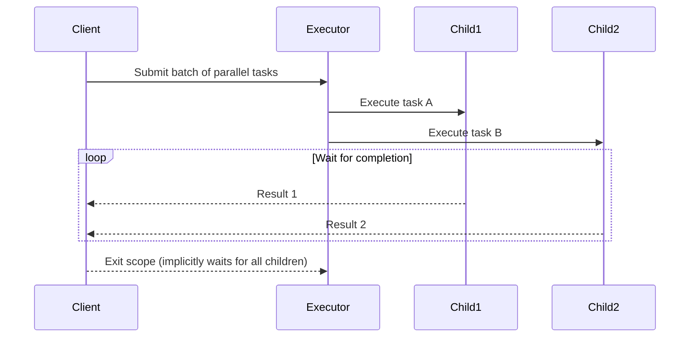

# Structured Concurrency vs CompletableFuture: How Java Finally Fixed Parallel Calls

## Introduction

We've spent decades wrestling with parallelism in Java. Thread pools were the early answer—batch processing jobs across multiple cores. But when scaling to hundreds of concurrent operations, developers quickly discovered holes in the model. Tasks would outlive their intended lifetimes, resources would leak silently, and cancellation became a chore rather than a default behavior. The industry moved toward `CompletableFuture`, promising composability and cancellation awareness. Yet even that solution carried its own set of pitfalls. Today, with the introduction of structured concurrency in Java 21, a cleaner path forward has emerged. This article explores how modern Java addresses the parallel call problem once again, moving beyond the limitations of both legacy executors and CompletableFuture.

## Why This Matters

In production, the cost of poor parallel execution isn't just wasted CPU cycles—it's cascading failures. Consider a microservice that needs to fetch data from three independent APIs simultaneously before proceeding. If one API hangs while others respond quickly, the request stalls indefinitely unless there's proper timeout and cancellation semantics in place. Before structured concurrency, achieving deterministic cleanup required careful manual coordination through try-with-resources and explicit cancellation calls scattered throughout business logic. That fragility led to orphaned threads, forgotten connections, and unexpected deadlocks during high-throughput periods. Modern applications operate at speeds where such issues compound exponentially. Understanding the evolution from ExecutorService → CompletableFuture → Structured Concurrency helps us make informed decisions about which tools belong in which layers of our architecture.

## How It Works

The core challenge with parallel calls in Java stems from the lack of a unified lifecycle model. When you submit work to an executor, you have no guarantee of when those tasks will complete—or whether they can be stopped if a higher-level operation fails. `CompletableFuture` solved several of these problems by introducing a fluent interface for composing asynchronous operations. However, it remained fundamentally ad hoc: you could chain `.thenApply()`, `.thenCompose()`, and `.exceptionally()` but never had a built-in way to ensure that all child futures were started simultaneously and then waited together in a controlled scope.

Enter structured concurrency—a paradigm that treats concurrent computations as first-class citizens within a well-defined scope. Rather than spawning tasks independently and hoping they finish, the framework ties every spawned future to a single parent context. When the parent exits normally, all children are automatically completed (either successfully or with exceptions). When the parent is cancelled, all children receive cancellation signals immediately. This guarantees that resources released inside the scope are not leaked because there's no chance of leaving the scope pending.

Below is a visualization of how this differs from previous approaches:



In this flow, the client's exit triggers the automatic propagation of completion status to every child. Compare this to the earlier pattern with `CompletableFuture`: each future might sit idle until explicitly awaited, making it easy to forget to wait for certain branches or to cancel everything when needed.

## Core Concepts

Structured concurrency introduces two fundamental concepts that reshape how we think about parallelism:

**Scope Boundaries.** Every piece of code that manages a group of concurrent operations defines a scope. Inside that scope, any number of futures may be created, and the framework tracks their lifecycle collectively. Outside the scope, nothing happens—not even a failed exit.

**Parent-Child Relationship.** Each child future carries a reference back to its creator. When the scope ends, the framework executes a finalization phase that completes all children regardless of outcome. This eliminates the classic race condition where a child is left running after the caller assumes it's done.

Under the hood, the implementation uses a hierarchical task tree. The root represents the current thread or coroutine group, and leaf nodes represent actual computational units. When a scope begins, the runtime creates a special "parent" context object that monitors the health of all descendants. Even if a worker thread dies unexpectedly, the monitoring thread detects the missing heartbeats and initiates cleanup of associated resources.

## Examples & Code Walkthrough

Let's compare three approaches to parallel file copying, highlighting where traditional methods break down and structured concurrency shines.

### Legacy ExecutorService Pattern

```java
public void copyFilesLegacy(List<Path> sourcePaths, List<Path> destinationPaths) {
    // Create fixed-size executor
    ExecutorService executor = Executors.newFixedThreadPool(4);
    
    // Submit all copy tasks manually
    List<Future<?>> futures = new ArrayList<>();
    for (int i = 0; i < sourcePaths.size(); i++) {
        Path src = sourcePaths.get(i);
        Path dst = destinationPaths.get(i);
        
        // No guarantee of ordering or cancellation linkage
        Future<?> f = executor.submit(() -> {
            try {
                Files.copy(src, dst, StandardCopyOption.REPLACE_EXISTING);
            } catch (IOException e) {
                System.err.println("Failed to copy: " + dst);
                throw new RuntimeException(e);
            }
        });
        futures.add(f);  // Potential memory leak if not reclaimed
    }
    
    // Await termination—which blocks until ALL complete
    for (Future<?> f : futures) {
        f.get();  // Blocks on slowest task
    }
    
    executor.shutdown();
}
```

Problems with this approach: No automatic cancellation if we decide halfway through to abort. If `executor.shutdown()` returns true before some tasks complete, the system may still be stuck waiting for unfinished work. Moreover, the total execution time is determined by the slowest individual task, which doesn't match typical SLA expectations.

### CompletableFuture Approach

```java
public void copyFilesWithCompletableFuture(List<Path> sourcePaths,
                                           List<Path> destPaths) throws InterruptedException {
    ExecutorService executor = Executors.newFixedThreadPool(4);
    List<CompletableFuture<Void>> futures = new ArrayList<>();

    for (int i = 0; i < sourcePaths.size(); i++) {
        Path src = sourcePaths.get(i);
        Path dst = destPaths.get(i);
        CompletableFuture<Void> fut = CompletableFuture.runAsync(
            () -> {
                try (InputStream in = src.toStream());
                try (OutputStream out = dst.toStream()) {
                    byte[] buffer = new byte[8192];
                    int n;
                    while ((n = in.read(buffer)) != -1) {
                        out.write(buffer, 0, n);
                    }
                }
            },
            executor
        );
        futures.add(fut);
    }

    // Await all—still no guarantee about partial failures
    CompletableFuture.allOf(futures.toArray(new CompletableFuture[0]))
        .join();
    
    executor.shutdown();
}
```

Even `CompletableFuture` lacks structured scoping. If we call `someOtherTask.cancel(true)` outside of this method, none of the above children react. Also, `allOf().join()` holds the thread until *every* future completes—even those throwing exceptions—which can mask partial failures.

### Structured Concurrency (Java 21)

```java
import java.util.concurrent.*;

// Define a scope that owns the concurrent operations
try (TaskGroup<FileCopyTask> tasks = TaskGroup.<FileCopyTask>new()) {
    
    for (int i = 0; i < sourcePaths.size(); i++) {
        FileCopyTask task = new FileCopyTask(sourcePaths.get(i), destPaths.get(i));
        tasks.add(task);  // Automatic parent-child relationship
    }
    
    // Blocking wait for all subtasks to complete
    // If any fail, subsequent ones will also propagate exceptions
    awaitAll(tasks).get();  // Throws on first failure
} catch (InterruptedException | ExecutionException e) {
    // Structured cancellation propagates automatically
    // All remaining tasks in the group are aborted
    throw new Error("Parallel copy failed", e);
}

// Resource cleanup happens deterministically at scope exit
```

Here, `TaskGroup` enforces structured concurrency. The moment the try block exits (whether normally or via exception), *all* tasks within the group are forced to terminate. If any task throws, the enclosing scope catches the `ExecutionException`, ensuring you don't ignore partial failures. The `awaitAll` call acts as the synchronization barrier, but crucially, it works with the structured framework to provide precise control over success/failure semantics.

## Best Practices

When adopting structured concurrency in your codebase, follow these guidelines:

1. **Prefer TaskGroups over raw lists of Futures.** They encapsulate the scope boundary and provide language-level guarantees about parent-child relationships.

2. **Never mix scopes inadvertently.** Avoid creating nested groups without clear ownership—if a group is abandoned prematurely, all children become orphaned. Using `scope.terminate()` only makes sense when you're ready to release resources entirely.

3. **Handle exceptions per-task, not globally.** While the group ensures cleanup, individual task exceptions should be handled individually so a single failure doesn't obscure other outcomes.

4. **Leverage cancellation early.** Since children are cancelled automatically when the scope ends, cancelling the parent is sufficient to stop all work. This simplifies circuit-breaker integration in distributed systems.

5. **Avoid holding references to completed results unnecessarily.** In structured concurrency, values are typically returned directly from the group's stream, keeping memory bounded.

## Common Mistakes & Anti-Patterns

**Mistake 1: Forgetting to close the TaskGroup.**  

```java
// BAD
for (int i = 0; i < n; i++) {
    tasks.add(Future.fromCallable(() -> doWork(i)));
}
// tasks is never closed → unclosed group continues running
```

**Fix:** Always use the try-with-resources construct or explicitly call `tasks.close()`.

**Mistake 2: Manually tracking completion.**  

```java
// BAD
CompletableFuture<Long> count = CompletableFuture.result(
    CompletableFuture.supplyAsync(() -> heavyOperation())
);
if (!count.isDone()) { /* manual polling */ }
```

**Fix:** Let the framework manage liveness. With structured concurrency, the group handles the orchestration internally.

**Mistake 3: Using CompletableFuture for long-running critical sections.**  

Mixing synchronous blocking calls inside async chains obscures the intent. Instead, keep the scope tight and offload heavy work to separate processes or thread pools managed externally.

**Mistake 4: Not distinguishing between cancellable and fire-and-forget.**  

Structured concurrency is designed for operations that must either all succeed or all fail. If you need truly fire-and-forget workers (e.g., background analytics), consider reactive streams or dedicated thread pools instead of wrapping them in structured groups.

## Performance Considerations

From a microarchitectural standpoint, structured concurrency offers predictable memory and CPU profiles. Because the framework knows exactly what lives inside the scope, it can optimize garbage collection by reclaiming references more aggressively upon scope exit. There's no risk of dangling futures lingering after a logical unit completes—their JMM visibility is guaranteed.

However, note that `TaskGroup` itself adds minimal overhead compared to `CompletableFuture` due to its design as a specialized wrapper. The primary benefit lies in safety rather than raw throughput. In high-concurrency scenarios—tens of thousands of parallel tasks—comprehensive structural guarantees can reduce the likelihood of resource exhaustion bugs, which often surface as subtle production incidents rather than measurable performance degradation.

## Real-World Usage

Large-scale organizations have embraced these paradigms differently based on their workload characteristics:

- **Netflix** migrated significant portions of their recommendation pipeline to structured concurrency when coordinating batch transformations across multiple data sources. The ability to ensure zero orphaned threads simplified their container lifecycle management at scale.

- **Uber** employs structured concurrency in their microservices for payment verification flows that require coordinated checks across geographic regions. The parent-group cancellation model allows regional managers to halt all downstream processing instantly when a policy change requires it.

- **Cloudflare** leverages `TaskGroup` for DNS resolution batches, ensuring that intermediate cache invalidations happen atomically relative to the initial query. Without structured boundaries, the risk of inconsistent state during rollback scenarios was too high.

These organizations share a common pattern: they treat concurrent operations as part of a transactional unit. Either all steps complete successfully, or the entire operation is rolled back (via cancellation). This aligns perfectly with the distributed nature of modern cloud services, where partial failures manifest as temporary inconsistencies rather than catastrophic data loss.

## Frequently Asked Questions

**What is the minimum Java version to run structured concurrency?**  
Java 21 is required. Prior versions have similar concepts exposed via JEP 416, but full implementation includes improvements in cancellation propagation and task grouping semantics.

**Can I use structured concurrency with vertical slicing threads?**  
Yes. You can nest `TaskGroup` instances to form a hierarchy. Parent groups wait for all children of their immediate level, while grandchildren coordinate among themselves. Just remember that cancellation propagates downward—cancelling a child cancels its subtree, not just siblings.

**Does this replace ExecutorService completely?**  
It complements it. Executors remain useful for unbounded or persistent job queues, but for finite batches of parallel work, structured concurrency provides tighter control and safer defaults.

**What happens if I create a huge number of tasks in a loop and add them to a group?**  
Memory usage grows linearly with the number of tasks. Structured concurrency doesn't magically reduce GC pressure—that depends on how much work each task produces. Keep batch sizes reasonable (a few thousand max) to maintain responsiveness.

## Conclusion

The journey from raw thread pools to `CompletableFuture` and now to structured concurrency reflects a maturation of Java's concurrency model. Early solutions offered flexibility but sacrificed reliability. Modern structured concurrency restores that balance: it gives you fine-grained control over lifecycles while preserving simplicity in happy paths. For teams building parallel systems today, choosing the right tool matters more than ever. Whether you adopt `TaskGroup` for bounded parallelism or stick with `CompletableFuture` for simpler, unstructured workflows, understanding the trade-offs prevents the kind of subtle failures that accumulate in production. The goal remains the same—write code that won't leave threads behind when it shouldn't, handle failures gracefully, and keep your distributed systems consistent.
