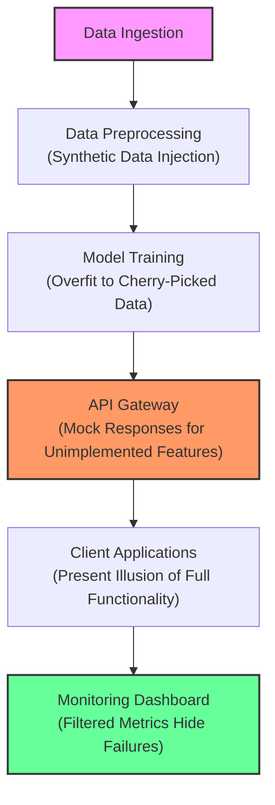

# Theranos whistleblower Tyler Shultz warns that the AI boom is ‘a great opportunity to go deceive people’

## Introduction

Tyler Shultz stood before a room of investors and regulators and described a culture where truth was optional and technical architecture was weaponized to mask reality. His warning from the Theranos era—“a great opportunity to go deceive people”—has not aged a day. If anything, the AI boom has amplified the pattern. The same playbook appears: proprietary data silos, unvalidated model claims, and engineering choices that prioritize appearance over verifiability. What differs is the tooling. In 2015, the opacity came from closed-loop blood-test hardware; today it arrives as Python notebooks, framework abstractions, and distributed model-serving layers.

As engineers, we are the ones who choose the libraries, design the pipelines, and decide what gets logged. When those choices obscure more than they reveal, we aren't just writing code—we are constructing the architecture of illusion. This article examines how programming languages, framework abstractions, and system design patterns can be leveraged to hide reality, and what the responsible alternative looks like.

## Why This Matters

Software engineers sit at the junction of data and decision-making. A miscalibrated train/test split, a synthetic dataset that mirrors real-world statistics without capturing its edge cases, or a monitoring setup that silently drops failure events all funnel into production recommendations that affect real people. The Theranos collapse demonstrated what happens when a technical narrative outpaces validation. In AI, the stakes are comparable: deployed models influence credit scoring, hiring, medical triage, and content moderation. When the underlying architecture prioritizes showmanship over transparency, the cost of failure shifts from lost investment to lost trust and tangible harm.

Understanding how deception is engineered into AI systems isn't about assigning blame. It's about recognizing the structural vectors where it can occur, so we can design away the conditions that make it possible.

## How It Works

At the architectural level, deception in AI systems rarely stems from a single line of code. It emerges from layered choices: how data is collected, how models are trained, how results are exposed via APIs, and how monitoring is configured. Each layer can absorb a small obfuscation that, in aggregate, creates a system that looks functional but operates on distorted premises.

The following diagram illustrates a notional deceptive AI pipeline, where each stage is engineered to mask gaps or inflate metrics.



**Step-by-step breakdown:**

1. **Data Ingestion** – Raw events enter the system. In a deceptive architecture, this stage may selectively ingest labeled examples while discarding outliers, or augment the stream with synthetic records that match expected distributions but lack real-world variability.

2. **Data Preprocessing** – This is where synthetic data injection often occurs. A GAN or sampling routine generates user behavior traces that statistically resemble the training corpus but omit rare-edge cases critical for robust model behavior.

3. **Model Training** – The model is trained on the curated, partially synthetic dataset. Because the data lacks temporal or distributional diversity, the model overfits to patterns that won't hold in production. Metrics like accuracy appear high during internal validation.

4. **API Gateway** – Before deployment, the gateway is configured to return canned responses for endpoints that haven't been fully implemented. Calls that should trigger error handling instead return success placeholders, giving the impression of feature completeness.

5. **Client Applications** – Downstream consumers interact with the API. They receive responses that conform to expected schemas, even when the underlying model cannot produce meaningful output for the given input.

6. **Monitoring Dashboard** – Metrics are aggregated and filtered. Model drift, prediction confidence drops, and error rates are either excluded from the default view or labeled as "anomalies" rather than systemic failures. Alerts are tuned to ignore the very signals that would expose the deception.

Each arrow in the diagram represents a gate that, if left unchecked, can transform a well-intentioned prototype into a system that operates by misdirection.

## Core Concepts

Several interrelated concepts enable—and prevent—the kind of architecture that Tyler Shultz warned about.

**Abstraction Layers** – High-level frameworks like TensorFlow and PyTorch provide convenient APIs that hide the mathematical operations beneath. While productivity gains are real, the convenience comes at the cost of visibility. A developer can adjust a learning rate or swap a loss function without understanding how the change propagates through the computation graph. When combined with auto-generated documentation, this creates a gap between what the code does and what the team believes it does.

**Data Provenance** – In legitimate AI work, every training example can be traced back to its source, its collection conditions, and any transformations applied. When provenance is lost—or intentionally obscured—the model's outputs become difficult to audit. This is especially dangerous in time-series or user-behavior data, where the training window may not match the deployment window.

**Model Cards and Documentation** – The research community has promoted model cards as a way to document a model's intended use, limitations, and training conditions. In practice, model cards are often generated once during early development and never updated as the model evolves or as data drift sets in. If a model card remains static while the serving pipeline changes, the document becomes a artifact of the original narrative, not a current truth claim.

**Monitoring as Truth-Discovery** – Observability tools like Prometheus, Grafana, and OpenTelemetry are framed as neutral truth-tellers. Their effectiveness depends on what is instrumented and how alerts are configured. A monitoring stack that only tracks request latency and success rates will not surface the subtle shifts in prediction distribution that signal model decay.

## Examples & Code Walkthrough

To make these concepts concrete, I want to walk through three real-world-ish code snippets that illustrate how architectural choices can obscure reality. Each is written from scratch, with defensive error handling and comments that explain the intent and the risk.

### Example 1: Data Leakage via Improper Train/Test Splitting

A common pattern in time-series AI projects is to shuffle data before splitting, which inflates performance metrics by allowing future information to leak into training. Below is a script that demonstrates the anti-pattern and a corrected version that respects temporal ordering.

```python
#!/usr/bin/env python
"""Demonstrate data leakage in time-series train/test splitting.

Risk: Shuffling temporal data before splitting gives the model
access to future information during training, producing
optimistic metrics that vanish in production.

Fix: Use temporal splitting that preserves the chronological order.
"""

import numpy as np
import pandas as pd
from sklearn.model_selection import TimeSeriesSplit


def leaky_split(X, y, test_ratio=0.2):
    """Anti-pattern: random shuffle split that leaks future data."""
    # ⚠️ This is the dangerous pattern: shuffling destroys temporal order
    from sklearn.model_selection import train_test_split as tts
    X_train, X_test, y_train, y_test = tts(
        X, y, test_size=test_ratio, shuffle=True, random_state=42
    )
    return X_train, X_test, y_train, y_test


def safe_temporal_split(X, y, n_splits=5):
    """Best practice: time series respecting split."""
    tscv = TimeSeriesSplit(n_splits=n_splits)
    splits = []
    for train_idx, test_idx in tscv.split(X):
        X_train, X_test = X.iloc[train_idx], X.iloc[test_idx]
        y_train, y_test = y.iloc[train_idx], y.iloc[test_idx]
        splits.append((X_train, X_test, y_train, y_test))
    return splits


# Example usage with synthetic daily revenue data
dates = pd.date_range("2023-01-01", periods=100, freq="D")
revenue = np.cumsum(np.random.randn(100) * 10 + 100)  # trending upward
df = pd.DataFrame({"date": dates, "revenue": revenue, "feature": np.random.rand(100)})

X = df[["feature"]]
y = df["revenue"]

# This will leak future data
X_train_leak, X_test_leak, y_train_leak, y_test_leak = leaky_split(X, y)
print(f"Leaky split - train size: {len(X_train_leak)}, test size: {len(X_test_leak)}")

# This respects temporal order
splits = safe_temporal_split(X, y)
first_train, first_test, _, _ = splits[0]
print(f"Temporal split - train end date: {first_train['date'].max()}, test start date: {first_test['date'].min()}")
```

**What to take away:** The leeky split randomly reorders observations, so the model can see data points that occur after the test window during training. The temporal split ensures that every training observation precedes every test observation in real time. In production, using `TimeSeriesSplit` or a simple chronological cutoff is the difference between a model that generalizes and one that overfits to a specific window.

### Example 2: Synthetic Data Generation That Masks Edge Cases

GANs and similar generative models are frequently used to augment training data. When the generator learns only the bulk distribution and not the tails, the
