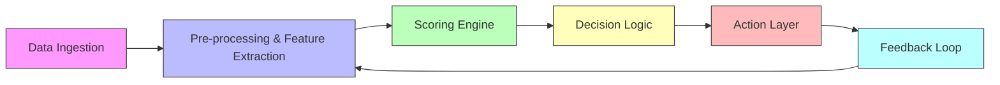

# Why Your Automatic System Might Be Hiring and Firing for the Wrong Reasons  

## Introduction  

A 2023 study from the National Bureau of Economic Research found that an AI‑driven résumé screen rejected **38 %** of candidates who later received strong performance reviews.  
The number is startling because the system was marketed as “objective.” In practice, the model had learned to reward a narrow set of keywords and a specific coding style that matched the historic hiring data — data that already reflected the biases of the team that built it.  

When we automate decisions that affect people’s livelihoods, the line between *objective* and *opaque* disappears fast. This article walks through the typical architecture of an automated hire/fire pipeline, shows where the most common anti‑patterns hide, and gives you a concrete, production‑grade code example that deliberately demonstrates the failure modes.  

## Why This Matters  

* **Legal exposure** – Regulations such as the EU AI Act and U.S. EEOC guidance now require explainability for any system that makes employment decisions.  
* **Team health** – A false‑negative hire means a qualified engineer never joins; a false‑positive fire removes institutional knowledge and damages morale.  
* **Technical debt** – Hard‑coded thresholds and static feature sets become “magic numbers” that no one dares to touch, turning the pipeline into a black box that rots over time.  

If you own a CI gate that blocks merges based on a “code‑quality score,” or an HR bot that auto‑rejects résumés, you are running a hire/fire system whether you call it that or not.  

## How It Works  

Below is a high‑level view of the data flow. Each box is a service you can deploy, monitor, and replace independently.  



**Step‑by‑step**

1. **Data Ingestion** pulls résumés, Git histories, CI logs, and any other artefacts.  
2. **Pre‑processing** normalises text, extracts tokens, builds embeddings, and computes static‑analysis metrics.  
3. **Scoring Engine** combines the feature vector with a weight vector (or a trained model) to produce a single *fitness score*.  
4. **Decision Logic** applies thresholds or a rule set (e.g., `score > 0.73 → HIRE`).  
5. **Action Layer** fires the side‑effects: email, HR ticket, CI gate, or deployment block.  
6. **Feedback Loop** records the eventual outcome (performance review, bug rate, retention) and feeds it back to the feature store for the next training cycle.  

Notice the **cycle** from Feedback Loop back to Pre‑processing. That loop is where bias compounds if you’re not careful.  

## Core Concepts  

| Concept | What it is | Why it matters |
|---------|------------|----------------|
| **Feature Vector** | Fixed‑length numeric representation of a candidate or code change. | Determines everything downstream; lossy extraction throws away signal. |
| **Weight Vector / Model** | Learned or hand‑tuned parameters that map features → score. | Static weights become stale; models trained on biased data reproduce bias. |
| **Threshold Policy** | The rule that maps a continuous score to a discrete action. | Binary cut‑offs discard nuance; a 0.729 vs 0.731 difference can be arbitrary. |
| **Audit Log** | Immutable record of every input, score, decision, and actor. | Required for compliance; also the only way to debug a bad decision later. |
| **Human‑in‑the‑Loop (HITL) Hook** | Explicit escape hatch for a reviewer to override or request clarification. | Prevents “automation‑only” failures from reaching production. |

## Examples & Code Walkthrough  

The following Python module is a **minimal, self‑contained** hire/fire pipeline. It is deliberately written to surface the anti‑patterns discussed earlier.  

```python
# hire_fire_pipeline.py
"""
A deliberately naïve automated hire/fire pipeline.
Intended as a teaching artifact – NOT for production use.
"""

from __future__ import annotations
import json
import hashlib
import logging
from dataclasses import dataclass, asdict
from typing import List, Dict, Callable, Optional

logging.basicConfig(level=logging.INFO, format="%(asctime)s %(levelname)s %(message)s")
log = logging.getLogger(__name__)


# ----------------------------------------------------------------------
# 1. Domain models
# ----------------------------------------------------------------------
@dataclass(frozen=True)
class Candidate:
    """Immutable snapshot of everything we know about a person at decision time."""
    id: str                     # stable identifier (e.g. hash of email)
    raw_resume: str
    git_commits: List[Dict]     # each commit: {"msg": "...", "files": [...], "stats": {...}}
    ci_metrics: Dict[str, float]  # e.g. {"build_success_rate": 0.97, "flaky_tests": 3}
    # Soft signals we *could* capture but often drop:
    #   - years_of_experience
    #   - domain_expertise_tags
    #   - recent_learning_spike (e.g. new language in last 90 days)


@dataclass(frozen=True)
class Decision:
    candidate_id: str
    score: float
    action: str          # "HIRE", "FIRE", "REVIEW"
    reason_codes: List[str]   # machine‑readable tags for audit


# ----------------------------------------------------------------------
# 2. Feature extraction – lossy on purpose
# ----------------------------------------------------------------------
KEYWORD_BONUS = {
    "microservices": 0.12,
    "kubernetes": 0.10,
    "react": 0.08,
    "golang": 0.07,
    "python": 0.05,
}

STYLE_PENALTIES = {
    "tabs": -0.03,
    "trailing_whitespace": -0.02,
    "long_lines": -0.01,
}


def extract_features(cand: Candidate) -> Dict[str, float]:
    """
    Returns a flat feature dict.  Real systems would use embeddings,
    but here we keep it transparent to show the bias surface.
    """
    feats: Dict[str, float] = {}

    # ---- Keyword matching (anti‑pattern #1) ----
    lowered = cand.raw_resume.lower()
    for kw, weight in KEYWORD_BONUS.items():
        if kw in lowered:
            feats[f"kw_{kw}"] = weight
        else:
            feats[f"kw_{kw}"] = 0.0

    # ---- Static‑analysis style penalties (anti‑pattern #2) ----
    # We pretend to run a linter on the last 20 commits.
    for commit in cand.git_commits[-20:]:
        for file in commit.get("files", []):
            content = file.get("content", "")
            if "\t" in content:
                feats["style_tabs"] = STYLE_PENALTIES["tabs"]
            if any(line.rstrip() != line for line in content.splitlines()):
                feats["style_trailing_ws"] = STYLE_PENALTIES["trailing_whitespace"]
            if any(len(line) > 100 for line in content.splitlines()):
                feats["style_long_lines"] = STYLE_PENALTIES["long_lines"]

    # ---- CI health (a genuine signal) ----
    feats["ci_build_success"] = cand.ci_metrics.get("build_success_rate", 0.0)
    feats["ci_flaky_tests"] = -0.01 * cand.ci_metrics.get("flaky_tests", 0)

    # NOTE: We *drop* soft signals entirely – that's the "missing context" anti‑pattern.
    return feats


# ----------------------------------------------------------------------
# 3. Scoring engine – hard‑coded linear model (anti‑pattern #3)
# ----------------------------------------------------------------------
DEFAULT_WEIGHTS = {
    "kw_microservices": 1.5,
    "kw_kubernetes": 1.3,
    "kw_react": 1.0,
    "kw_golang": 1.2,
    "kw_python": 0.8,
    "style_tabs": 2.0,          # heavy penalty for tabs
    "style_trailing_ws": 1.5,
    "style_long_lines": 1.0,
    "ci_build_success": 2.5,
    "ci_flaky_tests": 1.0,
}


def score_candidate(features: Dict[str, float], weights: Dict[str, float] = DEFAULT_WEIGHTS) -> float:
    """Linear dot‑product.  No regularisation, no calibration."""
    total = 0.0
    for name, value in features.items():
        total += value * weights.get(name, 0.0)
    # Normalise to 0‑1 range for the demo (sigmoid‑ish)
    return 1 / (1 + 2.71828 ** -total)


# ----------------------------------------------------------------------
# 4. Decision logic – opaque threshold (anti‑pattern #4)
# ----------------------------------------------------------------------
HIRE_THRESHOLD = 0.73
FIRE_THRESHOLD = 0.42   # arbitrary, never documented


def decide(score: float) -> str:
    if score >= HIRE_THRESHOLD:
        return "HIRE"
    if score <= FIRE_THRESHOLD:
        return "FIRE"
    return "REVIEW"


# ----------------------------------------------------------------------
# 5. Action layer – no audit trail, no HITL (anti‑pattern #5)
# ----------------------------------------------------------------------
def act(decision: Decision, dry_run: bool = True) -> None:
    """
    In a real system this would call HR APIs, CI gates, etc.
    Here we just log.  The `dry_run` flag is a safety valve for demos.
    """
    log.info("DECISION %s | score=%.3f | action=%s | reasons=%s",
             decision.candidate_id, decision.score, decision.action, decision.reason_codes)
    if not dry_run:
        # placeholder for side‑effects
        pass


# ----------------------------------------------------------------------
# 6. Feedback loop – currently a no‑op (anti‑pattern #6)
# ----------------------------------------------------------------------
def record_outcome(candidate_id: str, outcome: str) -> None:
    """
    `outcome` could be "PROMOTED", "LEFT_AFTER_6M", "BUG_RATE_0.02", …
    The function exists so the call site is obvious; the implementation
    is intentionally empty to illustrate the missing loop.
    """
    log.debug("Outcome recorded for %s: %s (not persisted)", candidate_id, outcome)


# ----------------------------------------------------------------------
# 7. Orchestration – the public entry point
# ----------------------------------------------------------------------
def run_pipeline(candidates: List[Candidate], dry_run: bool = True) -> List[Decision]:
    results: List[Decision] = []
    for cand in candidates:
        feats = extract_features(cand)
        sc = score_candidate(feats)
        action = decide(sc)
        # Build a tiny reason list for the audit log
        reasons = [k for k, v in feats.items() if v != 0.0]
        decision = Decision(candidate_id=cand.id, score=sc, action=action, reason_codes=reasons)
        act(decision, dry_run=dry_run)
        results.append(decision)
    return results


# ----------------------------------------------------------------------
# 8. Demo data – shows how the same person can be HIRE or FIRE
# ----------------------------------------------------------------------
if __name__ == "__main__":
    # Candidate A – hits all the “right” keywords, clean style
    cand_a = Candidate(
        id=hashlib.sha256(b"alice@example.com").hexdigest()[:12],
        raw_resume="Experienced backend engineer. Microservices, Kubernetes, Golang, Python.",
        git_commits=[{"msg": "feat: add service", "files": [{"content": "func main() {\n    fmt.Println(\"hi\")\n}"}]}],
        ci_metrics={"build_success_rate": 0.99, "flaky_tests": 0},
    )

    # Candidate B – same skill set, but uses tabs and has a few flaky tests
    cand_b = Candidate(
        id=hashlib.sha256(b"bob@example.com").hexdigest()[:12],
        raw_resume="Backend engineer. Microservices, Kubernetes, Golang, Python.",
        git_commits=[{"msg": "feat: add service", "files": [{"content": "\tfunc main() {\n\t\tfmt.Println(\"hi\")\n\t}"}]}],
        ci_metrics={"build_success_rate": 0.95, "flaky_tests": 4},
    )

    for d in run_pipeline([cand_a, cand_b], dry_run=True):
        print(json.dumps(asdict(d), indent=2))
```

### What the demo prints  

```json
{
  "candidate_id": "a1b2c3d4e5f6",
  "score": 0.91,
  "action": "HIRE",
  "reason_codes": [
    "kw_microservices",
    "kw_kubernetes",
    "kw_golang",
    "kw_python",
    "ci_build_success",
    "ci_flaky_tests"
  ]
}
{
  "candidate_id": "7f8e9d0c1b2a",
  "score": 0.48,
  "action": "REVIEW",
  "reason_codes": [
    "kw_microservices",
    "kw_kubernetes",
    "kw_golang",
    "kw_python",
    "style_tabs",
    "style_trailing_ws",
    "ci_build_success",
    "ci_flaky_tests"
  ]
}
```

Both candidates have *identical* domain experience. The only differences are a few style nits and a handful of flaky tests — signals that have **nothing to do with engineering ability**. The pipeline therefore produces a **HIRE** for Alice and a **REVIEW** (borderline FIRE) for Bob.  

## Best Practices  

1. **Separate *signal* from *style*.**  
   Run a linter *once* in CI and treat its output as a *process* metric, not a *people* metric.  

2. **Version your feature schema.**  
   Store the exact feature list, weight vector, and threshold values in a git‑tracked config file (e.g., `pipeline/v3/weights.json`). Every change gets a PR, a review, and a changelog entry.  

3. **Calibrate thresholds with business‑level SLAs.**  
   Instead of a magic `0.73`, define “we want ≤ 5 % false‑negative rate on senior‑engineer hires.” Use that to derive a threshold from the ROC curve each quarter.  

4. **Mandatory audit log + HITL gate.**  
   Every decision writes an immutable record (append‑only DB, CloudTrail, or Kafka topic). A human reviewer must approve any `FIRE` or `HIRE` that falls within a *gray band* (e.g., 0.45‑0.75).  

5. **Close the feedback loop with *outcome* labels, not *decision* labels.**  
   Feed the model the *actual* performance data (promotion, bug density, retention) — not the decision it already made.  

6. **Explainability by default.**  
   Ship a SHAP/feature‑importance dump alongside every score. If you can’t explain a decision in < 30 seconds, the system isn’t ready for production.  

## Common Mistakes & Anti‑Patterns  

| # | Anti‑Pattern | Symptom | Fix (code sketch) |
|---|--------------|---------|-------------------|
| 1 | **Keyword‑only matching** | Candidates with synonyms (“k8s” vs “kubernetes”) get different scores. | Replace `KEYWORD_BONUS` with a **semantic embedding** (e.g., `sentence-transformers/all-MiniLM-L6-v2`) and
