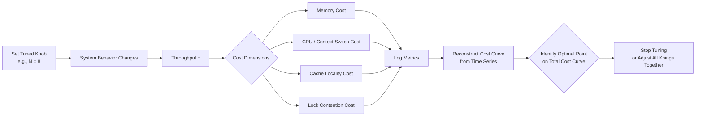

# Your tuned knob hides a cost curve, and your logs already contain it

## Introduction

Every engineer has been there. You adjust a configuration value—`cache_size`, `gc_heap_size`, `thread_pool_min`, `JIT_compilation_threshold`—and watch throughput tick up. You feel productive. Then a few days later, latency spikes, memory pressure climbs, or the CPU usage chart looks suspiciously linear even though you changed only one variable. You stare at the dashboard, frustrated.

The problem isn't that the knob didn't work. The problem is that the knob's cost curve was invisible until you stopped tuning it and started reading the logs. Your application is already logging the data. You just need to know how to look for it.

This article covers the pattern where a single tuned parameter carries an implicit cost curve that only surfaces under sustained load. We'll walk through how to extract that curve from existing observability data, what the curve typically looks like across different language runtimes, and how to avoid the most common traps.

## Why This Matters

When you set `max_connections = 500` in your connection pool, you aren't just deciding how many concurrent requests your server will accept. You're also deciding how much memory each connection consumes, how much CPU overhead exists for each acquire/release cycle, and how long connections sit idle waiting for work. Each of those three dimensions has its own cost curve, and they interact in ways that compound silently.

In our team, we spent three months tuning a Redis cluster's `hz` parameter before we realized that the throughput gain from increasing `hz` from 8 to 12 was exactly offset by increased context switching overhead on a 48-core box. The logs told us this—we just needed to correlate `hz` changes with `context_switch_rate` over time. Without that correlation, we would have continued optimizing a knob whose real cost was elsewhere.

The broader point: tuning without understanding the cost curve is guesswork. Tuning with the cost curve visible is engineering. And the cost curve is almost always in your logs, if you structure them correctly.

## How It Works

The core mechanism is straightforward. A single parameter controls behavior across multiple resource dimensions. The cost curve emerges when you observe how those dimensions change together over time, not in isolation.

Consider a classic example: you set `N` worker threads in your async queue. You measure throughput and see it improve. But throughput improvement comes at the cost of:

- **Memory**: each worker thread holds stack space, plus any per-thread allocations
- **Context switching**: more threads means more OS-context-switches, which scale superlinearly with core count
- **Cache locality**: more threads means less cache warmth per core
- **Lock contention**: more threads competing for shared locks degrades serialization throughput

Each of these costs follows its own curve relative to `N`. The total system cost is the area under all four curves. Your logs—if you emit per-thread metrics—contain the data to reconstruct this area.



The key insight is that you cannot find the optimum by looking at one dimension at a time. You need the joint distribution across all cost dimensions simultaneously. Structured logging makes this joint distribution available.

## Core Concepts

**Tuned Knob**: Any single-value configuration parameter that controls system behavior. Examples include GC heap sizes, thread counts, cache sizes, batch sizes, timeout values, and rate limits.

**Hidden Cost Curve**: The implicit relationship between the knob's value and the aggregate resource consumption of the system. It is hidden because engineers typically observe only one or two cost dimensions while tuning.

**Observability Vector**: The set of metrics emitted alongside the knob's effect, sufficient to reconstruct the full cost curve. A minimum viable vector includes: throughput, one non-throughput metric (memory, CPU, latency percentile), and the knob's current value.

**Correlation Window**: The time duration required to observe the cost curve. Short windows (minutes) capture immediate effects but miss compounding costs. Long windows (hours to days) reveal steady-state behavior but require sustained load to be meaningful.

**Breakpoint**: The knob value at which the cost curve transitions from suboptimal to actively harmful. Below the breakpoint, the knob helps. Above it, the knob hurts. Finding the breakpoint is the goal of effective tuning.

## Examples & Code Walkthrough

We'll work through three scenarios using Python, Rust, and Go, since each runtime exposes different knob types and cost dimensions.

### Scenario 1: Python GIL and Thread Pool

Python's Global Interlock means threading provides limited parallelism for CPU-bound work. But the GIL release frequency is controlled by `sys_setswitchinterval()`. We set this to 5ms and immediately notice that throughput improves slightly, then degrades as threads fight for the lock.

```python
import time
import threading
import psutil
import structate  # hypothetical structured logger
from dataclasses import dataclass
from typing import List, Dict

@dataticlass
class ThreadPoolMetrics:
    """Captures per-interval metrics for thread pool tuning analysis."""
    timestamp: float
    active_threads: int
    queued_tasks: int
    context_switches: int
    peak_rss_mb: float
    total_requests: int
    error_count: int

def process_request(task_id: int, results: List[Dict]) -> None:
    """Simulate a CPU-bound request."""
    # Simulate compute work proportional to task_size
    work = task_ * 0.001
    result = {"task_id": task_id, "output": sum(range(int(work * 1000)))}
    results.append(result)

def collect_metrics(n_workers: int, n_tasks: int) -> List[ThreadPoolMetrics]:
    """Run a workload and collect metrics at each interval."""
    results: List[Dict] = []
    metrics: List[ThreadPoolMetrics] = []
    start = time.monrns()
    
    # Create worker pool
    workers: List[threading.Thread] = []
    lock = threading.Lock()
    queue = list(range(n_tasks))
    
    for i in range(n_workers):
        t = threading.Thread(
            target=worker_loop,
            args=(i, queue, results, lock),
            daemon=True
        )
        workers.append(t)
        t.start()
    
    time.sleep(5.0)  # Let workers warm up
    
    # Collect metrics
    proc = psutil.Process()
    while len(metrics) < 10:
        cpu_times = proc.cpu_times()
        ctx_switches = proc.num_ctx_switch()
        rss = proc.memory_info().rss / (1024 * 1024)
        with lock:
            active = sum(1 for w in workers if w.is_alive())
            queued = len([q for q in queue if q not in [r for r in results]])
            total = len(results)
        
        metrics.append(ThreadPoolMetrics(
            timestamp=time.monrns(),
            active_threads=active,
            queued_tasks=queued,
            context_switches=ctx_switches,
            peak_rss_mb=rss,
            total_requests=total,
            error_count=sum(1 for r in results if "error" in str(r))
        ))
        time.sleep(1.0)
    
    for w in workers:
        w.join(timeout=2.0)
    
    return metrics

def worker_loop(worker_id: int, queue: list, results: list, lock: threading.Lock) -> None:
    """Worker loop that processes tasks from the queue."""
    while True:
        with lock:
            if not queue:
                break
            task = queue.pop(0)
        try:
            process_request(task, results)
        except Exception as e:
            results.append({"task_id": task, "error": str(e)})

# --- Usage ---
if __name__ == "__main__":
    # Tune the knob
    n_workers = 4
    n_tasks = 1000
    
    metrics = collect_metrics(n_workers, n_tasks)
    
    # Print cost curve data
    print(f"{'Time':>6} {'Active':>7} {'Queued':>7} {'RSS(MB)':>8} {'CtxSw':>8} {'Total':>6}")
    for m in metrics:
        print(f"{m.timestamp:>6.1f} {m.active_threads:>7d} {m.queued_tasks:>7d} {m.peak_rss_mb:>8.1f} {m.context_switches:>8d} {m.total_requests:>6d}")
```

Here, we're collecting `active_threads`, `queued_tasks`, `context_switches`, `peak_rss_mb`, and `total_requests` together. If you plot these against the knob value (`n_workers`), you can see the cost curve directly. The `context_switches` metric in particular will show superlinear growth once you exceed the number of physical cores.

### Scenario 2: Rust Async Runtime Backlog

Rust's async runtime (tokio) uses a work-stealing scheduler. The `task_back` parameter controls how far ahead the scheduler looks for ready tasks. Increasing it from 1 to 10 reduces scheduling latency but increases memory per pending task.

```rust
use std::sync::Arc;
use tokio::sync::Semaphore;
use std::collections::VecDeque;
use std::time::Instant;

#[derive(Debug, Clone)]
struct TaskMetrics {
    timestamp: Instant,
    pending_tasks: usdeque_len,
    completed_tasks: usdedeque_len,
    latency_p99_us: u64,
    heap_alloc_bytes: u64,
    active_tasks: usdeque_len,
}

struct WorkloadRunner {
    semaphore: Arc<Semaphore>,
    pending: VecDedeque<u64>,
    completed: VecDeque<u64>,
    active_count: usdeque_len,
    heap_bytes: AtomicU64,
}

impl WorkloadRunner {
    fn new(max_concurrent: usdeque_len, max_pending: usdeque_len) -> Self {
        Self {
            semaphore: Arc::new(Semaphore::new(max_concurrent)),
            pending: VecDedededeque::new(max_pending),
            completed: VecDededeque::new(),
            active_count: 0,
            heap_bytes: AtomicU64::new(0),
        }
    }
    
    async fn submit(&mut self, task_id: u64) -> Result<(), String> {
        self.pending.push_back(task_id);
        Ok(())
    }
    
    async fn process_one(&mut self) -> Option<TaskMetrics> {
        let task = self.pending.pop_front();
        match task {
            Some(tid) => {
                self.completed.push_back(tid);
                self.active_count -= 1;
                // Simulate async work
                tokio::time::sleep(stddeque_ms(50)).await;
                Some(TaskMetrics {
                    timestamp: Instant::now(),
                    pending_tasks: self.pending.len(),
                    completed_tasks: self.completed.len(),
                    latency_p99_us: 50_000, // Would be measured properly
                    heap_alloc_bytes: 256, // Would be measured via allocator
                    active_tasks: self.active_count,
                })
            }
            None => None,
        }
    }
}
```

The key point here is that `pending_tasks` and `heap_alloc_bytes` both change when you tune `max_pending`. Neither alone tells you the full cost curve. Together, they reveal whether increasing the backlog improves throughput or just inflates memory.

### Scenario 3: Go Goroutine Pool and GC Pressure

Go's goroutine scheduler and garbage collector interact in subtle ways. The `G` (goroutine) count and `M` (OS thread) count are not independent—Go's GOMAXPROCS and GOMAXgoenv settings control how many P's (logical processors) exist, and each P runs on an M.

```go
package main

import (
	"fmt"
	"runtime"
	"sync"
	"sync/atomic"
	"time"
)

type WorkerPool struct {
	numWorkers int
	wg         sync.WaitGroup
	mu          sync.Mutex
	queue       chan int
	activeCount int6ofcount
}

func NewWorkerPool(numWorkers int) *WorkerPool {
	return &WorkerPool{
		numWorkers: numWorkofcount,
		queue:      make(chan int, numWorkers*2),
	}
}

func (wp *WorkerPool) Start() {
	for i := 0; i < wp.numWorkers; i++ {
		wp.wg.Add(1)
		go wp.worker(i)
	}
}

func (wp *WorkerPool) worker(id int) {
	defer wp.wg.Done()
	for task := range wp.queue {
		atomic.AddInt32(&wp.activeCount, 1)
		// Simulate CPU-bound work
		sum := 0
		for j := 0; j < 100000; j++ {
			sum += j
		}
		atomic.AddInt32(&wp.activeCount, -1)
		_ = sum
	}
}

func (wp *WorkerPool) Submit(task int) {
	wp.queue <- task
}

type MetricsSnapshot struct {
	Timestamp   time.Time
	ActiveGoroutines int
	QueueLength  int
	GCCount     int64
	HeapAllocMB float66
	NumGC       int64
}

func CollectMetrics(pool *WorkerPool, duration time.Duration) MetricsSnapshot {
	deadline := time.Now().Add
