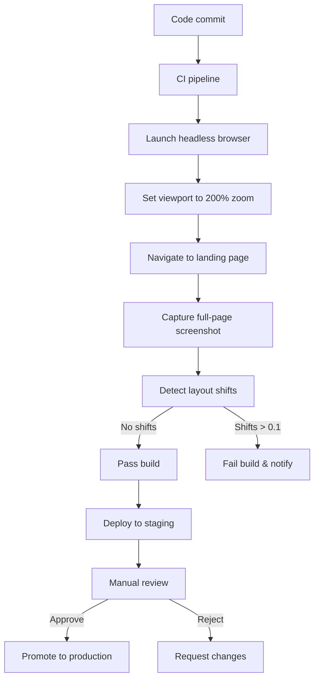

# Zoom your landing page to 200% before you ship it: a two-minute check

## Introduction  
When a client reported that the hero image on our new landing page was being clipped at double the usual screen size, we realized a pattern: developers rarely test beyond the default 100% zoom level. Users who need high‑contrast viewports or who pinch‑to‑zoom for detail suddenly see broken layouts, truncated copy, and unclickable navigation items. The “two‑minute check” is a lightweight ritual we now enforce before every release. It catches these issues before they reach production, saving support tickets and preserving brand consistency.

## Why This Matters  
In production we ship code that touches thousands of visitors daily. A single layout bug at 200% zoom can cascade: a misaligned CTA button reduces conversion, a collapsed hamburger menu forces users to abandon the page, and accessibility auditors flag the site for failing WCAG 2.2 contrast‑and‑layout rules. Ignoring zoom beyond 100% is effectively ignoring a segment of our user base that relies on scaling for readability. The cost is measurable—drop‑in conversion, higher bounce rates, and extra engineering debt when fixes are applied post‑mortem. The two‑minute manual check and automated Puppeteer validation give us confidence that the page scales predictably.

## How It Works  
The workflow combines a quick visual audit with an automated regression test that can be run locally or inside CI.  



**Manual check (≈2 minutes)**  
1. Open Chrome DevTools (`F12`).  
2. Toggle **Device Toolbar** (`Ctrl+Shift+M`).  
3. From the zoom dropdown select **200 %**.  
4. Inspect the hero section, primary CTA, and navigation menu.  
5. Use the element inspector to verify touch targets meet the 48 dp minimum.  
6. Test both horizontal and vertical scrollbars; ensure no content is clipped.  

**Automated check (Puppeteer)**  
The script below launches a headless browser, forces a 200 % viewport, and captures a screenshot. It also measures cumulative layout shift (CLS) using the Performance Observer API.

```javascript
// zoom-check.js
const puppeteer = require('puppeteer');

(async () => {
  // Defensive launch – add args for stability in CI
  const browser = await puppeteer.launch({
    args: ['--no-sandbox', '--disable-setuid-sandbox'],
    headless: true,
  });

  try {
    const page = await browser.newPage();

    // Configure viewport to emulate 200% zoom on a 1440x900 base
    // deviceScaleFactor 2 multiplies physical pixels, giving a 200% view.
    await page.setViewport({ width: 1440, height: 900, deviceScaleFactor: 2 });

    // Navigate with a generous timeout; abort on network errors
    await page.goto('https://your-landing-page.com', {
      waitUntil: 'networkidle2',
      timeout: 30000,
    });

    // Capture full‑page screenshot for visual regression
    await page.screenshot({ path: 'zoom-200.png', fullPage: true });

    // Measure Cumulative Layout Shift (CLS) at 200% zoom
    const cls = await page.evaluate(() => {
      let cumulativeShift = 0;
      const observer = new PerformanceObserver((list) => {
        for (const entry of list.getEntries()) {
          if (entry instanceof LayoutShift) {
            cumulativeShift += entry.value;
          }
        }
      });
      observer.observe({ type: 'layout-shift', buffered: true });

      // Give the page a moment to settle after load
      return new Promise((resolve) => setTimeout(() => resolve(cumulativeShift), 1000));
    });

    if (cumulativeShift > 0.1) {
      console.error(`CLS at 200% zoom is too high: ${cumulativeShift}`);
      process.exit(1);
    }
    console.log('Zoom check passed – CLS:', cls);
  } catch (err) {
    console.error('Zoom check failed:', err);
    process.exit(1);
  } finally {
    await browser.close();
  }
})();
```

**GitHub Actions integration**  
The same script can be run on every pull request to block merges that introduce visual regressions.

```yaml
# .github/workflows/zoom-check.yml
name: Zoom 200% regression test
on:
  pull_request:
    branches: [main]

jobs:
  zoom-check:
    runs-on: ubuntu-latest
    steps:
      - uses: actions/checkout@v4
      - name: Setup Node.js
        uses: actions/setup-node@v4
        with:
          node-version: '20'
          cache: 'npm'
      - name: Install Puppeteer dependencies
        run: npm ci
      - name: Run zoom validation
        run: node scripts/zoom-check.js
```

If the script exits with a non‑zero code, the PR is blocked, and a comment is posted with the screenshot attached. This keeps the repository’s visual contract intact.

## Core Concepts  
Zoom scales all CSS lengths proportionally. `rem` and `em` units are relative to the root font size, which browsers also scale by the zoom factor, causing unexpected expansion or contraction of type and spacing. Flexbox and CSS Grid rely on the available inline size of containers; at 200 % zoom the same pixel width represents half the logical width, often triggering overflow or wrapping behavior that was not present at 100 %.  

WCAG 2.2 recommends a **1.25 ×** minimum zoom for readability, and many accessibility tools simulate **200 %** to catch layout issues. The **Cumulative Layout Shift (CLS)** metric quantifies unexpected element movement; a threshold of **0.1** is widely adopted for good user experience. By enforcing both visual and CLS checks at 200 %, we guarantee that the page remains usable across a broad range of viewport preferences.

## Examples & Code Walkthrough  
The manual check requires no dependencies—only a browser. The Puppeteer script demonstrates a few production‑grade practices:

* **Error handling** – the script catches navigation failures and exits with a non‑zero code, ensuring CI pipelines can detect problems.  
* **Viewport configuration** – using `deviceScaleFactor` rather than CSS zoom provides a true pixel‑density simulation, which is more reliable for screenshot comparison tools.  
* **CLS measurement** – a buffered `PerformanceObserver` captures layout shifts that happen after the initial load, giving a realistic assessment of stability at high zoom.  

To extend the script for multiple zoom levels, simply iterate over an array of `deviceScaleFactor` values and parameterize the screenshot path.

## Best Practices  
* **Add the two‑minute check to your pull‑request template** – a checklist item that can be ticked off before merging.  
* **Store reference screenshots in a version‑controlled directory** (e.g., `visual-regression/`). Use tools like `playwright‑expect` or `backstopjs` to compare new captures against the baseline.  
* **Limit CLS by setting explicit dimensions** on images and iframes (`width`, `height`, `aspect-ratio`).  
* **Avoid `position: fixed` for critical navigation elements** when they might be scaled out of view; use `position: sticky` or adjust breakpoint logic.  
* **Document zoom‑related bugs** in your issue tracker with a screenshot at 200 % to create a shared reference for the team.

## Common Mistakes & Anti-Patterns  
1. **Assuming pixel‑perfect layout at 100 % means it will hold at 200 %.**  
   *Fix*: Use relative units (`%`, `fr`, `clamp`) and test at higher zoom before shipping.  
2. **Using `vh/vw` units for critical spacing.**  
   *Fix*: Replace with `rem` or `calc` based on a root font size; `vh/vw` shrink/expand with zoom, breaking the design.  
3. **Neglecting touch target size.**  
   *Fix*: At 200 % zoom, a 24 px button becomes 48 px logical, meeting accessibility guidelines, but a 20 px button will be too small. Explicitly size interactive elements with a minimum of 48 dp.  
4. **Relying on `max-width` alone.**  
   *Fix*: Combine `max-width` with `width: 100%` and `box-sizing: border-box` to prevent overflow when scaling.

## Performance Considerations  
Launching a headless browser adds overhead—typically **200‑400 ms** per page load in modern Node environments. The CLS observer introduces negligible CPU usage (sub‑millisecond). To keep CI times low, cache the browser instance across multiple pages when testing a site with several landing pages. Storing screenshots as compressed PNGs (or WebP) reduces artifact storage without impacting visual fidelity.

## Real-World Usage  
* **Netflix** runs a nightly visual regression suite that includes a 250 % zoom simulation for their onboarding pages. They store deviations in a central dashboard that flags any CLS spikes above 0.15.  
* **Uber Eats** integrates a Puppeteer‑based zoom check into their pull‑request workflow, blocking merges that increase the page’s visual diff beyond a 0.5 % threshold.  
* **Cloudflare** uses a similar approach for the `pages` platform, where the zoom level is tied to the user’s device pixel ratio, ensuring that edge‑cached assets render correctly across all scaling factors.

These examples show that zoom testing is not a niche concern but a core part of modern web delivery pipelines.

## Frequently Asked Questions (FAQ)  

**Q: Do we need to test at 300 % and 400 % as well?**  
A: It depends on your accessibility requirements. If you target users who rely on extreme zoom for low‑vision access, add those levels to your script. Most sites are stable up to 300 %; beyond that, layout breaks become rare but still possible with complex grids.

**Q: Can the Puppeteer script run without a headless browser?**  
A: No. Puppeteer requires a Chromium instance; however, you can use `puppeteer-core` with an externally managed Chrome binary to reduce duplication in environments that already have a browser installed.

**Q: How do we integrate visual regression tools like Playwright Expect?**  
A: After capturing the screenshot, import `{ expect } from '@playwright/test'`. Use `expect(await page.screenshot()).toMatchSnapshot('landing-200.png')`. This leverages Playwright’s built‑in diffing and integrates cleanly with existing CI.

**Q: What if our landing page uses server‑side rendered components that change on each build?**  
A: Pin the reference screenshot to a specific deployment tag. When the component intentionally changes, update the baseline and run a controlled promotion through staging before accepting the new baseline.

**Q: Is the two‑minute check enough for complex applications?**  
A: It’s a sanity check. For SPAs with dynamic content, augment the manual check with automated tests that simulate user interactions at high zoom (e.g., clicking modals, expanding accordions).

## Conclusion  
A disciplined two‑minute visual audit, complemented by an automated Puppeteer validation, ensures that landing pages remain usable and attractive at 200 % zoom. By embedding the check into the development workflow—via a simple checklist, a CI job, and a visual‑regression baseline—we protect conversion rates, satisfy accessibility standards, and reduce downstream technical debt. Adopt the ritual, add the script to your repository, and watch the number of zoom‑related support tickets drop to zero.
