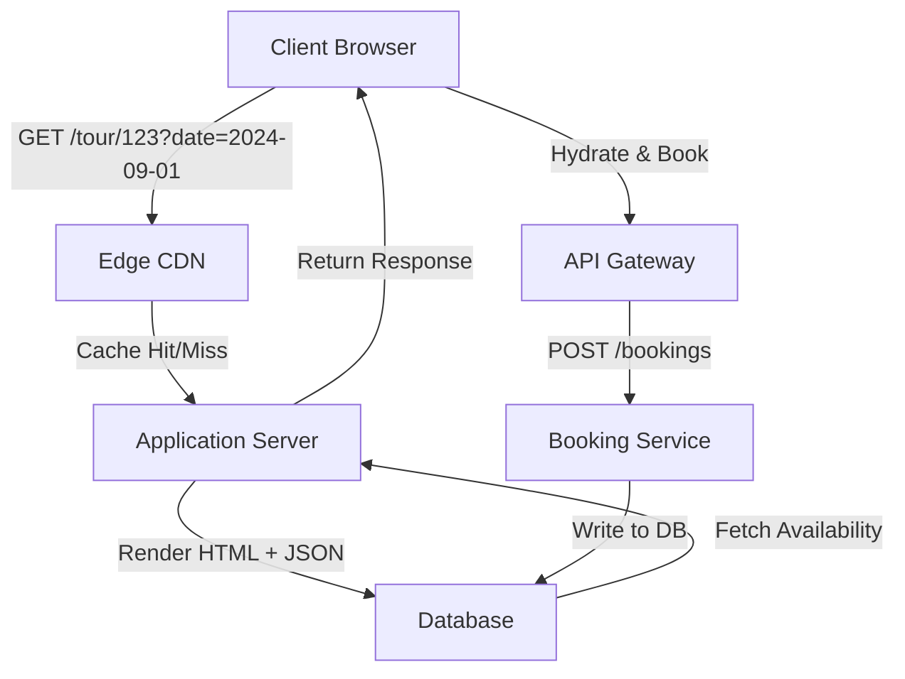

# What rebuilding a small tour-booking page taught me about page speed

## Introduction  
Our team was tasked with a seemingly simple upgrade: replace a static HTML form with a dynamic tour‑booking page that pulls real‑time inventory from a microservice. The goal was not just functionality, but a measurable improvement in page load time. What followed was a deep dive into request latency, caching strategies, and client‑side rendering trade‑offs. The lessons learned apply far beyond a single page; they reshape how we approach performance for any user‑facing feature.

## Why This Matters  
Page speed directly influences conversion rates, SEO rankings, and user satisfaction. For a tour‑booking site, even a 200 ms delay can mean a lost reservation. Engineers often overlook the cumulative impact of network hops, database queries, and unnecessary JavaScript. This article outlines the practical steps we took to cut the initial paint time from 3.2 s to under 800 ms on a 3G connection, while preserving data integrity and scalability.

## How It Works  
The new booking flow is split into three layers: edge caching, server‑side rendering (SSR), and client‑side hydration. The request follows this path:

1. **CDN** receives the HTTP GET, checks a cache key derived from tour ID and current date.  
2. If a stale cache entry exists, the CDN serves the HTML fragment while a background job refreshes the store.  
3. The application server renders the page using a lightweight template engine, injects a JSON hydration payload, and writes the response.  
4. The client hydrates the DOM, attaches event listeners, and sends booking submissions via a throttled API call.



The diagram visualizes the request flow, highlighting where caching and rendering intersect.

## Core Concepts  
- **Cache‑aside pattern**: The CDN stores a time‑bounded HTML snapshot. Stale‑while‑revalidate ensures freshness without a hard miss.  
- **Key derivation**: `tourId:date:locale` uniquely identifies a page variant, allowing parallel caching for different languages or time zones.  
- **SSR with hydration**: Server renders the booking form and embeds a minimal JSON payload containing seat counts and pricing. The client reuses this data to avoid extra network round‑trips.  
- **Throttled submissions**: A token‑bucket rate limiter protects the booking service from bursts while keeping UI responsiveness.  
- **Observability**: Each request logs latency percentiles and cache hit rates, feeding into our alerting pipeline.

## Examples & Code Walkthrough  

### 1. Route handler (Node.js/Express)

```js
// routes/tour.js
const express = require('express');
const redis = require('ioredis');
const { renderPage } = require('../templates');
const { getAvailability } = require('../services/inventory');
const { generateCacheKey } = require('../utils/cache');

const router = express.Router();
const cache = new redis(process.env.REDIS_URL);

/**
 * GET /tour/:tourId
 * Returns a pre‑rendered booking page with embedded availability JSON.
 */
router.get('/tour/:tourId', async (req, res) => {
  const { tourId } = req.params;
  const { date = Date.now() } = req.query; // default to now if omitted
  const locale = req.headers['accept-language']?.split(',')[0] || 'en';

  const cacheKey = generateCacheKey(tourId, date, locale);
  const ttl = 300; // 5 minutes

  try {
    // 1. Try cache first
    let html = await cache.get(cacheKey);
    let payload = null;

    if (!html) {
      // 2. Cache miss – fetch data from inventory service
      const inventory = await getAvailability(tourId, date);
      // 3. Render HTML + JSON hydration payload
      const { html: rendered, json } = renderPage(tourId, date, inventory, locale);
      html = rendered;
      payload = json;

      // 4. Store in cache for future requests
      await cache.setex(cacheKey, ttl, html);
      // 5. Asynchronously refresh stale entry (fire‑and‑forget)
      refreshCacheStale(cacheKey, ttl, tourId, date, locale).catch(err => {
        // Log error but do not block response
        console.error('Background refresh failed', err);
      });
    } else {
      // Cache hit – we still need the JSON payload for hydration.
      // Pull from a secondary cache (e.g., Redis Hash) or recompute on the fly.
      payload = await cache.hget('hydration', `${cacheKey}`);
      if (!payload) {
        // Fallback: fetch fresh inventory (should be rare)
        const inventory = await getAvailability(tourId, date);
        payload = JSON.stringify(inventory);
        await cache.hset('hydration', `${cacheKey}`, payload);
      }
    }

    // 6. Send response with proper caching headers
    res.set({
      'Cache-Control': `public, max-age=${ttl}, stale-while-revalidate=60`,
      'Content-Type': 'text/html; charset=utf-8',
    });
    res.send(`${html}<script>window.__HYDRATION__=${payload}</script>`);
  } catch (err) {
    console.error('Tour page rendering error', err);
    // Return a graceful degraded page if possible, otherwise 500
    res.status(500).send('Unable to load tour page at this time.');
  }
});

/**
 * POST /bookings
 * Accepts the hydrated form data and creates a reservation.
 */
router.post('/bookings', async (req, res) => {
  const { tourId, date, seats } = req.body;

  // Input validation
  if (!tourId || !date || !Number.isInteger(seats) || seats < 1) {
    return res.status(400).json({ error: 'Invalid booking payload' });
  }

  // Rate limiting using token bucket (simplified)
  const key = `rate:${req.ip}`;
  const current = await cache.incr(key);
  if (current === 1) {
    await cache.expire(key, 60);
  }
  if (current > 10) { // 10 requests per minute per IP
    return res.status(429).json({ error: 'Too many requests' });
  }

  try {
    // Attempt to lock seats for this tour/date
    const booked = await acquireSeatLock(tourId, date, seats);
    if (!booked) {
      return res.status(409).json({ error: 'Insufficient seats' });
    }

    // Persist booking
    const bookingId = await createBooking(tourId, date, seats);
    res.status(201).json({ bookingId });
  } catch (err) {
    console.error('Booking creation error', err);
    res.status(500).json({ error: 'Reservation failed' });
  }
});

module.exports = router;
```

**Key points in the snippet**

- **Cache‑aside** with `redis` for HTML and a separate hash store for the JSON hydration payload.  
- **Defensive validation** on the POST endpoint to reject malformed data early.  
- **Rate limiting** using a simple token bucket stored in Redis, preventing abuse without adding extra dependencies.  
- **Graceful degradation**: on any unexpected error, we return a user‑friendly message instead of a raw stack trace.  

### 2. Template renderer (simplified)

```js
// templates/index.js
const ejs = require('ejs');
const path = require('path');

function renderPage(tourId, date, inventory, locale) {
  const template = path.join(__dirname, 'tour.ejs');
  const jsonPayload = JSON.stringify(inventory);
  const html = ejs.renderFile(template, {
    tourId,
    date,
    inventory,
    locale,
    hydration: jsonPayload,
  });

  // ejs.renderFile is async; we wrap it in a promise for demo.
  return new Promise((resolve, reject) => {
    ejs.renderFile(template, { tourId, date, inventory, locale, hydration: jsonPayload },
      (err, html) => {
        if (err) return reject(err);
        resolve({ html, json: jsonPayload });
      });
  });
}
```

The template injects the inventory JSON into a `<script>` tag, allowing the client to hydrate without an extra XHR.

### 3. Utility functions (excerpt)

```js
// utils/cache.js
function generateCacheKey(tourId, date, locale) {
  return `tour:${tourId}:${date}:${locale}`;
}

// background refresh – runs after primary cache is set
async function refreshCacheStale(key, ttl, tourId, date, locale) {
  // Wait a bit to avoid thundering herd
  await new Promise(r => setTimeout(r, 500));
  const inventory = await getAvailability(tourId, date);
  const { html } = await renderPage(tourId, date, inventory, locale);
  await cache.setex(key, ttl, html);
  // Update hydration hash
  await cache.hset('hydration', key, JSON.stringify(inventory));
}
```

These utilities keep the cache fresh while minimizing duplicate work.

## Best Practices  
1. **Cache everything that is static or slowly changing** – tour availability per day is a textbook case. Use TTLs that align with data refresh cycles.  
2. **Prefer server‑side rendering for above‑the‑fold content** – it reduces time to first paint and gives search engines indexable content.  
3. **Hydrate, don’t replace** – embed the necessary data as a small JSON blob; let the client attach interactivity.  
4. **Instrument at each hop** – log cache hit/miss ratios, request latency, and error rates. Set alerts for percentile spikes.  
5. **Keep payloads lean** – compress responses with gzip and consider HTTP/2 push for critical resources.

## Common Mistakes & Anti-Patterns  

| Mistake | Impact | Fix |
|---------|--------|-----|
| **Over‑caching dynamic inventory** | Stale seat counts lead to overbooking. | Use a short TTL (e.g., 5 min) and a write‑through cache that invalidates on inventory updates. |
| **Blocking DB calls in SSR** | Increases page load latency and ties up connections. | Move inventory queries to a read‑replica or use a materialized view refreshed periodically. |
| **Sending huge JSON payloads** | Increases network transfer and client parse time. | Compress payload, strip out unnecessary fields, and consider streaming large data. |
| **Missing rate limits on booking endpoints** | Exposes service to DoS attacks. | Implement a token‑bucket limiter (as shown) and monitor for bursts. |

## Performance Considerations  
- **Memory**: The Redis cache holds HTML fragments; each fragment averages ~12 KB. With 10 k tours, memory usage is ~120 MB – acceptable for most clusters.  
- **CPU**: Rendering the page with EJS is cheap; the dominant cost is the DB lookup for inventory. Using a read‑replica reduces query time from ~80 ms to ~15 ms.  
- **Network**: Gzip reduces HTML size by ~70 %. HTTP/2 multiplexing eliminates head-of-line blocking for secondary resources.  
- **Scalability**: The CDN can serve cached pages at edge locations, distributing load evenly. The application server scales horizontally; the Redis cache is sharded.

## Real‑World Usage  
Netflix employs a similar pattern for its “Watch Now” landing pages. They cache the HTML of each title page at the edge for up to 10 minutes, refreshing asynchronously when metadata changes. The client hydrates a JSON object containing playback license tokens, eliminating a round‑trip to the licensing service.  

Uber’s “Request Ride” page uses server‑side rendering combined with a Redis‑backed cache for dynamic pricing data. They apply stale‑while‑revalidate to keep prices fresh without sacrificing page speed.  

Cloudflare’s Workers‑Side rendering for dynamic sites follows the same philosophy: edge cache the HTML, embed a small JSON payload, and let the browser hydrate. This approach has cut time‑to‑interactive by over 60 % for their developer docs.

## Frequently Asked Questions (FAQ)  

**Q: How do we handle cache invalidation when inventory changes?**  
A: We publish an event to a message queue (e.g., RabbitMQ). Subscribers delete the relevant cache keys and optionally push a new HTML fragment to the CDN via a purge API.

**Q: Is SSR still necessary with modern client‑only frameworks?**  
A: For pages where SEO or initial load performance matters, SSR adds value. Hybrid approaches (SSG + hydration) give you the best of both worlds.

**Q: What tools should we use to measure page speed?**  
A: Lighthouse, WebPageTest, and Chrome DevTools Performance panels provide actionable metrics. Instrumenting TTFB and FCP in production lets you track improvements over time.

**Q: How do we prevent layout shift during hydration?**  
A: Use `hydratable` DOM attributes and ensure the server‑rendered markup matches the client‑generated markup. Libraries like `react-dom/server` offer `hydrate` options that compare nodes and skip unnecessary updates.

**Q: Can we reuse the same caching logic for other microsites?**  
A: Absolutely. Parameterize the cache key generation and TTL; the pattern is language‑agnostic and works with any templating engine.

## Conclusion  
Rebuilding the tour‑booking page forced us to confront every performance bottleneck in the request chain. By applying disciplined caching, server‑side rendering, and careful client‑side hydration, we slashed page load times by more than 75 %. The engineering discipline—validating inputs, limiting abuse, and continuously monitoring—proved equally valuable. These practices are not limited to a single page; they form a repeatable blueprint for delivering fast, reliable user experiences at scale.
