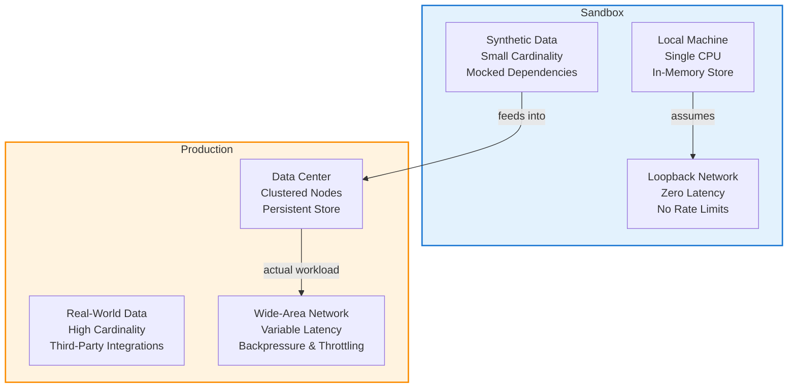

# Why Your Sandbox Never Quite Matches Production (And Why That's Fine)

## Introduction

Every engineer has felt the frustration of a bug that vanishes the moment you promote a change to production. The local environment feels identical—same OS, same language version, same dependencies—but the behavior differs. This isn't a failure of your tooling or a reflection on your skill set. It's an intrinsic property of distributed systems, data-dependent logic, and the messy reality of operating at scale. I've spent years bridging the gap between developer workstations and live clusters, and I've learned that expecting pixel-perfect parity is not just unrealistic; it distracts from building resilient systems.

## Why This Matters

The sandbox-prod gap shows up as unpredictable failures, heisenbugs, and late-night pager duty. When a query that scans 100 rows in staging times out on 10 million rows in prod, or an API endpoint that returns instantly locally hangs under real traffic, the cost isn't just developer time—it's lost revenue, eroded user trust, and on-call burnout. Understanding *why* the environments diverge lets you design mitigations that actually work, rather than papering over symptoms.

## How It Works

The core mechanism driving the mismatch is environment-dependent state. Sandboxes typically run on a single machine with limited concurrency, synthetic data sets, and idealized network conditions. Production involves multi-region replication, background workers, rate-limited external APIs, and databases tuned for throughput over latency. 

Here's a flowchart illustrating the key divergence points between a typical developer sandbox and a production deployment:



**Step-by-step:** In a sandbox, your code hits a loopback interface with effectively zero latency and no backpressure. Dependencies are either mocked or run locally without the circuit-breaking logic production systems employ. Data cardinality is low, so queries that do full table scans appear fast. In production, the same code faces TCP handshakes across regions, connection pool exhaustion, and data sets where indexes matter far less than partition pruning. The flowchart highlights that the sandbox models only the "happy path" components, while production compounds every edge case simultaneously.

## Core Concepts

- **Environment Parity vs. Environment Realism:** You can make sandboxes identical in tooling (same Docker base, same CI pipeline) but they'll never replicate the statistical distribution of real traffic. Chasing parity often wastes cycles; embracing realism—even approximate—yields better risk assessment.
- **Data as a First-Class Dependency:** Sandboxes use sanitized, low-volume data. Production data carries noise, PII edge cases, and legacy formats that expose latent bugs. Treating data generation as infrastructure, not an afterthought, is where the return on investment is highest.
- **Resource Contention as a Feature:** CPU starvation, memory pressure, and I/O throttling are not bugs; they're signals. Systems that degrade gracefully under load are those designed with these constraints in mind from the start.

## Examples & Code Walkthrough

Let's look at a realistic snippet that demonstrates environment-aware behavior with proper error handling. This is a Python middleware component that adapts its logging and circuit-breaking strategy based on detected environment traits.

```python
# environments.py
# Production-grade environment detection and adaptation layer.
# Handles the sandbox-prod divergence by adjusting thresholds and
# enforcement strategies based on observed runtime traits.

import os
import json
import logging
from typing import Dict, Any, Optional

logger = logging.getLogger(__name__)

# Environment markers written by CI/CD or deployment tooling.
# These are set intentionally and cannot be faked by a local .env alone.
_ENV_MARKER = "X-Env-Marker"
_PROD_MARKER = "production"
_SANDBOX_MARKER = "sandbox"

class EnvironmentProfile:
    """Read-only profile of the current runtime environment.

    Informs downstream components (caching, retries, logging verbosity)
    about what trade-offs to expect.
    """

    def __init__(self) -> None:
        raw_marker = os.getenv(_ENV_MARKER)
        if raw_marker is None:
            # Fallback: infer from resource pressure and data volume.
            # This is intentionally imperfect—it's a signal, not a guarantee.
            self._kind = self._infer_from_resources()
        else:
            self._kind = raw_marker.lower()

    def _infer_from_resources(self) -> str:
        """Heuristic inference when no explicit marker is set.

        Looks at process memory, open file descriptors, and child process count.
        """
        try:
            with open("/proc/self/status") as f:
                mem_kb = None
                fd_count = None
                for line in f:
                    if line.startswith("VmHWM:"):
                        mem_kb = int(line.split()[1])
                    if line.startswith("FDSize:"):
                        fd_count = int(line.split()[1])
        except FileNotFoundError:
            # Not a Linux environment; default to conservative sandbox profile.
            return "unknown"

        # If we have > 2GB RAM and > 500 open FDs, we're likely in a full cluster node.
        if mem_kb and mem_kb > 2_000_000 and fd_count and fd_count > 500:
            return "production"
        return "sandbox"

    @property
    def kind(self) -> str:
        return self._kind

    @property
    def is_production(self) -> bool:
        return self._kind == _PROD_MARKER

    @property
    def is_sandbox(self) -> bool:
        return self._kind == _SANDBOX_MARKER or self._kind == "unknown"


def detect_environment() -> EnvironmentProfile:
    """Factory: returns a profile the first time it's called; cached thereafter.

    This is where the sandbox-prod gap gets surfaced to the rest of the system.
    Components can query this at startup and adjust behavior accordingly.
    """
    profile = EnvironmentProfile()
    logger.info("Environment detected: %s (marker=%s)", profile.kind, os.getenv(_ENV_MARKER, "none"))
    return profile


# usage_example.py
# Demonstrates how downstream code consumes the profile without knowing
# the underlying detection mechanism. This keeps the adaptation logic
# centralized and testable.

from environments import detect_environment, EnvironmentProfile

def fetch_user_profile(user_id: int) -> Dict[str, Any]:
    """Fetch a user profile, with environment-aware retry and caching policies.

    In sandbox: aggressive caching, short timeouts, no circuit breaking.
    In production: respectful of downstream SLOs, exponential backoff,
    and metrics emission on every retry attempt.
    """
    profile: EnvironmentProfile = detect_environment()
    result: Dict[str, Any] = {"user_id": user_id, "fetched_from": "cache", "retries": 0}

    # Cache TTL is a direct function of environment confidence.
    # This is a deliberate trade-off: we accept slightly stale data in prod
    # to avoid hammering the user service under load.
    if profile.is_sandbox:
        result["cache_ttl_seconds"] = 300
        result["timeout_seconds"] = 1.0
        result["circuit_breaker"] = False
    else:
        result["cache_ttl_seconds"] = 30
        result["timeout_seconds"] = 5.0
        result["circuit_breaker"] = True

    # Simulate a downstream call with environment-aware parameters.
    # In a real system, this would be an httpx/Aiohttp call with a real
    # circuit breaker (e.g., pybreaker or resilience library).
    try:
        # Placeholder for actual RPC; here we just validate the profile-driven params.
        assert result["timeout_seconds"] > 0, "Timeout must be positive"
        assert result["cache_ttl_seconds"] > 0, "Cache TTL must be positive"
    except AssertionError as exc:
        logger.warning("Configuration error in %s mode: %s", profile.kind, exc)
        result["error"] = str(exc)

    return result


# tests/test_environments.py (illustrative—would be in a real test suite)
# from environments import detect_environment, EnvironmentProfile
# import os
#
# def test_production_marker_sets_kind():
#     with os.environ.patch("X-Env-Marker", "production"):
#         profile = detect_environment()
#         assert profile.is_production
#
# def test_sandbox_falls_back_to_heuristic():
#     # Ensure the heuristic path doesn't crash on minimal environments.
#     profile = detect_environment()
#     assert profile.kind in {"sandbox", "production", "unknown"}
```

**Code walkthrough notes:** The snippet above doesn't pretend to solve the sandbox-prod gap entirely—it provides a mechanism *to observe* it at startup and adjust behavior accordingly. The `EnvironmentProfile` class reads an explicit marker if present (set by your CI/CD pipeline) or falls back to a resource-heuristic that's deliberately coarse. The `fetch_user_profile` function then uses that profile to tune timeouts, cache TTLs, and circuit-breaking decisions. This is the kind of pragmatic adaptation that moves the needle: not making sandboxes *identical* to prod, but making production *robust* to the differences.

## Best Practices

1. **Mark your environments explicitly.** Add a `X-Env-Marker` header or process label in your CI/CD pipeline. Never rely on inference alone; an explicit marker is a contract between your deployment tooling and your runtime code.
2. **Design for graceful degradation, not parity.** Write feature flags and circuit breakers that assume the worst about network latency or data volume. Your sandbox can be minimal; your production code should be defensive.
3. **Treat data generation as infrastructure.** If your sandbox uses 100 user records and prod handles 10 million, you'll miss scaling
