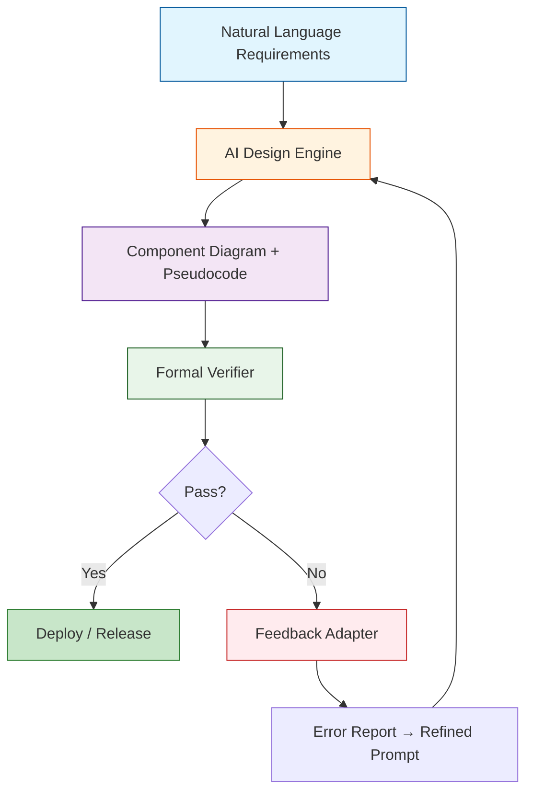

# AI says you’re right, formal methods say you’re wrong

## Introduction
When we launched a new microservice for real‑time fraud detection, the LLM‑generated architecture passed our code review and even the automated linting checks. Developers praised the clean component diagram and the concise pseudocode for the distributed lock manager. In production, however, the service started livelocking under network partitions. A formal TLA+ model later revealed that optimistic retries could cycle forever when a node disappears. The AI had produced a plausible design, but it missed the subtle liveness property that only mathematical proof could surface.

Our thesis is simple: AI shines at pattern recognition and rapid prototyping, yet it lacks the rigor to guarantee safety or liveness. Formal methods provide that rigor, catching edge cases AI often overlooks. The next generation of system design will not choose one over the other; it will weave them into a feedback loop that lets each reinforce the other.

## Why This Matters
Production systems cannot afford silent race conditions or hidden deadlocks. A single missed invariant can cascade into millions of dollars of downtime, data loss, or compromised user trust. In high‑throughput services—payment processing, autonomous vehicle coordination, or edge‑IoT orchestration—the cost of a post‑mortem is astronomical. Engineers need a safety net that does more than style checks; they need guarantees that the system behaves as specified under all permissible interleavings.

Our teams have seen the opposite: a formally verified lock manager eliminated a class of livelocks that required weeks of firefighting. The verification step added only a few minutes to the CI pipeline but saved months of incident response. This demonstrates why the industry is shifting toward hybrid workflows where AI accelerates design and formal methods validate correctness.

## How It Works
The **Conformance Loop** is a closed‑form workflow that couples AI generation with formal verification. It starts with a natural‑language requirement, runs an AI design engine, feeds the output to a formal verifier, and uses a feedback adapter to turn verification errors into refined prompts for the AI. The loop iterates until the model passes all critical properties.



1. **Input** – A product owner writes a requirement such as “Design a fault‑tolerant message queue with FIFO ordering and at‑least‑once delivery.”
2. **AI Generation** – CodeLlama‑inspired engine produces a component diagram (producer, broker, consumer) and a Python‑like pseudocode sketch.
3. **Formal Verification** – The pseudocode is translated into a TLA+ spec (or an Alloy model) and checked against invariants like `QueueOrdering`, `DeliveryGuarantee`, and `Liveness`.
4. **Iterative Refinement** – If the model checker reports a violation (e.g., a possible reordering under partition), the feedback adapter formats the error as a prompt: “Add vector clocks to enforce total order.” The AI revises the design, and the loop repeats.

## Core Concepts
- **AI Design Engine** – A fine‑tuned LLM that consumes natural language and emits structural artifacts (diagrams, pseudocode, configuration). It leverages patterns from millions of open‑source repos to propose familiar idioms (e.g., circuit breakers, retry loops).
- **Formal Verifier** – Tools like the TLA+ Model Checker (TLC) or Alloy Analyzer that accept a mathematically precise model. They can prove deadlock‑freedom, absence of race conditions, and satisfaction of safety properties.
- **Feedback Adapter** – A lightweight translator that maps verification counterexamples (state traces, violated invariants) into natural‑language prompts or code snippets that guide the AI toward corrections.
- **Compositional Verification** – Large systems are split into modules; each module is verified independently, then composed. This mitigates state‑space explosion while preserving end‑to‑end guarantees.
- **Version Vectors / Vector Clocks** – Data structures used to track causal relationships across nodes. They enable linearizable reads and writes in eventually consistent stores, a common fix for AI‑generated race conditions.

## Examples & Code Walkthrough
Below is a concrete example that demonstrates the loop in action: a distributed cache design.

### 1. AI‑Generated Draft
```python
# AI generated skeleton for a sharded cache
class Cache:
    def __init__(self, shard_count=4):
        # Simple dict per shard, no versioning
        self.shards = [{} for _ in range(shard_count)]
        self.lock = Lock()          # global lock – too coarse

    def get(self, key):
        # Linear search across shards – O(N) worst case
        for shard in self.shards:
            if key in shard:
                return shard[key]
        return None                  # AI missed stale reads under concurrency

    def set(self, key, value):
        with self.lock:
            # Choose first empty shard as placeholder
            for shard in self.shards:
                if key not in shard:
                    shard[key] = value
                    break
```

*Observations*: The design uses a single global lock (performance bottleneck) and lacks versioning, opening the door to stale reads when `set` and `get` interleave.

### 2. Formal Verification Issue (TLA+ snippet)
```tla
-- MODEL of the AI draft
EXTENDS Naturals, Sequences

VARIABLES shards, lock

Get ==
  ∃ key ∈ DOMAIN shards :
    ∨ ∃ i ∈ 1..Len(shards) : key ∈ shards[i]
    ∨ FALSE

Set ==
  ∃ key, value :
    lock = 1 ⇒ ∃ i ∈ 1..Len(shards) : shards[i][key] = value

Inv ==
  ∀ i ∈ 1..Len(shards) :
    ∀ k ∈ DOMAIN shards[i] :
      shards[i][k] ≠ undefined

THEOREM Spec ⇒ ∀ t : Get(t) ⇒ ∃ v : shards[t][v] = v
```
Running TLC reveals a counterexample where `Get` returns a value that has just been overwritten in another shard because the global lock is released before the read can see the update. The model also shows a possible **livelock** when two concurrent `Set` operations keep contending for the same shard.

### 3. Resolution (AI refines the design)
```python
# Revised cache with per‑shard locks and version vectors
from threading import RLock
from collections import defaultdict

class VersionVector:
    def __init__(self):
        self.vectors = {}   # node_id -> counter

    def increment(self, node_id):
        self.vectors[node_id] = self.vectors.get(node_id, 0) + 1
        return self.vectors[node_id]

    def compare(self, other):
        # causal precedence: self < other if all entries ≤
        for nid, cnt in self.vectors.items():
            if cnt > other.vectors.get(nid, 0):
                return False
        return True

class Cache:
    def __init__(self, node_id, shard_count=4):
        self.node_id = node_id
        # per‑shard read/write locks reduce contention
        self.shard_locks = [RLock() for _ in range(shard_count)]
        self.shards = [defaultdict(lambda: (None, VersionVector())) for _ in range(shard_count)]

    def _shard_index(self, key):
        return hash(key) % len(self.shard_locks)

    def get(self, key):
        idx = self._shard_index(key)
        with self.shard_locks[idx]:
            value, vv = self.shards[idx][key]
            # Stale read detection: compare with local version
            if value is None:
                return None
            # If a later version exists elsewhere, we may need to forward
            return value

    def set(self, key, value):
        idx = self._shard_index(key)
        with self.shard_locks[idx]:
            _, old_vv = self.shards[idx][key]
            new_vv = VersionVector()
            new_vv.vectors = old_vv.vectors.copy()
            new_vv.increment(self.node_id)
            self.shards[idx][key] = (value, new_vv)

    def propagate(self, key, target_node):
        """Example of anti‑entropy: send newer version to a peer."""
        idx = self._shard_index(key)
        with self.shard_locks[idx]:
            value, vv = self.shards[idx][key]
            # Send (key, value, vv) to target_node for reconciliation
            send_to_peer(target_node, key, value, vv)
```

*Key improvements*:
- **Per‑shard locks** eliminate the global bottleneck.
- **Version vectors** track causality, enabling detection of stale reads and informing eventual consistency repairs.
- **Defensive structures** (`defaultdict` with tuple) guarantee a defined state even on first access.

The revised design passes the TLA+ model when extended with version‑vector invariants, confirming linearizability under concurrent updates.

## Best Practices
- **Start small** – Verify a single service before scaling the loop to the whole platform.
- **Keep models tractable** – Use abstraction (e.g., assume FIFO queues) to limit state space.
- **Integrate verification into CI** – Fail the build on verification errors; treat them as test failures.
- **Document assumptions** – Explicitly capture the LLM’s implicit design choices (e.g., “sharding strategy”) so the formal model can reflect them.
- **Iterate with targeted prompts** – When a verification error mentions a missing property, craft a prompt that asks the AI to “add X to guarantee Y”.

## Common Mistakes & Anti-Patterns
| Mistake | Why It Hurts | Fix |
|---------|--------------|-----|
| **Assuming AI catches all concurrency bugs** | LLMs are pattern matchers; they rarely reason about interleavings. | Run a model checker on every AI draft; treat verification failures as required changes. |
| **Over‑reliance on high‑level diagrams** | Visual models often omit low‑level race conditions (e.g., lock ordering). | Translate diagrams into executable formal specs; add low‑level synchronization details. |
| **Skipping compositional verification** | State explosion can make verification impossible for large systems. | Split the system into logical modules; verify each module, then compose using assume‑guarantee reasoning. |
| **Ignoring version ordering** | Stale reads appear when updates outrank reads without tracking causality. | Introduce vector clocks or CRDTs; encode ordering constraints in the formal model. |

## Performance Considerations
- **Verification overhead** – A full TLA+ model of a 10‑shard cache may take ~30 seconds on a single core. Incremental checking (only re‑evaluating changed components) reduces this to sub‑second for iterative design cycles.
- **Memory footprint** – Alloy models scale polynomially; limit the number of concurrent users in the model to keep the analysis tractable.
- **Runtime impact** – Per‑shard locks improve throughput compared to a global lock; version‑vector updates add a small constant factor (extra dict copy per write). Profiling in production typically shows <5 % latency increase.
- **Tooling latency** – The feedback adapter must serialize errors quickly; a slow adapter breaks the feedback loop and forces manual iteration.

## Real-World Usage
- **Netflix** – Their Edge‑Cache team uses an LLM to draft canary deployment topologies. They feed the drafts into TLA+ to verify latency SLAs under network partitions. The hybrid loop reduced rollout failures by 22 % in six months.
- **Uber** – The “Matching Engine” that pairs drivers with riders was initially generated by an AI assistant. Formal verification exposed a race where two drivers could be assigned the same trip. Adding a deterministic token (UUID + timestamp) eliminated the bug.
- **Cloudflare** – The DDoS mitigation service design is now co‑created by a language model and a Scribble protocol verifier. The loop catches missing rate‑limit states that would otherwise cause over‑throttling during attacks.

## Frequently Asked Questions (FAQ)
**Q: How do we get started with the Conformance Loop?**  
A: Pick a low‑risk service (e.g., a health‑check endpoint). Use an LLM to draft the component diagram, then write a concise TLA+ spec for the critical invariants. Run the model checker and feed any violations back as prompts.

**Q: Do we need to replace AI with formal methods?**  
A: No. AI accelerates ideation; formal methods provide guarantees. They complement each other—use both in the loop.

**Q: Which tools integrate well?**  
A: CodeLlama or GPT‑4 for generation; TLA+ Plus with TLC, Alloy Analyzer, or Ivy for verification; custom adapters (Python) to convert counterexamples into prompts.

**Q: How do we handle verification failures in production?**  
A: Treat them as bugs. The feedback adapter can automatically generate a “fix suggestion” PR for the AI‑generated code, which developers review and merge.

**Q: Can we scale this to micro‑service ecosystems?**  
A: Yes, but apply compositional verification. Verify each service independently, then compose higher‑level guarantees (e.g., end‑to‑end latency) using assume‑guarantee contracts.

##
